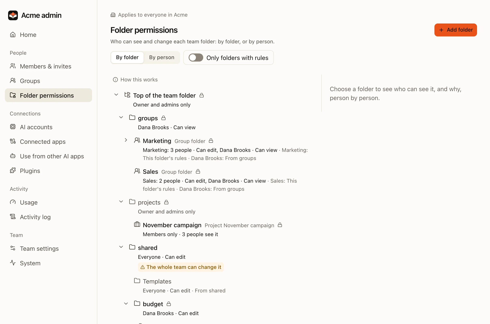
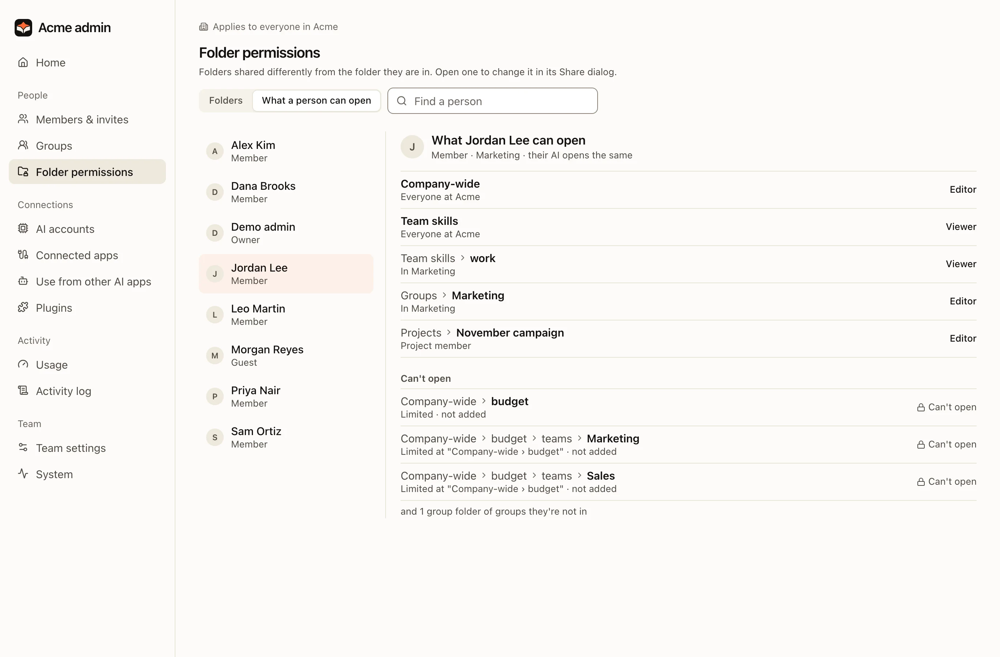

El conocimiento de la empresa vive en una sola carpeta del equipo en el servidor. Las reglas de carpetas deciden quién ve qué. La IA nunca ve más que la persona que pregunta.

## La carpeta del equipo

| Carpeta | Quién la ve | Para qué sirve |
|---|---|---|
| `shared/` | Lo que digan las reglas; normalmente todos | Documentos de toda la empresa |
| `groups/<group>/` | Ese grupo, más quien añada una regla | Documentos de un equipo, como Ventas o Finanzas; las habilidades propias del grupo, en su `skills/` |
| `projects/<project>/` | Lo que digan las reglas | Trabajo con su propia carpeta e instrucciones |
| `skills/` | Todos la leen; los responsables de habilidades escriben | Habilidades del equipo y reglas del equipo |
| `users/<id>/` | Solo esa persona | Archivos personales y habilidades personales |

## Cómo se decide el acceso

Una única función de permisos en el servidor decide cada acceso. El sistema operativo impide que la IA la esquive.

- Un archivo que usted no puede abrir es **invisible**, no "denegado". Archivos, las respuestas de la IA, la búsqueda, las vistas previas, el historial de versiones, la papelera y las actualizaciones en directo siguen la misma regla.
- El acceso de una persona viene de la **regla más cercana** por encima del archivo que la nombra. Las reglas de personas van antes que las de grupos. Con varios grupos, gana el acceso más amplio.
- Los cambios se aplican **al instante**. La IA vuelve a leer los permisos en cada llamada a una herramienta.
- Quitar el acceso no borra las respuestas anteriores que citaron un archivo.

## Compartir una carpeta

Los propietarios y administradores comparten una carpeta como en Google Drive: **Archivos › ⋯ de una carpeta › Compartir**, o **Administración › Permisos de carpetas › Compartir**. Las dos opciones abren el mismo cuadro.

:::steps
#### Añada personas y grupos
Escriba un nombre. Cada persona o grupo recibe **Lector** o **Editor**. **Quitar acceso** está en el mismo menú.

#### Revise el acceso general
**Restringido**: solo las personas de la lista pueden abrirla. O todo el equipo, como **Lector** o **Editor**. Una carpeta sin configuración propia muestra lo que recibe de la carpeta superior, con **Cambiar allí**.

#### Revise antes de guardar
El cuadro indica quién gana o pierde acceso. Nada cambia hasta que guarda. Dar más acceso pide confirmación antes, y lo mismo ocurre con un límite que deja fuera a personas que la carpeta superior deja entrar.
:::

El acceso se suma, como en Google Drive: lo que da una carpeta se añade a lo que dan las carpetas superiores. No se puede elegir un rol inferior a ese; la fila indica de dónde viene el rol superior ("Editor desde "Toda la empresa"").

Para dar a una carpeta menos acceso que las carpetas superiores, active **Configuración › Limitar el acceso**. Entonces solo la abren las personas y grupos añadidos allí. **Acceso quitado** muestra a las personas que pueden abrir la carpeta superior pero no esta; **Añadir** devuelve a una como Lector. Al volver a desactivar el límite, cualquier rol inferior al de las carpetas superiores sube a ese nivel.

El propietario y los administradores siempre pueden abrir las carpetas del equipo, salvo los proyectos de los que no son miembros. Aparecen como una sola fila **Gestor**.

:::note
Después de la actualización que hizo que el acceso se sume, algunas carpetas muestran a sus personas por su nombre (con la etiqueta **Añadido cuando cambiaron las carpetas**), y Permisos de carpetas muestra una vez un aviso que las nombra. Las personas añadidas por su nombre conservan el acceso si más tarde dejan el grupo. **Administración › Grupos** y la página de la persona lo indican antes de guardar, con **Quitar ahora**.
:::

**Administración › Permisos de carpetas › Carpetas** muestra solo las carpetas que se comparten de forma distinta a la carpeta en la que están, con los mismos nombres que en Archivos, y **Limitada** en las que dejan fuera a personas. **Compartir** abre el cuadro Compartir de la carpeta. Las carpetas de proyectos son una sola línea: sus miembros se cambian en el proyecto.

**Lo que puede abrir una persona** muestra, para una persona (y por tanto para su IA), cada carpeta con Lector o Editor y el motivo, y las carpetas que no puede abrir.

:::warning
`skills/` contiene instrucciones que sigue la IA de todos los miembros. El permiso de escritura allí convierte a alguien en responsable de habilidades. Antes de que la IA guarde algo en `skills/`, el servidor pide a una persona que lo confirme. Lo mismo vale para el `groups/<group>/skills/` de un grupo: la IA de todos los miembros de ese grupo lo sigue, y cualquier miembro que pueda escribir en la carpeta del grupo lo cambia.
:::

## Trabajar con archivos

- **Subir**: suba archivos o carpetas enteras desde la pantalla Archivos.
- **Historial de versiones**: cada cambio guarda una versión que puede abrir o restaurar.
- **Papelera**: **Archivos › Papelera** muestra lo que puede restaurar, por nombre y por el lugar en el que estaba ("price-sheet.xlsx · Toda la empresa › Sales"). Un archivo eliminado más de una vez es una sola fila con sus copias: **Restaurar** recupera la más reciente, y al abrir la fila puede restaurar cualquier otra copia. Si la lista incluye elementos eliminados por otras personas, **Eliminado por mí** muestra solo los suyos. Los elementos se eliminan definitivamente después del periodo de conservación del equipo (Administración › Configuración del equipo, 30 días de forma predeterminada); cada fila indica cuándo.
- **Formatos**: la IA lee el texto de archivos PDF, Office y HWP/HWPX, y ve las fotos y las páginas escaneadas como imágenes (los administradores pueden desactivarlo). Los servidores Linux no ejecutan OCR.
- **Confirmación**: cuando la IA fuera a escribir contenido restringido en un lugar donde lo pueden ver más personas, el servidor pregunta antes.

## De HTML a PDF

Un archivo HTML, como un presupuesto o un informe que escribió la IA, se convierte en un PDF con el mismo aspecto que la página: sus colores y fondos, las celdas de tabla combinadas, el tamaño de página y los márgenes de la propia regla `@page` de la página (A4 si no indica ninguno) y sus saltos de página.

- **En la vista previa**: abra el archivo `.html` y pulse **Guardar como PDF** en el encabezado de la vista previa. El PDF se guarda junto a la página con el mismo nombre, y el aviso enlaza a él. Un segundo PDF de la misma página se guarda como `name (2).pdf`, nunca encima del primero. En una carpeta que solo puede leer, el PDF se descarga. En un teléfono, la acción está en el menú **⋯**.
- **Pida a la IA**: "Convierte quote.html en un PDF". La IA imprime la propia página; no la reescribe como Markdown.
- **Qué usa el PDF**: la página y sus propias imágenes, hojas de estilo y fuentes de la carpeta del equipo, por ruta relativa. Las direcciones web nunca se cargan: una imagen de la web aparece como un recuadro gris, igual que en la vista previa. Guarde la imagen en la carpeta del equipo y haga referencia a ella por su ruta. Los scripts de la página no se ejecutan, así que falta cualquier parte que dibujaría un script; escriba esa parte como HTML sin scripts.
- **Límites**: hasta 200 páginas y 50 MB, y alrededor de un minuto por página. En un servidor se crean pocos PDF a la vez; los demás esperan.
- **Dónde funciona**: el servidor imprime con un Chromium sin interfaz (headless) en el entorno aislado de su conversor, sin red. Un servidor Linux lo tiene cuando está instalado el paquete `chromium` de Debian (el entorno de desarrollo lo instala, y también una imagen de servidor alojado creada con el entorno de desarrollo). En un servidor Linux, cada impresión se ejecuta con su propio límite de memoria, separada de otras conversiones, y necesita al menos 3 GB de memoria en el servidor (dos impresiones a la vez a partir de 6 GB). Un servidor sin navegador, o con menos memoria, no muestra la acción, y la IA indica que no puede imprimir HTML. Un administrador puede indicar el navegador con `MYCEL_HTML_PDF_BROWSER` ([entorno](../../reference/environment.md) (en inglés)).

Todos los detalles: [Seguridad y permisos](../../../security-and-permissions.md) (en inglés) y el [modelo de permisos (en coreano)](../../../PERMISSIONS.md).
