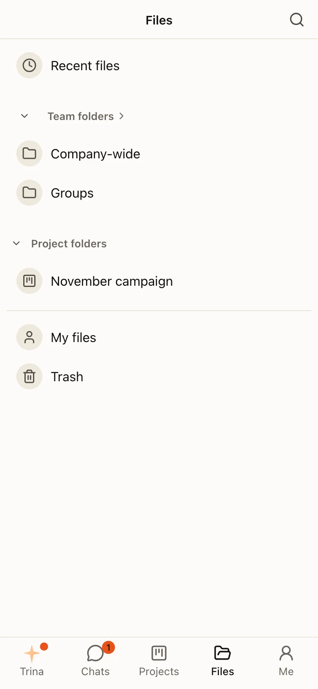

El conocimiento de la empresa vive en una sola carpeta del equipo en el servidor. Las reglas de carpetas deciden quién ve qué. La IA nunca ve más que la persona que pregunta.

## La carpeta del equipo

| Carpeta | Quién la ve | Para qué sirve |
|---|---|---|
| `shared/` | Lo que digan las reglas; normalmente todos | Documentos de toda la empresa |
| `groups/<group>/` | Ese grupo, más quien añada una regla | Documentos de un equipo, como Ventas o Finanzas; las habilidades propias del grupo, en su `skills/` |
| `projects/<project>/` | Lo que digan las reglas | Trabajo con su propia carpeta e instrucciones |
| `skills/` | Todos la leen; los responsables de habilidades escriben | Habilidades del equipo y reglas del equipo |
| `users/<id>/` | Solo esa persona | Archivos personales y habilidades personales |

## Cómo se decide el acceso

Una única función de permisos en el servidor decide cada acceso. El sistema operativo impide que la IA la esquive.

- Un archivo que usted no puede abrir es **invisible**, no "denegado". Archivos, las respuestas de la IA, la búsqueda, las vistas previas, el historial de versiones, la papelera y las actualizaciones en directo siguen la misma regla.
- El acceso de una persona viene de la **regla más cercana** por encima del archivo que la nombra. Las reglas de personas van antes que las de grupos. Con varios grupos, gana el acceso más amplio.
- Los cambios se aplican **al instante**. La IA vuelve a leer los permisos en cada llamada a una herramienta.
- Quitar el acceso no borra las respuestas anteriores que citaron un archivo.

## Compartir una carpeta

Los propietarios y administradores comparten una carpeta como en Google Drive: **Archivos › ⋯ de una carpeta › Compartir**, o **Administración › Permisos de carpetas › Compartir**. Las dos opciones abren el mismo cuadro.

:::steps
#### Añada personas y grupos
Escriba un nombre. Cada persona o grupo recibe **Lector** o **Editor**. **Quitar acceso** está en el mismo menú.

#### Revise el acceso general
**Restringido**: solo las personas de la lista pueden abrirla. O todo el equipo, como **Lector** o **Editor**. Una carpeta sin configuración propia muestra lo que recibe de la carpeta superior, con **Cambiar allí**.

#### Revise antes de guardar
El cuadro indica quién gana o pierde acceso. Nada cambia hasta que guarda. Dar más acceso pide confirmación antes, y lo mismo ocurre con un límite que deja fuera a personas que la carpeta superior deja entrar.
:::

El acceso se suma, como en Google Drive: lo que da una carpeta se añade a lo que dan las carpetas superiores. No se puede elegir un rol inferior a ese; la fila indica de dónde viene el rol superior ("Editor desde "Toda la empresa"").

Para dar a una carpeta menos acceso que las carpetas superiores, active **Configuración › Limitar el acceso**. Entonces solo la abren las personas y grupos añadidos allí. **Acceso quitado** muestra a las personas que pueden abrir la carpeta superior pero no esta; **Añadir** devuelve a una como Lector. Al volver a desactivar el límite, cualquier rol inferior al de las carpetas superiores sube a ese nivel.

El propietario y los administradores siempre pueden abrir las carpetas del equipo, salvo los proyectos de los que no son miembros. Aparecen como una sola fila **Gestor**.

Los propietarios y administradores también pueden pedírselo a Trina en un chat: «da al grupo Ventas acceso de lectura a Reports», «deja que Jun edite Sales/Q4», «quita al grupo Diseño de Reports». Una persona o un grupo y una carpeta cada vez. Pregunta antes con una tarjeta: dice quién obtiene o pierde el acceso y cuántas personas pueden abrir la carpeta antes y después. Si dentro hay archivos compartidos uno a uno con personas que pierden la carpeta, la tarjeta pregunta si esos permisos también se quitan. La tarjeta ofrece **Permitir siempre** para este tipo de cambio; si lo elige, Trina hace estos cambios sin preguntar y los archivos de dentro compartidos uno a uno siguen compartidos. El acceso general y Limitar acceso se cambian solo en este cuadro. Un miembro que lo pide ve **Pedir a un administrador**, que envía un mensaje suyo al propietario y a los administradores del equipo; una carpeta que no puede abrir se responde como si no existiera.

:::note
Después de la actualización que hizo que el acceso se sume, algunas carpetas muestran a sus personas por su nombre (con la etiqueta **Añadido cuando cambiaron las carpetas**), y Permisos de carpetas muestra una vez un aviso que las nombra. Las personas añadidas por su nombre conservan el acceso si más tarde dejan el grupo. **Administración › Grupos** y la página de la persona lo indican antes de guardar, con **Quitar ahora**.
:::

**Administración › Permisos de carpetas › Carpetas** muestra solo las carpetas que se comparten de forma distinta a la carpeta en la que están, con los mismos nombres que en Archivos, y **Limitada** en las que dejan fuera a personas. **Compartir** abre el cuadro Compartir de la carpeta. Las carpetas de proyectos son una sola línea: sus miembros se cambian en el proyecto.

**Lo que puede abrir una persona** muestra, para una persona (y por tanto para su IA), cada carpeta con Lector o Editor y el motivo, y las carpetas que no puede abrir.

:::warning
`skills/` contiene instrucciones que sigue la IA de todos los miembros. El permiso de escritura allí convierte a alguien en responsable de habilidades. Antes de que la IA guarde algo en `skills/`, el servidor pide a una persona que lo confirme. Lo mismo vale para el `groups/<group>/skills/` de un grupo: la IA de todos los miembros de ese grupo lo sigue, y cualquier miembro que pueda escribir en la carpeta del grupo lo cambia.
:::

## Compartir un archivo

Puede compartir un archivo suyo con las personas que elija, sin cambiar quién puede abrir su carpeta: **Archivos › ⋯ de un archivo › Compartir**. Añada personas o grupos y pulse **Compartir**. Pueden ver el archivo y descargarlo; no ven el resto de la carpeta. Cada persona que añada lo ve en **Actividad**.

- **Todo el equipo** es la primera opción en **Añadir personas o grupos**. Antes de pulsar **Compartir**, una línea avisa de que todo el equipo podrá abrir el archivo, también quienes se unan después. Los invitados nunca. Cuenta como una de las 50 personas y grupos con los que se puede compartir un archivo.
- Si comparte varios archivos a la vez (por ejemplo en el último paso de **Buscar archivos de trabajo en este ordenador**), cada persona recibe un solo aviso en **Actividad**, «Mina compartió 5 archivos con usted», que abre la lista de esos archivos. Quien añada por su nombre recibe además un aviso en el teléfono.
- **Personas con acceso** muestra al propietario y a cada persona o grupo con **Puede ver**. **✕** quita el acceso (antes pregunta). El propietario del archivo siempre puede quitar a personas, también cuando el equipo ha desactivado que los miembros compartan.
- Quien haya perdido el acceso ve «Mina dejó de compartir este archivo» al abrir el enlace del archivo, y puede pedir acceso de nuevo. No recibe ningún aviso.
- También puede pedírselo a Trina en un chat: «comparte el presupuesto con Jun» o «deja de compartir el presupuesto con Jun». Una tarjeta bajo la respuesta dice qué cambió: el archivo y dónde está, quién puede verlo y un botón. Tras compartir, el botón es **Gestionar acceso**, que abre este cuadro. Tras dejar de compartir es **Deshacer**, y la tarjeta dice quién aún puede abrir el archivo y por qué (por ejemplo, por un grupo con el que sigue compartido, o porque puede abrir su carpeta). Trina pregunta antes de compartir un archivo, salvo que su mensaje nombrara el archivo y a la persona. Dejar de compartir no necesita pregunta si su mensaje nombró a la persona. Si alguien ya puede abrir el archivo, la tarjeta lo dice y para esa persona no cambia nada.
- Cuando Trina no puede compartir un archivo, la tarjeta explica por qué y pone el siguiente paso como su único botón: **Pedir a Mina** si el archivo es de Mina (ella recibe la solicitud en **Actividad** y decide), o **Pedir a un administrador** cuando el equipo desactivó que los miembros compartan (el propietario y los administradores del equipo reciben un mensaje suyo pidiendo volver a activarlo).
- Un archivo del equipo también lo abren todas las personas que pueden abrir su carpeta.
- **Copiar enlace** da el enlace propio del archivo. Quienes tienen acceso lo abren; los demás ven **Necesita acceso** y pueden **Pedir acceso** con una nota. La solicitud llega al propietario en **Actividad** con **Compartir** y **Rechazar**. La página del enlace nunca muestra el nombre del archivo a quien no puede abrirlo.
- Al mover un archivo a un lugar que menos personas pueden abrir, se le dice cuántas personas lo tienen por su enlace.
- Pregunte a Trina **«¿quién puede abrir este archivo?»** o **«¿por qué Jun no puede abrirlo?»**. Le dice cómo entra cada persona (compartido por nombre, por un grupo, por su carpeta). Verá los nombres en sus propios archivos; en el archivo de otra persona verá su propio acceso y a quién preguntar.
- Después de que Trina publique en una sala, le avisa si algunas personas de allí no pueden abrir un archivo de la publicación. **Permitir que lo vean** comparte su archivo solo con las personas nombradas en esa línea. Si el archivo es de otra persona, el botón con el nombre del propietario (como **Pedir a Mina**) le envía una solicitud en **Actividad** («Alice le pidió que comparta Quote.pdf con Jun») con **Compartir** y **Rechazar**. Para una carpeta del equipo, un miembro ve **Pedir a un administrador**, que envía un mensaje suyo al propietario y a los administradores del equipo.

Los propietarios y administradores pueden compartir cualquier archivo del equipo. En **Administración › Ajustes del equipo**, **Los miembros pueden compartir sus propios archivos** desactiva el uso compartido para los miembros (lo ya compartido sigue funcionando, y su propietario aún puede dejar de compartirlo). El propietario del equipo puede **Quitar todos los archivos compartidos** allí de una vez.

### Compartir una carpeta de Mis archivos

También puede compartir una carpeta de **Mis archivos** de la misma forma, como una carpeta de Mi unidad en Google Drive:
**Archivos › ⋯ de una carpeta › Compartir**. Las personas y los grupos que añada pueden ver todo lo que contiene, también
los archivos que añada más adelante, y no pueden cambiar nada. La encuentran en **Archivos › Compartidos conmigo** y la
abren como una carpeta, un nivel cada vez: nombres, tamaños y fechas, y cada archivo para verlo o descargarlo. Nunca ven
las carpetas que hay por encima.

- El diálogo dice qué contiene la carpeta («3 archivos, 1 carpeta»). **Todo el equipo** tiene su propia línea: todo el
  equipo, también quienes se unan más adelante, verá todo lo que hay en la carpeta y lo que se añada. Los invitados nunca.
- En **Archivos**, una carpeta compartida dice **Compartido** y un archivo de dentro dice **Compartido a través de Work**
  (en su propio diálogo, las personas de la carpeta aparecen «A través de Work»).
- **Dejar de compartir** quita a todos a la vez. Antes indica lo que sigue compartido por separado (archivos y carpetas
  de dentro). Después, **Deshacer** vuelve a poner a las personas durante unos minutos. Quitar personas y dejar de
  compartir siempre funcionan, también si su equipo desactivó compartir para los miembros.
- Su carpeta personal en sí y los lugares donde Trina guarda cosas allí (descargas, imágenes, habilidades, carpetas de
  proyectos y algunos más) no se pueden compartir; el diálogo dice por qué.
- Si la carpeta del servidor ya no es la que compartió (por ejemplo, se reemplazó fuera de Trina), el uso compartido se
  **pausa**: nadie puede abrirla y usted recibe un aviso. Abra su diálogo Compartir y pulse **Reanudar**.

En **Administración › Ajustes del equipo**, el interruptor es **Los miembros pueden compartir sus propios archivos y
carpetas**, y **Quitar todos los archivos compartidos** cuenta archivos y carpetas por separado.

También puede pedírselo a Trina: «comparte la carpeta Work con Jun». Trina muestra antes la tarjeta con la carpeta, dónde está y lo que contiene (**Permitir siempre** para compartir archivos no incluye las carpetas). La tarjeta ofrece **Permitir siempre** para compartir carpetas; si lo elige, Trina comparte sus carpetas sin preguntar. Dejar de compartir se hace al momento cuando su mensaje nombra la carpeta (su nombre entre comillas, como `"Work"`, o dónde está), y la tarjeta que lo dice tiene **Deshacer**.

### Archivos compartidos con usted

**Archivos › Compartidos conmigo** muestra los archivos que otras personas han compartido con usted, los más recientes primero, con quién lo compartió y cuándo. Un archivo que usted ya puede abrir en su carpeta aparece aquí solo cuando alguien le añadió por su nombre. Abra un archivo desde allí para verlo o descargarlo; **‹ Compartidos conmigo** le devuelve a la lista. Al abrir un archivo, su aviso en **Actividad** se marca como leído. Un archivo sale de la lista cuando usted pierde el acceso (su propietario le quitó, lo movió a la papelera o ya no puede editarlo).

Trina también puede usar estos archivos. Pida «resume el archivo que Mina compartió conmigo» y lo busca entre lo que se compartió con usted, también cuando un archivo de sus propias carpetas tiene el mismo nombre. En la página de un archivo compartido, **Preguntar a Trina** abre un chat nuevo con ese archivo ya en el cuadro de texto. Trina puede ver un archivo compartido, no modificarlo.

### «Este archivo», «ese hilo»

Cuando dice «resume esto» o «responde en ese hilo» sin dar un nombre, Trina mira qué tiene abierto en la aplicación: el archivo, la sala, el hilo o el chat que hay en su pantalla, empezando por la ventana en la que está escribiendo. Solo lo hace cuando señala algo sin nombrarlo, y pregunta cuando podrían ser dos cosas. Todo lo que comparta o publique por usted de este modo le muestra antes una tarjeta, salvo que haya elegido **Permitir siempre** para ese tipo de tarjeta. No se guarda nada de su pantalla: una ventana cerrada se olvida, y un chat confidencial nunca se menciona.

## Trabajar con archivos

- **Subir**: suba archivos o carpetas enteras desde la pantalla Archivos.
- **Descargar**: en la aplicación de escritorio, un archivo que descargue va directamente a la carpeta Descargas de su ordenador, y un aviso ofrece **Mostrar en la carpeta**. Si ya hay un archivo con el mismo nombre, se conserva: el nuevo se guarda como "nombre (1)". En un navegador, el navegador decide dónde se guardan las descargas.
- **Historial de versiones**: cada cambio guarda una versión que puede abrir o restaurar.
- **Papelera**: **Archivos › Papelera** muestra lo que puede restaurar, por nombre y por el lugar en el que estaba ("price-sheet.xlsx · Toda la empresa › Sales"). Un archivo eliminado más de una vez es una sola fila con sus copias: **Restaurar** recupera la más reciente, y al abrir la fila puede restaurar cualquier otra copia. Si la lista incluye elementos eliminados por otras personas, **Eliminado por mí** muestra solo los suyos. Los elementos se eliminan definitivamente después del periodo de conservación del equipo (Administración › Configuración del equipo, 30 días de forma predeterminada); cada fila indica cuándo.
- **Formatos**: la IA lee el texto de archivos PDF, Office y HWP/HWPX, y ve las fotos y las páginas escaneadas como imágenes (los administradores pueden desactivarlo). Los servidores Linux no ejecutan OCR.
- **Confirmación**: cuando la IA fuera a escribir contenido restringido en un lugar donde lo pueden ver más personas, el servidor pregunta antes.

## De HTML a PDF

Un archivo HTML, como un presupuesto o un informe que escribió la IA, se convierte en un PDF con el mismo aspecto que la página: sus colores y fondos, las celdas de tabla combinadas, el tamaño de página y los márgenes de la propia regla `@page` de la página (A4 si no indica ninguno) y sus saltos de página.

- **En la vista previa**: abra el archivo `.html` y pulse **Guardar como PDF** en el encabezado de la vista previa. El PDF se guarda junto a la página con el mismo nombre, y el aviso enlaza a él. Un segundo PDF de la misma página se guarda como `name (2).pdf`, nunca encima del primero. En una carpeta que solo puede leer, el PDF se descarga. En un teléfono, la acción está en el menú **⋯**.
- **Pida a la IA**: "Convierte quote.html en un PDF". La IA imprime la propia página; no la reescribe como Markdown.
- **Qué usa el PDF**: la página y sus propias imágenes, hojas de estilo y fuentes de la carpeta del equipo, por ruta relativa. Las direcciones web nunca se cargan: una imagen de la web aparece como un recuadro gris, igual que en la vista previa. Guarde la imagen en la carpeta del equipo y haga referencia a ella por su ruta. Los scripts de la página no se ejecutan, así que falta cualquier parte que dibujaría un script; escriba esa parte como HTML sin scripts.
- **Límites**: hasta 200 páginas y 50 MB, y alrededor de un minuto por página. En un servidor se crean pocos PDF a la vez; los demás esperan.
- **Dónde funciona**: el servidor imprime con un Chromium sin interfaz (headless) en el entorno aislado de su conversor, sin red. Un servidor Linux lo tiene cuando está instalado el paquete `chromium` de Debian (el entorno de desarrollo lo instala, y también una imagen de servidor alojado creada con el entorno de desarrollo). En un servidor Linux, cada impresión se ejecuta con su propio límite de memoria, separada de otras conversiones, y necesita al menos 3 GB de memoria en el servidor (dos impresiones a la vez a partir de 6 GB). Un servidor sin navegador, o con menos memoria, no muestra la acción, y la IA indica que no puede imprimir HTML. Un administrador puede indicar el navegador con `MYCEL_HTML_PDF_BROWSER` ([entorno](../../reference/environment.md) (en inglés)).

Todos los detalles: [Seguridad y permisos](../../../security-and-permissions.md) (en inglés) y el [modelo de permisos (en coreano)](../../../PERMISSIONS.md).
