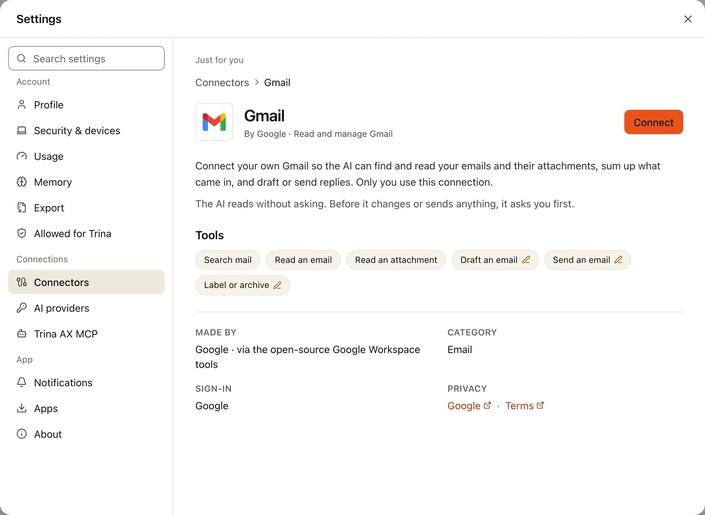
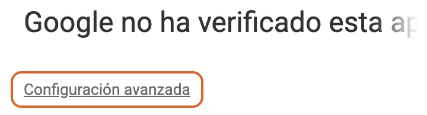
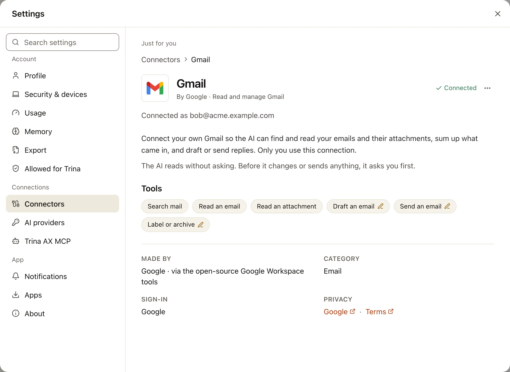
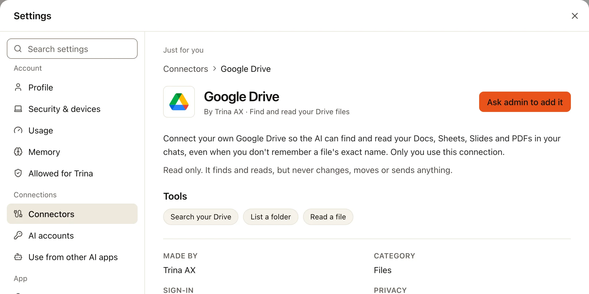
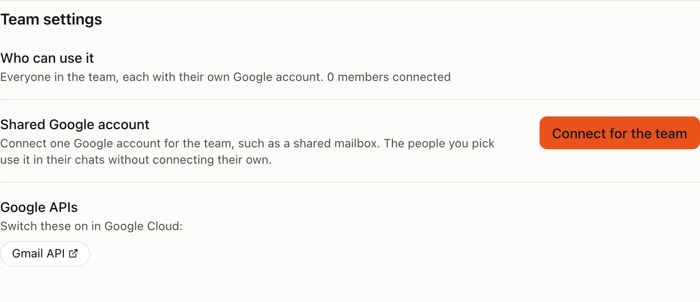
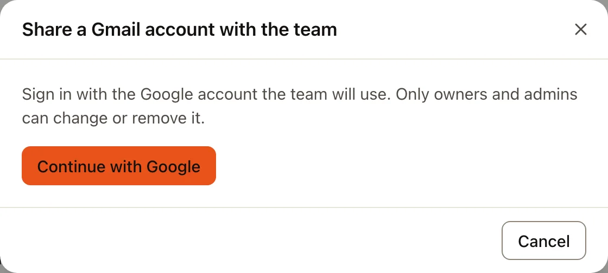
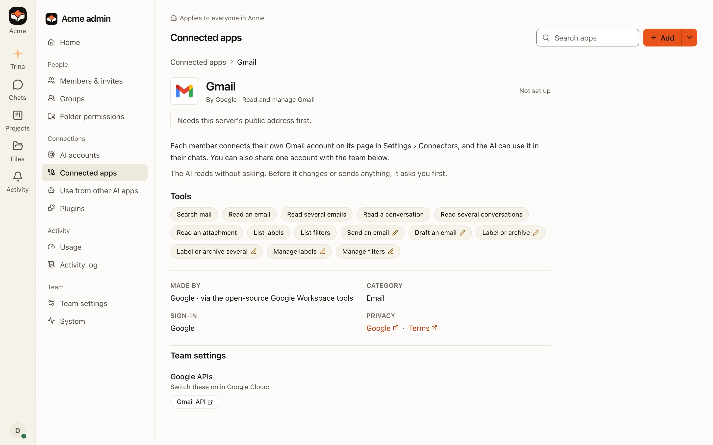

Google Drive, Gmail, Google Calendar, Google Docs y Google Sheets vienen integrados en Trina AX. Cada persona conecta su
propia cuenta de Google, una vez por app, y la IA la usa solo en los chats de esa persona, con los permisos de Google de
esa persona.

No hay nada que copiar ni pegar: usted inicia sesión en Google.

## Conectar una app de Google (todos)

:::tip
**Qué necesita**

- Su cuenta de Google (una cuenta de Google Workspace de la empresa o una cuenta personal de Gmail), con la sesión
  iniciada en su navegador.
:::

:::steps
#### Abra la app en Conectores
1. Elija su foto en la parte inferior de la barra de la izquierda y después **Configuración**.
2. En la lista de la izquierda, elija **Conectores**.
3. En **Descubrir**, elija la app, **Gmail** por ejemplo. (Escriba su nombre en **Buscar apps** si no la ve).

Se abre la página de la app. Explica qué puede hacer allí la IA y enumera todas las herramientas; un lápiz marca las
herramientas que cambian algo. **Conectar** está arriba a la derecha.



#### Elija Conectar
Se abre una ventana nueva (en la app de escritorio, en su navegador). En un equipo alojado por Trina, primero muestra la
página de inicio de Trina, que nombra a su equipo y dice qué puede hacer Trina AX: elija **Continuar a Google**. Después
se abre la propia página de inicio de sesión de Google. Si tiene la sesión iniciada en más de una cuenta de Google,
Google le pregunta cuál: elija la que quiere usar.

#### Supere el aviso de Google
Mientras Google sigue revisando la app de Google de Trina, Google muestra **Google no ha verificado esta aplicación**
antes de los permisos. Es el aviso de Google sobre la revisión, no un problema de su cuenta. Bastan dos clics:

1. Elija **Configuración avanzada** debajo del texto.

   

2. Elija **Ir a Trina AX (no seguro)** al final del texto que se abre.

   ")

Una empresa con Google Workspace puede evitar este aviso para todos usando su propia app de Google: vea
[Qué inicio de sesión de Google](#qué-inicio-de-sesión-de-google) más abajo.

#### Deje todas las casillas marcadas
Google muestra una página que nombra a Trina AX y enumera lo que puede hacer, una línea por permiso, como "Leer,
redactar y enviar correos". Algunas líneas tienen una casilla. Deje **todas** las casillas marcadas y elija
**Continue**. Un inicio de sesión con una casilla sin marcar se rechaza: "No se marcaron algunos permisos. Vuelva
a conectar y deje todas las casillas marcadas."

#### Confirme la cuenta
De vuelta en Trina AX, compruebe la cuenta que aparece ("¿Conectar esta cuenta?") y elija **Conectar esta cuenta**. La
página indica ahora **Conectado** arriba a la derecha y **Conectado como** y su dirección debajo del nombre.


:::

La lectura no pide confirmación. Antes de que la IA envíe un correo, añada un evento o edite un documento, muestra una tarjeta con todo lo
que va a hacer y espera su sí. En la tarjeta, o en la **Configuración** de la app (su menú **⋯**), puede elegir
**Permitir siempre** en lugar de **Preguntarme primero**. Google Drive solo lee: nunca cambia, mueve ni envía nada.

### Si ve "Pedir que lo añadan"

La app todavía no está configurada en su equipo. Elija **Pedir que lo añadan**: el propietario y los administradores
reciben un aviso, y usted recibe respuesta cuando ya puede conectar.



## Una cuenta de Google compartida para el equipo (administradores)

Un buzón o calendario compartido, como `sales@acme.com`, se puede conectar una sola vez para las personas que lo
necesitan, como un buzón compartido de Gmail que abren varias personas. Lo usan en sus chats sin conectar el suyo.

:::steps
#### Abra la app de Google en Administración
Elija el logotipo de su equipo en la parte superior de la barra de la izquierda, después **Administración › Apps
conectadas**, y elija la app de Google (Gmail, por ejemplo). Desplácese hasta **Ajustes del equipo**. La fila **Cuenta
de Google compartida** tiene **Conectar para el equipo** a la derecha.



#### Inicie sesión con la cuenta compartida
Elija **Conectar para el equipo**. Se abre el cuadro **Compartir una cuenta de Gmail con el equipo**. Elija **Continuar
con Google** e inicie sesión en Google con la cuenta compartida, no con la suya. Deje todas las casillas marcadas, como
arriba, y después compruebe la cuenta y elija **Conectar esta cuenta**.



#### Elija quién la usa y guarde
En **Quién puede usarlo**, elija a todos, grupos o personas, y elija **Guardar**. Nadie la usa hasta que guarde; si
cierra el cuadro antes, se quita de nuevo. La fila muestra entonces la cuenta, quién la usa y quién la conectó, con un
menú **⋯**: **Cambiar personas**, **Volver a conectar** y **Quitar**.
:::

Google Drive tiene **Compartido con el equipo** en el mismo lugar: **Compartir un Google Drive con el equipo** conecta
una cuenta de Google y le deja elegir sus carpetas; las personas que elija las usan en sus chats.

## Configurar las apps de Google (administradores de un servidor que gestiona usted mismo)

En un equipo alojado por Trina, el inicio de sesión de Google ya está listo: no hay nada que configurar. En un servidor
que gestiona su propia empresa, un administrador crea una vez una app de inicio de sesión de Google en Google Cloud y la
añade en **Administración › Apps conectadas**.

:::tip
**Qué necesita**

- Una **dirección https pública** para el servidor de su equipo (las personas vuelven a ella desde Google). Mientras no
  la tenga, las apps de Google muestran "Primero hace falta la dirección pública de este servidor." La fija quien
  gestiona el servidor: vea [Configuration](../../operate/configuration.md) (en inglés).
- Un **proyecto de Google Cloud**, las **API** que necesita cada app activadas y un **cliente de inicio de sesión** de
  tipo **Web application**.
- De Google Cloud: el **archivo JSON** del cliente (o su **ID de cliente** y su **Secreto del cliente**).
- Para Google Cloud: las **direcciones de regreso** que muestra Trina AX, una para Google Drive y otra para las otras
  cuatro apps.
:::



:::steps
#### Cree la app en Google Cloud
Siga [En Google Cloud](google-own-app.md#en-google-cloud) en la página de la app de la empresa: un proyecto, las API, el
nombre y el público de la app (**Internal** para una empresa con Google Workspace; si no, **External** con usuarios de
prueba), los permisos y un cliente **Web application**.

#### Añada las direcciones de regreso
En **Authorized redirect URIs** del cliente, añada las direcciones que muestra el cuadro **Configurar** de cada app, con
su botón de copiar:

```
https://<your team address>/api/integrations/google-drive/callback
https://<your team address>/api/integrations/google-apps/callback
```

#### Suba el archivo en Trina AX
En **Administración › Apps conectadas**, abra **Google Drive** y elija **Configurar**. Suba el archivo JSON que
descargó, o pegue el **ID de cliente** y el **Secreto del cliente**, y guarde. Después abra Gmail, Google Calendar, Docs
y Sheets uno por uno, elija **Configurar** y active **Usar la misma app de Google que Google Drive**: no hay que subir
nada más.
:::

La página de cada app enumera, en **API de Google**, las API que hay que activar para ella:

| App | API de Google que hay que habilitar |
|---|---|
| Google Drive | Google Drive API |
| Gmail | Gmail API |
| Google Calendar | Google Calendar API |
| Google Docs | Google Docs API, Google Drive API |
| Google Sheets | Google Sheets API, Google Drive API |

Las apps de Gmail, Calendar, Docs y Sheets funcionan en servidores Linux. En la app de Mac sus páginas dicen "Aún no
disponible en el servidor del equipo".

## Qué inicio de sesión de Google

Hay dos formas de iniciar sesión en Google. Su equipo usa una de ellas para las cinco apps de Google.

| | Inicio de sesión de Trina | La app de Google de su empresa |
|---|---|---|
| Quién puede conectar | Cualquier cuenta de Google: una cuenta de Google Workspace de la empresa o una cuenta personal de Gmail | Solo las cuentas del Google Workspace de su empresa |
| Configuración | Ninguna en un equipo alojado por Trina | Unos 15 minutos, una vez, a cargo de un administrador de TI: [Usar la app de Google de su empresa](google-own-app.md) |
| Pantalla de Google | **Google no ha verificado esta aplicación** mientras Google revisa la app de Trina: [dos clics](#conectar-una-app-de-google-todos) | El nombre de la app de su empresa, sin aviso |
| Cuántas personas | Limitado por Google mientras dura la revisión | Sin límite |

Empiece con el inicio de sesión de Trina. Si su empresa usa Google Workspace y no quiere el aviso, o Google dice que la
app ha alcanzado su límite, cambie a la app propia de su empresa. Las personas vuelven a conectar Google una vez.

## Problemas

| Qué ve | Qué hacer |
|---|---|
| **No se marcaron algunos permisos. Vuelva a conectar y deje todas las casillas marcadas.** | Vuelva a conectar y deje marcadas todas las casillas de la pantalla de Google. |
| **Google le pide que inicie sesión de nuevo.** | Elija **Volver a conectar** en la página de la app. Ocurre después de un cambio de contraseña, o cuando el administrador de su empresa retiró el acceso. |
| **`redirect_uri_mismatch`** en la página de Google (servidores propios) | Una dirección de regreso en Google Cloud difiere de la que muestra Trina AX. Cópiela de nuevo desde el cuadro **Configurar**. |
| **"This app is blocked"** o **`admin_policy_enforced`** | El administrador de Google de su empresa limita qué apps pueden usar las cuentas de Google. Pídale que marque la app como de confianza: vea [Marcar la app como de confianza en la Admin console](google-own-app.md#opcional-marcar-la-app-como-de-confianza-en-la-admin-console). |
| **Google no ha verificado esta aplicación** | Con el inicio de sesión de Trina: elija **Configuración avanzada** y después **Ir a Trina AX (no seguro)** ([imágenes](#conectar-una-app-de-google-todos)). Con una app que su administrador creó en Testing: elija **Configuración avanzada** › **Ir a …** solo si su administrador la creó, o pídale que la ponga en **Internal**. |
| **Acceso bloqueado**, o Google dice que la app ha alcanzado su límite de usuarios | El inicio de sesión de Trina ha alcanzado el límite de Google mientras dura la revisión. Un administrador cambia el equipo a [la app de Google de su empresa](google-own-app.md). |

Todos los detalles para desarrolladores y operadores: [Google apps](../../../GOOGLE-APPS.md) (en inglés) y
[Google Drive](../../../GOOGLE-DRIVE.md) (en inglés).
