Cuando las personas conectan Google Drive, Gmail, Google Calendar, Google Docs o Google Sheets, inician sesión en Google
a través de la propia app de Google de Trina. Una empresa con Google Workspace puede usar en su lugar **su propia app de
Google**. Su administrador de TI crea la app una vez en Google Cloud y la añade una vez a Trina AX. A partir de entonces,
las cinco apps de Google inician sesión con ella, y las personas ven el nombre de su empresa en la pantalla de Google,
sin el aviso de "app no verificada" y sin límite de cuántas personas pueden iniciar sesión.

Lleva unos 15 minutos: la mayor parte en Google Cloud, y después un cuadro en Trina AX.

:::tip
**Qué necesita**

| Dato | De dónde sale | Adónde va |
|---|---|---|
| Dos **direcciones de regreso** | El cuadro de Trina AX, paso **En Google Cloud**, cada una con **Copiar** | Google Cloud › Clients › su cliente › **Authorized redirect URIs** |
| La lista de **permisos** (scopes) | El bloque de esta página, [Añada los permisos](#en-google-cloud) | Google Cloud › **Data access** › **Manually add scopes** |
| El **archivo JSON** del cliente (o **ID de cliente** y **Secreto del cliente**) | Google Cloud › **Clients** › **Download JSON**, justo después de crear el cliente | El cuadro de Trina AX, paso **Añádala aquí** |
:::

:::note
Las capturas de esta página usan un equipo inventado, "Acme", y un proyecto de Google Cloud inventado, "acme-trina".
Google cambia su consola de vez en cuando: si una pantalla se ve distinta, siga la etiqueta citada en el texto y el
enlace a la página de Google Cloud.
:::

## Para quién es

- **Una empresa con Google Workspace** (todos inician sesión con una dirección de su empresa, como `name@acme.com`).
  Esta página es para usted. Debe ser el propietario del equipo o un administrador en Trina AX, y poder crear un
  proyecto en el Google Cloud de su empresa.
- **Personas con cuentas personales de Gmail.** Mantenga el inicio de sesión de Trina: una app Internal solo deja entrar
  a las cuentas de su propia empresa.

Para los miembros no cambia nada más: las mismas páginas, el mismo botón **Conectar**. Vuelven a conectar Google una
vez, después del cambio.

:::tip
Un equipo pequeño sin Google Workspace puede crear en su lugar una app **External** en **Testing**. Solo pueden iniciar
sesión las personas que usted añada como usuarios de prueba (100 como máximo), y Google les pide volver a iniciar sesión
cada 7 días. Para la mayoría de los equipos, el inicio de sesión propio de Trina es más sencillo.
:::

## En Google Cloud

Inicie sesión en [Google Cloud](https://console.cloud.google.com/) con una cuenta de su empresa.

:::steps
#### Cree un proyecto
Abra [New project](https://console.cloud.google.com/projectcreate). Póngale un **Project name** (nombre del proyecto)
que reconozca, como "acme-trina". En **Parent resource** (o **Organization**), elija su empresa: la app solo puede ser
**Internal** si el proyecto pertenece a la organización de su empresa ("No organization" en la imagen es la cuenta usada
para las imágenes). Elija **Create** y, antes de los pasos siguientes, asegúrese de que el proyecto nuevo está elegido en la
parte superior de la página.

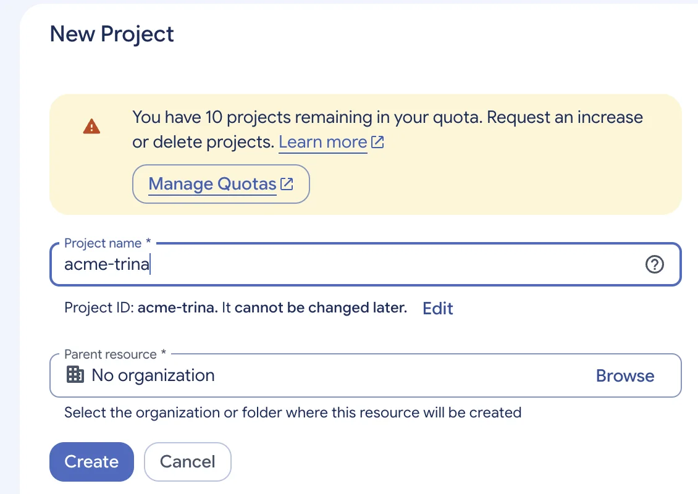

#### Active cinco API
Abra cada una de estas páginas y elija **Enable**:

- [Google Drive API](https://console.cloud.google.com/apis/library/drive.googleapis.com)
- [Gmail API](https://console.cloud.google.com/apis/library/gmail.googleapis.com)
- [Google Calendar API](https://console.cloud.google.com/apis/library/calendar-json.googleapis.com)
- [Google Docs API](https://console.cloud.google.com/apis/library/docs.googleapis.com)
- [Google Sheets API](https://console.cloud.google.com/apis/library/sheets.googleapis.com)

Active las cinco, aunque hoy su equipo use solo algunas de las apps de Google. Cuando una API ya está activada, su
página muestra **Manage** y **API Enabled** en lugar de **Enable**.

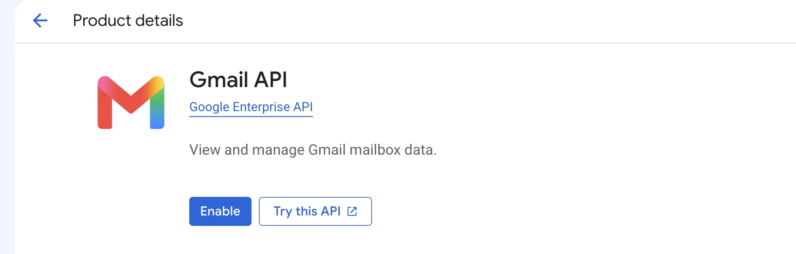

#### Ponga nombre a la app y elija Internal
Abra [Google Auth Platform](https://console.cloud.google.com/auth/overview). La primera vez muestra **Get started**:

1. **App Information**: un **App name** que las personas reconozcan, como "Acme Trina", y un **User support email**.
   Elija **Next (Siguiente)**.

   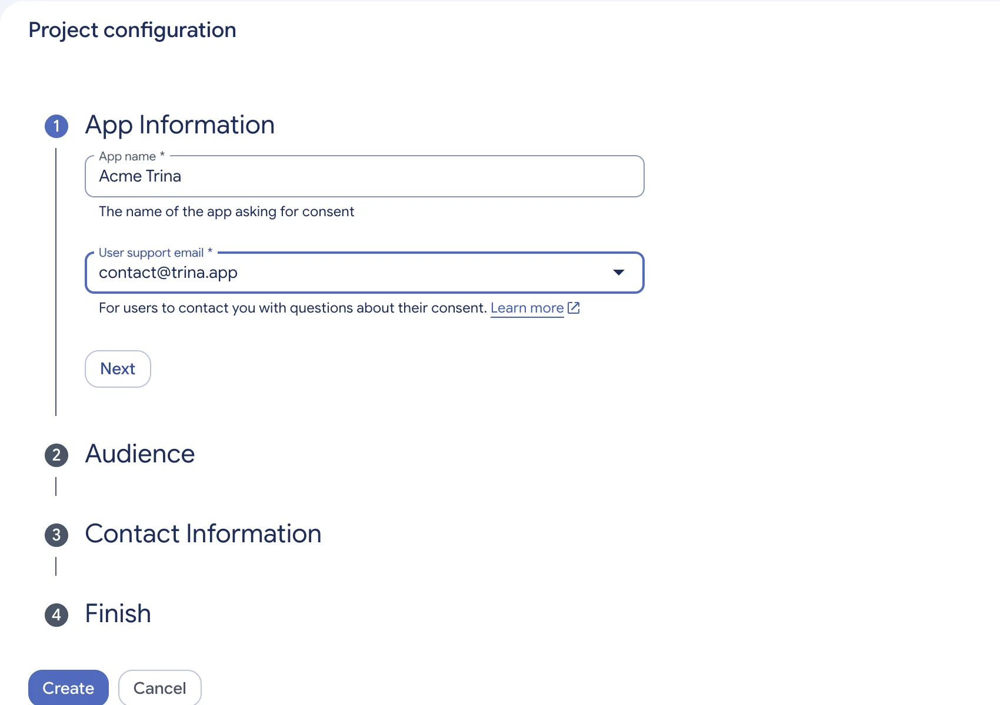

2. **Audience**: elija **Internal**. Solo las cuentas de su empresa pueden usar la app, y Google no necesita revisarla.
   (En la imagen **Internal** aparece en gris porque la cuenta usada para las imágenes no tiene organización. Con una cuenta de su
   empresa se puede elegir).

   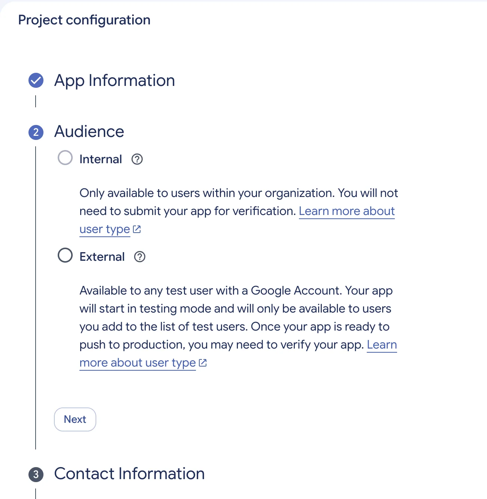
3. **Contact Information**: una dirección de correo a la que Google pueda escribir sobre el proyecto.
4. **Finish**: acepte la política de Google y elija **Create**.

Más adelante puede cambiar estos datos en [Branding](https://console.cloud.google.com/auth/branding) y
[Audience](https://console.cloud.google.com/auth/audience).

#### Añada los permisos
Abra [Data access](https://console.cloud.google.com/auth/scopes) y elija **Add or remove scopes**.

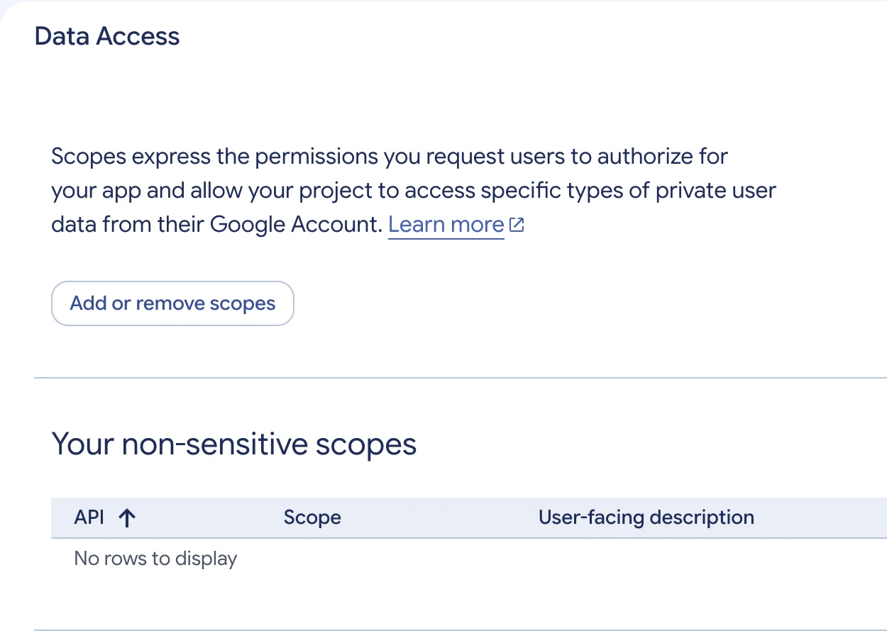

Se abre un panel a la derecha. Al final del panel, en **Manually add scopes**, pegue el bloque completo de abajo, elija
**Add to table**, después **Update** y después **Save** en la página.

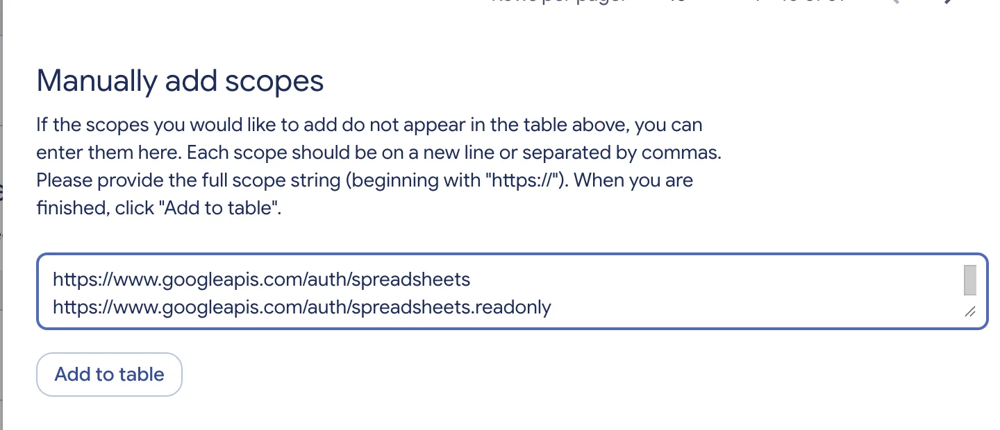

```
openid
https://www.googleapis.com/auth/userinfo.email
https://www.googleapis.com/auth/userinfo.profile
https://www.googleapis.com/auth/drive.readonly
https://www.googleapis.com/auth/drive.file
https://www.googleapis.com/auth/gmail.readonly
https://www.googleapis.com/auth/gmail.send
https://www.googleapis.com/auth/gmail.compose
https://www.googleapis.com/auth/gmail.modify
https://www.googleapis.com/auth/gmail.labels
https://www.googleapis.com/auth/gmail.settings.basic
https://www.googleapis.com/auth/calendar
https://www.googleapis.com/auth/calendar.readonly
https://www.googleapis.com/auth/calendar.events
https://www.googleapis.com/auth/documents
https://www.googleapis.com/auth/documents.readonly
https://www.googleapis.com/auth/spreadsheets
https://www.googleapis.com/auth/spreadsheets.readonly
```

Son exactamente los permisos que pide Trina AX, para las cinco apps juntas. No omita ninguno: un inicio de sesión al que
le falte uno se rechaza.

#### Cree el cliente de inicio de sesión
Abra [Clients](https://console.cloud.google.com/auth/clients) y elija **Create client**.

1. **Application type**: **Web application**.
2. **Name**: cualquiera, como "Trina AX". Las personas no lo ven.

   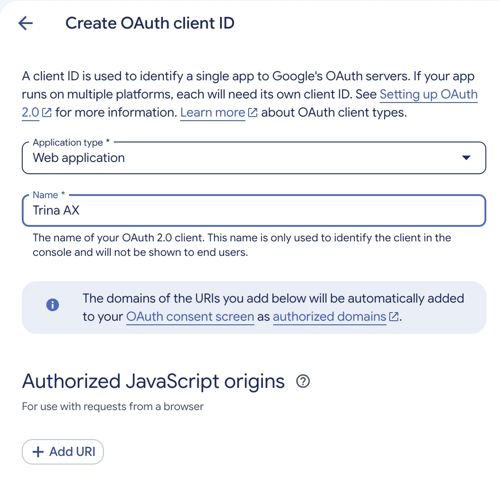

3. En **Authorized redirect URIs**, elija **Add URI** dos veces y pegue las dos direcciones de regreso. Cópielas de
   Trina AX (el cuadro de la parte siguiente las muestra, cada una con **Copiar**). Tienen este aspecto, con la
   dirección de su equipo:

   ```
   https://<your team address>/api/integrations/google-drive/callback
   https://<your team address>/api/integrations/google-apps/callback
   ```

   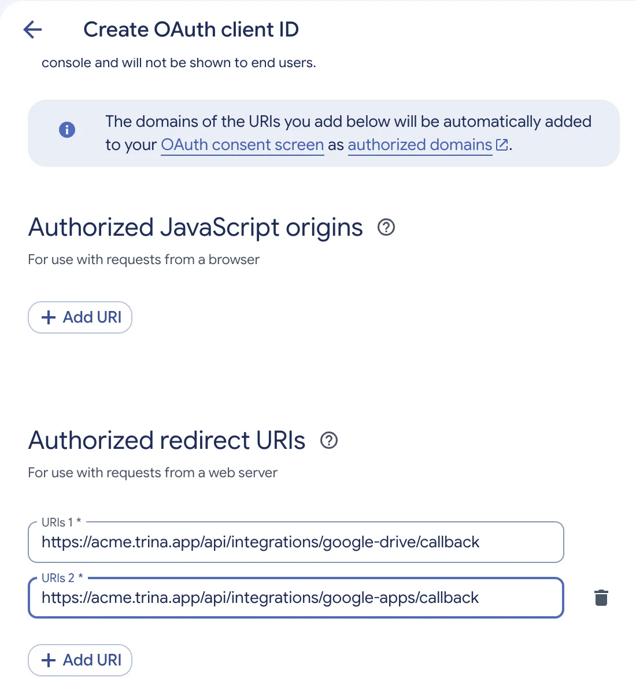

4. Elija **Create**. En **OAuth client created**, elija **Download JSON** y guarde el archivo. Google muestra el secreto
   solo en este momento; si lo pierde, cree un secreto nuevo para el cliente.

   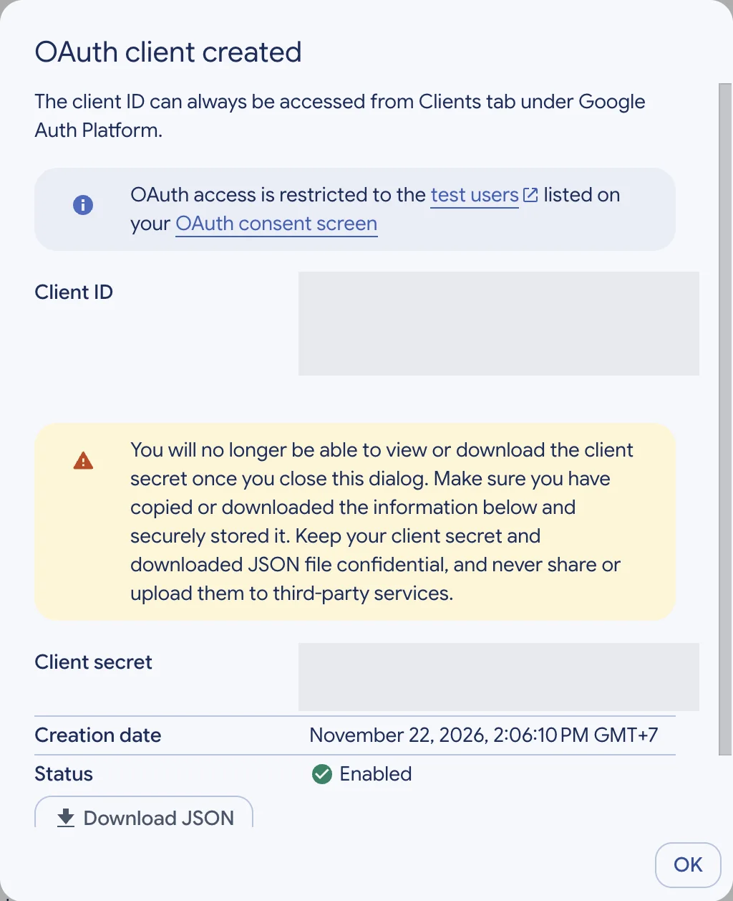
:::

## En Trina AX

:::steps
#### Abra una página de Google
En **Administración › Apps conectadas**, elija cualquiera de las apps de Google, **Gmail** por ejemplo. Las cinco páginas
terminan con **Ajustes del equipo**, y su primera fila es **Inicio de sesión de Google**: "Todos inician sesión con la
app de Google de Trina. Su empresa puede usar su propia app de Google en su lugar, para todas las apps de Google de
aquí."

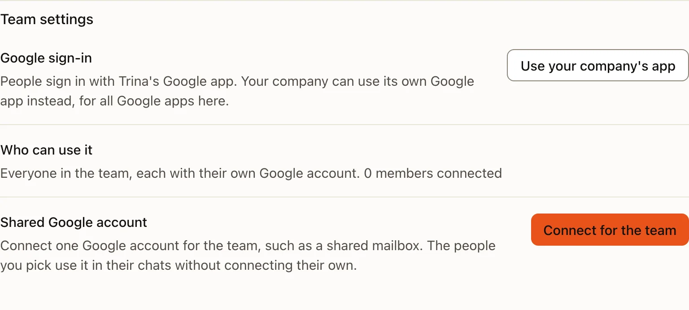

#### Pulse Usar la app de su empresa
Se abre el cuadro **Usar la app de Google de su empresa**. Su primer paso, **Antes de empezar**, explica para quién es y
enlaza con esta página.

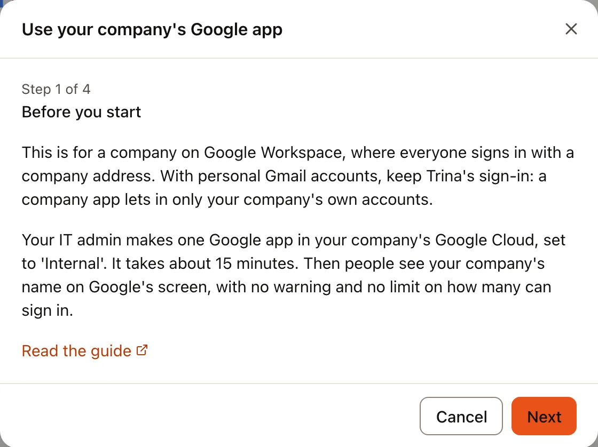

#### En Google Cloud
El segundo paso enumera los pasos de Google Cloud de arriba, con un enlace a cada página, y las dos direcciones de
regreso de su equipo, cada una con **Copiar**. Cópielas desde aquí en **Authorized redirect URIs**, para que queden
exactas.

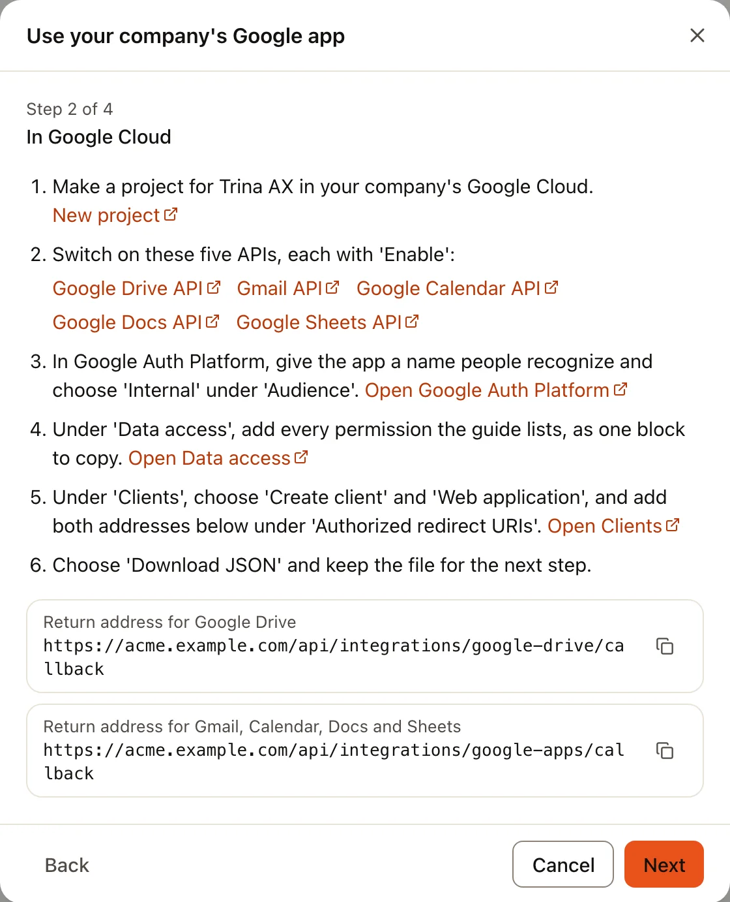

#### Añádala aquí
Suelte el archivo que descargó de Google, o elíjalo. Si prefiere escribir, **Escribir el ID y el secreto en su lugar**
abre dos campos para el **ID de cliente** y el **Secreto del cliente**. Un archivo que no incluye las dos direcciones de
regreso se rechaza, con una línea que indica cuál debe añadir en Google Cloud.

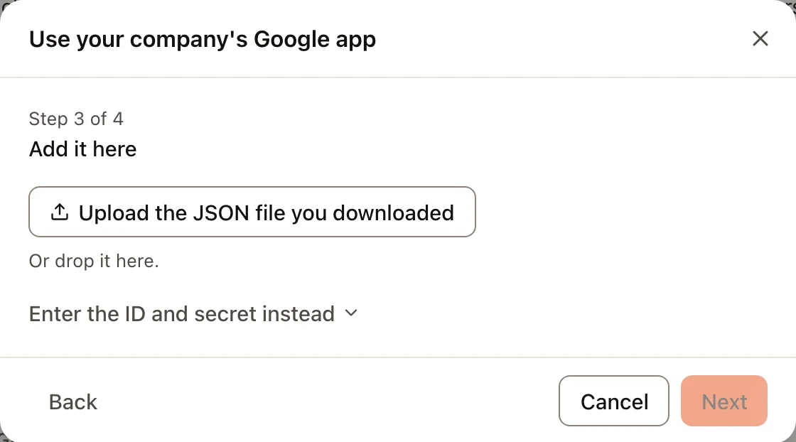

#### Revise y guarde
El último paso, **Antes de guardar**, explica qué cambia, con las cifras de su equipo: cuántas personas tendrán que
volver a conectar Google, y que las cuentas de Google compartidas y los Drive compartidos con el equipo necesitan que un
administrador los vuelva a conectar. No cambia nada hasta que elija **Guardar**. **Cancelar** lo deja todo como estaba.

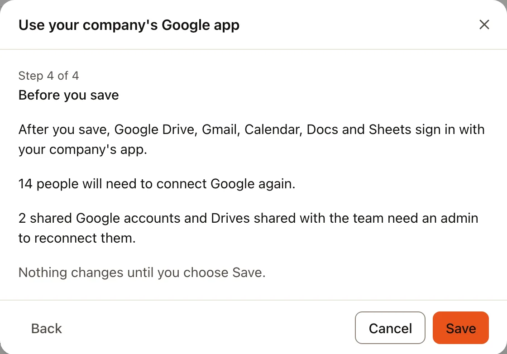
:::

Después de **Guardar**, la fila dice "Todos inician sesión con la app de Google de su empresa, para Google Drive, Gmail,
Calendar, Docs y Sheets." con quién lo configuró y cuándo. Su menú ⋯ tiene **Reemplazar** (para añadir un archivo nuevo,
por ejemplo después de crear un secreto nuevo) y **Volver al inicio de sesión de Google de Trina**. Se configura una sola
vez: la fila es la misma en las cinco páginas de Google.

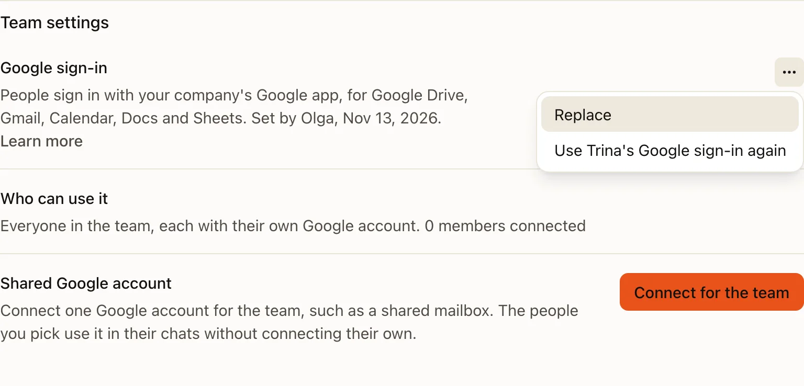

En el teléfono, el ⋯ se queda junto al nombre de la fila, como en los ajustes de un teléfono.

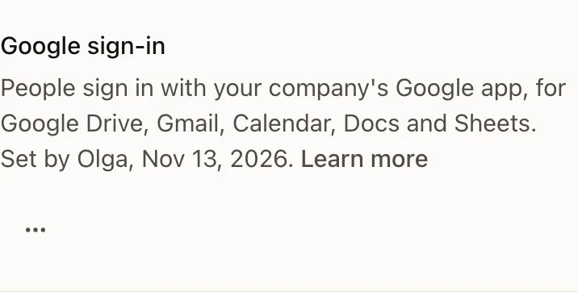

## Lo que ven los miembros

Todas las conexiones con Google hechas a través de la app de Trina dejan de funcionar cuando usted hace el cambio, porque
Google vincula un inicio de sesión a la app que lo hizo.

- **Cada persona** ve su habitual **Volver a conectar** en sus apps de Google en **Configuración › Conectores**, una vez.
  Google muestra entonces el nombre de la app de su empresa, sin aviso.
- **Las cuentas de Google compartidas y los Drive compartidos con el equipo** muestran **Volver a conectar** en
  **Ajustes del equipo** de su página de Google. Un administrador los vuelve a conectar; hasta entonces, la IA no puede
  usarlos.

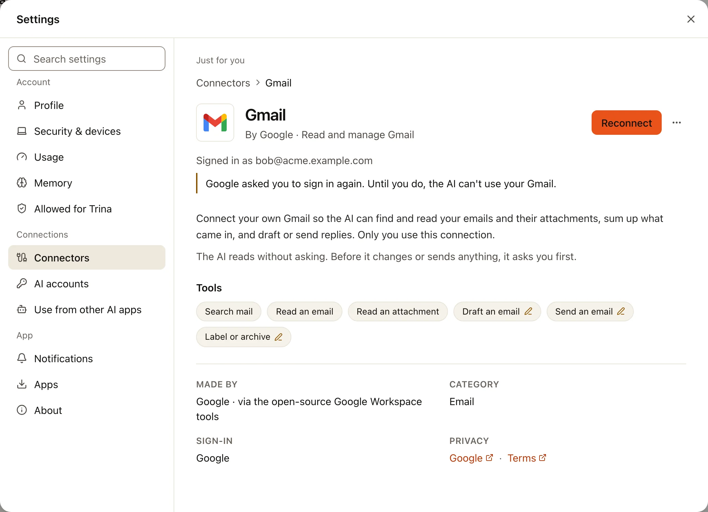

## Opcional: marcar la app como de confianza en la Admin console

Si su empresa limita qué apps pueden usar las cuentas de Google, un superadministrador de Google Workspace marca la app
como de confianza. Sin esto, las personas pueden ver `admin_policy_enforced` al conectar.

1. Busque el ID de cliente de la app. Está en el archivo JSON que descargó, después de `"client_id":`, y en la página
   del cliente en [Clients](https://console.cloud.google.com/auth/clients). Termina en `.apps.googleusercontent.com`.
2. Inicie sesión en la [Admin console](https://admin.google.com/) como superadministrador.
3. En el menú de la izquierda, abra **Security**, después **Access and data control** y después **API controls**.
4. Elija **Manage Third-Party App Access** y después **Configure new app**.
5. Pegue el ID de cliente en el cuadro de búsqueda y elija su app en la lista.
6. Elija a quién se aplica (normalmente a toda la organización), marque **Trusted** y termine con **Configure** (el
   último botón de Google; su nombre puede variar un poco).

## Lo que guarda Trina AX

- El ID y el secreto de la app se guardan en **un archivo privado en el servidor de su equipo**, que solo el servidor
  puede leer. Nunca se vuelven a mostrar: ni en la página, ni en un registro, ni en el registro de actividad.
- En un equipo alojado, **el servicio de alojamiento de Trina gestiona ese servidor**, así que también gestiona el lugar donde está ese
  archivo. El secreto por sí solo no abre nada: cada persona sigue iniciando sesión en Google y dando allí su
  consentimiento.
- Los inicios de sesión de Google de cada persona se siguen guardando sellados en el servidor, como antes.

## Volver al inicio de sesión de Trina

En cualquier página de Google, en **Ajustes del equipo › Inicio de sesión de Google**, abra ⋯ y elija **Volver al inicio
de sesión de Google de Trina**. Primero muestra las mismas cifras que **Antes de guardar**. Cuando confirme, las cinco
apps de Google vuelven a iniciar sesión a través de la app de Trina, las personas vuelven a conectar Google una vez y el
archivo de la app de la empresa se borra del servidor. Después puede eliminar el cliente en Google Cloud.

Si cambia la dirección de su equipo, la fila Inicio de sesión de Google lo indica. Añada las dos nuevas direcciones de
regreso al cliente en Google Cloud, descargue su archivo de nuevo y después abra ⋯ › **Reemplazar** en Trina AX: el cuadro
se abre en **En Google Cloud** con las direcciones nuevas para copiar. Hasta entonces, nadie puede conectar Google.

## Problemas

| Qué ve | Qué hacer |
|---|---|
| **`redirect_uri_mismatch`** en la página de Google | Falta una dirección de regreso en Google Cloud o difiere en una letra. Abra [Clients](https://console.cloud.google.com/auth/clients), elija su cliente y pegue de nuevo las dos direcciones desde el paso **En Google Cloud** del cuadro. Lo guardado puede tardar unos minutos en funcionar. |
| **"No se marcaron algunos permisos. Vuelva a conectar y deje todas las casillas marcadas."** | La persona desmarcó una casilla en la pantalla de Google, o falta un permiso en **Data access**. Compruebe que todo el bloque de arriba aparece allí y vuelva a conectar con todas las casillas marcadas. |
| **`admin_policy_enforced`** | La Admin console de su empresa bloquea la app. Márquela como de confianza (vea [más arriba](#opcional-marcar-la-app-como-de-confianza-en-la-admin-console)). |
| Se rechaza **una cuenta de fuera de la empresa** (Google dice que la app solo se puede usar dentro de su organización) | Eso es lo que significa **Internal**. Use una cuenta de su empresa. Las cuentas de Google compartidas también deben ser cuentas de la empresa. |

Todos los detalles para desarrolladores y operadores: [Google apps](../../../GOOGLE-APPS.md) (en inglés) y
[Google Drive](../../../GOOGLE-DRIVE.md) (en inglés).
