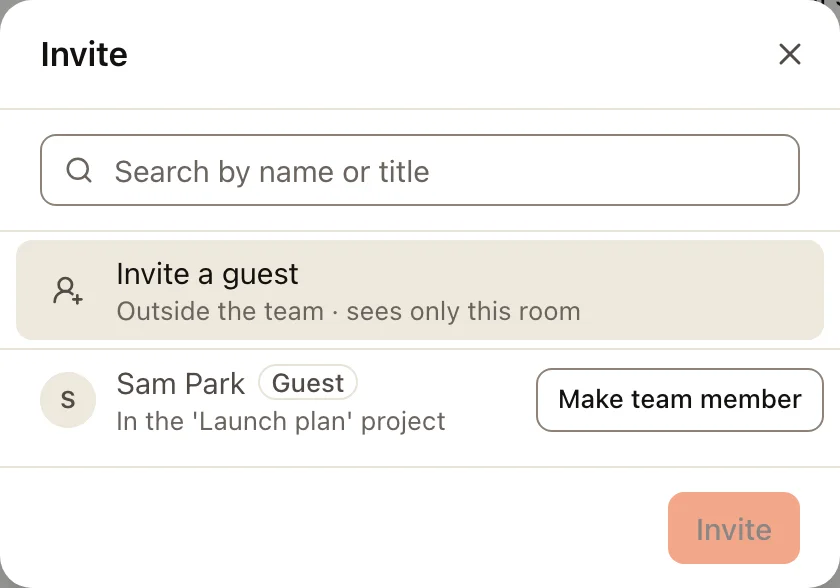
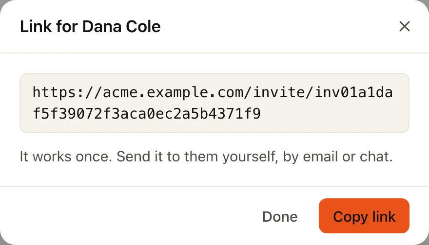
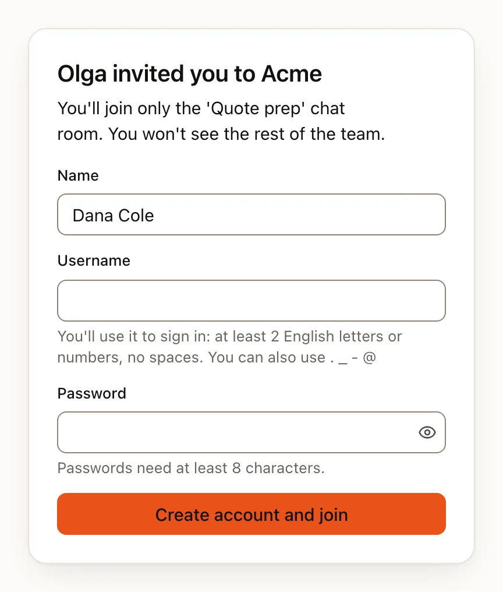

Un **invitado** es alguien de fuera de su equipo, como un cliente, un socio o un profesional independiente. Un invitado
está como máximo en un chat de grupo y en un proyecto, y no ve nada más del equipo: ni otros chats, ni archivos del
equipo, ni otros proyectos, ni habilidades del equipo. No ocupa una plaza de su plan.

| | Un miembro del equipo | Un invitado |
|---|---|---|
| **Adónde puede ir** | Todo lo que permiten sus grupos y sus permisos de carpetas | Un chat de grupo y un proyecto, como máximo |
| **Archivos del equipo** | Las carpetas que puede abrir | Solo los archivos de su proyecto (ninguno en un chat de grupo) |
| **IA** | Los ajustes de IA del equipo | Sin IA, salvo que se elija una IA para él |
| **Plaza** | Ocupa una | No ocupa ninguna |
| **Archivo más grande que pueden subir** | 1 GB en un chat, 20 GB en Archivos | 100 MB, salvo que un propietario o administrador lo suba a 1 GB en **Administración › Miembros e invitaciones**, encima de la lista **Invitados** |

Junto al nombre de un invitado verá una etiqueta **Invitado**, y un chat o proyecto con invitados lo indica arriba
("Incluye 1 invitado").

## Quién puede invitar a un invitado

- **A un chat de grupo:** cualquier persona de ese chat.
- **A un proyecto:** la persona que creó el proyecto, o un propietario o administrador.

No tiene que abrir antes el chat o el proyecto: **Nuevo mensaje** empieza con **Invitar a un invitado**, y los
propietarios y administradores también encuentran **Invitado** en **Invitar a personas** y en **Administración ›
Miembros e invitaciones › Invitar al equipo**. Vea [Sin abrir el chat ni el proyecto](#sin-abrir-el-chat-ni-el-proyecto)
y [Desde Administración](#desde-administración) más abajo.

Los invitados nunca están en los **Canales** (el canal Todos y los canales de cada grupo). Un invitado puede
enviar mensajes directos, pero solo a las personas de su propio chat o proyecto.

## Invitar a un invitado

:::steps
#### Abra la lista para añadir
En un chat de grupo, elija **⋯** arriba y después **Invitar personas** (o haga clic en el nombre del chat y después en
**Invitar personas**). En un proyecto, elija **Gestionar** junto a **Miembros** en la página del proyecto. La primera
fila es **Invitar a un invitado**.

#### Diga para quién es y elija su IA
Escriba el nombre de la persona en **¿Para quién es?**. En **IA para esta persona**, al principio está elegido **Sin
IA**. Las otras opciones se explican más abajo, en [La IA de un invitado](#la-ia-de-un-invitado).

#### Copie el enlace y envíelo usted mismo
**Crear enlace** crea un enlace para esta persona. Trina no envía ningún correo: elija **Copiar enlace** y envíeselo
usted, por correo o en un chat. El enlace funciona una vez, durante 7 días; el cuadro muestra la fecha y la hora en que
deja de funcionar.

:::

El enlace también aparece en **Administración › Miembros e invitaciones**, en **Enlaces de invitación**, con la etiqueta **Invitado** y el nombre de la persona, hasta que se usa o vence.

Un enlace solo funciona mientras la persona que lo creó todavía pueda invitar. Si sale del chat, pierde el proyecto, la quitan o (para **IA del equipo**) deja de ser administrador, el enlace deja de funcionar y sale de **Enlaces de invitación** en **Administración › Miembros e invitaciones**. Otra persona que pueda invitar crea un enlace nuevo.

### Sin abrir el chat ni el proyecto

- **Nuevo mensaje** (el **+** encima de sus conversaciones): la primera fila es **Invitar a un invitado**.
- **Invitar a personas** (propietarios y administradores: el menú del equipo debajo del logotipo del equipo, la
  búsqueda, o **Yo** en el teléfono): elija **Invitado** en la parte superior del cuadro (al principio está elegido
  **Miembro del equipo**).
- **Invitar a su equipo** (los primeros pasos y el objetivo del equipo en Inicio): debajo del mensaje, **Invitar a un
  invitado**.

Cada uno enumera el único lugar al que puede unirse el invitado: los chats de grupo en los que usted está y los proyectos
cuyos miembros puede cambiar (los que usted creó; propietarios y administradores: cualquier proyecto del equipo). Elija
uno y rellene el mismo cuadro de arriba. Si todavía no hay ningún chat o proyecto así, el cuadro lo indica. Si su plan no
tiene sitio para más invitados, lo indica en su lugar.

Sus propios proyectos de **Mis proyectos** también aparecen, marcados con **Solo yo**. Si elige uno, se comparte igual que
con **Añadir personas** en la página del proyecto, y el cuadro lo indica en una línea antes de **Crear enlace**:

- **Crear enlace** lo convierte en un proyecto del equipo. Hasta que el invitado se une, sigue siendo solo suyo y sigue en **Mis proyectos**.
- Cuando el invitado se une, pasa a **Proyectos del equipo**, con usted y el invitado como sus dos miembros.
- El invitado puede abrir y editar sus archivos. No ve sus chats, ni los anteriores ni los que empiece después.
- Igual que con **Añadir personas**, no se puede volver a que sea solo suyo.

Si su equipo solo deja compartir proyectos a los propietarios y administradores, los proyectos propios de un miembro no aparecen.

### Desde Administración

Los propietarios y los administradores pueden invitar a un invitado sin abrir antes el chat o el proyecto. En
**Administración › Miembros e invitaciones**, elija **Invitar al equipo** y después **Invitado** en la parte superior del
cuadro (al principio está elegido **Miembro del equipo**). Elija el único lugar al que se une el invitado: un chat de
grupo en el que usted está, un proyecto del equipo o uno de sus propios proyectos (compartido como se explica arriba).
Después rellene el mismo cuadro de arriba: su nombre, su IA, **Crear enlace** y **Copiar enlace**. Si su plan no tiene
sitio para más invitados, el cuadro lo indica en lugar de enumerar lugares.

## Lo que ve el invitado

El enlace abre una página que dice quién le invitó y el único chat o proyecto al que se unirá. Elige un nombre de
usuario y una contraseña, y ya está dentro. Si usted eligió **Su propio inicio de sesión**, la página también le dice que conectará su propia cuenta de Claude o ChatGPT. Si el enlace ya no funciona, la página explica por qué: venció, ya se
usó, se desactivó, la persona que lo creó ya no puede invitarle, o el chat o el proyecto ya no existe.

Cuando inicia sesión, Trina abre su chat o proyecto. La barra de la izquierda solo tiene lo que puede usar: no hay
**Archivos**, ni proyectos o canales del equipo, ni **Trina** cuando su IA está desactivada. Su **Configuración** solo
tiene sus propias cosas, como su perfil y sus notificaciones.

En un proyecto, los miembros del proyecto pueden ver los chats que tiene allí un invitado. A un invitado que puede usar IA se le avisa de esto en la página del proyecto.

Los invitados no reciben ni comparten enlaces de archivos. Para darle un archivo a un invitado, publíquelo en su chat de grupo o en su proyecto.

## Un chat de grupo y un proyecto

Un invitado puede estar en un chat de grupo y en un proyecto a la vez, nunca en más. Una invitación abre un solo lugar.
Para llevar a un invitado a su segundo lugar, añádalo como a cualquier otra persona: desde **Invitar personas** en el chat
de grupo, o desde **Miembros** en el proyecto. Trina no le deja añadir a un invitado a un segundo chat de grupo ni a un
segundo proyecto. En una lista para añadir, un invitado que ya está en otro lugar del mismo tipo no se puede marcar y
muestra dónde está (solo el nombre de un lugar en el que usted también está).

Un invitado que está en los dos ve a las personas de ambos: puede escribir a cualquiera de su chat de grupo o de su
proyecto, y a nadie más. Cada lado ve al invitado; quienes solo están en el chat de grupo no ven el nombre del proyecto,
y al revés.

Si la persona necesita más de un chat de grupo o proyecto, un propietario o administrador puede elegir **Hacer miembro
del equipo** (vea abajo).

Si un invitado sale, lo sacan, o su chat o proyecto se cierra, deja de estar en ese lugar. Puede seguir iniciando sesión
mientras esté en su otro lugar. Fuera de todos sus lugares, ya no puede iniciar sesión, igual que cuando se le quita. Un
proyecto en la papelera sigue siendo suyo: mientras esté allí, no puede unirse a otro proyecto.
Al mover a la papelera un proyecto con invitados, se avisa antes de que confirme. Si su proyecto vuelve de la papelera, puede volver a iniciar sesión por sí mismo, salvo que un propietario o
administrador lo haya activado o desactivado mientras tanto. Cambiar el nombre del chat o del proyecto no cambia nada para él.

## La IA de un invitado

| Opción | Qué significa | Quién puede elegirla |
|---|---|---|
| **Sin IA** (la predeterminada) | Solo habla con personas. | Cualquiera que invite |
| **IA del equipo** | Usa una de las cuentas de IA del equipo, hasta un importe mensual en dólares estadounidenses que usted fija. | El propietario y los administradores |
| **Su propio inicio de sesión** | Conecta su propia cuenta de Claude o ChatGPT en **Configuración › Proveedores de IA** y usa esa. Es su propio plan, así que el equipo no paga nada. | Cualquiera que invite |

Cuando un invitado agota su importe mensual, se le indica el día en que vuelve a empezar. Si se elimina la cuenta de IA
del equipo que usa un invitado, el invitado lee que la IA no puede responderle ahora, y su fila en **Administración ›
Miembros e invitaciones** indica que se quitó la cuenta: elija **Cambiar IA** para elegir otra.

:::note
Si su equipo usa Trina AX en un Mac de la oficina que se instaló sin contraseña de administrador, los invitados no pueden
usar IA allí: la única opción es **Sin IA**. Instalarlo con el instalador de administrador (.pkg) hace posibles las demás
opciones.
:::

## Planes y límites

Los invitados no ocupan plazas. Cada plan permite un número de invitados a la vez:

| Plan | Invitados |
|---|---|
| Prueba gratuita | 10 |
| Starter | 10 |
| Team | 30 |
| Business | 100 |
| Su propio servidor (autoalojado) | Sin límite |

**Administración › Miembros e invitaciones** muestra cuántos invitados tiene junto a **Invitados**, por ejemplo "3 de 10
invitados". Cuando el plan está completo, el cuadro de invitación lo indica antes de que rellene nada. Quitar a un
invitado que ya no necesita libera un lugar.

Si su plan cambia a uno con menos invitados de los que tiene, no se quita a nadie: todos los invitados siguen
funcionando. La cifra se pone naranja con una nota breve, y las invitaciones nuevas esperan hasta que quite invitados o
cambie de plan.

## Gestionar invitados (propietarios y administradores)

**Administración › Miembros e invitaciones** tiene una lista **Invitados**. Para ver solo a los invitados, elija **Invitados** en la lista de roles de arriba. Cada fila
muestra dónde está el invitado y qué IA tiene.

El menú **⋯** de un invitado tiene:

- **Cambiar IA**: elegir de nuevo Sin IA, IA del equipo o su propio inicio de sesión.
- **Hacer miembro del equipo**: pasa a ser un miembro normal y ocupa una plaza. Se queda donde está, y usted puede
  añadirlo a más chats y proyectos. Su IA de invitado y su importe mensual terminan: su IA sigue entonces los ajustes del
  equipo, como la de cualquier miembro. Un invitado quitado al que se hace miembro del equipo puede volver a iniciar sesión.
- **Quitar invitado**: su cuenta se desactiva y ya no puede iniciar sesión. Sus mensajes y archivos se quedan en el
  equipo. Los invitados quitados se ocultan detrás de **Mostrar quitados**.

El menú **⋯** de un invitado quitado tiene **Volver a activar** mientras su chat o proyecto siga ahí para él, y después
**Hacer miembro del equipo** y **Eliminar**. Cuando no hay nada a lo que devolverlo, su fila explica por qué (salió, su
proyecto está en la papelera, o el chat o el proyecto ya no existe): invítelo de nuevo o hágalo miembro del equipo. Cuando su proyecto está en la papelera, **Restaurar proyecto** en su fila lo recupera, y a él con el proyecto, mientras el plan tenga sitio para otro invitado.
