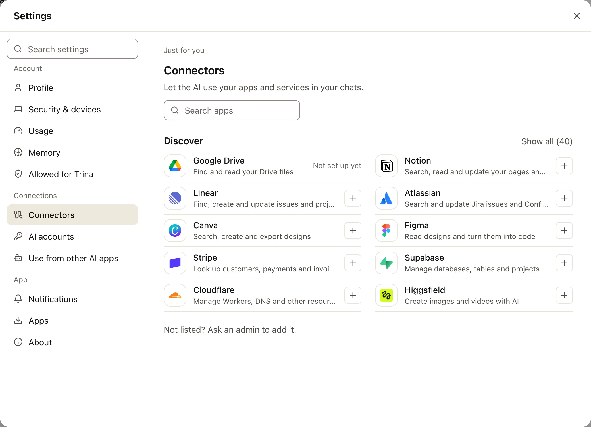
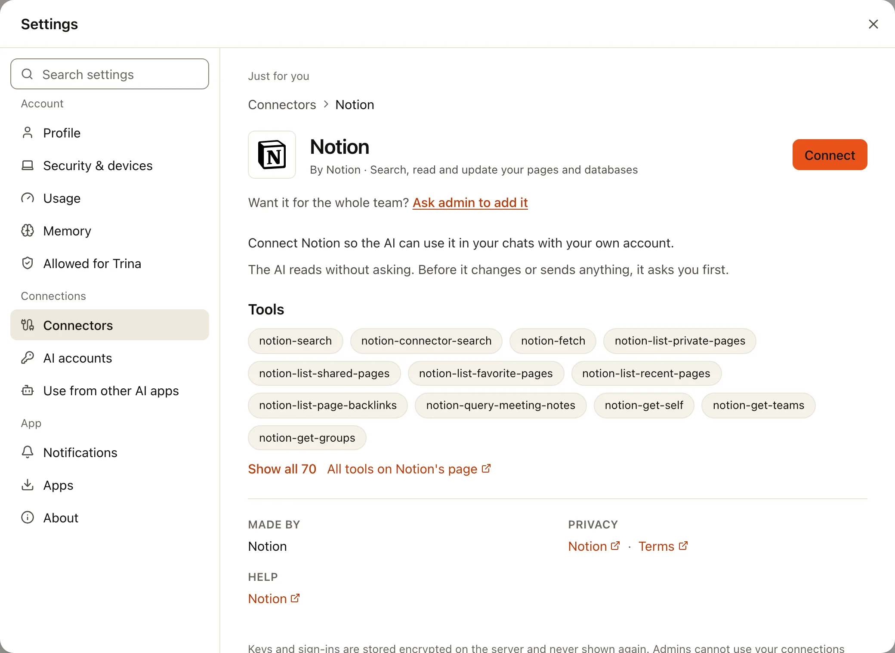
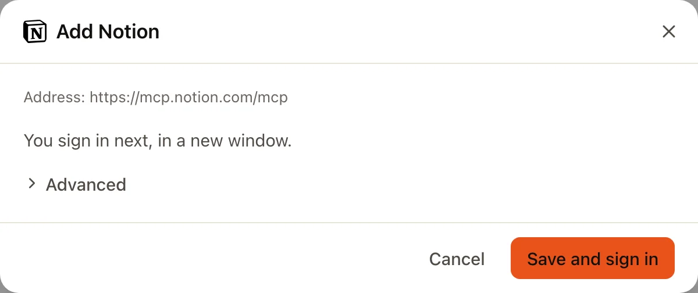
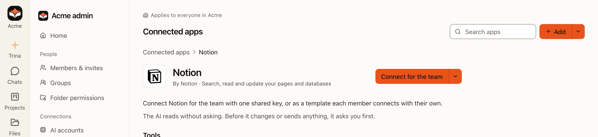

La IA puede usar por usted apps que están fuera de Trina AX: buscar en sus páginas de Notion, abrir una incidencia de
Linear, leer un ticket de Jira. Cada app se conecta una vez. Para la mayoría no hay nada que copiar: usted inicia sesión
en la propia página de la app. Algunas apps, como GitHub, le dan en cambio una clave.

:::note
Antes de la versión 0.4.0, esta pantalla se llama **Servicios externos** (External services). Estas conexiones usan MCP,
una forma habitual de que las apps ofrezcan herramientas a una IA; no necesita saber más para usarlas.
:::

## Cómo se conecta su app

| App | Qué necesita | Guía |
|---|---|---|
| Notion, Linear, Atlassian (Jira, Confluence), Figma, Canva, Stripe, Supabase, Cloudflare, Higgsfield y las demás apps de **Descubrir** | Su cuenta en esa app. Nada que copiar | [Iniciar sesión en una app de Descubrir](#iniciar-sesión-en-una-app-de-descubrir) |
| GitHub | Su cuenta de GitHub. Nada que copiar | [GitHub](#github) |
| Otra app que publica una dirección de "MCP server" | La dirección, y una clave si la app la pide | [Añadir una app por su dirección](#añadir-una-app-por-su-dirección) |
| El sistema propio de su empresa (una API) | Una dirección, una clave y notas | [La API de su empresa](api-connections.md) |
| Google Drive, Gmail, Calendar, Docs, Sheets | Su cuenta de Google | [Apps de Google](google-apps.md) |
| Slack | Nada para los miembros; un administrador lo añade una vez | [Slack](slack.md) |

## Para usted o para el equipo

| | Para usted | Para el equipo |
|---|---|---|
| Dónde | **Configuración › Conectores** | **Administración › Apps conectadas** (propietarios y administradores) |
| Qué cuenta usa la IA | La suya | La cuenta que inició sesión, o la clave que se guardó |
| Quién la usa | Solo usted, en sus propios chats | Todos, o los grupos o personas que elige el administrador |
| Quién la ve | Solo usted, no los administradores | Los administradores |

Una conexión del equipo inicia sesión **una vez, como una sola cuenta**: todas las personas para las que es actúan como
esa cuenta en la app. Si cada persona debe actuar como ella misma (sus propias páginas de Notion, sus propios permisos de
GitHub), cree en su lugar una [plantilla](#plantillas-cada-miembro-usa-su-propia-clave), o deje que cada persona la
conecte para sí misma.

## Iniciar sesión en una app de Descubrir

:::tip
**Qué necesita**

- Una cuenta en la app (Notion, Linear …), con la sesión iniciada en su navegador.
- Nada que copiar ni pegar: Trina AX rellena la dirección oficial de la app.
:::

:::steps
#### Abra Conectores
Elija su foto en la parte inferior de la barra de la izquierda y después **Configuración › Conectores** (en el teléfono,
la pestaña **Yo**). **Descubrir** enumera las apps que puede conectar. **Ver todos** las muestra todas; **Buscar apps**
encuentra una por su nombre.

#### Abra la app y elija Conectar
La página de la app explica qué puede hacer la IA allí y enumera sus herramientas. Elija **Conectar** (o el **+** de la
lista). Un miembro también ve **Pedir que lo añadan**, para pedirla para todo el equipo.

#### Guardar e iniciar sesión
El cuadro muestra la dirección oficial de la app. Deje **Avanzado** como está y elija **Guardar e iniciar sesión**.

#### Permita el acceso en la página de la app
Se abre una ventana nueva en la propia página de la app (Notion, Linear …). Inicie sesión si se lo pide, elija el espacio
de trabajo y elija **Allow** (el botón también puede llamarse **Continue** o **Accept**). La ventana se cierra y
Trina AX indica **Sesión iniciada.** La app sube a **Sus conectores** con **Conectado**.
:::

Para el equipo, un administrador hace lo mismo en **Administración › Apps conectadas**:

1. Elija el logotipo de su equipo en la parte superior de la barra de la izquierda, después **Administración › Apps
   conectadas**, y abra la app en **Descubrir**.
2. Elija **Conectar para el equipo**. (La flecha que hay al lado ofrece en su lugar **Como plantilla: cada miembro
   conecta**: vea [Plantillas](#plantillas-cada-miembro-usa-su-propia-clave)).
3. El cuadro muestra la dirección de la app y una línea **Para: Todo el equipo**. Para elegir grupos o personas, elija
   **Cambiar** en esa línea.
4. Elija **Guardar e iniciar sesión**, después inicie sesión en la página de la app con la cuenta que compartirá el
   equipo y permita el acceso, como arriba. La app sube a **Conectados**.

El inicio de sesión tiene que hacerse en un ordenador, en un navegador o en la app de escritorio. Una vez conectada,
también funciona en su teléfono.

## GitHub

GitHub se conecta iniciando sesión, como las otras apps de Descubrir: no hay ningún token que crear ni copiar. Usa la GitHub App que tiene el servidor, así que cada persona inicia sesión en GitHub con su propia cuenta y elige qué repositorios puede ver la IA. En un equipo alojado por Trina ya está listo. En un servidor que usted mismo administra, quien lo opera añade antes la GitHub App; hasta entonces la página de GitHub dice "GitHub aún no está configurado en este servidor".

:::tip
**Qué necesita**

- Su cuenta de GitHub, con la sesión iniciada en el navegador.
:::

:::steps
#### Elija Conectar
Abra GitHub en **Descubrir** y elija **Conectar**. Se abre la página de GitHub (en la app de escritorio, en su navegador).

#### Elija los repositorios
GitHub pregunta qué repositorios puede abrir la app. Elija solo los que la IA necesita: solo verá esos.

#### Terminar
De vuelta en Trina AX, la línea muestra **Conectado**. La IA pregunta antes de cambiar algo, y puede elegir **Permitir siempre**.
:::

Para todo el equipo, un administrador conecta GitHub para el equipo y elige quién puede usarlo, o crea una [plantilla](#plantillas-cada-miembro-usa-su-propia-clave) para que cada persona inicie sesión con su cuenta.

## Añadir una app por su dirección

Se puede añadir cualquier app que publique una dirección de "MCP server", aunque no esté en Descubrir. Los propietarios y
los administradores la añaden en **Administración › Apps conectadas** › **Añadir por su dirección**. Un miembro ve "¿No
aparece? Pida a un administrador que lo añada."

:::tip
**Qué necesita**

- **Dirección**: en las páginas de ayuda de la app, normalmente una página llamada "MCP", "MCP server" o "Connect to AI
  tools". Empieza por `https://` y a menudo termina en `/mcp`.
- Cómo inicia sesión la app: en su propia página (**Iniciar sesión (OAuth)**), con una clave (**Clave de API**) o sin
  inicio de sesión (**Ninguno**).
- Para una clave: la **Clave**, de la configuración de la app ("API keys", "Tokens", "Developer"), y el **Nombre del
  encabezado** si la ayuda de la app indica uno, como `X-API-Key`.
:::

Los campos del cuadro:

| Campo | Qué poner |
|---|---|
| **Nombre** | El nombre que las personas ven en los chats, como "GitHub". |
| **Dirección** | La dirección MCP de la app. Empieza por `https://`. |
| **Quién conecta** (Avanzado) | **Una para el equipo**, o **Cada miembro la suya**. |
| **Tipo** (Avanzado) | **Servidor MCP**. Elija **API** solo para una API web simple: vea [La API de su empresa](api-connections.md). |
| **Método de inicio de sesión** (Avanzado) | **Iniciar sesión (OAuth)**, **Clave de API** o **Ninguno**, según diga la ayuda de la app. |
| **Encabezado para la clave** | Deje **Authorization: Bearer (predeterminado)**, salvo que la ayuda de la app indique otro encabezado. En ese caso elija **Otro encabezado** y escriba exactamente su **Nombre del encabezado**. |
| **Clave** | La clave, pegada entera. No podrá verla de nuevo después de guardar. |
| **Iniciar sesión con mi propia aplicación** (Avanzado) | Solo para apps que le piden crear su propia app de inicio de sesión, como los servidores MCP de Google. Vea [Iniciar sesión con su propia app](api-connections.md#iniciar-sesión-con-su-propia-app). |
| **Escritura, eliminación y envío** (Avanzado) | Si la IA pregunta primero (vea abajo). |

:::warning
Ponga la clave en el campo **Clave**, nunca en la dirección (`…?key=…`). Las personas que usan una conexión del equipo
pueden ver su dirección, y la IA la lee.
:::

## Los cambios necesitan un sí

Las lecturas se ejecutan enseguida. Todo lo demás es una escritura, y sigue el ajuste **Escritura, eliminación y envío**
de la conexión:

| Ajuste | Qué pasa |
|---|---|
| **Preguntar cada vez** (predeterminado) | Trina AX muestra una tarjeta con todo lo que se va a enviar. No sale nada hasta que una persona dice que sí. |
| **Bloquear escritura** | Solo consultas; las escrituras se rechazan. |
| **Ejecutar sin preguntar** | Las escrituras se ejecutan sin preguntar. Solo los administradores pueden elegirlo, y solo para conexiones del equipo. |

Quien gestiona una conexión también puede desactivar herramientas sueltas en su página. Lo que devuelve una app se trata
como datos externos, nunca como instrucciones. En una tarea programada nadie puede decir que sí, así que las escrituras
se rechazan, salvo en una conexión del equipo con **Ejecutar sin preguntar** permitida en la tarjeta de la tarea.

## Plantillas: cada miembro usa su propia clave

Muchas apps dan a una clave los permisos de su titular y registran cada llamada a nombre de esa persona. Para esas apps,
un administrador añade una **plantilla**: la app se registra una vez, y cada miembro la conecta con su propia clave o su
propio inicio de sesión.

:::steps
#### Añada una plantilla
En **Administración › Apps conectadas**, elija **Añadir por su dirección** (o, en la página de una app, la flecha junto a **Conectar para el equipo** › **Como plantilla: cada miembro conecta**). En **Avanzado**, ponga **Quién conecta** en **Cada miembro la suya**. Rellene la
dirección, el método de inicio de sesión y para quién es. No hay campo de clave, y la dirección no puede tener una parte
`?…`: una clave ahí llegaría a todos los miembros. Use **Nota para los miembros (opcional)** para indicar a las personas
dónde conseguir su clave.

#### Los miembros conectan
Los miembros para los que es reciben un aviso en **Actividad** y la ven en **Configuración › Conectores**, en **Sus
conectores**, con una etiqueta **Equipo** y **Conectar**. Escriben su propia clave o inician sesión. Se convierte en su
propia conexión, que solo se usa en sus chats.
:::

| | Conexión del equipo (una clave) | Plantilla |
|---|---|---|
| Clave | Una, añadida por el administrador | La de cada miembro |
| Con qué permisos actúa la IA | Los del titular de la clave, para todos | Los de cada miembro |
| Qué ve el administrador | La conexión | Quién la conectó y cuándo, y qué clave dejó de funcionar; nunca una clave |

En la línea de la plantilla en Administración › Apps conectadas, **Plantilla · N conectados** abre para quién es:
**Conectado**, **Sin conectar** o **La clave dejó de funcionar**. Una tarea programada que necesita una plantilla no se
ejecuta sin su propia clave: su resultado dice "Necesita su propia clave para …" y enlaza con **Conectar**.

Un miembro solo puede cambiar su clave o su inicio de sesión y el ajuste de escritura, y puede desconectarse en cualquier
momento. Si el administrador cambia la dirección o el método de inicio de sesión de una plantilla, se borra la clave de
todos los miembros y vuelven a conectar; un nombre o una nota nuevos mantienen conectados a todos. Al eliminar la
plantilla, o quitar a alguien de ella, se borran sus conexiones.

## Pedir a un miembro que conecte

Un administrador también puede enviar a un miembro una solicitud con la app ya rellenada: **Administración › Apps
conectadas** › la flecha junto a **Añadir** › **Pedir a un miembro que conecte**. El miembro recibe un aviso y conecta
con su propia clave, o rechaza. El administrador nunca ve la clave.

## Conectar desde un chat

También puede pedirlo en un chat: "Conecta Linear." La IA rellena la dirección oficial de la app y muestra una tarjeta.
Usted solo inicia sesión o pega la clave en la tarjeta. La clave nunca llega a la IA.

Si la dirección no está en la lista de apps de Trina AX, la tarjeta lo indica junto a la dirección. Antes de conectar,
compruebe que coincide con la de la documentación oficial de la app.

## Problemas

| Qué ve | Qué hacer |
|---|---|
| **Se requiere iniciar sesión** | El inicio de sesión terminó o la clave se revocó en la app. Abra la conexión y elija **Volver a iniciar sesión**, o **Reemplazar clave**. |
| **El inicio de sesión aún no ha terminado.** | La ventana de inicio de sesión se cerró o está detrás de otra ventana. Elija **Abrir ventana de inicio de sesión**, o cancele y vuelva a intentarlo. |
| **El inicio de sesión se detuvo en el servicio.** | Eligió Cancel o Deny en la página de la app. Vuelva a iniciar sesión y permítalo. |
| **No se pudo comprobar la conexión.** con "401" o "unauthorized" en el motivo | La clave es incorrecta, caducó o se copió con un espacio. Cópiela de nuevo con el botón de copiar de la app. Para un encabezado distinto de Bearer, revise el **Nombre del encabezado** letra por letra. |
| **El servicio no indicó ninguna herramienta.** | La dirección no es una dirección MCP (a menudo se pegó la página de inicio de la app). Use la dirección de la página de ayuda MCP de la app. |
| Un miembro no encuentra la app | Los miembros solo conectan apps desde **Descubrir**. Pida a un administrador que la añada por su dirección, o como plantilla. |

## En la otra dirección

Su propio Claude (Claude Code, Claude Desktop o claude.ai) puede conectarse **a** Trina AX y usar sus archivos con sus
permisos. [Más información sobre el conector MCP de Trina AX](../../agents/mcp-connector.md) (en inglés).

Todos los detalles para desarrolladores: [Integrations](../../../INTEGRATIONS.md) (en inglés).
