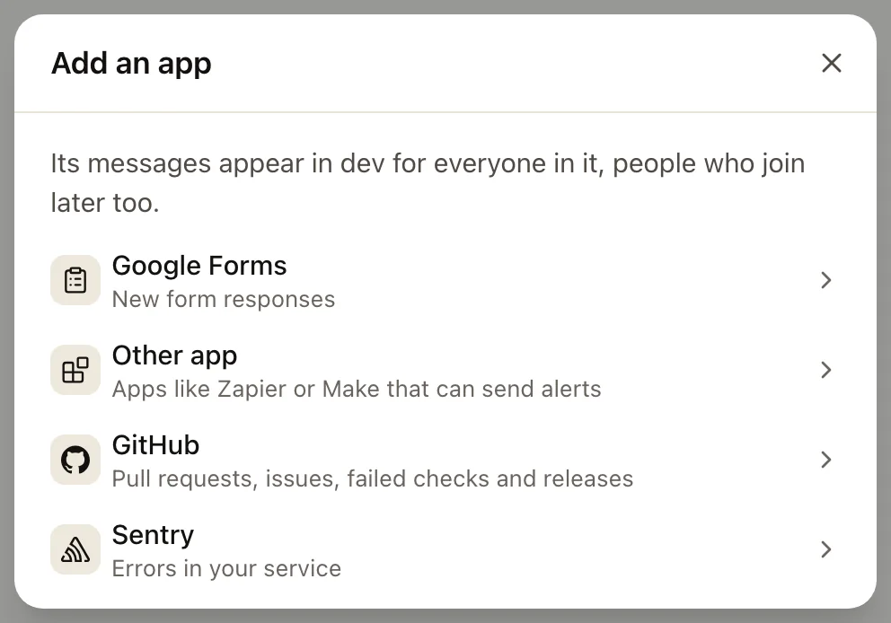
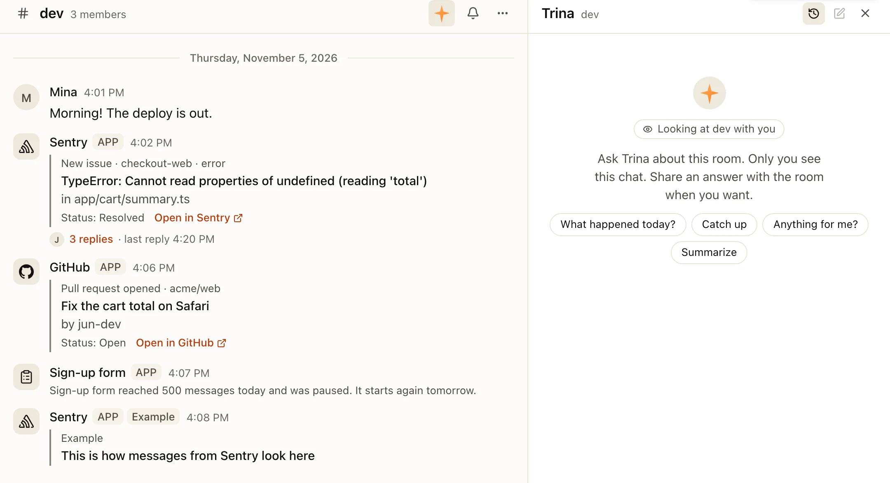
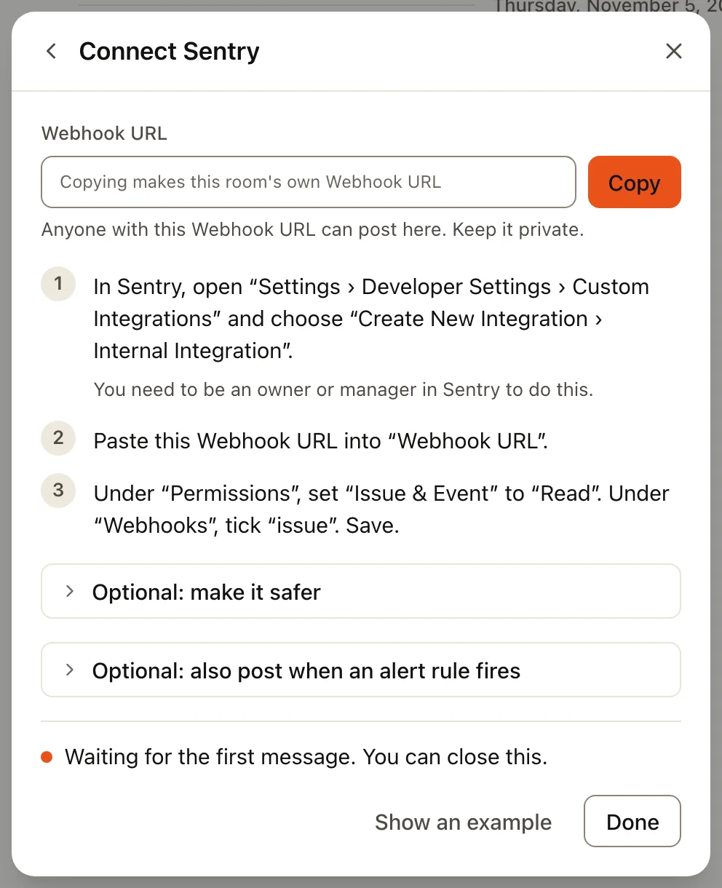

Una conversación puede recibir novedades de los servicios que su equipo ya usa: respuestas nuevas de **Formularios de Google**, errores de
**Sentry**, pull requests y comprobaciones fallidas de **GitHub**, o cualquier otra cosa que pueda enviar un mensaje a un Webhook URL.
Llegan como tarjetas de la app, con su logotipo y la etiqueta **APP**, nunca como una persona. Las repeticiones de lo mismo (el
mismo error, el mismo pull request, una respuesta editada) van a un único hilo bajo la primera tarjeta, y la línea de estado de la
primera tarjeta cambia a medida que avanzan las cosas.

## Añadir una app

1. Abra la conversación y luego **⋯ › Añadir una app**.
2. Elija un servicio. Están agrupados: **Formularios** (Formularios de Google, Typeform, Tally, Jotform), **Pagos y pedidos**
   (Stripe, Shopify), **Trabajo** (Notion, Zendesk, Jira, HubSpot) y **Para desarrolladores** (GitHub, Sentry). **Mostrar más
   servicios** abre algunos más (Toss Payments, Channel Talk, PortOne). **Otra app**, al final, sirve para cualquier otro. Un servicio que necesita un plan o un rol lo indica en su fila (por ejemplo *Necesita: un plan de pago de Notion*).
   Una Otra app recibe primero un nombre (por ejemplo *Avisos de copia de seguridad*): sus mensajes aparecen con ese nombre.
3. Pulse **Copiar** junto al Webhook URL (Formularios de Google: **Copiar código**) y siga los pasos numerados en ese servicio.
   No se añade nada a la conversación hasta que copia, así que puede mirar primero y cerrar la guía.
4. La guía muestra en directo lo que ocurre: *Esperando el primer mensaje*, *Conectado* o por qué no se mostró el último intento.
   Si pasan dos minutos sin nada, **¿Aún no llega nada?** muestra los errores habituales de ese servicio y cómo enviar una prueba.
   **Ver un ejemplo** muestra, dentro de la guía, cómo se verán sus mensajes. No se publica nada.

También puede empezar desde **Configuración › Conectores**. Sentry, Notion, Stripe y Atlassian (para Jira) tienen
**Añadir a una conversación** debajo de su fila. Solo muestra las conversaciones donde usted puede añadir
apps; elija una y se abre con la guía de ese servicio. Si aún no tiene ninguna, empiece una con **Nuevo mensaje**.



Quién puede hacerlo: en un canal (incluido el canal Todos), sus propietarios y administradores; en un mensaje directo (chat 1:1 o de grupo), cualquiera que esté en él.
Las demás personas de la conversación ven las tarjetas, responden en sus hilos y preguntan a Trina sobre ellas. Al tocar el nombre de la app
se ve quién la configuró.

Todos los que están en la conversación ven los mensajes de una app, también quienes se unan más tarde. Elija la conversación con cuidado: un informe de errores o una
respuesta de formulario pueden contener datos de clientes.

### En la conversación

Cada novedad es una tarjeta con el nombre de la app, la etiqueta **APP**, lo que ocurrió, una línea de estado y un enlace para abrirla en
el servicio. Las respuestas van al hilo de la tarjeta, como con cualquier mensaje. El chat lateral **✦** de la conversación ofrece **¿Qué pasó
hoy?** (en las conversaciones de Formularios de Google, también **Resumir las respuestas de hoy**), que resume los mensajes de las apps empezando por lo que necesita a alguien; en un hilo ofrece **Resumir este
hilo**.



### Formularios de Google

Formularios de Google no tiene dónde pegar un URL, así que Trina le da un script corto para el formulario
([activadores de Apps Script](https://developers.google.com/apps-script/guides/triggers/installable)).

- En el formulario abra **⋮ › Apps Script**, borre lo que haya, pegue el código y guarde.
- Elija **setUp** arriba y pulse **Ejecutar**. Google muestra **Google hasn't verified this app**: es lo esperado, porque
  el script es suyo y solo se ejecuta en su cuenta. Elija **Advanced › Go to … (unsafe)** y luego permita el acceso.
- Si el formulario recoge direcciones de correo, cada respuesta muestra el correo de quien responde. Desactive **Correo de quien responde** en
  la configuración de la app para dejarlo fuera. Cualquiera que pueda editar el formulario puede ver el código.

### Formularios, pagos y herramientas de trabajo

Typeform, Tally, Jotform, Stripe, Shopify, Notion, Zendesk, Jira y HubSpot tienen cada uno su propia guía con los pasos
en ese servicio, con los nombres que usa ese servicio. En resumen:

- **Typeform**: en el formulario, **Connect › Webhooks › Add a webhook**, pegue y guarde, y luego actívelo (su interruptor empieza
  desactivado y solo funciona después de guardar).
- **Tally**: en el formulario, **Integrations › Webhooks › Connect**, pegue en **Endpoint URL**.
- **Jotform**: en el formulario, **Settings › Integrations**, busque **WebHooks**, pegue el Webhook URL y luego pulse
  **Complete Integration** y **Finish** (ambos botones solo funcionan cuando el URL ya está puesto; no pulse **Add New Web Hook**).
- **Stripe** (rol Admin o Developer): **Developers › Workbench › Webhooks › Create an event destination**, marque los
  eventos que indica la guía, elija **Webhook endpoint** y pegue en **Endpoint URL**.
- **Shopify** (propietario de la tienda o personal con acceso a la configuración): **Settings › Notifications › Webhooks › Create webhook** para
  **Order creation**; si quiere, otra vez para Order payment, Order cancellation y Refund create.
- **Notion** (plan de pago): en la base de datos, **Automations**, acción **Send webhook**; marque al menos el título y Status.
- **Zendesk** (plan Team o superior, administrador): cree un webhook y luego un trigger que envíe el cuerpo que le da la guía
  (**Copiar cuerpo**, en ese paso).
- **Jira** (administrador del espacio): en el espacio, **Space settings › Automation › Create flow**, trigger **Work item created**,
  acción **Send web request** con el cuerpo que le da la guía (**Copiar cuerpo**). Un segundo y un tercer flujo opcionales para
  **Work item transitioned** y **Work item commented** ponen los cambios de estado y los comentarios en el hilo del elemento de trabajo
  ([acciones de automatización de Jira](https://support.atlassian.com/cloud-automation/docs/jira-automation-actions/)).
- **HubSpot** (Data Hub Professional o Enterprise): un workflow basado en negocios con la acción **Data ops › Send a
  webhook**, **Customize request body** con las claves que indica la guía; si quiere, uno para contactos y otro para tickets
  ([workflows de HubSpot](https://knowledge.hubspot.com/workflows/how-do-i-use-webhooks-with-hubspot-workflows)). Un
  contacto muestra su nombre y su empresa, nunca su correo ni su teléfono.

Las respuestas de formularios aparecen en la conversación tal como se dieron, también las direcciones de correo; de los archivos subidos solo se muestra el nombre (Formularios
de Google: solo cuántos son, así que el script no necesita acceso a su Drive). Las tarjetas de pagos
y pedidos muestran el nombre del cliente (y la ciudad en Shopify), nunca su correo, su teléfono ni su tarjeta.

Stripe, Shopify, Zendesk, Typeform y Tally pueden firmar lo que envían. **Opcional: hacerlo más seguro** en la guía recibe el
secreto de firma del servicio (o le da uno para pegar allí); a partir de entonces solo se muestran los mensajes firmados. Un secreto que le da
Trina (Typeform, Tally, GitHub) empieza a aplicarse con el primer mensaje firmado con él (Tally rellena un secreto propio
en **Add a signing secret**: sustitúyalo por el de Trina): hasta entonces, los mensajes sin él se siguen
mostrando, así que no se pierde nada antes de pegarlo en el servicio. Jira y HubSpot
no pueden firmar: su Webhook URL es la única clave, así que manténgalo en privado.

### Más servicios

**Mostrar más servicios** en el selector abre servicios que se usan sobre todo en Corea. La misma lista aparece para todos.

- **Toss Payments**: en el centro para desarrolladores, **웹훅 › 웹훅 등록하기** (Webhooks › Register webhook), pegue el Webhook URL y marque
  **PAYMENT_STATUS_CHANGED** ([webhooks de Toss Payments](https://docs.tosspayments.com/guides/v2/webhook)). Las tarjetas muestran
  el importe, el nombre del pedido y el método de pago; nunca un número de tarjeta, una cuenta ni un teléfono. Opcional: la
  clave de seguridad del centro para desarrolladores (**API 키 › 보안 키**, API keys › Security key).
- **Channel Talk**: **Settings › Webhook › Create new webhook**, pegue el Webhook URL y active las notificaciones de chats y
  mensajes ([webhooks de Channel Talk](https://developers.channel.io/en/articles/Webhook-events-7bd9b8e2)). Un chat
  nuevo muestra el nombre del cliente y su primer mensaje; sus mensajes posteriores (y, si lo activa, las respuestas de su equipo)
  van a su hilo. Los chats de grupo internos del equipo nunca se muestran. Opcional: el token del webhook.
- **PortOne** (V2): **결제 연동 › 연동 관리 › 결제알림(Webhook) 관리** (Payment integration › Integration settings ›
  Payment notifications), versión del webhook **결제모듈 V2** (Payment module V2), pegue el Webhook URL
  ([webhooks de PortOne](https://developers.portone.io/opi/ko/integration/webhook/readme-v2)). PortOne solo envía el
  identificador y el estado del pago, así que sus tarjetas no muestran importe ni nombre. Opcional: el secreto del webhook (**웹훅 시크릿 발급**,
  Issue webhook secret).

### Otras apps

Una herramienta que pide un **Slack, Discord or JANDI webhook URL** (URL de webhook de Slack, Discord o JANDI) puede publicar aquí: pegue el Webhook URL de Trina en ese campo.
Las herramientas que no tienen ninguno de los dos se pueden conectar a través de Zapier o Make; **¿No ve su app?** en la guía explica un
ejemplo de cada uno.

Funciona cualquier cosa que pueda enviar un mensaje a un Webhook URL (Zapier, Make, Grafana, Uptime Kuma, sus propios scripts). Pegue
el Webhook URL donde el servicio envía los mensajes y envíe una prueba. La guía y la configuración de la app muestran **Cómo enviar**
con un ejemplo para copiar:

```json
{ "text": "Backup finished: 1,204 files", "title": "Nightly backup", "url": "https://example.com/report", "thread": "nightly-backup" }
```

- `text` es el mensaje y el único campo necesario (`content` también funciona).
- `title` añade un encabezado, `url` un enlace, y los mensajes con el mismo `thread` van a un único hilo.
- También se aceptan mensajes al estilo de Slack (`blocks`, `attachments`), texto sin formato y un envío de formulario simple (`text=…`, los mismos campos; o el campo
  `payload` de Slack). Un encabezado `Idempotency-Key` hace que un
  reintento se publique una sola vez.

```bash
curl -X POST -H 'Content-Type: application/json' -d '{"text":"Hello from my app"}' <Webhook URL>
```

Una **Otra app** muestra la primera letra de su nombre sobre su propio color, así que dos de ellas en una conversación no se ven iguales. Para ponerle una imagen, abra su configuración y elija **Cambiar el icono**: **Subir una imagen** (PNG, JPEG o WebP; se recorta en cuadrado) o **Elegir un emoji**. **Quitar el icono** vuelve a la letra. El icono aparece en todos los mensajes de la aplicación, también en los anteriores. Un mensaje no puede cambiar el nombre ni el icono de la aplicación: campos como `username`, `icon_url` e `icon_emoji` de Slack o `avatar_url` de Discord se ignoran, así que nada enviado a la Webhook URL puede hacerse pasar por una persona u otra aplicación.

### GitHub

Por repositorio; necesita acceso de administrador a él ([documentación de GitHub](https://docs.github.com/en/webhooks/using-webhooks/creating-webhooks)).

- En el repositorio, abra **Settings › Webhooks › Add webhook**.
- Pegue el Webhook URL en **Payload URL** y elija **application/json**.
- Elija **Send me everything** y pulse **Add webhook**. Trina solo muestra lo que usted activa en la configuración de la app.
- *Opcional, más seguro:* pulse **Copiar secreto** en la guía y péguelo en **Secret**. A partir de la primera entrega firmada con él
  (el ping de GitHub al guardar), Trina solo muestra lo que GitHub firmó ([validar entregas](https://docs.github.com/en/webhooks/using-webhooks/validating-webhook-deliveries)).

Si no llega nada, **Recent Deliveries** en la página del webhook en GitHub muestra lo que se envió.

### Sentry

Sentry lo llama integración interna ([documentación de Sentry](https://docs.sentry.io/organization/integrations/integration-platform/)).
Necesita ser propietario o manager en Sentry.



- En Sentry, abra **Settings › Developer Settings › Custom Integrations** y elija **Create New Integration › Internal
  Integration**.
- Pegue el Webhook URL en **Webhook URL**.
- En **Permissions**, ponga **Issue & Event** en **Read**; en **Webhooks**, marque **issue**. Guarde.
- *Opcional, más seguro:* pegue el **Client Secret** de la integración en la guía. A partir de entonces, Trina solo muestra lo que Sentry
  firmó ([cómo firma Sentry](https://docs.sentry.io/organization/integrations/integration-platform/webhooks/)).
- *Opcional:* para publicar también cuando se dispara una regla de alerta, añada la acción **Send a notification via an integration** a la
  regla y elija esta integración; luego active **Alerta disparada** en la configuración de la app.

## Configuración

**⋯ › Integraciones** muestra las apps de la conversación en **Aplicaciones**, con **Añadir una aplicación**. La página de una app tiene:

- Quién la configuró, y **Cómo conectar** (sus pasos otra vez).
- **Una línea de estado**: el último mensaje, *En pausa*, *Esperando el primer mensaje* o, después de **Regenerar** y hasta
  que llegue el primer mensaje al nuevo URL, *Esperando a que GitHub use el nuevo Webhook URL* (la fila de la lista también
  lo dice).
- **Avisos**, cada uno con una acción: por qué no se mostró el último intento (**Revisar el secreto**), *Alguien que se fue conoce este
  Webhook URL* (**Regenerar**) y, para un servicio que puede firmar pero aún no tiene secreto, *Sin firma: cualquiera con el Webhook URL puede
  publicar* (**Hacerlo más seguro**).
- **Cambiar el icono** (Otra app): una imagen o un emoji en lugar de la primera letra de su nombre, o **Quitar el icono**.
- **Nombre**: el nombre con el que aparecen sus mensajes.
- **Mostrar en esta conversación**: los tipos de novedades que se publican (para las apps que envían más de un tipo). Un evento opcional que
  nunca configuró en el servicio (por ejemplo, los reembolsos de Shopify) dice *Sin configurar en Shopify*, con un enlace a ese paso.
- **Publicar en silencio**: una línea corta, sin marca de no leído ni alerta.
- **Cómo enviar** (Otras apps).
- **Webhook URL**: **Copiar** de nuevo, o **Regenerar** (el anterior deja de funcionar al instante; pegue el nuevo en el
  servicio).
- **Quitar aplicación**: la app ya no puede publicar; sus mensajes se quedan.


## Límites

Una app publica como máximo 500 mensajes al día (Formularios de Google: 500 respuestas). Si los supera, se pausa hasta la medianoche (en la zona horaria
de su equipo): la conversación recibe una línea, y las personas que la gestionan reciben un aviso en **Actividad** (y en su teléfono y en su navegador) con **Reanudar ahora**
(una vez al día). Todas las apps de un equipo juntas publican como máximo 5.000 mensajes al día: si se supera, todas las apps se pausan hasta la
medianoche, y la línea y el aviso dicen *Las apps de su equipo llegaron hoy a 5.000 mensajes*, sin **Reanudar ahora**. Las respuestas
de formulario que se omitieron siguen en la pestaña Respuestas del formulario. Las tarjetas son texto sin formato: nada en ellas puede mencionar a nadie,
ejecutar nada ni ocultar un enlace.

## Cuando las apps no pueden llegar al servidor

Las apps necesitan una conexión desde fuera para enviar mensajes a su equipo. Los equipos alojados y los servidores que usan el relay de Trina la
tienen. Un servidor que solo está en la red de una oficina no la tiene: **Añadir una app** en la conversación lo indica, y el propietario puede pulsar **Activar la
conexión** en **Administración › Sistema › Conexión**. Un servidor con su propia dirección pública y una lista de países o redes
sigue aceptando mensajes de apps desde cualquier lugar; Administración › Sistema › Conexión lo indica.
