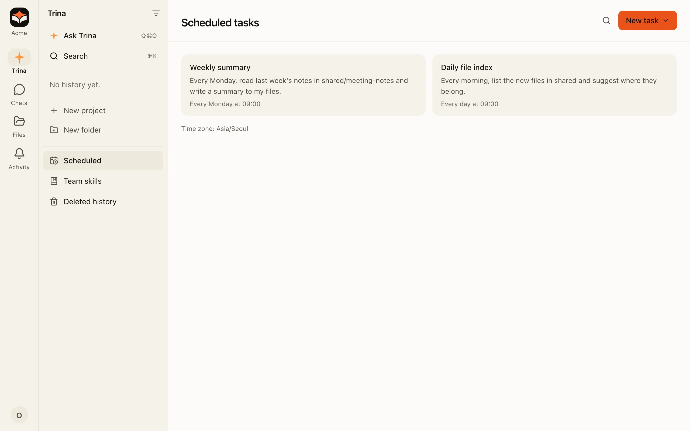
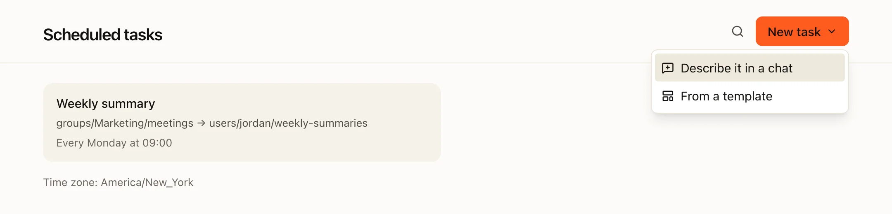
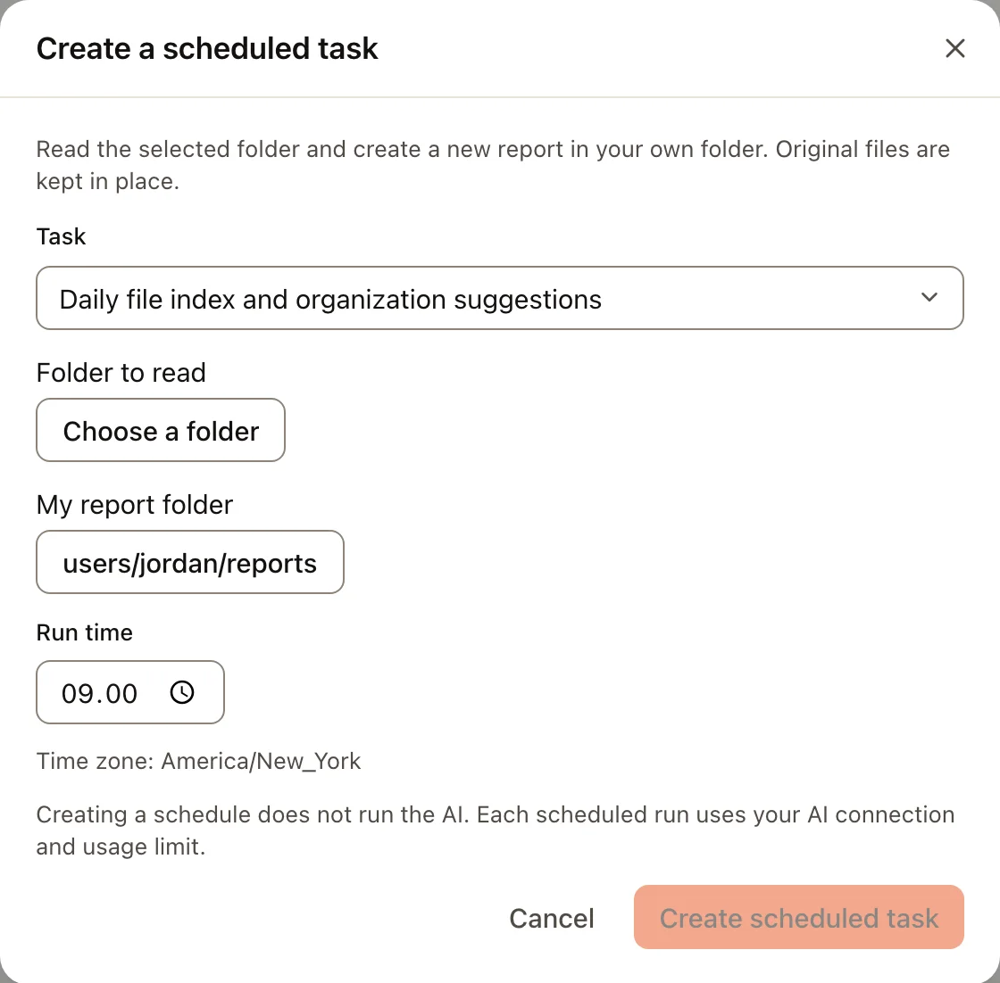
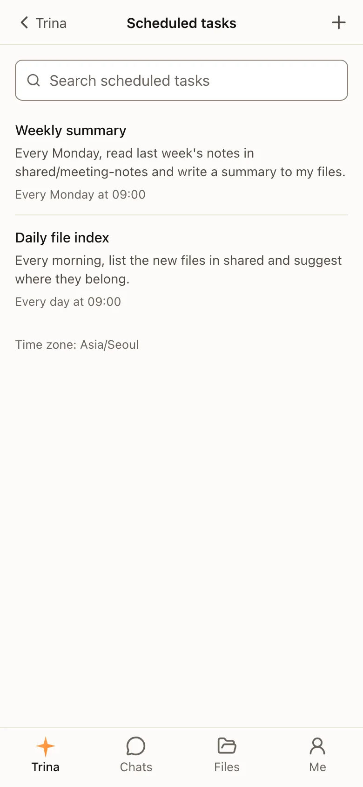

Una tarea programada ejecuta una petición una y otra vez: cada mañana de lunes a viernes, cada lunes, el primer día del mes. Se ejecuta como la persona que la creó.

:::note
Desde la versión 0.4.0, las tareas programadas tienen su propia página **Programadas**: una fila cerca de la parte superior de su lista de Trina (en un teléfono, en el menú **☰** de la pestaña **Trina**); **Nueva tarea programada** en ⌘K también la abre. Antes de esa versión están en **Configuración › Tareas programadas**.
:::

## Crear una tarea

Abra **Programadas** cerca de la parte superior de su lista de Trina y pulse **Nueva tarea** arriba a la derecha. Un
menú pequeño ofrece dos formas:

### Descríbala en un chat

1. Elija **Descríbala en un chat**. Se abre un chat nuevo con "Cada día laborable a las 9:00, " ya escrito en el cuadro
   de mensaje.
2. Termine la frase con sus propias palabras y envíela. Por ejemplo: "Cada lunes a las 9:00, resume las notas de la
   semana pasada en shared/sales."
3. La IA muestra una tarjeta con el nombre de la tarea, cuándo se repite y la instrucción completa. Revísela y pulse
   **Crear**. (Cuando la tarea podría enviar algo a una conexión del equipo, la tarjeta ofrece en su lugar **Crear y
   permitir enviar a esos servicios** y **Crear sin enviar a servicios conectados**). **No crear** no crea nada.

El chat dice que la tarea se creó, y ya está en la página **Programadas** con su próxima ejecución.

### Desde una plantilla

1. Elija **Desde una plantilla**. Se abre la ventana **Crear una tarea programada**.
2. En **Tarea**, elija lo que hace: **Índice diario de archivos y sugerencias de organización** o **Resumen semanal**.
3. Pulse **Elegir una carpeta** en **Carpeta que se leerá** y elija la carpeta que debe leer.
4. Revise **Mi carpeta de informes** (donde se guarda el informe, en su propia carpeta) y fije la **Hora de ejecución**
   (y el **Día de la semana** para la semanal). La hora está en la zona horaria del equipo, que se muestra debajo.
5. Pulse **Crear tarea programada**.

Un mensaje dice "Tarea programada creada.", y la tarea está en la lista. Crearla todavía no ejecuta la IA; cada ejecución
usa su conexión de IA y su límite de uso.

## Qué puede hacer una ejecución

| Tema | En una ejecución programada |
|---|---|
| **Permisos** | Los permisos de carpetas y las habilidades de quien creó la tarea. |
| **Hora** | La zona horaria del equipo. |
| **Preguntas** | No hay nadie para responder, así que no se ejecuta nada que necesite a una persona, salvo lo que permitió la tarjeta de la tarea (abajo). |
| **Web** | Como máximo 8 direcciones web nuevas por ejecución que no necesiten a una persona. |
| **Descargas grandes** | Un archivo de más de 1 GB se omite en lugar de preguntar por él. |

## Guardar y enviar sin preguntar

En una ejecución no hay nadie que responda a una confirmación, así que la tarjeta de la tarea pregunta una sola vez, cuando la tarea se crea, se edita o se vuelve a revisar:

- **Carpeta de guardado.** "Guarda archivos nuevos en: shared/Weekly reports (ahora lo pueden ver 30 personas). Contenido que puede ir ahí: Mi carpeta, conversación #Sales". Las ejecuciones ponen archivos **nuevos** allí y en sus subcarpetas sin preguntar, 20 como máximo por ejecución. Nunca cambian ni reemplazan un archivo de allí que no hayan creado, y nunca tocan habilidades ni archivos de instrucciones. Si una ejecución leyó algo que pueden ver menos personas y que la tarjeta no menciona (otra carpeta, otra conversación), guarda en su propia carpeta y explica por qué.
- **Sus propias conexiones.** "Adónde puede enviar: Mi Notion · 'Daily notes'". Las ejecuciones solo envían a los destinatarios de la tarjeta.

Si la carpeta de guardado se mueve, cambia de nombre o se elimina, cambian sus permisos o usted ya no puede escribir en ella, la tarea muestra **Revise de nuevo la carpeta de guardado** con **Revisar de nuevo**, y usted recibe un aviso. Hasta que la revise, las ejecuciones guardan en su propia carpeta. Que haya personas que entren en un grupo o salgan de él no cambia nada.

En **Editar**, el campo **Carpeta de guardado** elige otra carpeta o la quita (×), y cada elemento del contenido que puede ir ahí se puede quitar (×).

## Gestionar una tarea

Abra una tarea para ver su programación, sus instrucciones, la próxima ejecución y la última.

- **Ejecutar ahora** la ejecuta al instante.
- El interruptor la pausa y la reanuda.
- El menú de su nombre tiene **Editar** y **Eliminar**.

Una tarea de una sola vez ya terminada, o una que ya no puede ejecutarse, indica por qué no se puede activar.

## En un teléfono

Las tareas forman una sola lista, con un cuadro de búsqueda encima y **+** arriba para crear una tarea nueva.

