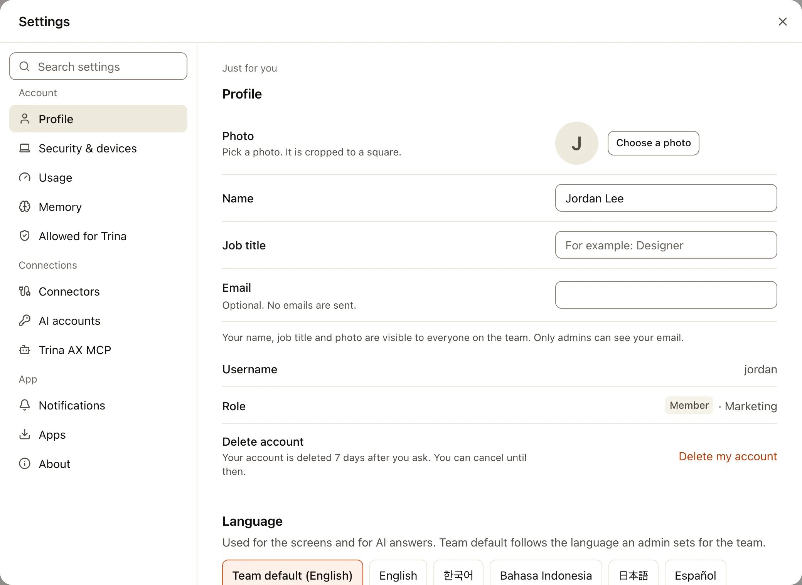
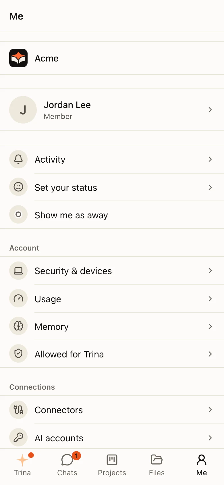
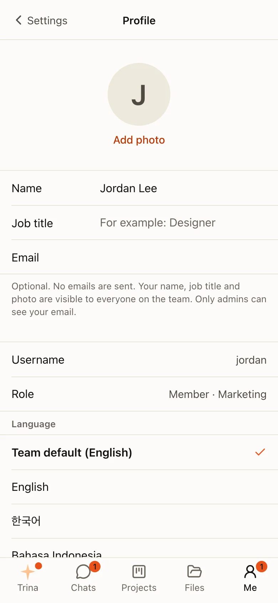
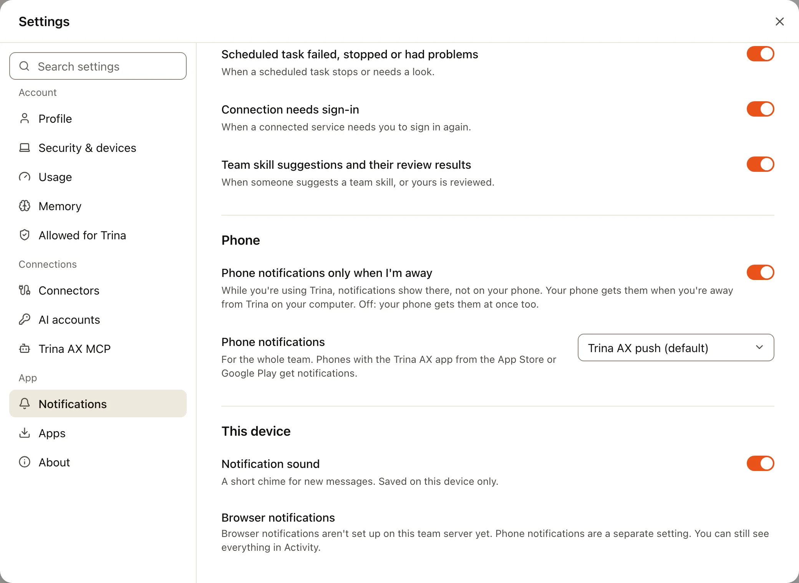
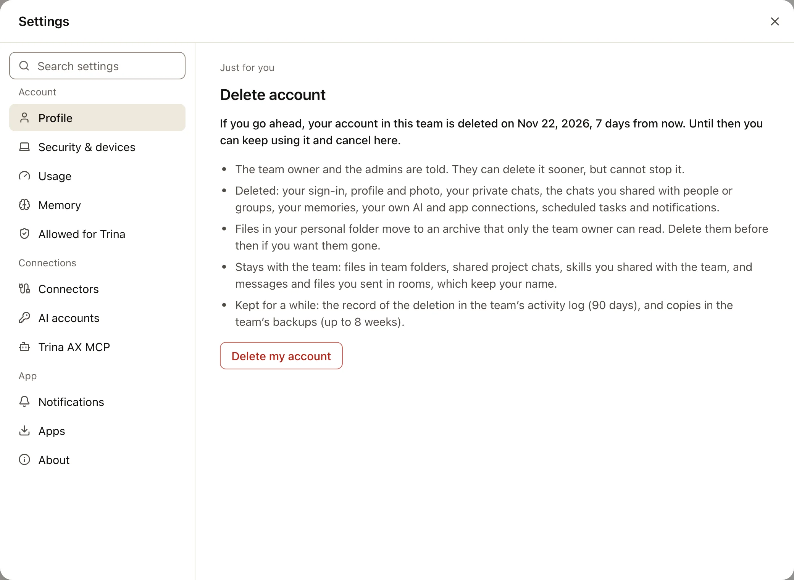
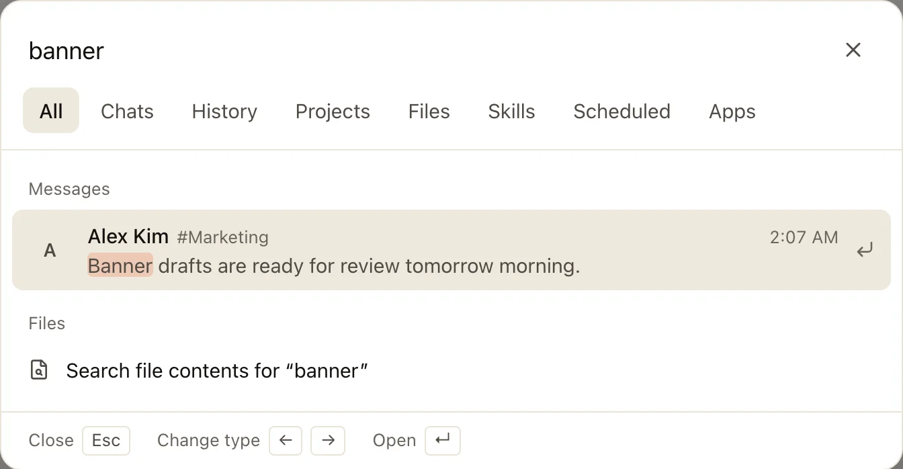

Todo lo relacionado con su propia cuenta está a un clic: su foto abajo de la barra de la izquierda.

## El menú de la cuenta

Haga clic en su foto abajo de la barra de la izquierda. En un teléfono, abra la pestaña **Yo**.

| Elemento | Qué hace |
|---|---|
| **Mostrarme como ausente** | Los demás le ven como ausente hasta que lo vuelva a cambiar |
| **Establecer su estado** | Un estado corto con un emoji, que aparece junto a su nombre |
| **Configuración** | Abre la ventana Configuración, en su perfil |
| **Cerrar sesión** | Termina esta sesión |

Su uso está en **Configuración › Uso**, y los chats que eliminó están en **Historial eliminado**, en el menú **⋯** junto a **Historial de Trina** en su lista de
Trina (en un teléfono, abajo del menú **☰** de la pestaña **Trina**).

### Cambiar de equipo

En la app de escritorio, haga clic en el logotipo de su equipo arriba de la barra de la izquierda y elija **Cambiar de
equipo**: muestra sus equipos, igual que el menú **Equipo** de la app (⌘1–9). En la app del teléfono está en la pestaña **Yo**, bajo
su equipo. En un navegador web cada equipo tiene su propia dirección, así que no hay nada que cambiar.

## La ventana Configuración

Configuración se abre como una ventana sobre la página en la que está. Los enlaces como `/settings/usage` la abren en esa sección.
Todo lo que contiene es solo para usted; lo que se aplica a todo el equipo está en Administración.

| Grupo | Secciones |
|---|---|
| **Cuenta** | Perfil, Seguridad y dispositivos, Uso, Memoria, Permisos para Trina (y Navegador, consulte más abajo) |
| **Conexiones** | Conectores, Proveedores de IA (si el equipo permite que los miembros añadan sus propias cuentas), Trina AX MCP |
| **App** | Notificaciones, Aplicaciones, Acerca de |

Un [invitado](guests.md) solo ve sus propias secciones, como Perfil y Notificaciones. Un invitado que usa su propio inicio de sesión conecta su cuenta de Claude o ChatGPT en **Proveedores de IA**.

**Conectores** contiene sus conexiones con otros servicios: Google Drive, Gmail y las demás apps de Google, Slack y los
servicios de la lista. Abra uno para conectarlo, ver qué puede hacer la IA con él o desconectarlo; **Conectores** encima de su nombre
(en un teléfono, **‹ Conectores**) vuelve a la lista. Los enlaces antiguos como `/connectors` también la abren. Consulte
[Conexiones MCP](mcp.md).

:::steps
#### Busque una sección
Elija una sección a la izquierda, o escriba en **Buscar en la configuración**.

#### Cambie lo que necesite
El perfil, el idioma (English, 한국어, Bahasa Indonesia, 日本語, Español o 简体中文), el tema (claro, oscuro o el del sistema, en Perfil), su motor predeterminado, las notificaciones y más.

#### Ciérrela
Pulse **Esc** o elija **✕**. Vuelve a donde estaba.
:::

**Permisos para Trina** muestra aquello para lo que eligió **Permitir siempre** en una tarjeta de confirmación, y las carpetas de salas en las que
permitió archivos nuevos. Si elimina uno, se le volverá a preguntar la próxima vez.

**Navegador** (en la app de escritorio, y en la web mientras **Permitir todos los sitios web** está activado) tiene **Permitir todos los sitios web**. Cuando está activado, la IA abre sitios web públicos sin preguntar cuando usted se lo pide, en sus chats y en las salas. Las tareas programadas siguen preguntando. Las direcciones con cadenas largas y difíciles de leer o con una consulta larga siguen preguntando, pero eso solo detecta los tokens evidentes: una instrucción oculta en un documento, una página o un mensaje de una sala puede hacer que la IA envíe cualquier cosa que pueda leer a cualquier sitio. También puede activarlo desde una tarjeta de dirección ("Permitir todos los sitios web (desactívelo en Configuración)"). En la app de escritorio, el mismo interruptor cubre el navegador propio de la app, que vuelve a preguntar una vez en su propia ventana. La sección aparece mientras su equipo lo permita.

En un teléfono, Configuración ocupa toda la pantalla. Primero aparece la lista de secciones, y **←** vuelve a ella.

## Notificaciones

**Configuración › Notificaciones** elige lo que le llega: los mensajes de las conversaciones (conversaciones directas y de grupo y
menciones, cada mensaje nuevo, o nada), las respuestas en sus hilos, las horas de **No molestar**, las tareas programadas,
las conexiones, las habilidades del equipo y **Chats compartidos conmigo**. En **Teléfono**, **Avisos en el teléfono solo cuando no estoy** mantiene
su teléfono en silencio mientras usa Trina en un ordenador. **Este dispositivo** tiene el sonido y, en un navegador, **Notificaciones
del navegador**.

Para el propietario y los administradores, **Teléfono › Notificaciones en el teléfono** elige adónde van las notificaciones de teléfono de todo el equipo:
**Push de Trina AX (predeterminado)**, **Desactivadas** o **Personalizado**, la dirección de su propio servicio push para su propia compilación de la
app del teléfono. Las notificaciones en un teléfono nunca contienen el contenido de archivos ni de conversaciones.

## Eliminar su cuenta

**Configuración › Perfil › Eliminar la cuenta** elimina su cuenta en este equipo 7 días después de pedirlo, con su contraseña. La
página indica la fecha, qué se elimina, qué pasa al archivo del propietario del equipo y qué se queda en el equipo. Hasta entonces
puede seguir usando su cuenta y pulsar **Conservar mi cuenta**. Se avisa al propietario del equipo y a los administradores; pueden eliminarla
antes, pero no impedirlo. La cuenta del propio propietario no se puede eliminar aquí: primero traspase el equipo.

## Buscar con ⌘K

Pulse **⌘K** (Ctrl+K en Windows), o elija **Buscar** bajo **Preguntar a Trina**.

- **Las pestañas** acotan la búsqueda: Todo, Chats, Historial, Proyectos, Archivos, Habilidades, Programadas y Apps.
- **Sin escribir nada**, muestra lo que necesita su atención, sus chats y proyectos recientes y acciones rápidas como **Preguntar a Trina**.
- **Las conversaciones y las personas** por su nombre aparecen primero en la pestaña Todo: escriba parte de un nombre, o las consonantes iniciales de un nombre coreano ("ㄱㅈ" encuentra "견적"). Una conversación se abre. Una persona abre su chat 1:1 con ella; si todavía no tiene ninguno, se abre la lista de chat nuevo con esa persona marcada, y el chat solo empieza cuando pulsa su botón.
- **Los mensajes** de sus conversaciones (canales, mensajes directos y chats de grupo) se encuentran en la pestaña Todo, después de sus chats: quién lo escribió, dónde, cuándo y las palabras alrededor de lo que escribió. Solo se encuentra lo que vería si abriera ahora esa conversación. Elija uno para abrir la conversación en ese mensaje (una respuesta abre su hilo); **Ir a lo más reciente** le lleva de vuelta a lo más nuevo. También funciona una parte de una palabra: "견적" encuentra "견적서를".
- **Los archivos enviados en conversaciones** se encuentran por su nombre en las pestañas Todo y Archivos, después de los archivos de su equipo: el archivo, quién lo envió, dónde y cuándo. Solo se encuentran los archivos de mensajes que usted puede ver. Elija uno para abrir la conversación en el mensaje con el que se envió.
- **Cuenta cada palabra**, en cualquier orden: "견적서 보내" encuentra "견적서를 보내드렸어요" en mensajes, chats y nombres de archivo.
- **Teclas:** ↑ y ↓ mueven, Intro abre, ← y → cambian de pestaña, Esc cierra.

