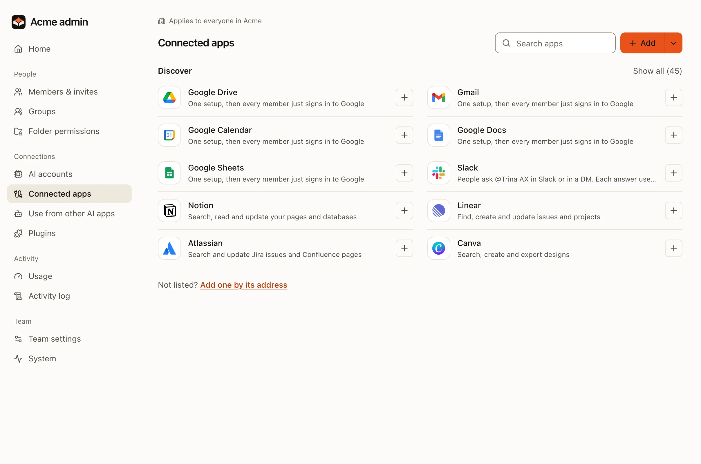
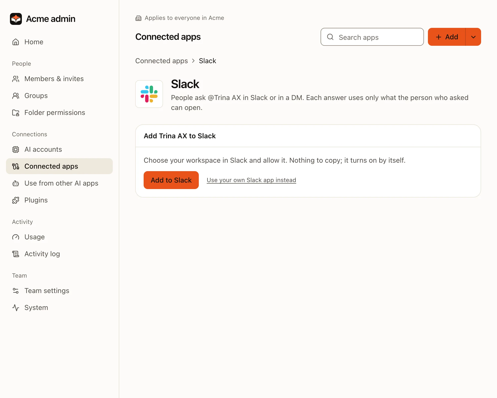
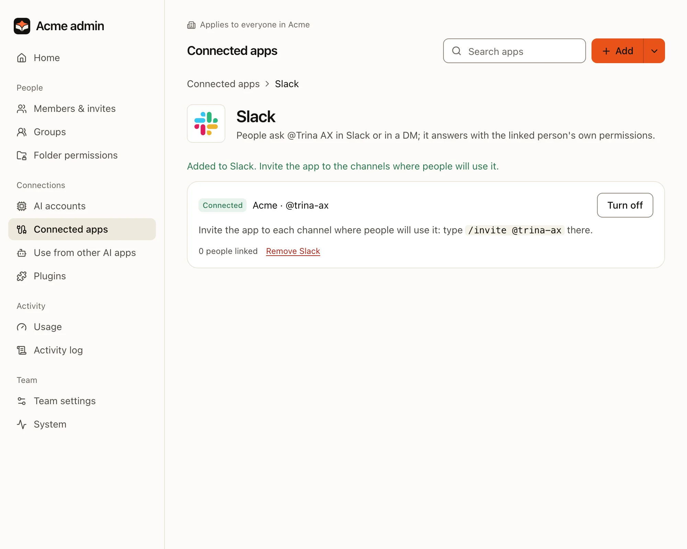
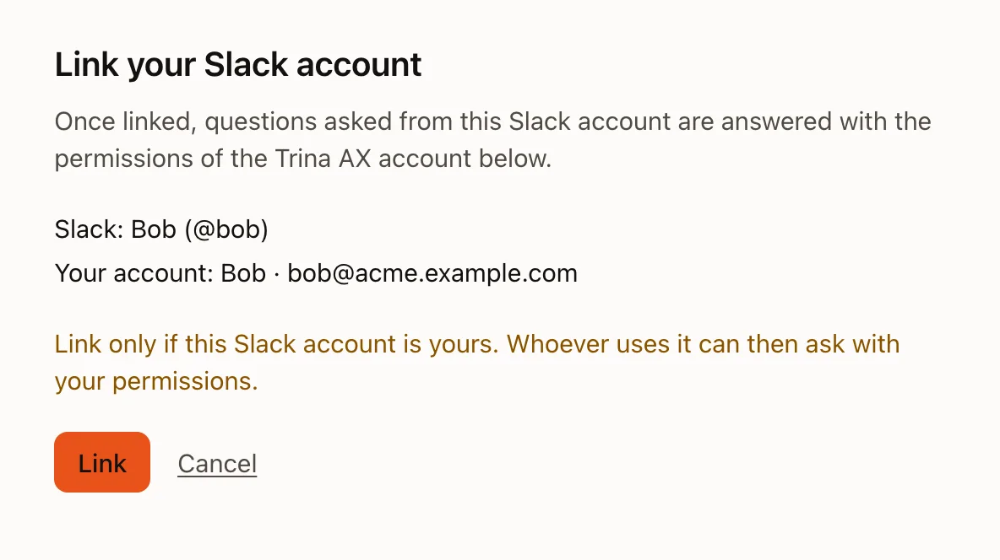
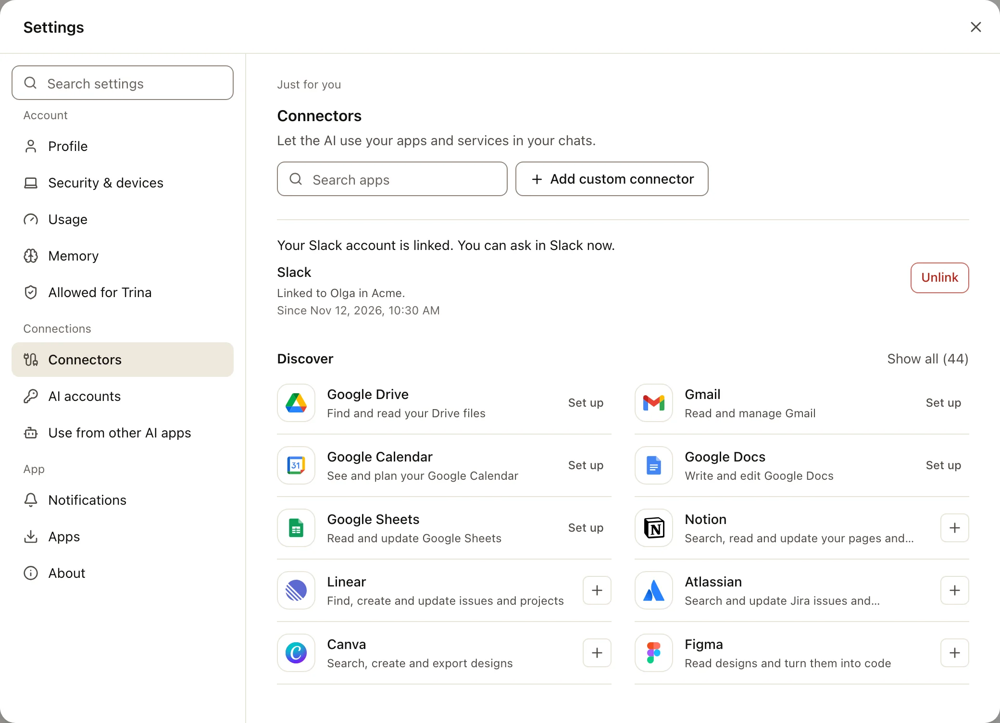
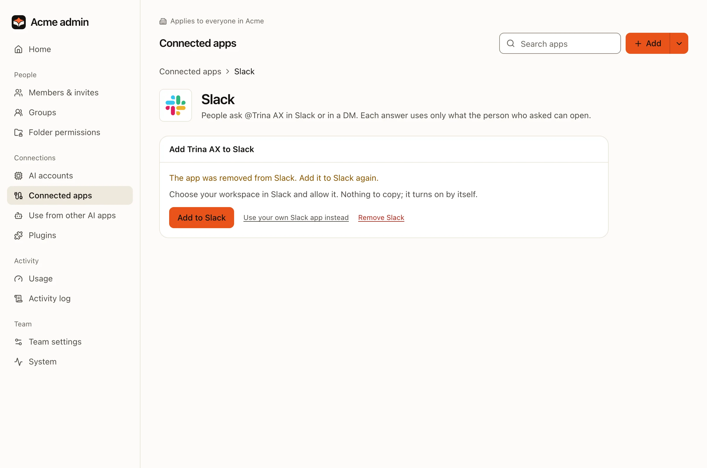

Con Slack conectado, las personas preguntan a Trina AX sin salir de Slack: mencionan a **@Trina AX** en un canal o le
envían un mensaje directo. Cada pregunta se ejecuta como la persona que preguntó, con sus propios permisos de carpetas,
su motor de IA y sus límites, y la respuesta completa también se guarda como un chat en Trina AX.

Son dos pasos cortos. El propietario del equipo o un administrador añade la app a Slack una vez, y cada persona vincula
su propia cuenta de Slack una vez.

:::tip
**Qué necesita**

- **Para añadir la app** (una vez): el propietario del equipo o un administrador en Trina AX, y alguien que pueda aprobar
  apps en su espacio de trabajo de Slack (un administrador o propietario del espacio de trabajo de Slack). Nada que
  copiar ni pegar.
- **Para vincular su cuenta** (cada persona, una vez): su propia cuenta de Slack. Nada que copiar ni pegar.
- **Solo en un servidor sin Añadir a Slack**: cuatro datos de su propia app de Slack, vea
  [más abajo](#si-no-aparece-añadir-a-slack).
:::

:::note
Las capturas de esta página usan un equipo y un espacio de trabajo inventados, "Acme".
:::

## Añadir Trina AX a Slack (el propietario o un administrador)

:::steps
#### Abra Slack en Administración › Apps conectadas
En **Administración**, elija **Apps conectadas**. Slack es uno de los servicios que aparecen allí: en **Descubrir** hasta
que se añade, y después en **Conectados**. Lo ven el propietario y los administradores del equipo.



Elija **Slack**. Su página muestra **Añadir Trina AX a Slack**.



#### Pulse Añadir a Slack
**Añadir a Slack** abre la propia página de Slack. También funciona en el teléfono.

#### Elija su espacio de trabajo y permita la app
La página de Slack muestra el nombre del espacio de trabajo en la esquina superior derecha y enumera lo que Trina AX
puede ver y hacer allí. Compruebe primero el espacio de trabajo: Slack se abre en el último que usó, que puede no ser el
que quiere. Si hace falta, cámbielo en esa esquina y después elija **Allow**.

#### Vuelva a la página de Slack en Trina AX
Dice "Añadida a Slack. Invite la aplicación a los canales donde se usará." La línea muestra su espacio de trabajo y la
app, **Conectando** durante unos segundos y después **Conectado**. No hay nada que copiar ni pegar. Mientras Trina AX
espera la ventana de Slack, están **Volver a intentar** y **Cancelar**; la espera termina sola a los cinco minutos.


:::

Solo un administrador o propietario del espacio de trabajo de Slack puede añadir la app. Cualquier otra persona vuelve a
"Tiene que añadirla un administrador del espacio de trabajo de Slack. Pídaselo a un administrador.", y la app se quita
otra vez del espacio de trabajo.

### Invitar la app a los canales

Slack solo informa a Trina AX de los canales en los que está, igual que con cualquier app de Slack. En cada canal donde
las personas vayan a preguntar:

1. Abra el canal en Slack.
2. En el cuadro de mensaje, escriba `/invite @trina-ax` y pulse Intro. (Slack puede sugerir la app mientras escribe:
   elíjala).
3. Slack publica una línea en el canal que dice que se añadió la app. A partir de entonces, cualquiera en el canal puede
   mencionarla.

```
/invite @trina-ax
```

Los mensajes directos no necesitan invitación: busque **Trina AX** en **Apps**, en la barra lateral de Slack, y
escríbale.

## Vincular su cuenta y preguntar (todos)

Cada persona vincula su propia cuenta de Slack con su propia cuenta de Trina AX, una vez. Nadie puede vincular la de
otra persona.

:::steps
#### Pregunte en Slack
Mencione a **@Trina AX** en un canal al que se haya invitado, o envíele un mensaje directo. Por ejemplo: "@Trina AX
resume las notas de la semana pasada en shared/sales".

#### Conecte su cuenta la primera vez
La primera vez, Trina AX responde solo a usted: "Para preguntar a Trina AX aquí, conecte primero su cuenta de Trina AX.
El enlace funciona una vez, durante 10 minutos, y solo para usted."

1. Elija **Conectar cuenta de Trina AX** en ese mensaje.
2. Trina AX se abre en su navegador (inicie sesión si se lo pide). La página **Vincular su cuenta de Slack** muestra las
   dos cuentas: su nombre de Slack, y su nombre y su correo de Trina AX.
3. Compruebe que la cuenta de Slack es suya y elija **Vincular**. La página dice "Vinculada. Vuelva a Slack y pregunte
   de nuevo."

**Vincular** aparece cuando su cuenta de Slack tiene el mismo correo que su cuenta de Trina AX. Si no es así, la página
explica por qué y ofrece en su lugar **Iniciar sesión con Slack para vincular**.



#### O vincule desde Trina AX
**Configuración › Conectores** tiene una línea **Slack**: "Inicie sesión con su cuenta de Slack de … para vincularla."
**Vincular** le lleva a Slack y le trae de vuelta, y la línea muestra entonces la cuenta vinculada.



#### Pregunte de nuevo
Vuelva a Slack y haga su pregunta de nuevo. A partir de ahora, Trina AX responde enseguida.
:::

### Dónde llega la respuesta

| Dónde pregunta | Qué recibe |
|---|---|
| **Un canal** | "Trabajando en ello…" y después la respuesta, visible solo para usted, con **Publicar en el canal**. Púlselo para publicar la respuesta en el hilo, con "Pregunta de" y su nombre. |
| **Un mensaje directo** | La respuesta, en el hilo de su mensaje. |

- **Siga en el mismo hilo.** Vuelva a mencionar la app en ese hilo, o responda en el hilo del mensaje directo: continúa
  el mismo chat. Un hilo nuevo empieza un chat nuevo.
- **En su idioma.** Las líneas propias de Trina AX en Slack ("Trabajando en ello…", "Responde como …", "Abrir en
  Trina AX") están en el idioma que usa en Trina AX. La respuesta en sí sigue el idioma que eligió para las respuestas de
  la IA.
- **La respuesta completa también está en Trina AX.** Una respuesta larga se acorta en Slack, con un enlace al resto.
  "Trabajando en ello…" también indica la cuenta como la que responde, para que sepa que es la suya.
- **Antes de publicar.** Si la respuesta usó un lugar que no todo el equipo puede ver, como la carpeta de un grupo o su
  propia carpeta, **Publicar en el canal** le pide primero que confirme, con **Publicar de todos modos** y **Cancelar**.
  En un canal compartido con otra organización, las respuestas nunca se publican.

## Si no aparece Añadir a Slack

**Añadir a Slack** aparece donde el servicio de alojamiento de Trina atiende su servidor: un equipo alojado, o un
servidor que usted instaló y que el servicio de alojamiento ha registrado. En cualquier otro caso, la página de Slack en
**Administración › Apps conectadas** muestra en su lugar **Conectar una aplicación de Slack**: cuatro pasos para crear la
app de Slack propia de su equipo a partir de nuestro manifiesto y pegar sus claves. Solo el propietario del equipo puede
hacerlo, porque implica pegar las claves de la app; un administrador ve "Solo el propietario del equipo puede conectar
Slack aquí." Abra la página en la dirección `https://` de su equipo: los enlaces de **Iniciar sesión con Slack** de las
personas vuelven allí.


:::tip
**Qué necesita, todo de la configuración de su app de Slack en api.slack.com/apps**

| Campo en Trina AX | Dónde en Slack | Aspecto |
|---|---|---|
| **Bot User OAuth Token** | **Install App** (u **OAuth & Permissions**), después de **Install to Workspace** | `xoxb-…` |
| **App-Level Token** | **Basic Information › App-Level Tokens › Generate Token and Scopes**, con el permiso `connections:write` | `xapp-…` |
| **Client ID** | **Basic Information › App Credentials** | números con un punto |
| **Client Secret** | **Basic Information › App Credentials**, **Show** | letras y números |
:::

:::steps
#### Crear la aplicación en Slack
Elija **Crear la aplicación en Slack**. Slack abre "Create an app" con todo rellenado a partir de nuestro manifiesto.
Elija su espacio de trabajo y elija **Create**. Crea una app solo para su espacio de trabajo.

#### Instalarla en el espacio de trabajo
Elija **Instalarla en el espacio de trabajo** (la página **Install App** de Slack), después **Install to Workspace** y
**Allow**. Copie el **Bot User OAuth Token**, que empieza por `xoxb-`.

#### Cree el token de la aplicación y copie sus credenciales
Elija **Cree el token de la aplicación y copie sus credenciales** (la página **Basic Information** de Slack). En
**App-Level Tokens**, elija **Generate Token and Scopes**, póngale cualquier nombre, añada el permiso
`connections:write` y elija **Generate**. Copie el token, que empieza por `xapp-`. En la misma página, en **App
Credentials**, copie el **Client ID** y el **Client Secret** (elija antes **Show**).

#### Péguelos y active
Pegue los cuatro datos en sus campos y elija **Comprobar y activar**. Trina AX los comprueba con Slack. Si Slack rechaza
un dato, se indica debajo de su propio campo, con la página de Slack donde se corrige.
:::

Después invite la app a los canales como se explica arriba. Detalles para operadores:
[Setting up the team's own app](../../../SLACK.md#setting-up-the-teams-own-app-the-owner) (en inglés).

| Qué ve | Qué hacer |
|---|---|
| "No es un token de bot." o "Slack no acepta este token." | Copie de nuevo el **Bot User OAuth Token** (`xoxb-`) desde **Install App**, con el botón de copiar de Slack. |
| "Slack no acepta este token de aplicación." | Cree un App-Level Token nuevo con el permiso `connections:write` y péguelo. |
| "Los dos tokens son de aplicaciones de Slack distintas." | Los dos tokens deben ser de la misma app de Slack. |
| "No es un Client ID." o "No es un Client Secret." | Cópielos de nuevo desde **Basic Information › App Credentials**; puede que los dos campos estén intercambiados. |
| "Active Configuración de la aplicación de Slack › Socket Mode." | El manifiesto lo activa; si alguien lo desactivó, vuelva a activarlo en Slack. |
| **Iniciar sesión con Slack** falla con un error de redirección | La página se guardó desde una dirección distinta de la `https://` del equipo. Ábrala en la dirección del equipo y guarde de nuevo. |

También ve los cuatro pasos cuando la app de Slack propia de su equipo ya está configurada. Para cambiar, el propietario
la quita primero (**Cambiar tokens** y después **Quitar Slack**) y luego pulsa **Añadir a Slack**. Un administrador
puede desactivar y activar la app propia del equipo, pero solo el propietario puede cambiarla o quitarla. Si Slack no
aparece en Administración › Apps conectadas, usted no es el propietario del equipo ni un administrador: pídaselo a
ellos.

## Conectar un canal de Slack a una conversación

Si su cliente le habla en un canal de Slack pero su equipo trabaja en Trina AX, conecte ese canal a una conversación del equipo o a un proyecto: sus mensajes aparecen en la conversación en cuanto se escriben, y lo que su equipo escribe allí vuelve al canal. El cliente sigue en Slack y no nota ningún cambio.

#### Abra el menú de la conversación › Añadir una app › Slack

Solo puede hacerlo un propietario o un administrador del equipo que esté en la conversación. La primera vez, el diálogo le pide **Iniciar sesión con Slack** para saber cuál es su cuenta de Slack.

#### Elija el canal y pulse Conectar

La lista muestra los canales en los que están usted y la app de Trina AX. Si un canal no aparece, invite primero a la app en Slack (`/invite @trina-ax`). Lea la frase que hay sobre el botón: **desde ahora todos en esta conversación verán los mensajes del canal**, y lo que escriban irá a Slack con su nombre. Pulse **Conectar**.

#### Lo que ve cada uno

- En la conversación, un mensaje de Slack muestra el nombre y la foto de Slack de quien lo envió, con una pequeña marca de Slack. Los hilos, las menciones, las ediciones y los borrados se mantienen. La cabecera muestra **#canal · Slack**.
- En Slack, un mensaje de la conversación aparece como **Mina (Trina AX)**. No hace falta una cuenta de Slack para escribir.
- Las respuestas de la IA y los archivos no se envían a Slack; ese mensaje dice **No enviado a Slack**. Si Slack rechaza un mensaje, dice **No enviado a Slack** con **Reintentar**.
- Una conversación con un invitado todavía no se puede conectar, y no se puede invitar a nadie de fuera mientras está conectada.

Para dejarlo, abra el diálogo otra vez (o pulse **#canal · Slack** en la cabecera) y pulse **Desconectar**. Lo que se dijo se queda en la conversación.

## Quitar o volver a conectar

La página de Slack en **Administración › Apps conectadas** siempre indica en qué estado está, y su fila en la lista
muestra el mismo estado: **Activado**, **Conectando**, **Desactivado** o lo que requiere su atención. Si Slack no
responde durante unos minutos, la página dice **No responde**, con lo que hay que hacer. Cuando la app se quitó en Slack,
la fila dice **Volver a conectar** y la página ofrece de nuevo **Añadir a Slack**, o **Quitar Slack** si no quiere
recuperarla.



| Qué pasó | Qué hacer |
|---|---|
| **Alguien quitó la app en Slack** | La página de Slack dice "La aplicación se quitó de Slack. Añádala a Slack de nuevo." Pulse **Añadir a Slack** otra vez. Los vínculos de las personas se mantienen: si se añade al mismo espacio de trabajo, nadie vuelve a vincular. Si no quiere recuperarla, pulse **Quitar Slack**: Slack vuelve a **Descubrir** y se borran los vínculos de cuenta de todos. |
| **Quiere desactivarla un tiempo** | Pulse **Desactivar**. Trina AX deja de responder en Slack; los vínculos se mantienen. **Activar** la recupera. |
| **Quiere quitarla del todo** | Pulse **Quitar Slack** y confirme. La app se quita de su espacio de trabajo de Slack y se borran los vínculos de cuenta de todos. Si la vuelve a añadir más adelante, todos vinculan de nuevo. |

Cualquiera puede **Desvincular** su propia cuenta de Slack en **Configuración › Conectores**, en la línea de Slack, en
cualquier momento.

## Preguntas frecuentes

### ¿Quién puede añadir Trina AX a Slack?

El propietario del equipo o un administrador pulsa **Añadir a Slack** en Trina AX, y en Slack debe permitirlo un
administrador o propietario del espacio de trabajo. Los administradores también pueden desactivarla y activarla, volver a
añadirla y quitarla. Configurar la app de Slack propia de su equipo (pegar sus claves) es solo para el propietario del
equipo. Los miembros nunca ven Administración; vinculan su propia cuenta de Slack en **Configuración › Conectores**.

### ¿Cada persona tiene que iniciar sesión?

Sí, una vez. Hasta que una persona vincula su cuenta de Slack, Trina AX solo le envía el enlace para conectar. A una
persona cuya cuenta de Trina AX se desactiva o se elimina se la desvincula de inmediato.

### ¿Qué ve Trina AX en Slack?

Los mensajes que mencionan a @Trina AX en los canales a los que se la invitó, y los mensajes directos que se le envían.
Cuando pregunta en un hilo, la IA también lee ese hilo. Si usted se lo pide, puede leer un canal o un hilo al que se
invitó a la app y en el que usted está. Los mensajes de otras apps allí, como alertas de formularios o de supervisión,
llegan con sus detalles. No lee archivos y no puede leer canales a los que no se invitó a la app. Para vincular cuentas
y decir quién preguntó, lee los nombres y las direcciones de correo de las personas del espacio de trabajo. En un canal,
una respuesta solo la ve la persona que preguntó hasta que la publica.

### ¿Con los permisos de quién se responde?

Con los de quien pregunta: sus permisos de carpetas, su motor de IA y sus límites. La respuesta cuenta en su uso, como
cualquier chat.

### ¿Podemos conectar más de un espacio de trabajo?

No, un espacio de trabajo por equipo. Se rechaza un espacio de trabajo que ya está conectado a otro equipo: "Este espacio
de trabajo de Slack está conectado a otro equipo. Quítelo allí, o quite la app en Slack, y vuelva a intentarlo." Las
personas de otra organización en un canal compartido, y los bots, no reciben respuesta.

Todos los detalles: [Slack connector](../../../SLACK.md) (en inglés).
