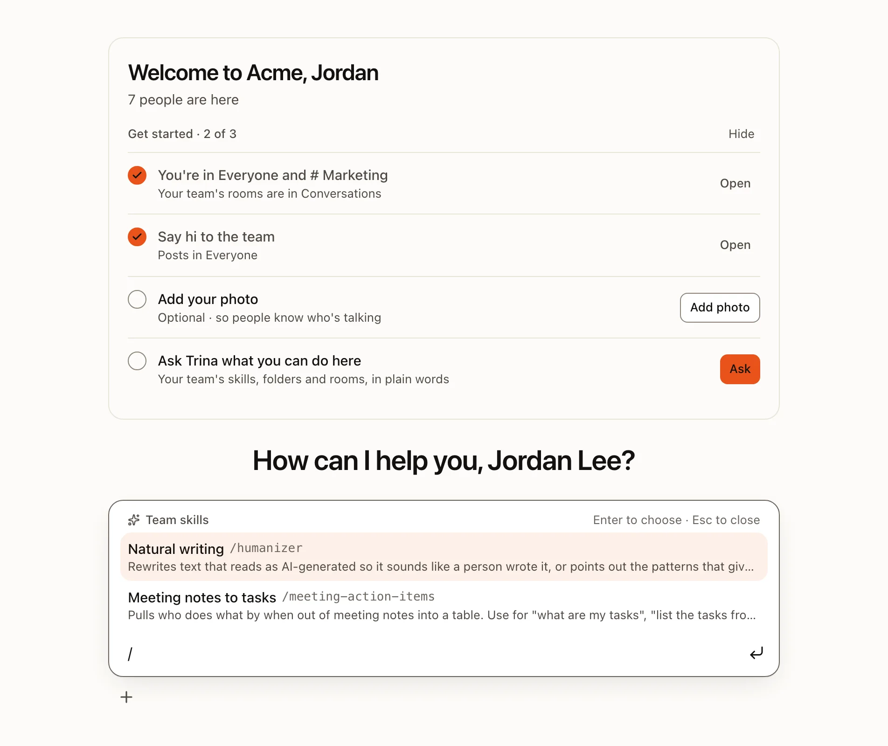
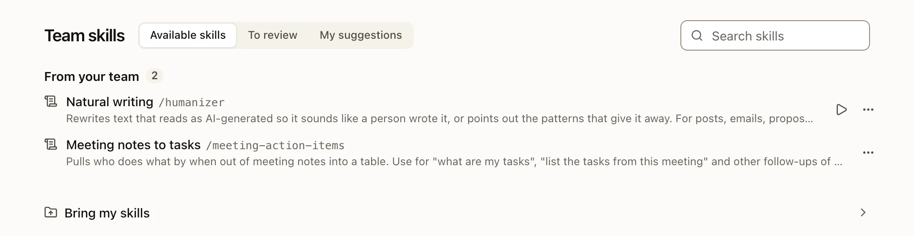

Una habilidad es un procedimiento reutilizable en un archivo `SKILL.md`. Le dice a la IA cómo hace su equipo una tarea. No entrena el modelo y nunca da acceso adicional.

## Usar una habilidad

- En un chat, escriba `/` y elija una habilidad, o escriba `/nombre-de-la-habilidad` en su mensaje.
- La IA también puede encontrar y cargar una habilidad por sí misma cuando encaja con la petición.
- **Habilidades del equipo**, una fila cerca de la parte superior de su lista de Trina (en un teléfono, en el menú **☰** de la pestaña **Trina**), muestra las habilidades que puede usar.





## Habilidades recomendadas

El producto incluye cuatro habilidades ya preparadas, en el idioma del equipo (coreano o inglés; los demás idiomas reciben el texto en inglés). Nada las añade por sí solo: cada una entra solo cuando alguien pulsa un botón que la nombra.

| Carpeta | Habilidades | Cómo se añaden |
|---|---|---|
| `skills/general/` | Company profile, Promo cards, Promo video | El propietario las elige en el paso de configuración **Elija las habilidades que usará su equipo**, o un propietario o administrador las añade después en **Habilidades disponibles** |
| `skills/work/` | Natural writing | Igual |

- **En los pasos de configuración**, cada habilidad tiene una línea y **Ejemplo**. Company profile, Promo cards y Promo video vienen marcadas si se guardó el perfil de la empresa (se crean a partir de él); Natural writing empieza sin marcar. El botón nombra lo que se añade, por ejemplo **Añadir Company profile·Promo cards·Promo video**.
- **En Habilidades disponibles**, los propietarios y administradores ven una línea plegada bajo la lista, **Habilidades preparadas por Trina AX · 2 más**, con las que el equipo todavía no tiene. Ábrala, marque las que quiera (al principio no hay nada marcado) y pulse **Añadir al equipo**. La línea se oculta mientras busca y desaparece cuando el equipo ya las tiene todas. Una habilidad que llega en una versión posterior solo aumenta el número: no hay ningún aviso.
- **Ejemplo** muestra lo que crea la habilidad para una empresa inventada, Example Coffee, y de dónde viene la habilidad.

Si el equipo tiene una de ellas al final de los pasos de configuración, la última pantalla ofrece crear un primer resultado con ella (primero Promo cards): al pulsarlo se abre el formulario de la habilidad y nada se ejecuta hasta que pulse **Ejecutar**.

Son archivos propios de su equipo: los responsables de habilidades pueden editarlas, moverlas o eliminarlas. Volver a añadirlas solo añade lo que falta; una habilidad que usted editó nunca se reemplaza, y se omite una cuyo nombre ya usa otra habilidad del equipo. Una habilidad que eliminó solo vuelve cuando alguien la añade de nuevo por su nombre.

**Natural writing** reescribe un texto que parece escrito por una IA para que suene escrito por una persona, sin cambiar ningún dato. La versión coreana la escribió la empresa y conoce los géneros coreanos (blog, títulos de Shorts, Instagram, propuestas, avisos); la inglesa está adaptada de la habilidad de código abierto "humanizer" (licencia MIT; su aviso está dentro de la habilidad).

Solo se incluyen habilidades de origen conocido. Las versiones anteriores también añadían habilidades para tareas de reuniones, resúmenes de documentos, marketing, trabajo diario y documentos coreanos de RR. HH.; los equipos que las tienen las conservan como archivos propios.

## Dónde viven las habilidades

| Ubicación | Quién la ve |
|---|---|
| `skills/<name>/SKILL.md` | Todos los que pueden leer `skills/` (normalmente todo el equipo) |
| `skills/<folder>/<name>/SKILL.md` | Solo las personas que pueden leer esa carpeta, por ejemplo `skills/finance/` |
| `groups/<group>/skills/<name>/SKILL.md` | Solo los miembros de ese grupo. Ni el propietario ni los administradores que no estén en él. |
| `projects/<project>/skills/<name>/SKILL.md` | Solo en los chats de ese proyecto, para las personas que pueden leer la carpeta del proyecto. |
| `users/<you>/skills/<name>/SKILL.md` | Solo usted. Ni siquiera el propietario ni los administradores. |

Cuando dos habilidades tienen el mismo nombre, gana la más cercana, solo para usted: su habilidad personal, luego la de su grupo, luego la del equipo y luego la del proyecto. Una habilidad de proyecto solo añade nombres nuevos. Si dos de sus grupos tienen una habilidad con el mismo nombre, se muestran ambas con su carpeta, y `/nombre` usa la del grupo cuyo nombre va primero.

## Habilidades de grupo

Cada grupo tiene sus propias habilidades en su carpeta: `groups/<group>/skills/`, junto a los archivos del grupo. Solo los miembros del grupo las ven y las usan: en **Habilidades del equipo** (una sección por grupo, con el nombre del grupo), en el menú `/` (marcadas con el nombre del grupo) y en lo que sabe la IA. El propietario y los administradores no reciben las habilidades de un grupo salvo que estén en él.

- Cualquier miembro del grupo puede añadir o cambiar sus habilidades, como los demás archivos del grupo. La IA le pregunta con una tarjeta antes de guardar una allí, igual que con las habilidades del equipo, y cada cambio se registra con el nombre del grupo.
- Un miembro puede sugerir una habilidad a su grupo (**Sugerir como habilidad** y luego la carpeta del grupo); los miembros del grupo la revisan.
- Al cambiar el nombre de un grupo se conserva su carpeta; la sección de **Habilidades del equipo** muestra el nuevo nombre al instante. Al eliminar un grupo, sus habilidades desaparecen de las listas de sus miembros.

Una habilidad de grupo la escriben los miembros del grupo, no los responsables de habilidades del equipo: lo que un miembro guarda allí, la IA de todos los miembros lo sigue.

## Habilidades de proyecto

Un proyecto del equipo en `projects/<project>/` puede tener habilidades propias en su carpeta `skills/`, una carpeta con un `SKILL.md` por habilidad. La IA las usa solo en los chats de ese proyecto (los suyos, los compartidos y las tareas programadas del proyecto), nunca en las salas ni en sus otros chats. **Habilidades del equipo** muestra una sección por proyecto, **Del proyecto <proyecto>**, y el menú `/` las marca dentro del proyecto.

- Quien puede escribir en la carpeta del proyecto puede añadirlas o cambiarlas; la IA pregunta antes con una tarjeta, con el nombre del proyecto, y cada cambio se registra con el nombre del proyecto.
- Una habilidad de proyecto solo añade nombres nuevos. Un nombre que ya usan el equipo, un grupo o usted aparece marcado en la página como **Mismo nombre: todo el equipo**, y la tarjeta de la IA ofrece otro nombre en lugar de guardar una habilidad que nunca se ejecutaría.
- Para mover una habilidad entre el equipo, un grupo, un proyecto y sus propias habilidades, use **Mover** en el menú de la habilidad: muestra quién la gana y quién la pierde en cada nivel, y el texto completo antes de que la reciban más personas. También puede pedírselo a la IA en un chat del proyecto; solo mueve una habilidad a un lugar donde la reciban menos personas, después de una tarjeta que muestra cada archivo.

## Escribir una habilidad

:::steps
#### Cree la carpeta
Cree `skills/<name>/` en Archivos. El nombre usa `a`–`z`, `0`–`9` y guiones, y coincide con el nombre de la carpeta.

#### Escriba SKILL.md
Empiece con un encabezado y luego el procedimiento.
```markdown
---
name: meeting-summary
description: Summarize permitted meeting notes into decisions, actions and open questions.
---

# Inputs
Ask for the source paths before reading.

# Procedure and output
Return decisions, an action table and open questions. Cite the source paths.
```

#### Compruebe que se carga
**Habilidades del equipo** muestra un motivo claro cuando una habilidad no se puede cargar. Corrija el encabezado y vuelva a intentarlo.
:::

[Leer el formato completo de SKILL.md](../../agents/skills-format.md) (en inglés).

## Traer sus habilidades de Claude Code o Codex

Los propietarios y administradores pueden traer al equipo las habilidades que ya usan con **Traer mis habilidades** bajo la lista de **Habilidades disponibles**, o desde un enlace de propuesta. Los pasos de configuración solo ofrecen las habilidades ya preparadas. En un teléfono, la página indica que esto se hace en un ordenador.

| Desde | Elija o suelte | Qué se lee |
|---|---|---|
| Claude Code | `~/.claude` (o el `.claude` de un proyecto) | `skills/`, `commands/*.md`, `CLAUDE.md` |
| Codex | `~/.codex`, y `~/.agents` para las habilidades personales actuales | `skills/` (nunca `.system`), `prompts/*.md`, `AGENTS.md`, los servidores remotos de `config.toml` |

O bien, cuando Claude Code o Codex estén conectados al equipo ([el conector MCP](../../agents/mcp-connector.md) (en inglés)), pegue una línea en él y enviará una propuesta.

- No se abre nada más de esas carpetas. Una habilidad que contiene una clave o un token nunca sale de su ordenador; solo se muestra su nombre.
- El servidor vuelve a comprobar cada habilidad y sugiere las que puede usar todo el equipo. Si esa comprobación tarda más de 30 segundos, la lista aparece sin nada marcado y usted elige. Nada llega al equipo antes de que pulse el botón que lo añade.
- El archivo de reglas se convierte en una regla del equipo. Los servidores MCP remotos se convierten en plantillas de conexión sin claves: cada miembro se conecta con las suyas.
- Una habilidad con el mismo nombre que una habilidad del equipo se combina en un chat que solo puede leer las dos y guardar la habilidad del equipo, después de que usted lo confirme.
- **A uno de sus grupos en lugar del equipo.** En la página de la propuesta, **Compartir con** elige todo el equipo (la opción predeterminada) o uno de sus grupos; Claude Code y Codex también pueden indicar el grupo. Una propuesta a un grupo solo añade habilidades (ni regla del equipo ni conexiones) y nunca cambia una habilidad del equipo: una habilidad con el mismo nombre que una del grupo se combina con ella o se guarda a su lado, y una con el mismo nombre que una habilidad del equipo se convierte en una copia propia del grupo. Los miembros del grupo la ven en **Habilidades del equipo › Revisar** (solo lo que va al grupo) y cualquiera de ellos puede añadirla al grupo.

## Quién puede cambiar las habilidades

Los **responsables de habilidades** cambian las habilidades del equipo: el propietario, los administradores y las personas o grupos que añade un administrador. En el fondo, eso es simplemente permiso de escritura en `skills/` o en una carpeta dentro de ella.

El propietario y los administradores ven quiénes son bajo el encabezado **Habilidades del equipo**: "Quién puede editar: el propietario y los administradores, Ventas: 3 personas, Alex [Cambiar]". La lista refleja lo que dice Permisos de carpetas para `skills/`, así que incluye a las personas que pueden editar a través de un grupo, de una regla para todos o de una regla sobre toda la carpeta del equipo. Las carpetas internas con reglas de escritura propias (para una persona, un grupo o todos) se cuentan al final ("2 carpetas con reglas de escritura propias"). **Cambiar** abre una ventana:

- Muestra al propietario y a los administradores (siempre) y a cada persona y grupo con su propia regla de escritura en `skills/`, con la carpeta cuando la regla está en una subcarpeta como `skills/finance/`. **Quitar** elimina esa regla después de confirmarlo; avisa si otra regla todavía permite editar a la persona (la de un grupo, la de todos o su propia regla en `skills/`).
- **Añadir una persona o un grupo** busca uno por su nombre. Lea el aviso y luego pulse **Activar**: podrán editar todo `skills/`.
- Para confiar solo una carpeta, siga **Para confiar una sola carpeta, use Permisos de carpetas** y dé allí permiso de escritura en esa carpeta.

Los miembros y los demás responsables de habilidades no ven esta línea.

- Los miembros pueden **sugerir** una habilidad personal al equipo. Un responsable de habilidades de la carpeta de destino la revisa.
- Lo que espera su revisión aparece como un número junto a **Habilidades del equipo** en la lista de Trina (y en el menú del teléfono), como los mensajes sin leer de un chat. **Por revisar** muestra solo lo que sigue esperando; lo que registró o rechazó está en **Revisadas**, al final de esa pestaña.
- Cada cambio en `skills/` se registra, y el propietario y los administradores reciben un aviso con un enlace al historial de versiones.
- Las habilidades de un grupo las cambian los miembros del grupo (consulte [Habilidades de grupo](#habilidades-de-grupo)); sus cambios se registran y se notifican de la misma forma.

## Los miembros traen sus propias habilidades

Los miembros usan **Traer mis habilidades** bajo la lista de **Habilidades disponibles** (en un ordenador), o la línea que aparece bajo la respuesta después de un primer buen resultado, que pregunta si también quieren traer al equipo las habilidades o los archivos que usan. Ambas opciones abren la misma hoja:

- El miembro elige o suelta su carpeta `.claude`, `.codex` o `.agents`, que se lee igual que arriba. Una habilidad que contiene una clave nunca sale de su ordenador.
- Al principio no hay nada marcado. Marca hasta 10 habilidades y las envía como sugerencias; pueden esperar hasta 20 sugerencias suyas a la vez. No se envían archivos de reglas ni servidores MCP.
- El servidor vuelve a comprobar cada habilidad (claves, scripts, tamaño, nombres, rutas de su ordenador) y la guarda fuera de los archivos del equipo. Ninguna IA la juzga.
- Si el miembro puede escribir en la carpeta del equipo, la hoja también enlaza a ella para los archivos. En un teléfono, la línea solo ofrece esa carpeta, y nada si no puede escribir en ninguna.

El propietario y los administradores reciben un aviso en **Actividad** por cada envío ("Mina quiere aportar 2 habilidades al equipo"), que abre **Revisar**, agrupado por persona. Solo el propietario y los administradores ven y aprueban una habilidad así: se guarda como `skills/<folder name>/` con sus archivos, el miembro recibe la noticia y la habilidad muestra "Sugerida por Mina" en la lista. Aprobarla nunca cambia la habilidad que abre la invitación ni la que nombra el objetivo de 7 días. La línea se puede cerrar para siempre con ✕.

## Habilidades iniciales

El repositorio tiene seis habilidades iniciales con datos ficticios: informe semanal, seguimiento de ventas, resumen de marca, revisión de gastos, guía para nuevos empleados y resumen de reuniones. [Ver los ejemplos](../../../../examples/README.md) (en inglés).
