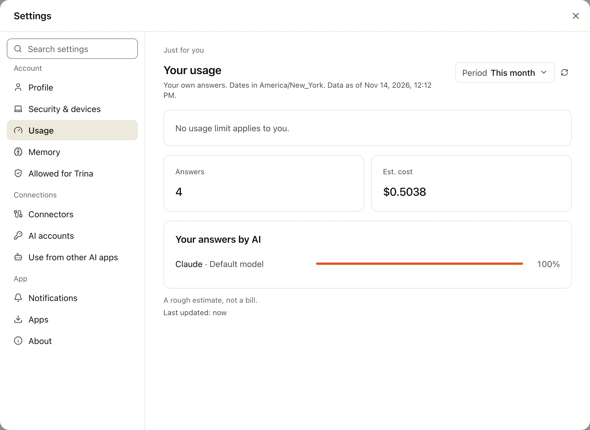
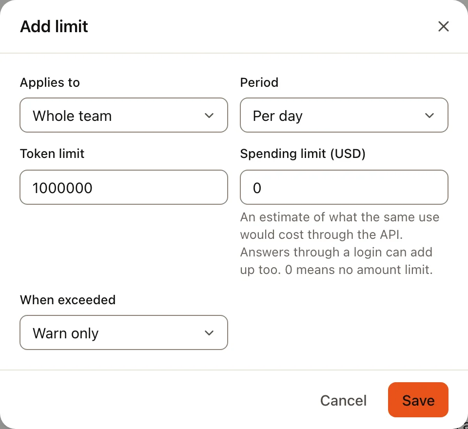

Trina AX cuenta cada respuesta: quién preguntó, qué motor y qué modelo, cuántos tokens y un coste estimado.

:::note
Los costes son estimaciones del precio equivalente de la API, no facturas. Las conexiones por suscripción suman 0 por petición, pero sus tokens sí se cuentan.
:::

## Su propio uso

Abra **Configuración › Uso** (su foto abajo de la barra de la izquierda › **Configuración**; en un teléfono, la pestaña **Yo**). Muestra sus respuestas y su coste estimado, qué IA las respondió y cuánto ha usado de cada límite que se le aplica. Solo ve sus propios números.

:::note
El uso personal es nuevo en la versión 0.4.0. Antes, solo los administradores ven el uso, en **Administración › Uso**.
:::

## El uso del equipo

Los administradores abren **Administración › Uso**. Está organizado como la página de uso de la Claude Console.

- **Filtros** arriba, cada uno un botón pequeño que muestra lo que está elegido:
  - **Grupo** (solo si el equipo tiene grupos) y **Rango**: hoy, los últimos 7 o 30 días, este mes o un rango personalizado.
  - **Persona**, **Motor**, **Modelo** y **Conexión de IA**, para ver uno de ellos. **Quitar filtros** vuelve a mostrarlo todo.
  - **Agrupar por** persona, grupo, motor, modelo, día, conexión de IA o habilidad.
- **Tarjetas** con los totales: tokens de entrada, tokens de salida, respuestas y el coste estimado.
- **Uso de tokens**: los tokens por día en barras apiladas, un color por cada valor de Agrupar por (los cinco mayores, el resto como "Otros"). Señale un día, o ponga el foco en el gráfico y use las flechas del teclado, para ver los números de ese día.
- **Desglose**: una fila por cada valor de Agrupar por, con las respuestas, los tokens, su proporción y el coste estimado.
- El botón **Descargar** guarda el desglose como CSV.

Las habilidades personales nunca se cuentan por su nombre, así que ningún administrador ve lo que alguien guarda en privado. Las habilidades de grupo se cuentan como las habilidades del equipo.

## Fijar límites

De forma predeterminada no hay límites. Un límite se cuenta en **tokens**: trozos pequeños de texto, cada uno más o menos
tres cuartos de una palabra en inglés. Todo lo que la IA lee (su pregunta, los archivos que abre) y escribe cuenta, así
que una respuesta que lee archivos largos usa muchos más tokens que una respuesta corta. Como un plan de datos mensual
en un teléfono, un límite fija cuánto se puede usar en un día o en un mes.

Para añadir un límite (propietarios y administradores):

1. Abra **Administración › Configuración del equipo** y baje hasta **Límites de uso**.
2. Pulse **Añadir límite**. Se abre una ventana.
3. **Se aplica a**: **Todo el equipo**, un grupo o una persona. **Período**: **Por día** o **Por mes**.
4. **Límite de tokens**: cuántos tokens, por ejemplo 1000000 para un millón. **Límite de gasto (USD)** es opcional: una
   estimación de lo que costaría el mismo uso a través de la API; 0 significa sin límite de importe.
5. **Al superar el límite**: **Solo advertir** deja que las respuestas sigan y envía un aviso; **Bloquear** detiene las
   respuestas nuevas hasta que empiece de nuevo el periodo.
6. Pulse **Guardar**.

El límite es ahora una fila en **Límites de uso**. Cada persona, grupo o el equipo entero puede tener un límite por periodo.

Para una sola persona es más rápido desde **Administración › Miembros e invitaciones**: abra su menú **…** y elija **Límite de uso…**. El
cuadro ya corresponde a esa persona y se abre con el límite que tiene, junto con cuánto ha usado. Elija **Por día** o
**Por mes** para ver o fijar cada uno, y **Quitar límite** para eliminar uno. Las personas con un límite lo muestran en una línea discreta
bajo su nombre, con **Límite superado** cuando se ha agotado. En un teléfono, abra la persona y toque **Límite de uso**.

| Límite para | Periodo |
|---|---|
| Una persona | por día o por mes |
| Un grupo | por día o por mes |
| Todo el equipo | por día o por mes |

Lo que pasa en el límite depende de **Al superar el límite**:

- **Bloquear**: el propietario y los administradores reciben un aviso al 80 % y otra vez al 100 % (y también la persona,
  cuando el límite es suyo). Al 100 %, las personas a las que afecta no pueden empezar respuestas nuevas hasta que se
  reinicie el periodo: la medianoche para un límite diario, el día 1 del mes para un límite mensual, en la zona horaria
  del equipo. Su página de uso indica cuándo ocurrirá.
- **Solo advertir**: las respuestas siguen. El propietario y los administradores (y la persona, cuando el límite es suyo)
  reciben un aviso cuando se agota.
