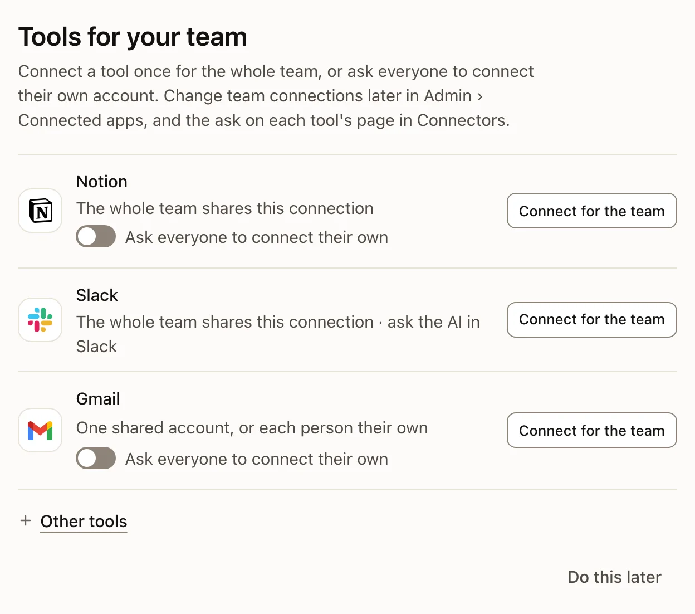

After you make a team, the app takes you, the owner, through a few short steps. Only the owner sees them. Every step can be put off, and the steps resume where you stopped, on any device.

If you made the team in a browser on a Mac or Windows computer, the next page offers **Continue in the Mac app** (or the Windows app): the app signs you in by itself, with no second password, and only the app can find work files on your computer. **Continue in the browser** goes on to the steps here. The steps come with you: in the app they open where you stopped, with the company website from your sign-up link already filled in.

## Make a team from the desktop app

No team yet? The Mac and Windows app makes one for you on the hosted service, on the Free plan, with no card:

:::steps
#### Create a team for free
Open the app and choose **Create a team for free**. (**Just look around first** opens a demo team in your browser, with no sign-up.)

#### Sign in
With **Continue with Google**, your browser opens Google's sign-in; then you can close the tab. With an e-mail address you stay in the app: type it, press **Send code** and type the 6-digit code from the mail. By continuing you agree to the Terms and the Privacy policy.

#### Name your team
Type the team's name. The app suggests its address (`acme.trina.app`); **Change** picks another. Read the Free plan's limits, tick the box, and create it.

#### Wait a few minutes
Making the team takes about 3 to 5 minutes. You can close the app; it comes back to this screen when you open it again.

#### Welcome to your team
The team opens in the app, signed in as you. If you signed in with Google, press **Continue**. If you signed in with an e-mail code, **choose a password** first: you use it on your phone and other computers.
:::

Each account has one free team. If yours already has a team, the app offers **Open it** instead. A Free team sleeps when nobody uses it and wakes when someone opens it. The owner upgrades in **Admin › System › Plan › Choose a plan**. The Mac App Store version only signs in to a team you made before (**Already made a team?** **Sign in**).

## The steps

:::steps
#### AI connection (only when no AI answers yet)
Connect a Claude or ChatGPT subscription, or an API key. Without AI the company profile cannot be read, so this step comes first. **Do this later** leaves the steps; the setup row then says **Connect AI**.

#### Company profile
Type the company website. The AI reads it and writes one line about the company ("Here's what we found: … · Edit"). You can add an intro file or a company deck with **Add an intro file if you have one**. While the AI reads, there is nothing to press. If it takes more than 90 seconds, **Don't wait, go on** moves to the next step and the reading carries on; come back to this step in the same window to see it.

**Save and continue** saves the profile. It also puts the website's photos and a company intro file into the team's brand folder; the line under the button says so. Nothing else starts by itself.

#### Choose the skills your team will use
The skills Trina AX prepared, each with **Example**: Company slide deck, Promo cards, Promo video and Natural writing. The first three come ticked when you saved the company profile. The button says what goes in, for example **Add 3 skills**. Nothing goes in until you press it. To bring the skills you use with Claude Code or Codex, use **Team skills › Bring my skills** later ([Team skills](../use/team-skills.md)).

#### Team files
**Choose a folder** with company documents. The AI suggests the ones the team can use from the file names, folders and dates only, and you tick what goes up. Nothing is uploaded until you press the button. Afterwards the AI can read them and offer folders to sort them into (**Sort them like this?**). One line says who will see the files.

#### Team tools
**Tools for your team** is one list: Notion, Higgsfield (AI images and video) and, where your server can connect them,
Google Drive and Gmail.
Each row offers one or both of two ways:

- **Connect for the team** (the button on the right). You sign in once with one account, and the whole team uses
  that one connection, like a shared mailbox everyone in a team can open. Notion and Higgsfield open the service's own
  sign-in page in a new window; a Higgsfield team connection uses that one account's plan and credits. Gmail opens the dialog
  Admin › Connected apps uses: **Continue with Google**, sign in with the shared Google account (such as
  `sales@acme.com`), then pick who may use it. Google Drive opens a different one, **Share a Google Drive with the
  team**: the same sign-in, and you also choose which of that account's folders the team may use.
- **Ask everyone to connect their own** (the switch under each row's line). Nothing is connected
  now. The tool comes first in everyone's **Settings › Connectors**, marked **Team asks you to connect**, and each
  person signs in with their own account, the way each person adds their own Gmail on their own phone. It blocks
  nothing: anyone may still connect any tool, or none.

After a team connection, the row says **Connected** (a Google row also names the shared account and who uses it).
**Other tools** opens the full list, where each tool's page has the same switch. Slack is there too, and in
**Admin › Connected apps** ([Slack](../use/slack.md)): it takes a few more steps, so it is not a row here. You change all of this later: team
connections in **Admin › Connected apps**, the switch on each tool's page in **Settings › Connectors**. Nobody signs
in with their own account on this step. On a phone this step is skipped.

#### Invite
Copy the ready-made message. It names one skill. People who join land on Home, where a welcome card says who invited them and what to do first; the skill is in **Team skills**. When each person signs in to their own AI, the message says so. The invite page offers the language of the person's browser. If someone else is already signed in on that computer, the page says "You're already in <team name>" and offers **Sign out to join**, which signs out and opens the same link.
:::

At the end, **You're all set** sums up the setup: each step with what it did, or put off with **Do it now**. Next come your own settings (your tools, photo and apps): **Start my settings** goes Home. It shows once.

## Coming back

- **Continue setup · 2/5** shows near the top of the Trina, Chats, Files and Activity lists beside the bar on the left until the steps are finished. It opens the steps where you stopped. On a phone it is at the top of the **☰** list on the **Trina** tab and of the **Files** tab, and Home shows it as a quiet row under the message box.
- Opening the app on Home also brings you back to the steps, once per browser session.
- ✕ hides the row. **Show setup again** in Admin › Home brings it back.
- Home's team goal card and **Ready in your team** have **Hide**. **Settings › Profile** shows them again (the team goal also from Admin › Home).

## When setup counts as finished

The company profile, skills, team files, tools and the invite are each done or put off. A skill to merge into an existing team skill waits until then; afterwards one notice in **Activity**, **Review skills to merge**, opens the merge chat.
