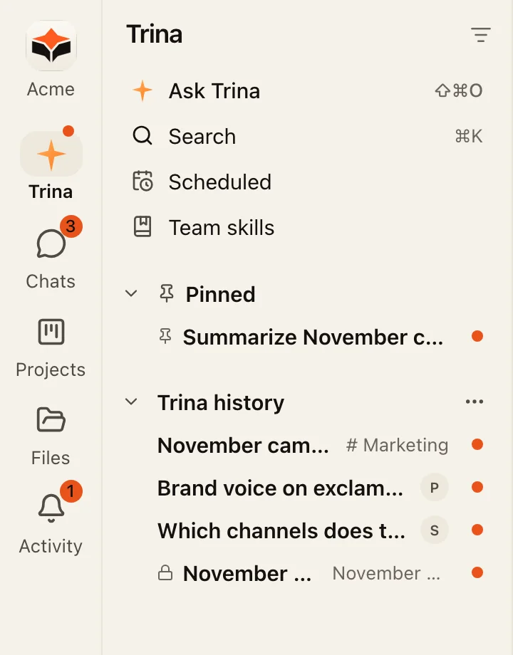

Trina AX punya beberapa komponen dasar. Semua halaman lain memakai istilah-istilah ini. Jika tim Anda memakai Google Drive
dan Slack, sebagian besar akan terasa akrab: perbandingan di bawah menyebutkan yang mana.

## Orang dan peran

| Peran | Bisa melakukan |
|---|---|
| **Owner** | Semua yang bisa dilakukan admin, ditambah keputusan tingkat tim seperti pembaruan, pemulihan, mengeluarkan anggota, dan nama tim. |
| **Admin** | Mengelola anggota, grup, izin folder, koneksi AI dan mesin tim, serta pengaturan tim. Admin tidak bisa membaca chat orang lain. |
| **Anggota** | Chat dengan AI, memakai file dan skill yang boleh mereka buka, serta memiliki folder dan skill pribadi. |
| **Tamu** | Orang dari luar tim, paling banyak di satu saluran privat atau obrolan grup, dan satu proyek. Tanpa AI, kecuali AI dipilihkan untuk mereka. Tidak memakai kursi. [Baca tentang tamu](../use/guests.md). |

**Grup** adalah sekumpulan orang, misalnya Penjualan atau Keuangan, seperti grup Google atau grup pengguna Slack. Folder
bisa dibagikan ke grup atau orang.

## Folder tim

Semua pengetahuan perusahaan berada di satu folder tim di server. Cara kerjanya seperti drive bersama di Google Drive: satu
tempat untuk seluruh perusahaan, dengan folder yang hanya bisa dibuka sebagian orang.

| Folder | Siapa yang melihatnya |
|---|---|
| `shared/` | Sesuai pembagiannya, biasanya seluruh tim. |
| `groups/<group>/` | Orang di grup itu, ditambah siapa pun yang diberi akses lewat pembagian. |
| `projects/<project>/` | Hanya anggota proyek. |
| `skills/` | Semua orang bisa membaca. Pengelola skill yang mengubahnya. |
| `users/<id>/` | Hanya orang itu sendiri. Owner dan admin pun tidak. |

Folder atau file yang tidak bisa Anda buka tidak terlihat sama sekali: di File, di jawaban AI, di pencarian, pratinjau, riwayat, dan sampah. [Baca tentang file dan izin](../use/files-and-permissions.md).

## Chat dan proyek

**Chat** adalah percakapan dengan AI. Hanya orang yang memulainya yang bisa melihatnya, sampai ia membagikannya ke orang atau grup,
seperti Anda membagikan Google Doc. Chat di proyek tim dilihat oleh anggota proyek tersebut, kecuali orang yang memulainya menguncinya.

**Proyek** adalah folder dengan instruksi, untuk pekerjaan yang terus kembali ke file yang sama: bayangkan folder
Drive dengan catatan di atasnya yang dibaca AI setiap kali. Chat di dalam proyek memberi AI folder dan instruksi tersebut. [Baca tentang chat dan proyek](../use/chats-and-projects.md).

## Skill

**Skill** adalah file `SKILL.md` yang berisi nama, deskripsi, dan prosedur, seperti kartu resep atau daftar periksa.
Skill memberi tahu AI cara tim Anda mengerjakan suatu tugas. Skill tidak pernah memberi akses tambahan. [Baca tentang skill tim](../use/team-skills.md).

## Mesin dan koneksi AI

**Mesin** adalah program AI yang menjawab (Anda memilihnya sekali; sebagian besar tim tetap memakai bawaannya):

| Mesin | Catatan |
|---|---|
| Claude Code | Mesin bawaan. |
| Codex | Agen dari OpenAI. Tidak tersedia di Mac kantor. |
| API | Eksperimental. Memakai alamat API, model, dan kunci yang sudah diatur. |

**Koneksi AI** adalah akun yang dipakai mesin: langganan Claude, kunci API, atau login ChatGPT. Seperti
kartu SIM di ponsel, mesin butuh satu koneksi agar bisa bekerja, dan perusahaan di balik kunci atau akun itu yang menagihnya. Koneksi bisa bersifat pribadi, atau dipakai bersama oleh satu grup atau seluruh tim.

## MCP dan koneksi lain

**Koneksi MCP** memungkinkan AI memakai layanan luar, seperti Notion atau Linear, dengan login milik seseorang atau milik
tim. Ini seperti mengizinkan aplikasi di iPhone memakai kalender Anda: Anda mengizinkannya sekali, di layanan itu, dan AI
lalu hanya bisa melakukan apa yang Anda izinkan. Anda tidak perlu tahu istilah MCP untuk menghubungkan aplikasi: [Menghubungkan aplikasi](../use/connect-apps.md). Trina AX juga bekerja ke arah sebaliknya: Claude Anda sendiri bisa terhubung ke Trina AX sebagai server MCP. [Baca tentang MCP](../use/mcp.md).

## Tugas terjadwal dan pemakaian

**Tugas terjadwal** mengulang sebuah permintaan sesuai jadwal, dalam zona waktu tim. **Pemakaian** menghitung jawaban, token, dan perkiraan biaya per orang, dengan batas yang bisa diatur jika perlu. [Baca tentang tugas terjadwal](../use/scheduled-tasks.md).
