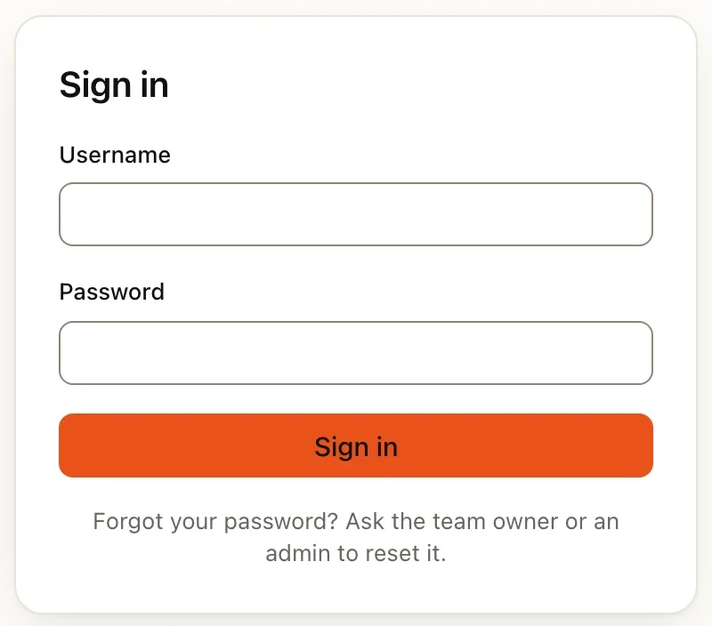
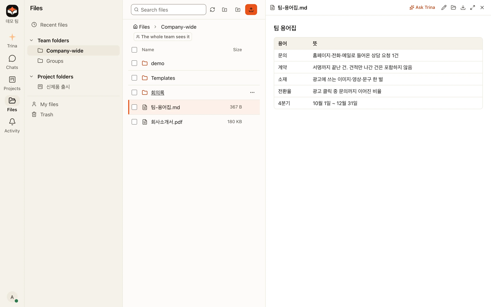

Demo ini memulai tim fiktif dengan enam skill awal. AI dimatikan, jadi Anda tidak memerlukan akun AI.

:::warning
Demo ini bukan pemasangan untuk produksi. Demo tidak memiliki isolasi OS. Gunakan data fiktif saja.
:::

## Sebelum mulai

| Yang Anda perlukan | Versi |
|---|---|
| macOS atau Linux | Pengguna Windows membuka server yang sudah disiapkan di browser |
| Git | versi terbaru mana pun |
| Bun | 1.3.12 (versi yang dipatok CI) |
| Go | 1.27 atau lebih baru |
| Alat build native | Xcode command-line tools di macOS |
| Port yang kosong | 19760 |

## Mulai demo

:::steps
#### Clone dan pasang
```sh
git clone https://github.com/trina-app/trina-ax.git
cd trina-ax
bun install --frozen-lockfile
```

#### Mulai demo
```sh
bun run demo
```
Biarkan terminal ini tetap berjalan. Perintah ini membangun aplikasi, menjalankannya di http://127.0.0.1:19760, lalu mengisi tim fiktif.

#### Masuk
Buka http://127.0.0.1:19760 dan masuk sebagai `alice` dengan `teamax-demo-1`. Akun lainnya adalah `bob`, `admin1`, dan owner `dion`. Kata sandi ini sengaja dibuat publik.



#### Periksa izin folder
1. Di bilah kiri, pilih **File**, lalu folder **Seluruh perusahaan**, lalu **팀-용어집.md** (glosarium tim demo).
   File itu terbuka di panel samping.
2. Buka jendela pribadi (private window; di Chrome, ⌘⇧N di Mac atau Ctrl+Shift+N di Linux), buka alamat yang sama, lalu
   masuk sebagai `bob`.
3. Pilih **File** lagi. Bob melihat folder grup keuangan, tetapi tidak melihat folder grup pemasaran. Seperti di Google
   Drive, folder yang tidak boleh Anda buka tidak tampil abu-abu: folder itu sama sekali tidak ada.


:::

:::tip
Gunakan `127.0.0.1`, bukan `localhost`. Keduanya adalah asal cookie yang berbeda, sehingga Anda harus masuk berulang kali.
:::

## Lebih jauh

Demo adalah cara tercepat untuk memulai. Jika Anda ingin lebih, pilih salah satu dari berikut ini.

:::tabs
@tab Port dan bahasa
Pilih port lain, folder data baru, dan antarmuka bahasa Korea:

```sh
bun run demo --port 19761 --data "$HOME/.trina-evaluation-new" --locale ko
```

Folder data belum boleh ada. Port yang sedang dipakai atau folder yang sudah ada akan ditolak.

@tab Coba AI-nya
Demo tidak dapat memanggil AI. Untuk server pengembangan yang memakai login Claude Code atau Codex Anda sendiri, hentikan demo terlebih dahulu lalu jalankan:

```sh
TEAM_AX_DEV_DIR="$HOME/.trina-ai-evaluation-new" TEAM_AX_DEV_PORT=19761 bun run dev --no-relay
# In a second terminal, before you create a team:
TEAM_AX_DEV_DIR="$HOME/.trina-ai-evaluation-new" bun run demo:seed --base http://127.0.0.1:19761
```

:::warning
Dalam mode pengembangan, mesin berjalan sebagai pengguna OS Anda, tanpa isolasi produksi. Hubungkan hanya akun yang boleh Anda pakai dengan cara ini.
:::

@tab Bagikan di tailnet Anda
Agar rekan kerja di jaringan Tailscale Anda bisa mencoba pratinjau, jalankan server pengembangan dengan AI dimatikan dan satu origin tambahan yang diizinkan.

:::steps
#### Tulis config dengan AI dimatikan
Simpan ini sebagai `preview.json` di folder baru yang pendek, misalnya `~/.trina-preview`. Ini config yang sama dengan yang ditulis oleh demo.
```json
{"mode":"dev","listen":{"host":"127.0.0.1","port":19780},
 "engine":{"authMode":"local-login","claudeBin":"/nonexistent/trina-demo-no-ai","codexBin":""},
 "relay":{"url":null,"officialAvailable":false},"update":{"feedUrl":null,"auto":false}}
```

#### Jalankan server dengan origin tailnet Anda
Ganti `<your-tailnet-host>` dengan nama Tailscale mesin tersebut.
```sh
MYCEL_CONFIG="$HOME/.trina-preview/preview.json" MYCEL_HOST=127.0.0.1 \
TEAM_AX_DEV_DIR="$HOME/.trina-preview" TEAM_AX_DEV_PORT=19780 \
MYCEL_PUBLIC_ORIGINS="https://<your-tailnet-host>:8443,http://127.0.0.1:19780" \
bun scripts/dev.ts --no-relay
```

#### Isi tim fiktif
```sh
TEAM_AX_DEV_DIR="$HOME/.trina-preview" bun run demo:seed --base http://127.0.0.1:19780
```

#### Sajikan hanya di tailnet
```sh
tailscale serve --bg --https=8443 http://127.0.0.1:19780
```
Gunakan `tailscale serve`, jangan pernah `tailscale funnel`: funnel membuatnya publik.

#### Ganti kata sandi demo
Kata sandi demo bersifat publik. Ganti untuk setiap akun sebelum Anda membagikan alamatnya.
:::

Untuk berhenti: tekan Ctrl-C di terminal server, lalu jalankan `tailscale serve --https=8443 off`.
:::

## Langkah berikutnya

:::cards cols=2
- icon=book-open | [Konsep utama](key-concepts.md) | Istilah yang dipakai di seluruh dokumentasi ini.
- icon=terminal | [Pengembangan lokal (bahasa Inggris)](../../develop/local-development.md) | Bangun, uji, dan ubah kodenya.
:::
