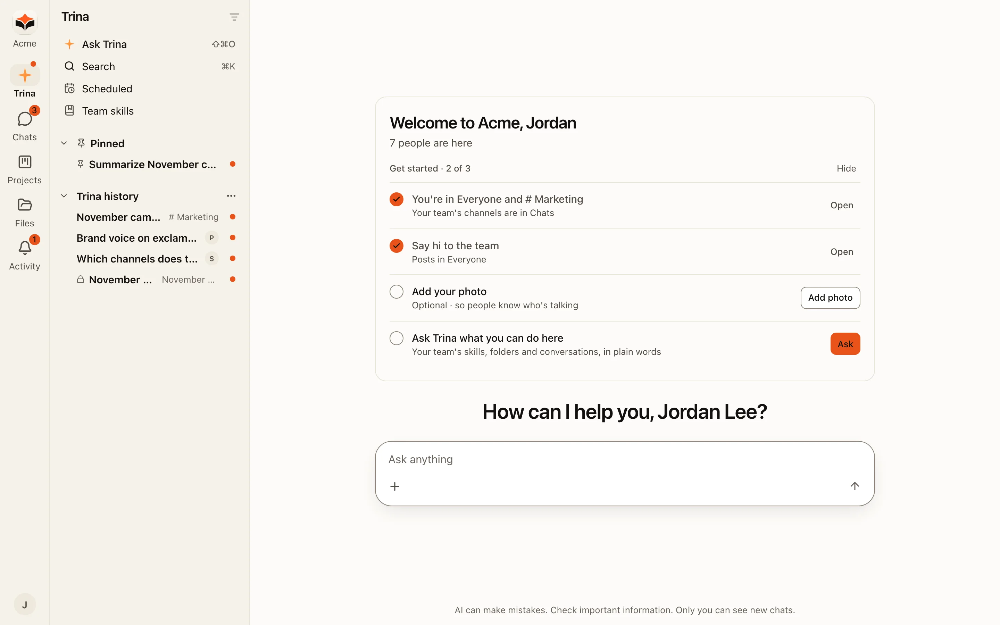

:::note
Ingin melihatnya dulu? [Coba dalam 1 menit, tanpa daftar](https://demo.trina.app).

Hanya ingin mencoba? Jalankan [demo lokal](get-started/quickstart.md). Demo ini tidak memerlukan akun AI.
:::

Trina AX adalah ruang kerja AI untuk perusahaan. Anda menyiapkan Claude Code satu kali di server, lalu semua orang memakainya dari browser.

| | Artinya |
|---|---|
| **Satu server** | Claude Code dan Codex berjalan di server Anda, bukan di setiap laptop. |
| **File Anda** | AI bekerja dari folder tim: `shared/`, `groups/`, `projects/` dan folder pribadi. |
| **Skill tim** | Sebuah file `SKILL.md` mengubah cara kerja tim Anda menjadi instruksi yang bisa dipakai ulang. |
| **Izin** | Server memeriksa setiap file yang dibuka AI, atas nama orang yang bertanya. |

---

## Memakai Trina AX di tempat kerja

Bukan developer? Mulai di sini. Setiap halaman punya langkah bernomor dengan nama tombol yang persis dan gambar layarnya.

:::cards cols=2
- icon=message-square | [Chat dan proyek](use/chats-and-projects.md) | Bertanya ke AI, bagikan chat seperti file Google Drive, dan simpan satu pekerjaan di sebuah proyek.
- icon=folder-lock | [File dan izin](use/files-and-permissions.md) | Bagikan file atau folder, dan simpan folder untuk lebih sedikit orang.
- icon=bell | [Pengaturan dan pencarian](use/settings-and-search.md) | Profil, bahasa, dan notifikasi Anda, serta pencarian ⌘K.
- icon=clock | [Tugas terjadwal](use/scheduled-tasks.md) | Biarkan AI mengerjakan hal yang sama setiap Senin, dengan beberapa klik.
:::

## Jalur yang disarankan untuk pengembang baru

:::steps
#### Jalankan demo
Mulai tim fiktif di komputer Anda dalam sekitar 10 menit. [Buka panduan memulai cepat](get-started/quickstart.md).

#### Pelajari istilahnya
Tim, grup, folder, skill, mesin, dan MCP dalam satu halaman. [Baca konsep utama](get-started/key-concepts.md).

#### Lihat cara semuanya bekerja bersama
Server, aplikasi web, mesin, dan pemeriksaan izin. [Baca arsitekturnya](../develop/architecture.md) (bahasa Inggris).

#### Buat perubahan pertama Anda
Siapkan server pengembangan, jalankan pemeriksaan, lalu buka pull request. [Baca panduan pengembangan lokal](../develop/local-development.md) (bahasa Inggris).

#### Siapkan untuk tim
Pilih hosting, server Linux, atau Mac kantor. [Bandingkan pilihan pemasangan](../operate/install.md) (bahasa Inggris).
:::

---

## Mengembangkan dengan Trina AX

:::cards cols=3
- icon=code | [Panduan pengembang (bahasa Inggris)](../develop/architecture.md) | Arsitektur, struktur repositori, pengujian, dan konvensi.
- icon=bot | [Untuk agen AI (bahasa Inggris)](../agents/overview.md) | Aturan untuk agen coding, dan cara AI bekerja di dalam Trina AX.
- icon=braces | [HTTP API (bahasa Inggris)](../reference/http-api.md) | Semua endpoint, dikelompokkan per bagian, beserta siapa yang boleh memanggilnya.
:::

## Kemampuan utama

:::cards cols=2
- icon=folder-lock | [File dan izin](use/files-and-permissions.md) | Setiap orang dan AI-nya hanya melihat folder yang boleh mereka buka.
- icon=book-open | [Skill tim](use/team-skills.md) | Instruksi yang bisa dipakai ulang, dikelola seperti file.
- icon=plug | [Koneksi MCP](use/mcp.md) | Biarkan AI memakai Notion, Linear, dan layanan lain.
- icon=clock | [Tugas terjadwal](use/scheduled-tasks.md) | Minta satu kali, lalu biarkan AI mengulang pekerjaannya.
:::

## Dukungan

:::cards cols=2
- icon=life-buoy | [Dukungan (bahasa Inggris)](../resources/support.md) | Tempat bertanya, melaporkan bug, atau mengirim laporan keamanan.
- icon=wrench | [Pemecahan masalah (bahasa Inggris)](../operate/troubleshooting.md) | Solusi untuk masalah umum, berdasarkan gejalanya.
:::
