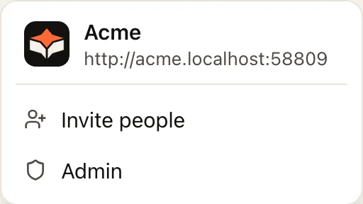
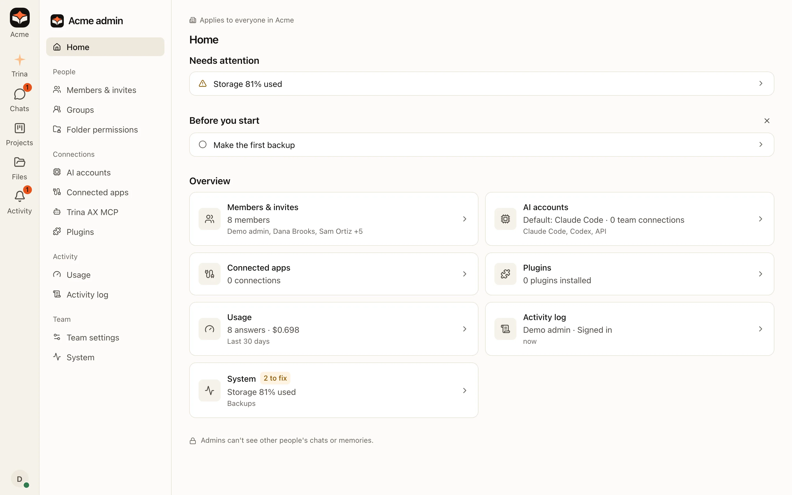
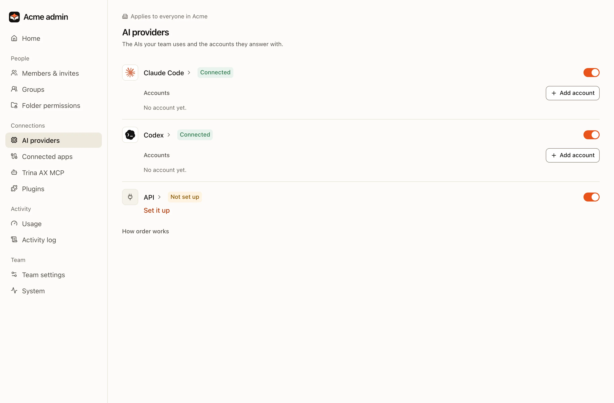
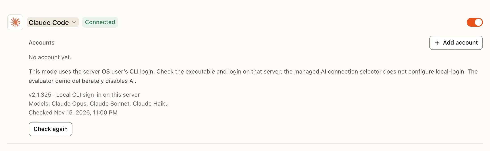
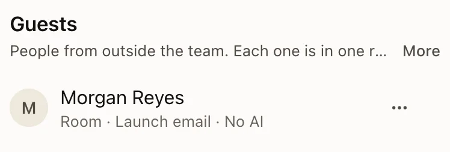
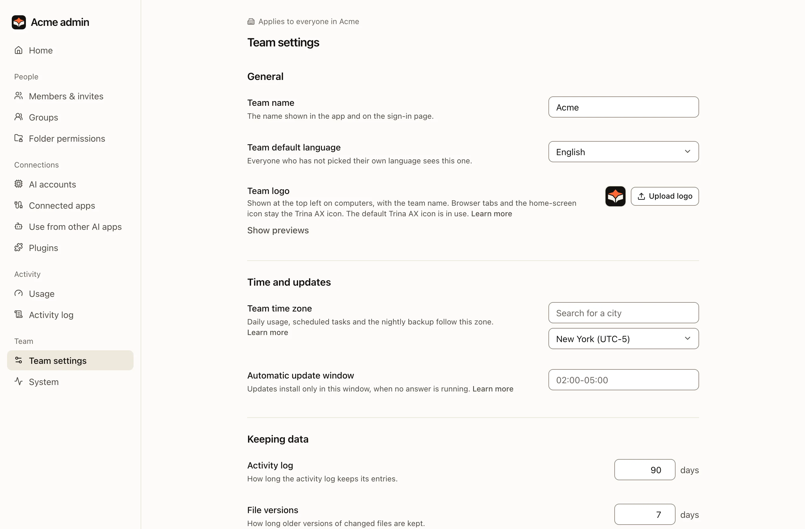
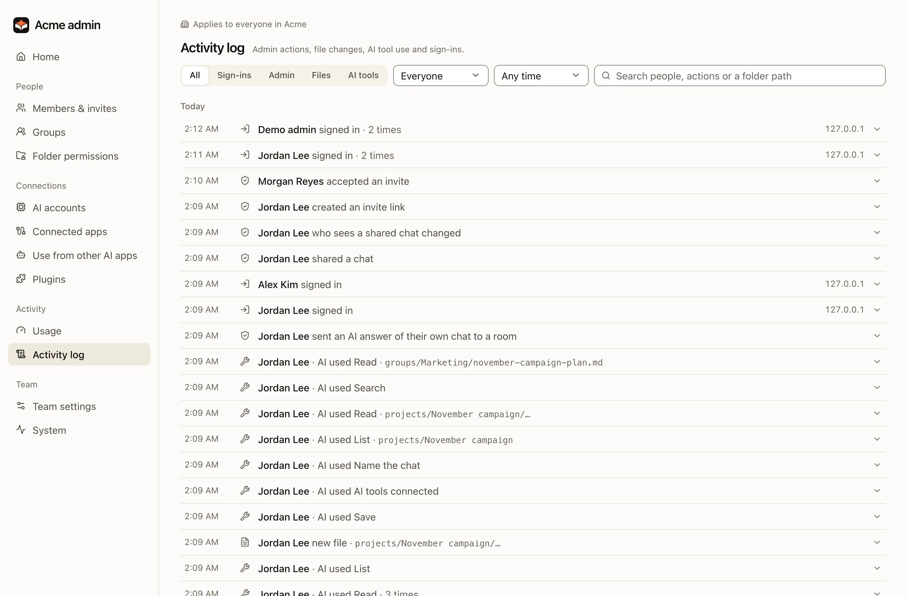
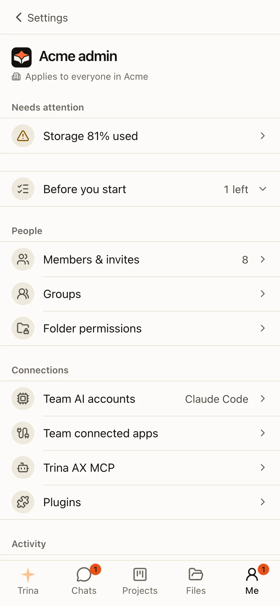

**Admin** untuk owner dan admin. Di komputer, Admin ada di menu tim di bawah logo tim Anda di bagian atas bilah kiri, dan ⌘K bisa menemukannya; di ponsel, Admin ada di tab **Saya**. Setiap halaman di dalamnya berlaku untuk seluruh tim: judul menunya adalah nama dan logo tim Anda ("Admin Acme"), dan setiap halaman menampilkan "Berlaku untuk semua orang di Acme" di atas judulnya. Nama halamannya sama dengan di Pengaturan. Admin › Aplikasi terhubung berisi koneksi tim; koneksi Anda sendiri ada di **Pengaturan › Konektor**. Admin terbuka di
**Beranda**, yang mencantumkan apa yang perlu diperhatikan lebih dulu.
Untuk owner, Beranda juga mencantumkan langkah penyiapan awal yang belum dikerjakan: cek koneksi AI, atur izin
folder, undang anggota tim, siapkan skill tim, buat backup pertama. Langkah yang sudah selesai hilang dari daftar.

## Menu Admin

| Grup | Halaman |
|---|---|
| **Orang** | Anggota & undangan, Grup, Izin folder |
| **Koneksi** | Penyedia AI, Aplikasi terhubung (aplikasi Google, layanan lain seperti Notion dan, khusus owner, [Slack](slack.md)), Trina AX MCP, Plugin |
| **Aktivitas** | Pemakaian, Log aktivitas |
| **Tim** | Pengaturan tim, Sistem |

**Anggota & undangan** juga mencantumkan tamu: orang dari luar tim yang berada di satu obrolan atau proyek. [Baca tentang tamu](guests.md).

:::note
Versi sebelumnya menempatkan akun AI di halaman tersendiri, **AI connections**, di samping **AI engines**. Sekarang
keduanya menjadi satu halaman **Penyedia AI** (sempat bernama **AI accounts**), dan alamat lamanya membuka halaman ini. Pengaturan AI tim (bawaan, siapa yang memilih mesin, akun milik
anggota, batas pemakaian) ada di **Pengaturan tim**. **Slack** dulu juga punya item menu sendiri; sekarang Slack menjadi
satu baris di **Aplikasi terhubung**, dan alamat lamanya membukanya di sana.
:::

Di perusahaan yang memakai Google Workspace, aplikasi Google bisa masuk dengan aplikasi Google milik perusahaan Anda sendiri, cukup diatur sekali untuk kelimanya: [Memakai aplikasi Google milik perusahaan Anda](google-own-app.md).

## Minggu pertama Anda

:::steps
#### Atur izin
Tetapkan folder ke grup dan periksa akses dengan dua akun uji. [Baca tentang izin](files-and-permissions.md).

#### Hubungkan AI
Di **Penyedia AI**, owner atau admin memilih **Tambah akun** di baris Claude Code atau Codex dan menghubungkan akun
Claude atau OpenAI yang berwenang. Setiap baris menunjukkan apakah mesin itu sudah siap.

#### Undang tim
Mulailah dengan kelompok uji coba kecil, lalu pastikan peran dan akses folder sudah benar. **Anggota & undangan** juga mencantumkan [tamu](#tamu) tim.
Di bawah daftar, **Link undangan** hanya menampilkan tautan yang masih berlaku: tautan undangan tim dan tautan undangan
yang belum dipakai siapa pun. Tautan yang sudah dipakai atau kedaluwarsa, atau tautan tamu yang ruang atau proyeknya sudah tidak ada, hilang dari daftar; siapa yang bergabung tercatat di daftar anggota dan di [Log aktivitas](#log-aktivitas).

#### Tambahkan skill pertama
Salin skill awal dan periksa hasilnya terhadap sumbernya. [Baca tentang skill](team-skills.md).

#### Buat backup pertama
Buat backup, lalu latih pemulihan bersama tim IT. [Baca tentang backup](../../operate/backups.md) (bahasa Inggris).
:::

## Yang tidak bisa dilakukan admin

- Membaca chat orang lain. Log aktivitas menunjukkan file mana yang dibaca AI, bukan isi percakapannya.
- Melihat folder pribadi atau skill pribadi di `users/<id>/`.
- Memakai koneksi MCP tim, kecuali sebuah aturan menyebut nama mereka.

:::warning
Orang yang mengoperasikan server, sistem operasinya, atau penyimpanannya bisa membaca file dan chat yang tersimpan. Pada paket yang di-hosting, ini termasuk operator Trina.
:::

## Penyedia AI

**Admin › Penyedia AI**, yang pertama di grup Koneksi, memiliki satu baris per mesin (Claude Code, Codex, API) dengan
logo, status, dan sakelar nyala/mati. Jika ada yang salah, satu baris singkat di bawah namanya menjelaskan cara
memperbaikinya. Di bawah Claude Code dan Codex ada akun-akun yang dipakai tim untuk menjawab, sesuai urutan dicobanya,
masing-masing dengan logo, paket, dan statusnya, serta **Tambah akun** untuk owner dan admin. **Cara urutan bekerja** di
bawah daftar menjelaskan urutannya.

Klik nama mesin untuk membuka detailnya: cara masuknya, setiap model, kapan terakhir diperiksa, **Cek lagi**, dan untuk
owner dan admin, formulir mesin API. Klik nama akun untuk melihat siapa yang memakainya, pemakaian bulan ini, dan kapan
terakhir dipakai. Menu **⋯** sebuah akun berisi Cek lagi, Naikkan / turunkan, ganti nama, ganti, matikan, dan hapus.

## Tamu

**Admin › Anggota & undangan** diakhiri dengan **Tamu**: orang dari luar tim, masing-masing di satu ruang atau satu
proyek, yang tidak memakai kursi. Setiap baris menunjukkan di mana tamu itu berada dan AI apa yang dimilikinya. Menu
**⋯**-nya berisi **Ubah AI** (tanpa AI, masuk dengan akun sendiri, atau akun AI tim dengan batas bulanan), **Jadikan
anggota tim**, dan **Keluarkan tamu**. Anggota mengundang tamu sendiri dari percakapan grup atau proyek
([Tamu](chats-and-projects.md#tamu)). Owner dan admin juga bisa memilih **Undang ke tim** › **Tamu** di sini lalu
memilih satu obrolan grup atau proyek ([Tamu: Dari Admin](guests.md#dari-admin)). Tim yang tidak punya tamu
tidak memiliki bagian **Tamu**; pilih **Tamu** di daftar peran untuk memeriksanya.

## Aplikasi terhubung

**Admin › Aplikasi terhubung** mencantumkan koneksi tim di bawah **Terhubung**, dan layanan yang bisa Anda tambahkan di
bawah **Jelajahi**. Setiap baris menunjukkan status aplikasinya (misalnya **Aktif**, **Menghubungkan**, atau **Perlu
perhatian**); seluruh baris membuka halaman aplikasi, yang menunjukkan status yang sama. Menghubungkan aplikasi yang
membuka jendela browser (aplikasi Google, proses masuk sebuah layanan, **Tambahkan ke Slack**) selalu bisa ditinggalkan:
**Coba lagi** dan **Batal** tersedia selama menunggu, dan penantian berakhir sendiri setelah lima menit jika jendelanya
ditutup. Slack punya panduan sendiri: [Slack](slack.md).

## Pengaturan AI tim

**Admin › Pengaturan tim** diakhiri dengan pengaturan AI tim:

| Grup | Isinya |
|---|---|
| **Default AI** | Mesin dan model bawaan, serta berapa banyak jawaban yang berjalan bersamaan. |
| **Siapa memilih mesin** | Apakah anggota boleh memilih mesin lain, dan beralih ke Codex saat batas Claude tercapai. |
| **Akun milik anggota** | Apakah anggota boleh menambahkan akunnya sendiri, apakah langganan boleh dibagikan, dan akun yang mereka tambahkan. |
| **Batas pemakaian** | Batas token atau dolar per hari atau per bulan, untuk satu orang, satu grup, atau tim. |

Batal dan Simpan hanya muncul di sebuah grup setelah Anda mengubah sesuatu di dalamnya; setiap grup disimpan sendiri-sendiri.

:::note
Mulai versi 0.4.0. Di versi 0.3.0 dan sebelumnya, semua ini beserta mesinnya ada di satu halaman **AI engines**.
:::

## Log aktivitas

**Admin › Log aktivitas** mencantumkan proses masuk, tindakan admin, perubahan file, dan pemakaian alat AI, dikelompokkan per hari. Filter tetap berada di atas saat Anda menggulir. Log ini tidak pernah menampilkan isi chat.

## Sistem

**Admin › Sistem** menampilkan penyimpanan tim, versi dan pembaruan, kesehatan server, cara tim menjangkau server, folder yang terhubung, backup, dan ekspor, sebagai bagian-bagian sederhana. Penyimpanan menghitung file dari obrolan dan ruang yang dihapus di **Berkas tim** ("Termasuk 120 MB dari chat dan ruang yang dihapus, dihapus setelah 30 hari"): file itu disimpan 30 hari agar bisa dikembalikan. Kesehatan mencantumkan apa yang perlu diperhatikan lebih dulu, seperti mesin yang belum ada, pemeriksaan yang gagal, atau pembaruan otomatis yang dimatikan; pemeriksaan yang lolos dilipat menjadi satu baris dengan **Lihat detail**. Admin yang bukan owner melihat paket, penyimpanan, dan, di Mac kantor, pembaruan otomatis. Agar disk kecil tidak penuh, backup tidak menyertakan folder yang dibangun ulang secara otomatis, dan cache yang tidak dipakai siapa pun selama 14 hari dibersihkan. File Anda sendiri tidak pernah disentuh. Jika pembaruan menunggu tugas yang sedang berjalan selesai, Sistem memberitahukannya; tersedia **Tunggu, lalu perbarui** atau **Tetap perbarui sekarang**.

