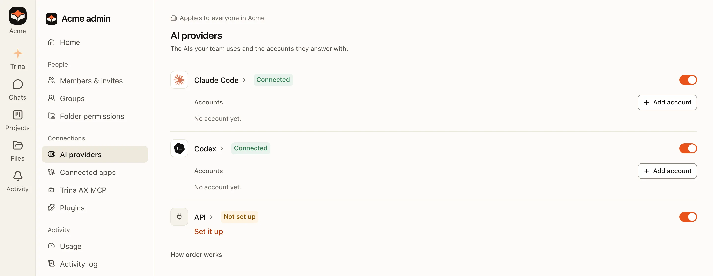
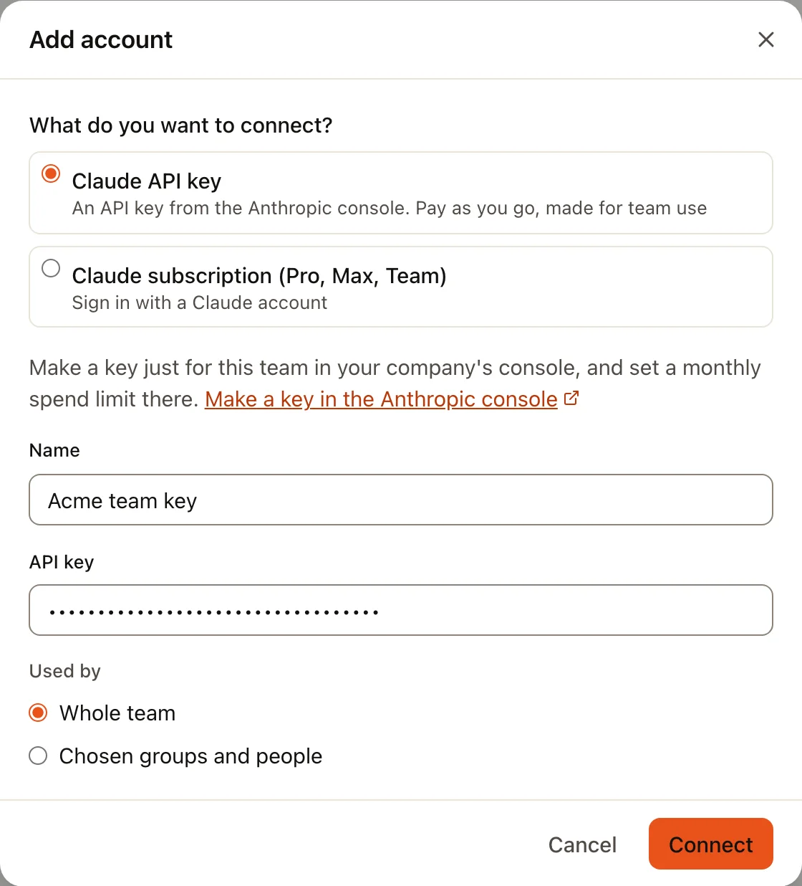
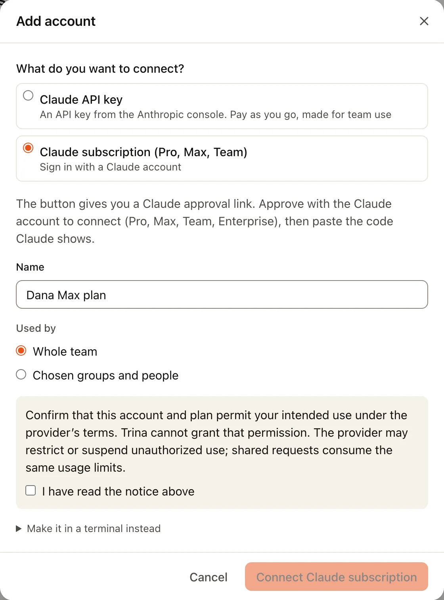
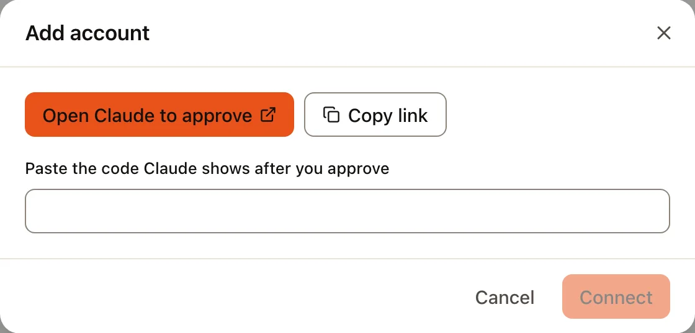
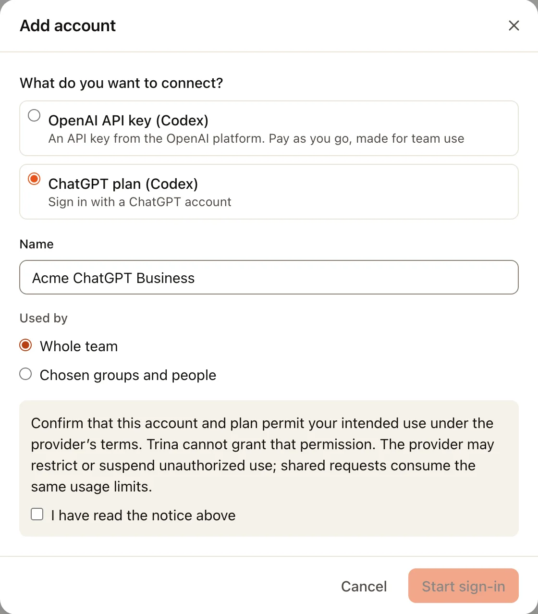
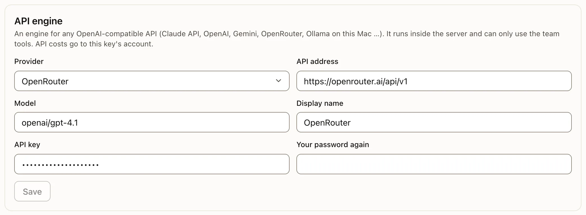
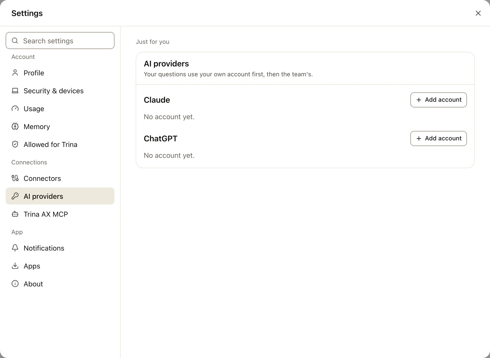

Trina AX menjawab dengan akun AI yang dihubungkan tim Anda: akun Claude atau ChatGPT, atau kunci API. Pemakaian AI tidak
termasuk dalam Trina AX. Akun atau kunci yang Anda hubungkan ditagih oleh Anthropic, OpenAI, atau perusahaan AI lain
itu, sesuai ketentuan perusahaan tersebut.

Owner atau admin menghubungkan akun tim di **Admin › Penyedia AI**. Jika tim mengizinkan, setiap orang juga bisa
menambahkan akunnya sendiri di **Pengaturan › Penyedia AI**: pertanyaan orang itu memakai akunnya lebih dulu.

## Mana yang dipilih

| Pilihan di Trina AX | Yang Anda perlukan | Ditagih oleh | Cocok untuk |
|---|---|---|---|
| **Kunci API Claude** | Kunci API dari Claude Console | Anthropic, per pemakaian | Tim, dengan batas bulanan yang Anda atur di Anthropic |
| **Langganan Claude (Pro, Max, Team)** | Akun Claude dengan paket berbayar | Anthropic, sesuai paket Anda | Akun milik satu orang |
| **Kunci API OpenAI (Codex)** | Kunci API dari platform OpenAI | OpenAI, per pemakaian | Tim yang memakai OpenAI |
| **Paket ChatGPT (Codex)** | Akun ChatGPT dengan paket berbayar | OpenAI, sesuai paket Anda | Akun milik satu orang |
| **Mesin API** | Alamat, model, dan kunci dari layanan apa pun yang kompatibel dengan OpenAI | Layanan itu | OpenRouter, Gemini, atau model di komputer Anda sendiri |

:::warning
Langganan (Claude atau ChatGPT) dibuat untuk pemiliknya. Sebelum Anda menghubungkannya untuk orang lain, pastikan
ketentuan penyedia mengizinkannya: dialog meminta Anda mencentang **Saya sudah membaca pemberitahuan di atas**. Untuk
tim, kunci API adalah pilihan yang lebih aman.
:::

## Menambahkan kunci API Claude

:::tip
**Yang Anda perlukan**

- **Kunci API**: kode panjang yang diawali `sk-`. Anda membuatnya di [Claude Console](https://platform.claude.com/settings/keys).
- **Nama**: nama apa saja yang dikenali tim Anda, misalnya "Kunci tim Acme".
:::

:::steps
#### Buat kunci di Anthropic
Masuk ke [Claude Console](https://platform.claude.com/settings/keys) dengan akun perusahaan Anda. Buka **API keys** dan
pilih **Create Key**. Beri nama seperti "Trina AX", lalu salin kuncinya: Anthropic hanya menampilkannya sekali. Selagi
di sana, atur batas pengeluaran bulanan untuk organisasi Anda di **Limits**. Lihat
[panduan kunci API](https://docs.claude.com/en/api/admin-api/apikeys/get-api-key) dari Anthropic untuk detailnya.

#### Buka Tambah akun
Di Trina AX, buka **Admin › Penyedia AI**. Di baris **Claude Code**, pilih **Tambah akun**, lalu **Kunci API Claude**.
Dialog juga menautkan ke Claude Console: **Buat kunci di konsol Anthropic**.

#### Tempel dan hubungkan
Isi **Nama** dan tempel kunci ke **Kunci API**. Di **Dipakai oleh**, biarkan **Seluruh tim** atau pilih **Grup dan orang
tertentu**. Pilih **Hubungkan**. Trina AX memeriksa kunci itu ke Anthropic, dan akun menampilkan **Berfungsi**.

:::

## Menambahkan langganan Claude

:::tip
**Yang Anda perlukan**

- **Akun Claude** dengan paket Pro, Max, Team, atau Enterprise, yang sudah masuk di browser Anda.
- Tidak ada yang perlu disalin dari konsol: Claude menampilkan **kode** setelah Anda menyetujui, dan Anda menempelnya
  kembali.
:::

:::steps
#### Buka Tambah akun
Di **Admin › Penyedia AI** (atau **Pengaturan › Penyedia AI** untuk akun Anda sendiri), pilih **Tambah akun** di bawah
Claude, lalu **Langganan Claude (Pro, Max, Team)**. Isi **Nama**, pilih siapa yang memakainya, baca pemberitahuannya, dan
centang **Saya sudah membaca pemberitahuan di atas**.

Untuk tim (di Admin), langganan hanya bisa dipilih setelah owner menyalakan **Izinkan langganan bersama** di
**Admin › Pengaturan tim**, di bagian **Akun milik anggota**. Sampai saat itu dialognya menampilkan "Berbagi langganan
dinonaktifkan."

#### Setujui di Claude
1. Pilih **Hubungkan langganan Claude**. Setelah beberapa detik, dialog menampilkan **Buka Claude untuk menyetujui**,
   **Salin tautan**, dan kotak kosong.
2. Pilih **Buka Claude untuk menyetujui**. Halaman Claude sendiri terbuka di tab baru. (Jika Anda masuk ke Claude di
   browser lain, pilih **Salin tautan** dan buka tautannya di sana.)
3. Di halaman Claude, masuk jika diminta, pastikan halaman itu menampilkan akun yang Anda maksud, lalu setujui. Claude
   lalu menampilkan sebuah kode.

#### Tempel kodenya
1. Di halaman Claude, salin seluruh kodenya dengan tombol salinnya (ada `#` di tengahnya).
2. Kembali ke tab Trina AX, tempelkan ke **Tempel kode yang ditampilkan Claude setelah Anda menyetujui**, lalu pilih
   **Hubungkan**.
3. Trina AX menampilkan **Terhubung · Langganan Claude**, dan akun itu muncul di baris Claude Code.
:::

Kata sandi Claude Anda tidak pernah sampai ke Trina AX: Anda masuk di halaman Claude sendiri, dan Trina AX hanya
menyimpan akses yang diberikan Claude.

**Buat lewat terminal** (di bawah pemberitahuan) adalah cara lain, untuk orang yang sudah memasang Claude Code: jalankan
`claude setup-token` di terminal, setujui di browser yang terbuka, lalu tempel seluruh token yang dicetaknya (terminal
memberi tahu baris yang mana) ke **Token**. Token ini berlaku satu tahun.

## Menambahkan kunci API OpenAI

:::tip
**Yang Anda perlukan**

- **Kunci API**: diawali `sk-`. Anda membuatnya di [platform OpenAI](https://platform.openai.com/api-keys).
:::

:::steps
#### Buat kunci di OpenAI
Masuk ke [platform OpenAI](https://platform.openai.com/api-keys), buka **API keys**, dan pilih **Create new secret key**.
Pilih proyek tempat kunci itu berada, lalu salin kuncinya: OpenAI hanya menampilkannya sekali. Atur anggaran untuk
proyek itu di **Limits**.

#### Tempel di Trina AX
Di **Admin › Penyedia AI**, pilih **Tambah akun** di baris **Codex**, lalu **Kunci API OpenAI (Codex)**. Isi **Nama**,
tempel kunci ke **Kunci API**, pilih siapa yang memakainya, lalu pilih **Hubungkan**.
:::

## Menambahkan paket ChatGPT

:::tip
**Yang Anda perlukan**

- **Akun ChatGPT** dengan paket berbayar. Tidak ada yang perlu disalin dari konsol: Trina AX memberi Anda alamat dan
  kode untuk dimasukkan di OpenAI.
:::

:::steps
#### Mulai proses masuk
Di **Admin › Penyedia AI**, pilih **Tambah akun** di baris **Codex**, lalu **Paket ChatGPT (Codex)**. Isi **Nama**,
pilih siapa yang memakainya, centang **Saya sudah membaca pemberitahuan di atas**, lalu pilih **Mulai masuk**.

#### Masukkan kode di OpenAI
1. Trina AX menampilkan **Buka halaman masuk ChatGPT** dan, di bawah **Masukkan kode ini (dalam 15 menit)**, sebuah kode
   pendek seperti `WXYZ-12AB3` dengan tombol salin.
2. Buka halamannya. Masuk di OpenAI dengan akun ChatGPT.
3. Ketik atau tempel kodenya di sana, lalu setujui. Biarkan tab Trina AX tetap terbuka: tab itu lanjut dengan sendirinya.

#### Selesai
Trina AX menampilkan **Terhubung · ChatGPT** beserta nama paketnya. Jika Anda masuk dengan akun yang bukan Anda maksud,
keluar di chatgpt.com lalu pilih **Mulai lagi**.
:::

## Mesin API

Mesin API berbicara dengan layanan apa pun yang menyediakan API yang kompatibel dengan OpenAI. Mesin ini masih ditandai
**Eksperimental**: jawaban, alat, dan biayanya bisa berbeda dari Claude Code dan Codex.

:::tip
**Yang Anda perlukan**

- **Penyedia**: pilih salah satu, dan Trina AX mengisi **Alamat API** serta sebuah **Model**.
- **Model**: nama persis model di penyedia itu.
- **Kunci API**: dari halaman kunci milik penyedia.
- **Kata sandi Anda lagi**: kata sandi Trina AX Anda sendiri, untuk konfirmasi.
:::

| Penyedia | Alamat API | Tempat membuat kunci |
|---|---|---|
| OpenAI | `https://api.openai.com/v1` | [platform.openai.com/api-keys](https://platform.openai.com/api-keys) |
| Claude API (Anthropic) | `https://api.anthropic.com/v1` | [platform.claude.com/settings/keys](https://platform.claude.com/settings/keys) |
| Google Gemini | `https://generativelanguage.googleapis.com/v1beta/openai` | [aistudio.google.com/apikey](https://aistudio.google.com/apikey) |
| OpenRouter | `https://openrouter.ai/api/v1` | [openrouter.ai/settings/keys](https://openrouter.ai/settings/keys) |
| Ollama (di komputer server) | `http://127.0.0.1:11434/v1` | Tanpa kunci: model yang berjalan di komputer yang sama dengan server. Hanya owner yang dapat mengatur alamat ini |

:::steps
#### Buka baris API
Di **Admin › Penyedia AI**, pilih **Atur sekarang** di bawah **API**.

#### Isi formulirnya
Pilih **Penyedia**, periksa **Model**, beri **Nama tampilan**, tempel **Kunci API**, dan ketik **Kata sandi Anda lagi**.
Pilih **Simpan**.

:::

## Akun Anda sendiri

Jika admin menyalakan **Izinkan anggota menambah koneksi AI sendiri** (**Admin › Pengaturan tim**, **Akun milik
anggota**), semua orang melihat **Pengaturan › Penyedia AI**: "Pertanyaan Anda memakai akun Anda sendiri lebih dulu,
lalu akun tim." Pilih **Tambah akun** di bawah **Claude** atau **ChatGPT** dan ikuti langkah yang sama seperti di atas.
Hanya pertanyaan Anda sendiri yang memakainya; admin tidak bisa memakainya atau melihat kuncinya.

## Input suara

Input suara mengubah ucapan menjadi teks melalui OpenRouter. Di server Anda sendiri, admin menambahkan **Kunci API
OpenRouter** di **Admin › Pengaturan tim**, di bagian **Input suara**. Buat kuncinya di
[openrouter.ai/keys](https://openrouter.ai/keys).

## Masalah

| Yang Anda lihat | Yang perlu dilakukan |
|---|---|
| **Bukan kunci API jenis ini.** | Kunci itu untuk jenis lain (kunci OpenAI di kolom Claude, atau sebaliknya), atau tersalin dengan spasi. Salin lagi. |
| **Tempel seluruh kodenya (ada # di tengahnya).** | Sebagian kode Claude hilang. Salin lagi dengan tombol salin milik Claude. |
| **Kode itu tidak berhasil. Mulai lagi, setujui, lalu tempel kode yang baru.** | Kode sudah pernah dipakai atau terlalu lama. Pilih **Hubungkan langganan Claude** lagi. |
| **Waktu habis.** (ChatGPT) | Kode berlaku 15 menit. Pilih **Mulai lagi**. |
| **Koneksi hanya bisa ditambahkan lewat koneksi aman (https).** | Buka Trina AX di alamat `https://`-nya. |
| Akun menampilkan **Ditolak** atau **Perlu dihubungkan ulang** | Kunci dicabut atau masa masuknya berakhir. Buka menu **⋯** akun itu dan pilih **Ganti token atau kunci** atau **Hubungkan ulang**. |
| Akun menampilkan **Batas bulanan habis** | Batas yang diatur di **⋯** › **Batas bulanan** sudah tercapai. Naikkan batasnya atau tunggu bulan berikutnya. |

Selengkapnya tentang urutan pemakaian akun, batas, dan mesin: [Admin](admin.md#penyedia-ai) dan
[Pemakaian dan batas](usage-and-limits.md).
