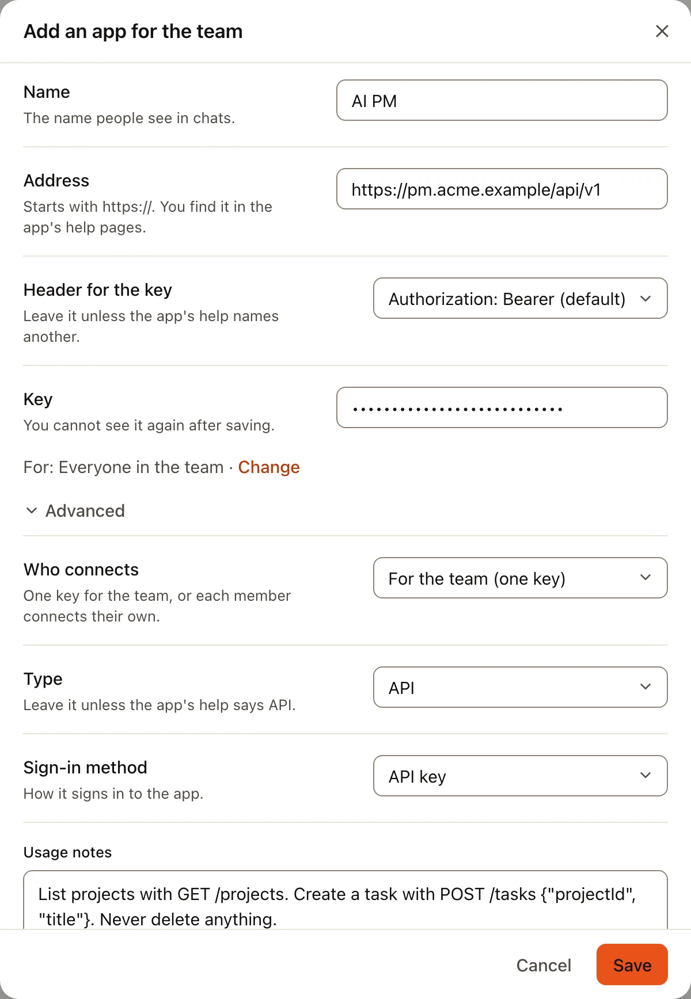
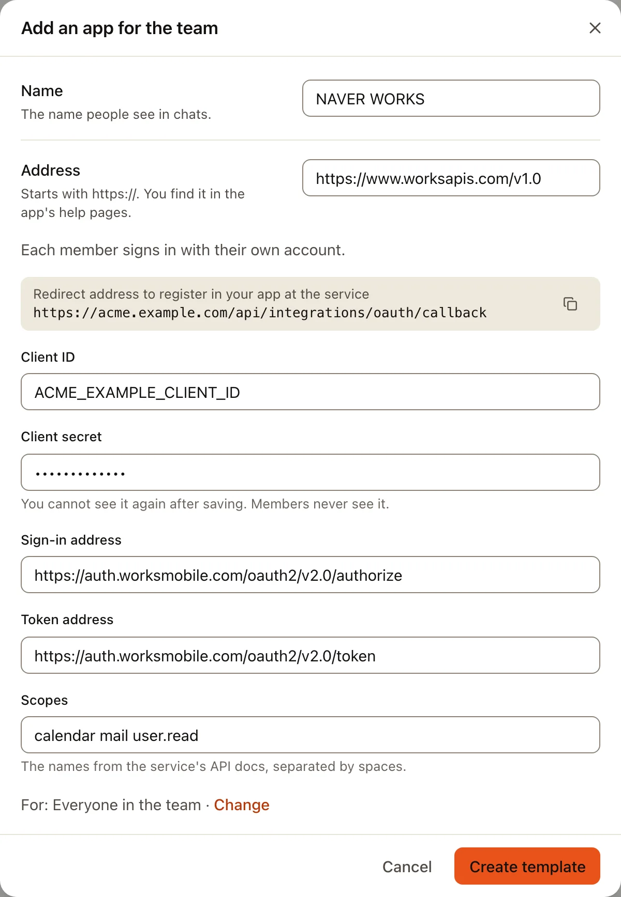

Perusahaan Anda mungkin punya sistem sendiri: pelacak proyek, sistem pesanan, alat internal. Jika sistem itu punya web
API, AI bisa memakainya. Owner atau admin menambahkannya sekali di **Admin › Aplikasi terhubung**, dengan alamatnya,
sebuah kunci, dan beberapa baris tentang cara memakainya. Setelah itu AI hanya bisa memanggil alamat di bawah alamat
tersebut.

Beberapa layanan, seperti NAVER WORKS, tidak memberikan kunci: orang masuk lewat aplikasi masuk yang dibuat perusahaan
Anda di layanan itu. Itu dibahas di [paruh kedua halaman ini](#masuk-dengan-aplikasi-anda-sendiri).

Anda memerlukan orang yang memahami sistem itu (admin atau pengembangnya) untuk nilai-nilai di bawah. Tidak ada yang
memerlukan kode di sini.

## Menghubungkan API dengan kunci

:::tip
**Yang Anda perlukan**

- **Alamat**: alamat dasar API, misalnya `https://pm.acme.example/api/v1`. Tanyakan ke admin sistem itu, atau cari di
  dokumentasi API-nya ("base URL").
- **Kunci**: kunci API atau token untuk sistem itu. Buat satu khusus untuk Trina AX, dengan hak tidak lebih dari yang
  diperlukan AI.
- **Header untuk kunci**: sebagian besar API menerima `Authorization: Bearer <key>`. Jika dokumentasi API menyebut header
  lain, seperti `X-API-Key`, catat namanya persis.
- **Catatan pemakaian**: beberapa baris tentang alamat mana yang sebaiknya dipanggil AI. Dokumentasi API sistem itu
  memuatnya.
:::

:::steps
#### Buka dialognya
1. Pilih logo tim Anda di bagian atas bilah kiri, lalu **Admin › Aplikasi terhubung**.
2. Gulir ke akhir **Jelajahi**. Di bawah daftar, di samping "Tidak ada di daftar?", pilih **Tambahkan lewat alamatnya**.
   Dialog **Tambah aplikasi untuk tim** terbuka.
3. Di dekat bagian bawah dialog, buka **Lanjutan** (bagian ini terlipat). Atur **Jenis** ke **API** dan **Cara masuk**
   ke **Kunci API**. Dialog lalu menampilkan kolom-kolom di bawah ini.

#### Isi kolom-kolomnya
- **Nama**: nama yang dilihat orang di chat, misalnya "AI PM".
- **Alamat**: alamat dasarnya. AI hanya bisa memanggil jalur di bawahnya.
- **Header untuk kunci**: biarkan **Authorization: Bearer (bawaan)**, atau pilih **Header lain** dan ketik **Nama
  header** persis seperti yang tertulis di dokumentasi.
- **Kunci**: tempel kuncinya.
- **Catatan pemakaian**: jalur utama, nilai yang diperlukan, dan apa pun yang tidak boleh dilakukan AI. Paling banyak
  4.000 karakter.



#### Pilih siapa yang boleh memakainya, lalu simpan
**Untuk: Semua orang di tim · Ubah** memilih grup atau orang. Biarkan **Menulis, menghapus, dan mengirim** pada **Selalu
tanya** untuk awalnya. Pilih **Simpan**: Trina AX memeriksa alamat dan kuncinya, dan barisnya menampilkan **Terhubung**.
:::

Catatan pemakaian yang baik terlihat seperti ini:

```
List projects with GET /projects.
Create a task with POST /tasks and a JSON body {"projectId", "title", "dueDate"}.
Dates are YYYY-MM-DD. Never call DELETE.
```

AI membaca catatan ini setiap kali memakai API, jadi buat singkat dan tepat.

## Masuk dengan aplikasi Anda sendiri

Beberapa layanan mengizinkan orang masuk (OAuth) tetapi hanya lewat aplikasi yang terdaftar di layanan itu: NAVER WORKS,
dan MCP server milik Google sendiri. Anda membuat aplikasi itu sekali di konsol pengembang layanan tersebut, lalu
menempelkan nilainya ke Trina AX. Biasanya Anda menambahkannya sebagai **templat**, agar setiap anggota masuk dengan
akunnya sendiri.

:::tip
**Yang Anda perlukan, dari konsol pengembang layanan itu**

- **Client ID** dan **Client secret** dari aplikasi yang Anda buat di sana.
- **Alamat login** dan **Alamat token** (untuk API; MCP server menemukannya sendiri).
- **Cakupan (scope)**: izin yang diperlukan AI, dipisahkan dengan spasi.

**Yang Anda berikan ke layanan itu**

- **Alamat pengalihan** yang ditampilkan Trina AX: `https://<your team address>/api/integrations/oauth/callback`.
:::

:::steps
#### Buka dialognya di Trina AX lebih dulu
1. Di **Admin › Aplikasi terhubung**, pilih **Tambahkan lewat alamatnya** (di bawah daftar **Jelajahi**).
2. Buka **Lanjutan** lalu atur **Siapa yang menghubungkan** ke **Milik tiap anggota**, **Jenis** ke **API** (atau
   **Server MCP**), dan **Cara masuk** ke **Masuk (OAuth)**. Untuk MCP server, nyalakan juga **Login dengan aplikasi
   saya**.
3. Dialog sekarang menampilkan **Alamat pengalihan untuk didaftarkan di aplikasi Anda pada layanan**, dengan tombol
   salin. Salin dengan tombol itu, bukan dengan memilih teksnya, dan biarkan dialog tetap terbuka.

#### Buat aplikasinya di layanan
Di konsol pengembang layanan itu, buat aplikasi (mungkin disebut "OAuth app", "client", atau "integration"). Tempel
alamat pengalihan di bagian redirect URL-nya, pilih cakupannya, lalu salin **Client ID** dan **Client secret**-nya.

#### Isi sisanya dan simpan
Kembali di Trina AX, isi **Nama**, **Alamat**, **Client ID**, **Client secret**, **Alamat login** dan **Alamat token**
(untuk API), serta **Cakupan (scope)**. Pilih **Buat templat**. Anggota lalu melihatnya di **Pengaturan › Konektor** dan
masuk dengan akunnya sendiri.


:::

### NAVER WORKS

| Di Trina AX | Nilai |
|---|---|
| **Jenis** | **API** |
| **Alamat** | `https://www.worksapis.com/v1.0` |
| **Alamat login** | `https://auth.worksmobile.com/oauth2/v2.0/authorize` |
| **Alamat token** | `https://auth.worksmobile.com/oauth2/v2.0/token` |
| **Client ID**, **Client secret** | Dari aplikasi Anda di NAVER WORKS Developer Console |
| **Cakupan (scope)** | Yang diperlukan AI, misalnya `calendar mail file user.read` |
| **Catatan pemakaian** | Alamat API yang sebaiknya dipanggil AI, dari dokumentasi API NAVER WORKS |

Di NAVER WORKS Developer Console, buka aplikasi Anda (atau tambahkan di bawah API 2.0), atur **Redirect URL**-nya ke
alamat yang ditampilkan Trina AX, centang **OAuth Scopes** yang sama, lalu salin **Client ID** dan **Client Secret**.
NAVER WORKS menjelaskan proses masuknya di [panduan OAuth](https://developers.worksmobile.com/kr/docs/auth-oauth)
miliknya.

### MCP server milik Google

Google juga menyediakan MCP server untuk Gmail, Calendar, Drive, dan lainnya (`https://gmailmcp.googleapis.com/mcp/v1`
dan sejenisnya), dalam program pratinjau Google. Server ini memerlukan aplikasi masuk Google milik Anda sendiri, yang
dibuat seperti di [Aplikasi Google milik perusahaan Anda](google-own-app.md#di-google-cloud) tetapi dengan alamat
pengalihan di atas. Untuk pemakaian sehari-hari, [aplikasi Google](google-apps.md) bawaan tidak memerlukan aplikasi
milik Anda sendiri.

## Masalah

| Yang Anda lihat | Yang perlu dilakukan |
|---|---|
| **Layanan tidak menerima Client ID atau Secret aplikasi ini.** | Client ID atau secret tersalin keliru, atau secret diperbarui di layanan. Edit koneksinya, masukkan lagi secret di bawah **Lanjutan**, lalu masuk lagi. |
| Layanan mengatakan alamat pengalihan salah (`redirect_uri_mismatch`, "invalid redirect") | Redirect URL di konsol layanan berbeda dari yang ditampilkan Trina AX. Salin lagi dengan tombol salin; periksa `https`, alamat tim, dan pastikan tidak ada garis miring di akhir. |
| **Client secret yang tersimpan tidak ikut ke alamat baru. Masukkan lagi.** | Anda mengubah alamat atau alamat login. Demi keamanan, secret tidak dipakai ulang: tempel lagi. |
| Panggilan menjawab 401 atau 403 | Kunci kedaluwarsa, kekurangan izin, atau tersalin dengan spasi. Buat kunci baru, atau tambahkan cakupan yang kurang di layanan lalu masuk lagi. |
| AI memanggil jalur yang salah | Buat **Catatan pemakaian** lebih tepat: cantumkan setiap jalur beserta metodenya. |

Detail lengkap untuk pengembang: [Integrations](../../../INTEGRATIONS.md#your-own-app-client-id) (bahasa Inggris).
