Chat adalah percakapan dengan AI. Chat baru hanya milik Anda sampai Anda [membagikannya](#membagikan-chat); chat di proyek
tim dibagikan ke anggota proyek kecuali Anda memilih **Hanya saya**. Admin melihat file mana yang dibaca AI, tetapi tidak
pernah melihat isi percakapannya.

## Memulai chat

:::steps
#### Buka chat baru
Pilih **Tanya Trina** di bagian atas daftar Trina Anda (**Trina** di bilah kiri), tekan ⇧⌘O (Ctrl+Shift+O di Windows), atau ketik di kotak pada halaman beranda. Di ponsel, tab **Trina** terbuka di Beranda: ketik di kotak di bagian bawah. Pada kali pertama, di bawah kotak, **Sudah disiapkan tim** menampilkan apa yang sudah disiapkan tim Anda: skill tim (**Contoh** menampilkan hasilnya, **Coba** membuka skill tersebut) sampai Anda menjalankan
salah satunya, dan file tim (**Tanyakan** menaruh pertanyaan tentang file itu di kotak, tanpa dikirim). Jika belum ada yang disiapkan, **Mulai
dari sini** menawarkan satu pertanyaan untuk dikirim.

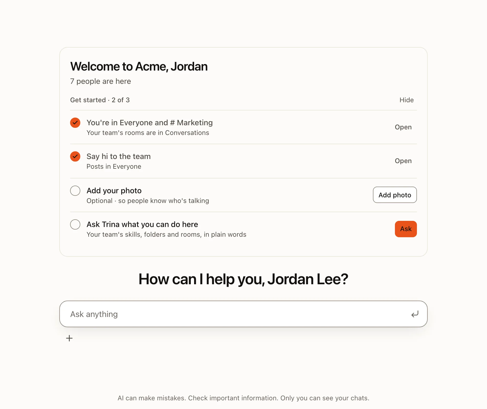

#### Bertanya dengan kata-kata biasa
Misalnya: "Ringkas catatan penjualan minggu lalu di shared/sales." Ketik `/` untuk memilih skill tim.

Kotak pesan berisi teks Anda di atas dan satu baris tombol di bawahnya, di dalam kotak: **+** di kiri menambahkan file
(dari komputer Anda atau dari file tim), dan di kanan ada pilihan AI (untuk orang yang diizinkan admin), mikrofon
jika diaktifkan, dan kirim (**↑**). Enter mengirim pesan.

#### Ikuti pekerjaannya
Buka **N langkah** di bawah jawaban untuk melihat setiap alat yang dipakai AI dan setiap file yang dibacanya.
:::

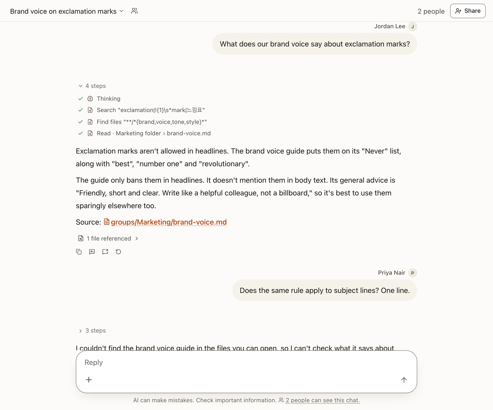

## Cara jawaban bekerja

| Topik | Yang terjadi |
|---|---|
| **Mesin** | Anggota memakai mesin bawaan tim. Orang yang diizinkan admin bisa memilih mesin dan model di dalam chat. |
| **File** | AI memakai alat file milik Trina. Setiap panggilan diperiksa sesuai izin Anda sendiri. |
| **Pertanyaan** | Jika AI memerlukan pilihan atau konfirmasi, AI menampilkan kartu. AI tidak bisa menjawab kartu itu sendiri. |
| **Agen bantu** | Untuk permintaan besar, AI bisa membagi pekerjaan menjadi subtugas, sampai 4 sekaligus. Setiap agen bantu bekerja atas nama Anda. |
| **Panjang** | Satu jawaban boleh memakai alat sampai 150 kali secara bawaan (admin bisa memilih 10 sampai 500). Saat batas tercapai, **Lanjutkan** meneruskannya. |
| **Web** | AI bisa membuka halaman web. Server memeriksa setiap alamat, dan menanyakan Anda dulu sebelum membuka alamat yang berisiko. |

:::note
Konteks yang dipilih dikirim ke penyedia AI yang Anda hubungkan. Self-hosting bukan berarti pemrosesan offline. [Baca alur datanya](../../operate/security.md) (bahasa Inggris).
:::

## Daftar Trina Anda

Di komputer, **Trina** di bilah kiri membuka daftar chat Trina Anda di samping halaman. Di bagian atas ada
**Tanya Trina**, **Cari**, **Terjadwal**, dan **Skill tim**. Di bawahnya, dari atas:

| Bagian | Isinya |
|---|---|
| **Menunggu jawaban Anda** | Hanya tampil selama ada chat yang menunggu jawaban Anda, dan membuka chat itu |
| **Disematkan** | Chat yang Anda sematkan |
| **Riwayat Trina** | Semua chat Anda yang lain, yang terbaru di atas. Chat di dalam proyek menampilkan nama proyeknya di ujung barisnya |

Tanda kecil menunjukkan siapa yang melihat sebuah chat: gembok sebelum judul untuk chat di proyek tim yang hanya Anda lihat, dan
ikon orang untuk chat yang dibagikan. Chat bersama yang juga ditulisi orang lain menampilkan wajah mereka di ujung barisnya (sampai 3, 2 di
ponsel); arahkan kursor ke wajah itu untuk melihat namanya. Hal ini sama di riwayat Anda, di halaman proyek, dan di pencarian.

**Trina** di bilah juga membuka chat yang menunggu selama ikonnya menampilkan **?**. Chat yang Anda hapus ada di **Riwayat terhapus**, di
menu **⋯** di samping **Riwayat Trina**. Tombol filter di bagian atas daftar bisa menampilkan sebagian chat saja, misalnya
chat yang sedang menjawab atau menunggu Anda. Proyek Anda punya tempat sendiri: **Proyek** di bilah kiri.

Di ponsel, tab **Trina** terbuka di Beranda. **☰** di bagian atas membuka riwayat Anda: **Cari**, **Terjadwal**, **Skill
tim**, lalu **Riwayat Trina** (chat yang disematkan lebih dulu, lalu yang terbaru, per tanggal), serta **Atur status** dan
**Riwayat terhapus** di bagian bawah.

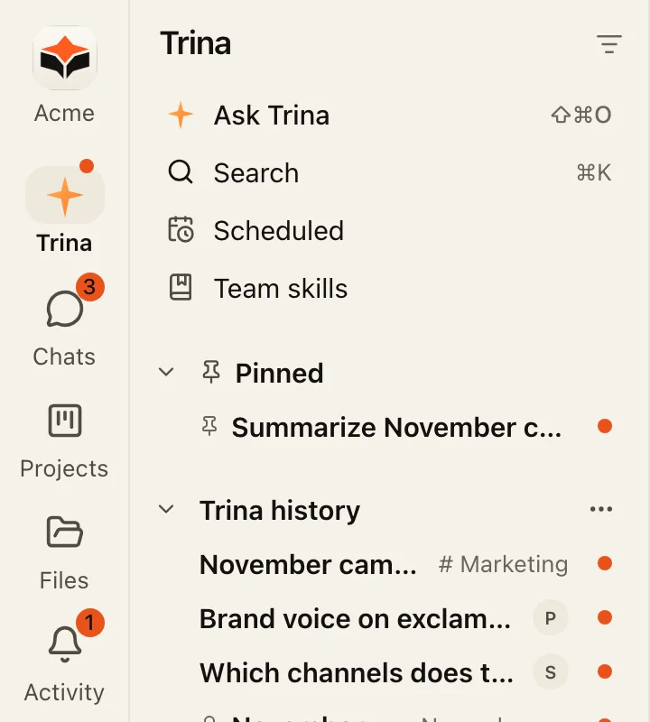

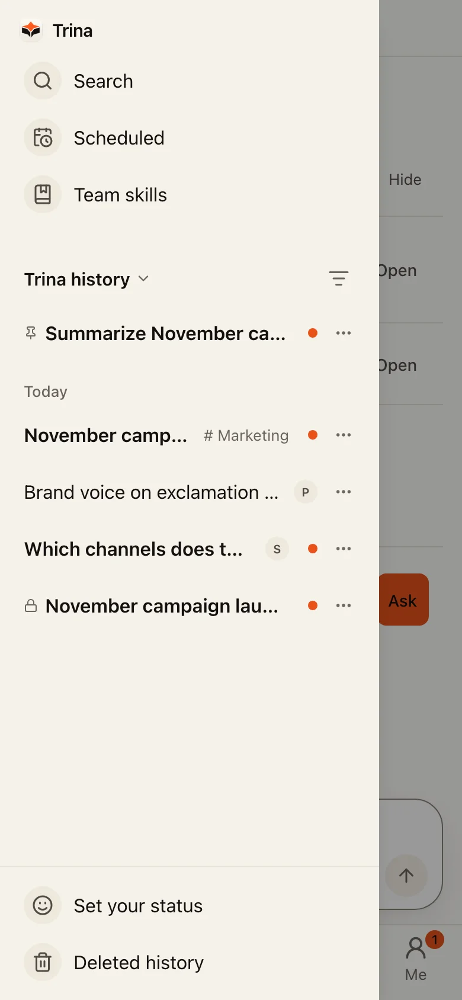

### Folder

Chat Trina tidak punya folder. Untuk mengumpulkan chat tentang satu pekerjaan, masukkan ke dalam [proyek](#proyek).

Daftar **Obrolan** punya **Folder obrolan** untuk saluran dan pesan langsung. Folder hanya merapikan daftar Anda, tidak lebih:
folder tidak menyimpan file dan tidak pernah mengubah siapa yang melihat sebuah percakapan. Buat folder dengan **Folder baru**, lalu pakai
**···** › **Pindahkan ke folder** pada sebuah percakapan. Menu **···** pada folder bisa mengganti nama, memindahkannya ke atas atau ke bawah, atau menghapusnya; menghapus folder tetap menyimpan
percakapannya di daftar Anda.

## Beberapa chat sekaligus

Setiap chat di daftar chat Trina Anda menampilkan paling banyak satu tanda, di ujung kanan barisnya:

| Tanda | Artinya |
|---|---|
| **?** berwarna kuning | AI menunggu Anda: kartu pertanyaan atau konfirmasi, atau jawaban yang gagal atau berhenti di batas. **?** pada kartu tetap ada sampai Anda menjawabnya. |
| Lingkaran abu-abu | AI sedang menjawab, atau jawabannya sedang menunggu giliran. |
| Titik, judul tebal | Jawaban baru yang belum Anda buka. |

Membuka chat menghapus titiknya, juga **?** dari jawaban yang gagal atau berhenti, di semua perangkat. Bagian yang dilipat tetap menampilkan tanda terkuat dari chat di dalamnya. Ruang obrolan menampilkan **?** menggantikan jumlahnya selama AI menunggu jawaban Anda di sana.

Saat tab browser berada di latar belakang, judulnya menghitung chat dan ruang obrolan yang memerlukan Anda, misalnya "(2) Trina". Aplikasi desktop menampilkan angka yang sama di Dock pada Mac, dan sebuah notifikasi ketika kartu muncul atau ketika jawaban yang berjalan lebih dari satu menit selesai saat Anda sedang melihat ke tempat lain; mengekliknya membuka chat itu. Tugas terjadwal hanya mendapat tanda; pertanyaan yang diajukan dari Slack dijawab di sana, sehingga chatnya tidak mendapat titik. **Trina** di bilah kiri (di ponsel, tab **Trina**) menampilkan **?** atau titik ketika ada chat yang memerlukan Anda, **Obrolan** menampilkan **?** selama AI menunggu jawaban Anda di ruang obrolan, dan di ponsel muncul pesan singkat dengan **Buka** di dalam aplikasi.

## Membagikan chat

Anda bisa membagikan chat mana pun milik Anda ke orang dan grup, seperti file di Google Drive. Mereka melihat seluruh chat, termasuk yang dibicarakan sebelum mereka
ditambahkan, dan bisa bertanya sendiri ke AI di dalamnya.

:::steps
#### Buka Bagikan
Di menu judul chat, atau di **···** pada barisnya di daftar Anda, pilih **Bagikan**.

#### Tambahkan orang dan grup
Ketik nama di **Tambahkan orang dan grup**. Anda ada di daftar sebagai **Memulai chat ini**. **✕** mengeluarkan seseorang lagi
(**Urungkan** mengembalikannya selama belum disimpan).

#### Simpan
Tekan **Bagikan** (**Simpan** jika chat sudah pernah dibagikan). Jika Anda keluar dengan perubahan yang belum disimpan, aplikasi akan bertanya dulu.
:::

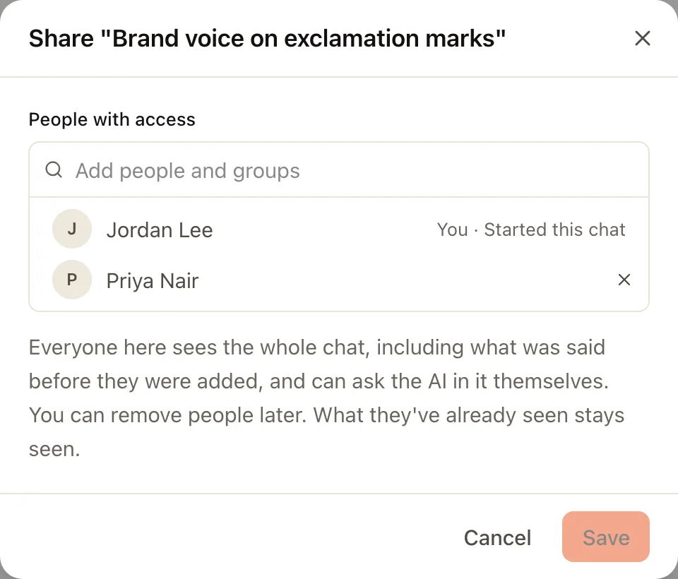

- **Sebelum orang baru ditambahkan**, aplikasi memeriksa apa yang akan mulai mereka lihat. Jika chat memakai tempat yang tidak bisa
  dibuka sebagian dari mereka, aplikasi menyebutkannya, misalnya "1 orang tidak bisa membuka sebagian yang dipakai chat ini: groups/Marketing/". Jika aplikasi
  menyebut jawaban ("2 jawaban di sini memakai tempat yang tidak bisa dibuka Priya"), **Lihat jawaban** menampilkan daftarnya. **Tetap bagikan** membagikan
  chat; **Batal** membiarkannya seperti semula.
- **File.** File yang Anda lampirkan dari komputer sebelum membagikan menjadi terlihat oleh orang yang Anda tambahkan, dan dialog
  menyebutkan jumlahnya. File yang Anda ubah sejak dilampirkan tetap milik Anda: file itu tidak dihitung, dan orang lain tidak melihatnya.
  Di chat bersama, siapa pun di dalamnya bisa melampirkan file dari komputer (paling besar 50 MB per file): file disimpan bersama chat,
  dan hanya orang yang melihat chat itu yang bisa membukanya dan bertanya ke Trina tentangnya. Menghapus chat juga menghapus file-file itu.
- **Siapa yang melihat jawaban.** Jawaban di chat bersama tidak pernah disembunyikan dari orang di dalamnya, termasuk orang yang ditambahkan belakangan.
  Setiap jawaban berjalan atas nama orang yang bertanya, dengan apa yang boleh ia buka. Sebelum AI membaca sesuatu yang tidak bisa dibuka sebagian dari mereka,
  AI menanyakan Anda dulu.
- **Yang dilihat orang lain.** Chat muncul di daftar Trina mereka, dan **Aktivitas** menampilkan "Jordan membagikan obrolan dengan Anda".
  Jika Anda menambahkan seseorang berdasarkan nama, ia juga mendapat notifikasi di ponsel dan di browser (**Pengaturan ›
  Notifikasi › Obrolan yang dibagikan ke saya** mematikannya). Mereka bisa melanjutkan chat dengan akses mereka sendiri, atau memilih
  **Sembunyikan dari daftar saya** di menunya; membukanya lagi akan mengembalikannya.
- **Mengubah siapa yang melihat.** Hanya orang yang memulai chat yang bisa mengubah siapa yang melihatnya: **Bagikan** lagi, atau **Ubah siapa yang
  melihatnya** di bawah kotak. Orang yang Anda keluarkan langsung kehilangan chat dan file-filenya, dan membaca "Obrolan ini tidak lagi dibagikan
  dengan Anda", juga saat ia membuka tautannya nanti; apa yang sedang ia ketik di dalamnya tetap ada dengan **Salin**. Orang
  yang Anda keluarkan berdasarkan nama tetapi juga ada di grup yang Anda bagikan tetap memiliki chat itu lewat grup tersebut, dan dialog menyebutkannya.
  Mengeluarkan semua orang membuat chat kembali hanya milik Anda.
- **Minta akses.** Rekan tim yang membuka tautan chat yang tidak bisa ia lihat mendapat **Minta akses**, dengan tempat untuk
  catatan; halamannya tidak menampilkan apa pun tentang chat itu, baik judulnya maupun siapa yang ada di dalamnya. Setelah
  ditekan, tombolnya menjadi **Sudah diminta**. Anda menerima permintaannya di **Aktivitas** dengan **Bagikan** dan **Tolak**,
  serta notifikasi di ponsel dan browser (**Pengaturan › Notifikasi › Berbagi**; paling banyak 10 sehari, dihitung bersama
  permintaan membuka file). **Bagikan** menambahkannya dengan nama, setelah pemeriksaan yang sama seperti dialog Bagikan;
  **Tolak** hanya memberi tahu bahwa permintaannya tidak disetujui, dan ia boleh meminta lagi. Tautan proyek bekerja sama:
  permintaan masuk ke orang yang bisa mengubah anggotanya, dan **Tambahkan** menjadikan orang itu anggota. Chat bersama di proyek
  tim meminta untuk bergabung ke proyek itu. Jika permintaan tidak mungkin (chat yang tidak pernah dibagikan, seperti chat di
  proyek pribadi, atau tidak ada yang bisa menjawab), halamannya hanya mengatakan bahwa Anda tidak bisa meminta, tanpa tombol
  dan tanpa alasan. Tamu tidak bisa meminta, dan orang yang sudah bisa
  membukanya langsung masuk.
- **Hal pribadi tetap di luar.** Di chat bersama, AI tidak memakai memori, browser, email, atau
  jadwal Anda. Untuk memakainya, pilih **Lanjutkan di obrolan yang hanya Anda lihat** di menu chat.
- Chat di proyek pribadi tetap milik Anda: **Bagikan** menawarkan untuk memindahkannya keluar lebih dulu. Chat di proyek tim dibagikan
  ke anggota proyek (lihat [Proyek](#proyek)).

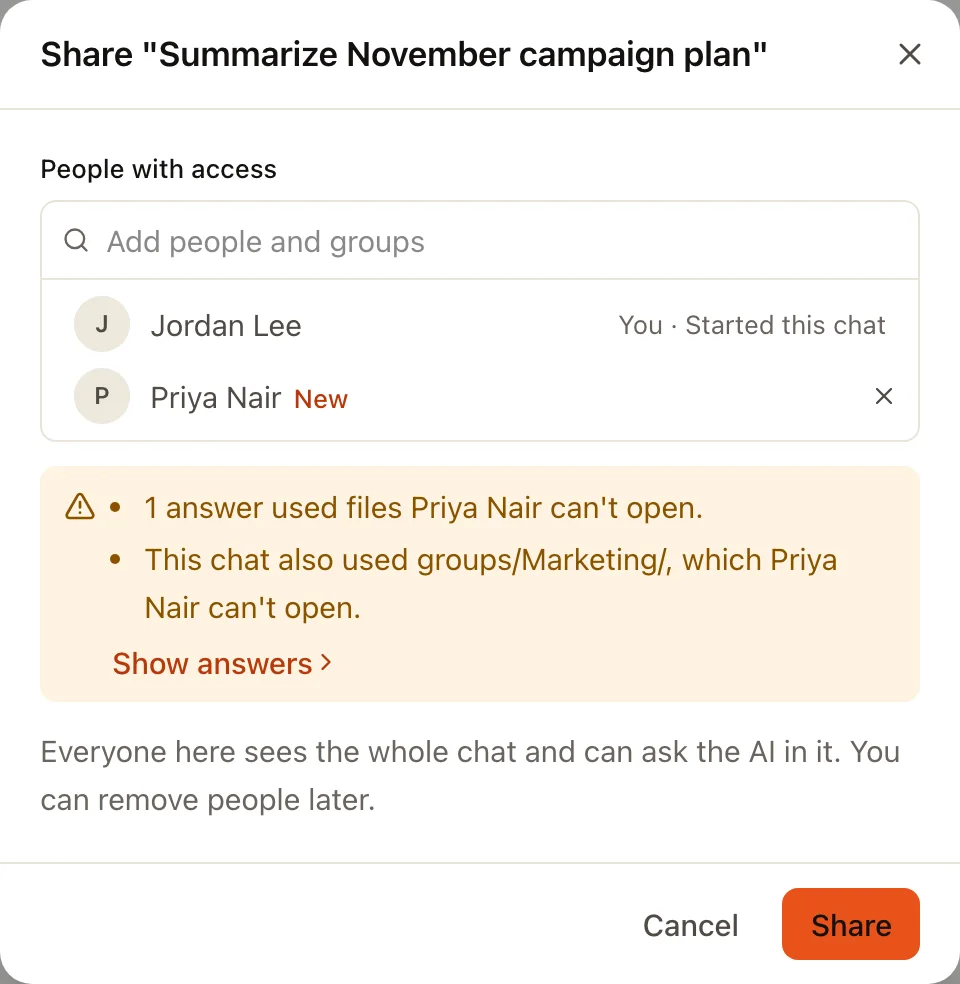

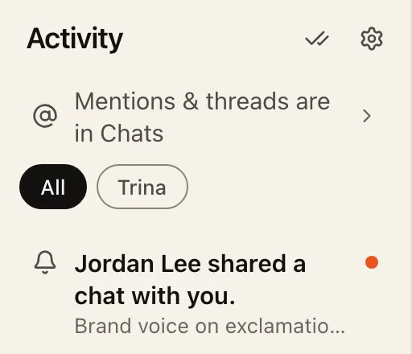

## Menyematkan chat

Di daftar chat Trina Anda, menu **···** sebuah chat (atau klik kanan pada barisnya, atau tekan lama di ponsel) berisi **Sematkan di atas**.
Chat yang disematkan tampil paling atas di daftar Trina Anda, yang terakhir disematkan lebih dulu, dengan pin kecil sebelum
judulnya, di komputer maupun di ponsel. Halaman proyek juga menampilkan
chat yang Anda sematkan lebih dulu. **Lepas sematan** mengembalikan chat ke tempatnya. Sematan hanya milik Anda, juga pada chat proyek bersama,
dan hilang saat chat dihapus atau Anda tidak bisa melihatnya lagi. Anda bisa menyematkan sampai 50 chat.

Percakapan di **Obrolan** (saluran dan pesan langsung, termasuk obrolan grup) disematkan dengan cara yang sama, dari **···** pada baris atau
**···** milik percakapan itu: yang disematkan tampil lebih dulu, dengan pin kecil setelah namanya, di setiap daftar percakapan, di komputer maupun di tab **Obrolan** ponsel.
Hanya Anda yang melihat sematan Anda. Sematan hilang saat Anda keluar dari percakapan atau menyembunyikannya. Anda bisa menyematkan sampai 50 percakapan.

Daftar **Obrolan** menampilkan setiap percakapan: sematan Anda, folder Anda, lalu **Saluran** (saluran Semua lebih dulu, lalu
menurut nama; saluran privat bergembok) dan **Pesan langsung** (obrolan 1:1 dan obrolan grup tanpa nama digabung, yang terbaru lebih dulu, masing-masing dengan wajah para anggotanya). Percakapan yang Anda sembunyikan ada di balik **Percakapan tersembunyi (N)**.

Tanda **+** di samping **Saluran** adalah **Buat saluran**: pilih orang dan beri nama, maka jadilah saluran privat yang
hanya bisa dilihat mereka. Tanda **+** di samping **Pesan langsung** adalah **Pesan baru**: pilih satu orang untuk pesan
langsung, atau beberapa orang untuk obrolan grup dengan nama mereka (jika sudah ada obrolan dengan orang yang persis sama,
obrolan itu yang dibuka). Untuk menjadikan obrolan grup saluran privat, pilih **···** › **Jadikan saluran privat** dan beri nama.

Obrolan langsung dengan seseorang yang sudah keluar dari tim menampilkan "<nama> sudah keluar dari tim" dan tidak memiliki kotak pesan. Riwayatnya tetap bisa dibaca.

## Obrolan tim

**Obrolan** di bilah kiri (di ponsel, tab **Obrolan**) adalah tempat orang saling berbicara: **Saluran**
(satu untuk semua orang di tim, satu per grup, dan saluran privat tempat Anda bergabung) dan **Pesan langsung** (obrolan 1:1 dan obrolan grup). **Mention & thread**
di bagian atas mengumpulkan pesan yang menyebut nama Anda dan utas yang Anda ikuti.

Untuk mengirim pesan ke satu orang, klik foto atau namanya di samping pesan (@mention orang itu, atau barisnya di daftar anggota percakapan, juga bisa). Sebuah kartu kecil terbuka dengan nama dan jabatannya: **Kirim pesan** membuka obrolan 1:1 Anda dengan orang itu. Di ponsel, kartu terbuka dari bawah layar. Kartu Anda sendiri berisi **Edit profil**. Aplikasi dan orang yang sudah tidak ada di tim tidak punya kartu; tamu hanya bisa mengirim pesan ke orang di obrolan grup atau proyeknya.

Untuk mengajak orang dari luar tim, pilih **Undang tamu** saat Anda menambahkan orang ke obrolan grup atau proyek. [Baca tentang tamu](guests.md).

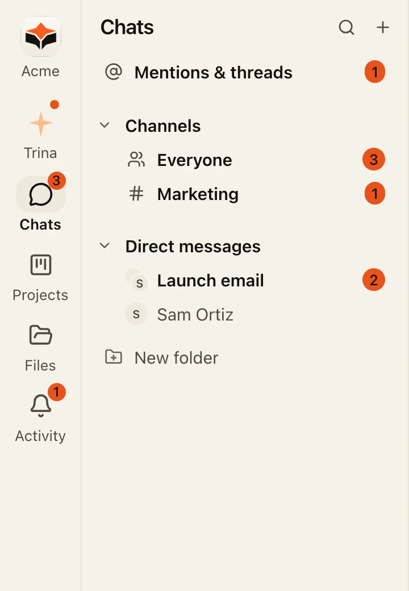

#### Bertanya ke Trina di samping ruang obrolan

Tombol **✦** di bagian atas ruang obrolan membuka chat samping dengan Trina di sebelahnya. Hanya Anda yang melihat chat ini, dan AI
menjawab dengan apa yang boleh Anda buka. Jika sebuah jawaban layak dibagikan, **Kirim ke ruang** di bawahnya menaruhnya di ruang obrolan sebagai pesan
Anda (**Kirim ke utas** jika Anda bertanya tentang satu pesan). Jika sebagian orang di ruang obrolan tidak bisa membuka file yang dipakai
jawaban itu, aplikasi memberi tahu Anda dulu dan menunggu persetujuan Anda.

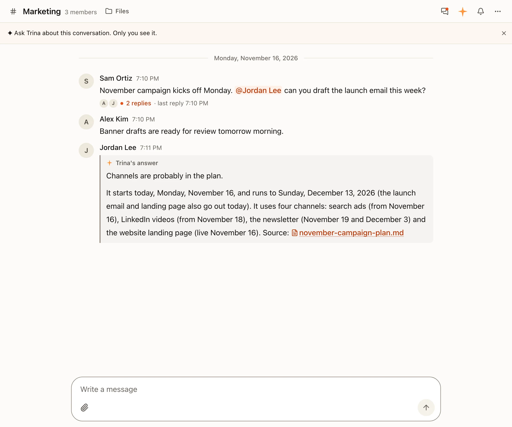

#### Membalas di utas

**Balas di utas** pada sebuah pesan menyimpan percakapan sampingan di bawahnya, sehingga ruang obrolan tetap mudah dibaca. Ruang obrolan menampilkan
berapa balasan yang ada di sebuah utas; **Kirim juga ke ruang obrolan** menaruh balasan di ruang obrolan juga.

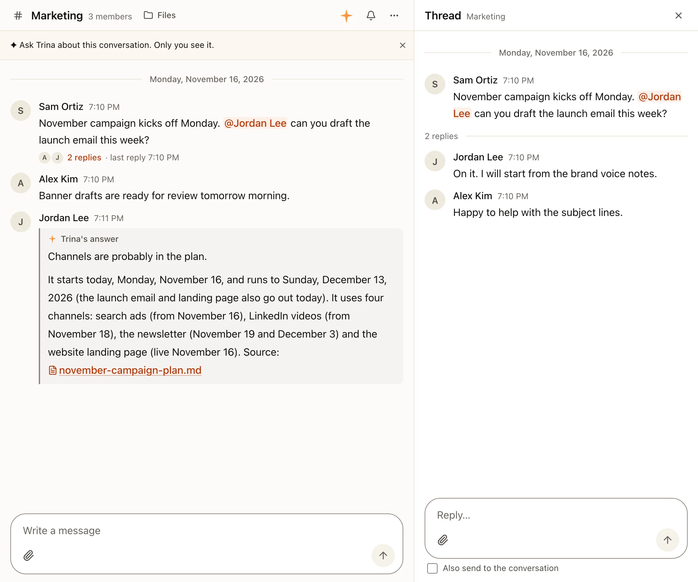

#### Menautkan ke sebuah pesan

**Salin tautan** di menu **⋯** sebuah pesan (di ponsel, tekan dan tahan pesannya) menyalin alamatnya. Tempelkan di saluran,
obrolan grup, pesan langsung, atau utas mana pun: tautan itu tampil sebagai nama percakapan, dan pesannya tampil di bawahnya
sebagai kartu berisi siapa yang menulisnya, kapan, isinya, dan file-filenya. Klik kartu untuk membuka pesannya.

Setiap orang hanya melihat kartu itu jika ia bisa melihat pesan tersebut. Bagi orang lain, tautan tetap berupa tautan biasa, dan membukanya
akan menampilkan bahwa percakapan tidak ditemukan. Jika sebagian orang di percakapan tidak bisa melihat pesan itu, kotak pesan memberi tahu
sebelum Anda mengirim: **Tampilkan tautan saja** (bawaan) hanya mengirim tautannya; **Tampilkan pesan** menunjukkan salinan pesan itu kepada mereka,
dengan tanda bahwa Anda yang membagikannya. Salinan hilang jika pesan aslinya dihapus. Untuk menghapus kartu dari pesan Anda sendiri, arahkan kursor ke kartu
lalu klik **✕** (atau pilih **Hapus pratinjau** di menu pesan).

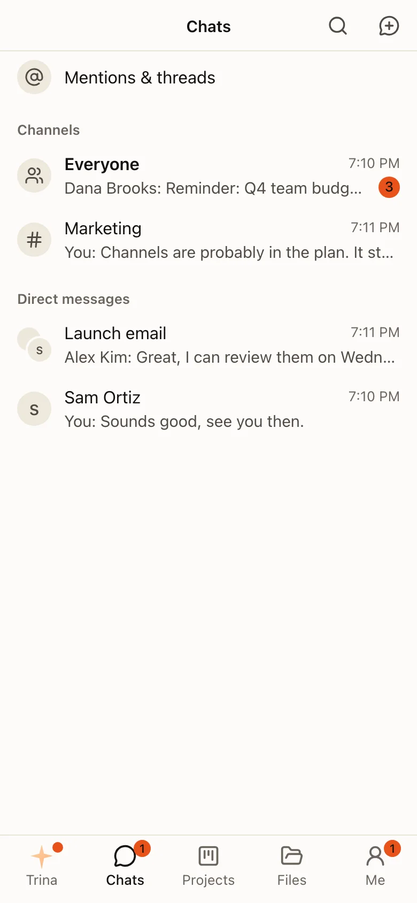

### Tamu

Orang dari luar tim, misalnya agensi atau klien, bisa bergabung ke obrolan grup atau proyek sebagai
tamu, dan berada di paling banyak satu obrolan grup dan satu proyek. Di obrolan grup, buka anggotanya (nama di bagian atas), **Undang orang**, lalu **Undang tamu**; di
proyek, **Tambah orang** di **Anggota**. Tuliskan untuk siapa tautan itu dan apakah ia mendapat AI, lalu **Buat tautan**. Tautan itu
hanya bisa dipakai satu kali: kirimkan sendiri kepadanya.

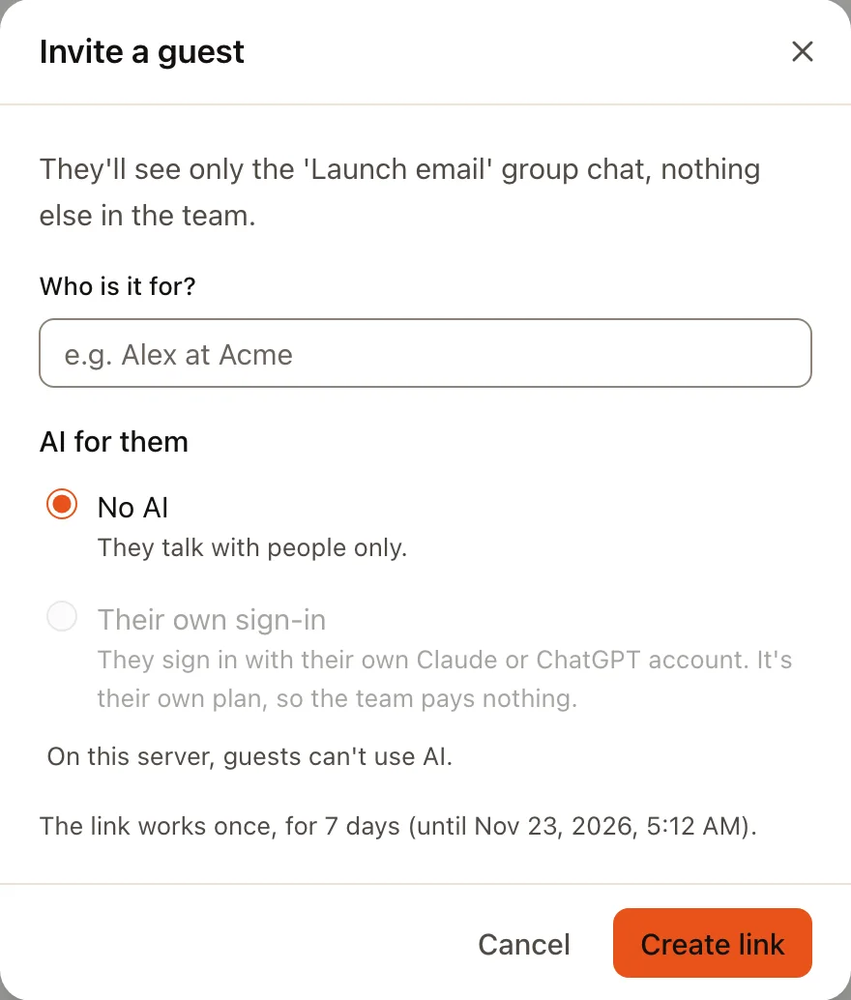

- Tamu hanya melihat tempat itu: tanpa File, tanpa obrolan grup atau proyek lain, tanpa area tim.
- AI-nya mati kecuali Anda memilih **Masuk dengan akun sendiri**, atau admin memberinya akun **AI tim** dengan batas bulanan.
- Label **Tamu** tampil di samping namanya, dan bagian atas menampilkan **Termasuk 1 tamu**.
- Admin melihat setiap tamu di **Admin › Anggota & undangan › Tamu** ([Admin](admin.md#tamu)).

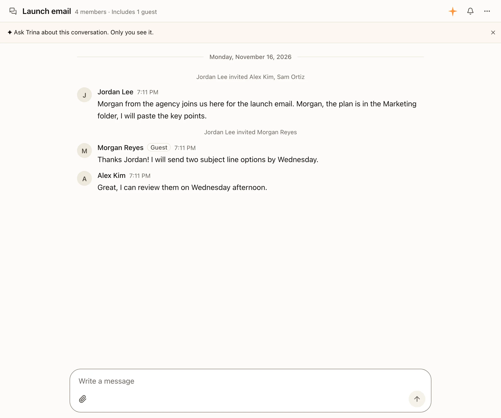

## Proyek

Proyek menyatukan chat, file, dan instruksi untuk satu pekerjaan, bagi Anda atau bagi orang yang Anda tambahkan. Gunakan proyek untuk pekerjaan yang terus kembali ke file yang sama: peluncuran, klien, atau laporan kuartalan.

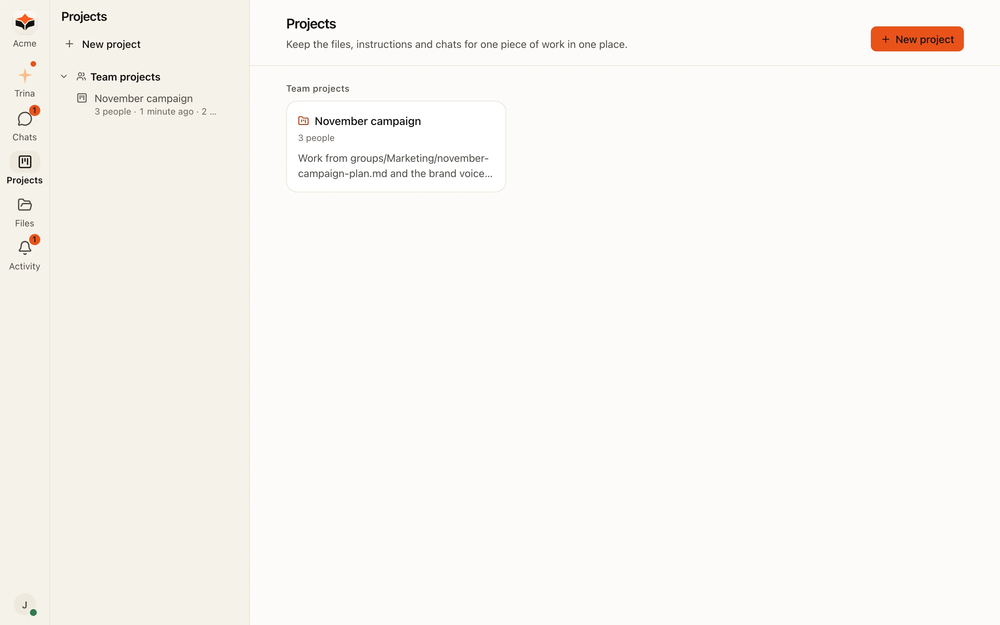

:::steps
#### Buat proyek
Buka **Proyek** di bilah kiri (di ponsel, tab **Proyek**) dan pilih **Proyek baru**. Beri nama.
Proyek baru bersifat **Hanya saya**: hanya Anda yang melihatnya sampai Anda menambahkan orang.

#### Tulis instruksinya
Jelaskan pekerjaan apa ini dan bagaimana AI sebaiknya membantu. Paragraf pertama tampil di bawah judul proyek.

#### Chat di dalam proyek
Mulai chat dari halaman proyek, atau pindahkan chat ke dalamnya dengan **Pindahkan ke proyek** di menu judul chat. AI lalu mendapat file dan instruksi proyek tersebut.

:::

- Proyek Anda ada di **Proyek**, di bilah kiri dan di tab **Proyek** ponsel: **Proyek tim**
  (orang lain juga melihatnya) dan **Proyek saya** (hanya Anda). Nama proyek membuka halamannya. Chat yang Anda buka dari proyek
  kembali ke proyek itu; chat-chatnya juga ada di **Riwayat Trina** di daftar Trina Anda. Folder tim dan sampahnya ada
  di **File**.
- Proyek punya anggota. Di halaman proyek, **Anggota** menunjukkan siapa saja mereka, dan **Tambah orang** membagikan proyek
  yang selama ini hanya milik Anda. Sebelum menyimpan, aplikasi memberi tahu bahwa mereka bisa melihat dan mengedit file serta instruksinya, bahwa chat Anda
  sejauh ini tetap milik Anda, dan bahwa proyek tidak bisa kembali menjadi hanya milik Anda. Di beberapa tim, hanya owner dan admin yang boleh membagikan
  proyek.
- Proyek juga bisa memiliki satu atau beberapa tamu: orang dari luar tim yang hanya melihat proyek ini. Anggotanya bisa melihat chat yang dimiliki tamu di sana. [Baca tentang tamu](guests.md).
- Hanya anggota proyek yang melihat isinya. Owner dan admin bisa mengubah anggotanya, tetapi mereka tidak melihat
  chat, file, dan instruksinya kecuali mereka sendiri anggota.
- **Untuk mengganti nama proyek**, klik namanya di bagian atas halamannya, ketik nama baru, lalu tekan Enter (Esc
  membatalkan). Anda juga bisa memilih **Ganti nama** di **···** proyek itu pada daftar **Proyek** (atau klik kanan), atau
  di menu nama di bagian atas halaman. Di ponsel, ketuk nama proyek di bilah atas. Hanya pembuat proyek, pemilik, dan
  admin yang bisa melakukannya; orang lain melihat namanya sebagai teks biasa. Mengganti nama proyek tidak mengganti nama
  foldernya.
- Satu folder berisi satu proyek. Setelah menjadi proyek, hanya admin yang bisa memindahkan, mengganti nama, atau menghapus folder itu.
- **Pindahkan ke sampah** di menu proyek tim memindahkan proyek beserta file-filenya ke sampah. Anggotanya tetap melihat kartunya, bertanda
  **di Sampah**: halamannya menyebutkan siapa yang memindahkannya dan kapan, serta bahwa admin atau pembuatnya bisa memulihkannya. Sampai saat itu, tidak ada yang
  bisa membuka file, chat, atau instruksinya. Admin atau pembuatnya memulihkannya di halamannya atau di
  **File › Sampah**, tempat proyek itu tampil sebagai satu baris dengan nama proyeknya. **Hapus permanen** hanya untuk admin.
- Instruksi yang tidak sepenuhnya Anda tulis sendiri dianggap konten dari luar. AI bertanya dulu sebelum mengingat apa pun setelah membacanya.
- **Chat di proyek tim dibagikan ke anggotanya.** Chip kecil setelah **+** di kotak pesan proyek menunjukkan
  siapa yang akan melihat chat yang sedang Anda mulai (misalnya **👥 3 orang**). Tekan chip itu untuk menyimpan chat hanya untuk Anda (**🔒 Hanya
  saya**); chat baru berikutnya kembali dibagikan. Chat yang hanya Anda lihat menampilkan gembok. Setiap pertanyaan menampilkan foto dan
  nama orang yang mengirimnya. Setiap jawaban berjalan atas nama orang yang bertanya, dengan aksesnya. Saat AI akan
  membaca sesuatu yang tidak bisa dibuka sebagian dari mereka, AI menanyakan Anda dulu (**Baca dan bagikan** / **Jangan baca**).
- **Chat yang Anda bawa atau pindahkan masuk tetap milik Anda.** Halaman proyek menyebutkan jumlahnya ("1 chat yang hanya Anda lihat"), dan **Pilih
  obrolan untuk dibagikan** (atau **Bagikan dengan anggota proyek** di menu chat) membagikannya. **Bawa obrolan** memindahkan chat
  lain ke dalam proyek.
- **File di chat proyek.** File yang Anda lampirkan dari komputer (**+**, tempel, atau seret) di chat proyek bersama
  disimpan di subfolder **Lampiran obrolan** di folder proyek (namanya mengikuti bahasa tim), tempat orang-orang di proyek
  bisa membukanya, dan sebuah baris di bawahnya menyebutkan hal itu. Anda memerlukan akses tulis ke folder proyek (tanpanya, **+**
  hanya menawarkan file tim); **✕** sebelum mengirim memindahkan file itu ke sampah.

## Menemukan apa saja

Tekan ⌘K (Ctrl+K di Windows) atau pilih **Cari** di bawah **Tanya Trina** untuk menemukan chat, pesan di percakapan Anda, proyek, file, skill, tugas terjadwal, dan koneksi MCP. [Baca tentang pencarian dan pengaturan](settings-and-search.md).

**Berkas yang Anda kirim.** Ketik "Berkas yang Anda kirim" di Pencarian, atau buka dari pemberitahuan, untuk melihat berkas yang Anda kirim di percakapan Anda, yang terbesar lebih dulu, beserta ruang yang dipakainya. Menghapus satu berkas juga menghapus pesan yang dikirim bersamanya, untuk semua orang di percakapan.

## Chat yang dihapus

Menghapus chat memindahkannya ke **Riwayat terhapus**, tempat Anda bisa mengembalikannya selama 7 hari secara bawaan. Admin bisa memilih 1 sampai 365 hari.

- Chat bersama masuk ke **Riwayat terhapus** milik orang yang membuatnya. Jika pembuat proyek atau admin menghapus chat bersama milik orang lain, chat itu juga ada di **Riwayat terhapus** mereka, selama mereka masih bisa mengembalikannya.
- Menghapus proyek secara permanen memindahkan chat bersamanya ke **Riwayat terhapus** milik orang yang membuatnya. Setelah dikembalikan, chat tersebut hanya milik pembuatnya, tanpa proyek.
