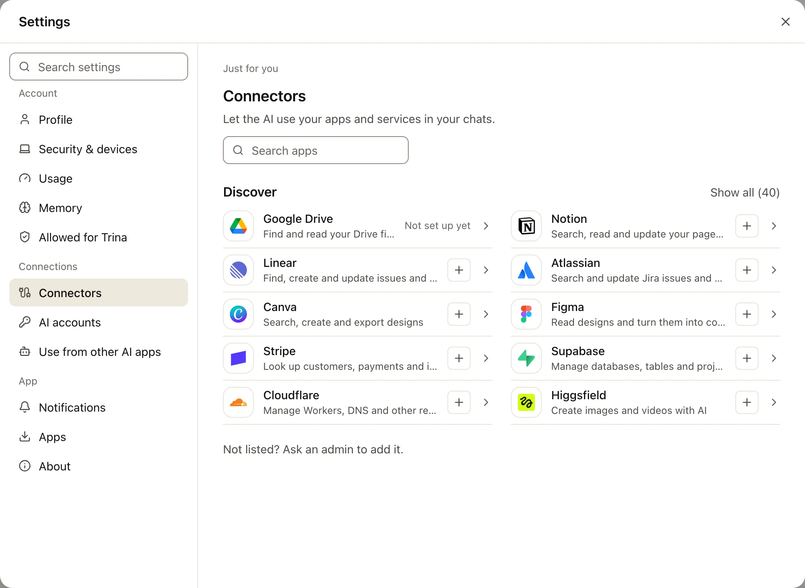
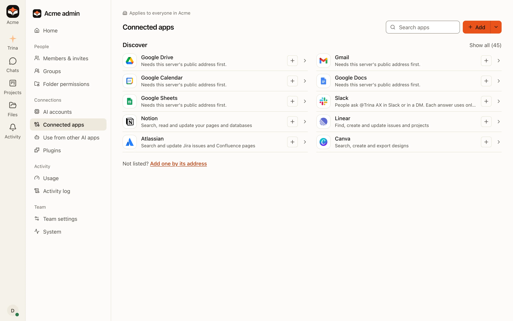

Trina AX terhubung ke dua jenis hal:

- **Akun AI** yang menjawab pertanyaan Anda: akun Claude atau ChatGPT, atau kunci API dari Anthropic, OpenAI, atau
  perusahaan AI lain. Trina AX tidak menyertakan AI: tim Anda menghubungkan akunnya sendiri, dan perusahaan itu yang
  menagih akun yang Anda hubungkan.
- **Aplikasi** yang dipakai AI untuk Anda: Google Drive, Gmail, dan aplikasi Google lainnya, Slack, Notion, Linear,
  GitHub, atau sistem milik perusahaan Anda sendiri.

Halaman ini memberi tahu panduan mana yang perlu Anda ikuti. Di bagian atas setiap panduan tercantum semua nilai yang
Anda perlukan dan dari mana Anda mendapatkannya.

:::note
Tangkapan layar di panduan-panduan ini memakai perusahaan rekaan, "Acme", dan kunci rekaan. Kunci asli tidak pernah
ditampilkan di halaman atau di gambar.
:::

## Ke mana harus pergi

| Yang Anda inginkan | Siapa yang melakukannya | Tempatnya di Trina AX | Panduan |
|---|---|---|---|
| Membuat AI bisa menjawab | Owner atau admin | **Admin › Penyedia AI** | [Penyedia AI](ai-accounts.md) |
| Memakai akun Claude atau ChatGPT Anda sendiri untuk pertanyaan Anda sendiri | Anda (jika tim mengizinkan) | **Pengaturan › Penyedia AI** | [Penyedia AI](ai-accounts.md#akun-anda-sendiri) |
| Membuat AI bisa membaca Google Drive, Gmail, Calendar, Docs, atau Sheets Anda | Anda | **Pengaturan › Konektor** | [Aplikasi Google](google-apps.md) |
| Menampilkan nama perusahaan Anda di layar masuk Google | Admin perusahaan yang memakai Google Workspace | **Admin › Aplikasi terhubung** › salah satu aplikasi Google | [Aplikasi Google milik perusahaan Anda](google-own-app.md) |
| Bertanya ke Trina AX dari Slack | Admin sekali, lalu setiap orang sekali | **Admin › Aplikasi terhubung › Slack** | [Slack](slack.md) |
| Membuat AI bisa memakai Notion, Linear, Atlassian, Figma, GitHub, dan aplikasi lain | Anda untuk diri sendiri, admin untuk tim | **Pengaturan › Konektor** atau **Admin › Aplikasi terhubung** | [Notion, Linear, dan aplikasi lain](mcp.md) |
| Membuat AI bisa memakai sistem milik perusahaan Anda (sebuah API) atau aplikasi yang memerlukan aplikasi masuk Anda sendiri, seperti NAVER WORKS | Admin | **Admin › Aplikasi terhubung** › **Tambahkan lewat alamatnya** | [API perusahaan Anda](api-connections.md) |
| Memakai file Trina AX Anda dari Claude atau ChatGPT | Anda | **Pengaturan › Trina AX MCP** | [Konektor Trina AX MCP](../../agents/mcp-connector.md) (bahasa Inggris) |

### Letak Pengaturan dan Admin

- **Pengaturan** (koneksi Anda sendiri): pilih foto Anda di bagian bawah bilah kiri, lalu **Pengaturan**. Di ponsel,
  buka tab **Saya**. Pengaturan terbuka di atas halaman, dengan **Konektor** dan **Penyedia AI** di daftarnya di bawah
  **Koneksi**.
- **Admin** (koneksi tim, untuk owner dan admin): pilih logo tim Anda di bagian atas bilah kiri, lalu **Admin**. Lihat
  [Admin](admin.md).

## Setiap nilai, dan dari mana asalnya

Anda tidak pernah memerlukan semuanya. Cari aplikasi yang Anda hubungkan; sisa barisnya memberi tahu apa yang perlu
disiapkan.

| Yang dihubungkan | Yang Anda isi di Trina AX | Dari mana Anda mendapatkannya |
|---|---|---|
| Kunci API Claude | **Kunci API** (kode panjang yang diawali `sk-`) | [Claude Console › API keys](https://platform.claude.com/settings/keys) › **Create Key** |
| Langganan Claude | **Kode yang ditampilkan Claude** setelah Anda menyetujui (ada `#` di tengahnya) | claude.ai, di jendela yang dibuka **Buka Claude untuk menyetujui** |
| Kunci API OpenAI | **Kunci API** (diawali `sk-`) | [OpenAI platform › API keys](https://platform.openai.com/api-keys) › **Create new secret key** |
| Paket ChatGPT | Tidak ada: Anda memasukkan kode **di OpenAI** | Trina AX menampilkan alamat dan kodenya |
| Mesin API (OpenRouter, Gemini, …) | **Alamat API**, **Model**, **Kunci API** | Halaman API perusahaan AI tersebut (lihat [mesin API](ai-accounts.md#mesin-api)) |
| Google Drive, Gmail, Calendar, Docs, Sheets | Tidak ada: Anda masuk di Google | Akun Google Anda |
| Aplikasi Google milik perusahaan Anda | **File JSON** dari Google Cloud (atau **Client ID** dan **Client secret**) | Google Cloud › Google Auth Platform › **Clients** |
| Slack (tim yang di-hosting) | Tidak ada: **Tambahkan ke Slack** | Admin workspace Slack mengizinkannya |
| Slack (aplikasi Slack Anda sendiri) | **Bot User OAuth Token** (`xoxb-`), **App-Level Token** (`xapp-`), **Client ID**, **Client Secret** | api.slack.com › aplikasi Anda |
| Notion, Linear, Atlassian, Figma, Canva, dan aplikasi lain di Jelajahi | Tidak ada: Anda masuk di halaman aplikasi itu sendiri | Akun Anda di aplikasi itu |
| GitHub | Tidak ada: Anda masuk di GitHub | Akun GitHub Anda |
| Asana, HubSpot, Box | Admin, sekali: **Client ID** dan **Client secret** dari aplikasi yang dibuat tim di sana (dialognya menautkan panduan tiap layanan). Setelah itu tidak ada: Anda masuk di layanannya | Asana: My apps › **MCP app**. HubSpot: Development › **MCP Connectors**. Box: Admin Console › Integrations › **Box MCP server** |
| Aplikasi lain yang memberikan kunci | **Alamat** dan **Kunci** (kadang **Nama header**) | Halaman bantuan aplikasi itu ("MCP server", "API keys") |
| API perusahaan Anda | **Alamat**, **Kunci**, **Catatan pemakaian** | Orang yang mengelola sistem itu |
| NAVER WORKS dan aplikasi lain yang masuk dengan aplikasi Anda sendiri | **Client ID**, **Client secret**, **Alamat login**, **Alamat token**, **Cakupan (scope)** | Konsol pengembang aplikasi itu |

## Pribadi atau untuk tim

| | Pribadi | Tim |
|---|---|---|
| Dibuat di | **Pengaturan › Konektor** atau **Pengaturan › Penyedia AI** | **Admin › Aplikasi terhubung** atau **Admin › Penyedia AI** |
| Siapa yang memakainya | Hanya Anda, di chat Anda sendiri | Orang yang dipilih admin: semua orang, grup, atau orang tertentu |
| Siapa yang melihat kuncinya | Tidak ada, admin pun tidak | Tidak ada: admin hanya melihat bahwa kunci sudah tersimpan, tidak pernah kuncinya |

Kunci dan data masuk disimpan terenkripsi di server dan tidak pernah ditampilkan lagi. Untuk mengubah kunci, Anda
menggantinya.

## Kesalahan yang sering terjadi

| Yang terjadi | Penyebab | Yang perlu dilakukan |
|---|---|---|
| "Masukkan kunci." atau "Bukan kunci API jenis ini." | Kunci tersalin dengan spasi, baris baru, atau bagian akhirnya terpotong | Salin lagi dengan tombol salin milik penyedia, bukan dengan memblok teksnya |
| `redirect_uri_mismatch` di Google, atau proses masuk yang mengatakan alamatnya salah | Alamat kembali di konsol penyedia berbeda satu huruf, `http`, atau garis miring dari alamat yang ditampilkan Trina AX | Salin alamat dari dialog Trina AX dengan tombol salinnya, lalu tempel lagi di konsol |
| "Beberapa izin tidak dicentang." | Ada kotak yang tidak dicentang di layar Google | Hubungkan lagi dan biarkan semua kotak tetap dicentang |
| "Perlu masuk" pada sebuah koneksi | Kunci dicabut atau kedaluwarsa, atau masa masuknya habis | Buka koneksi itu dan pilih **Masuk lagi**, atau ganti kuncinya |
| Anggota melihat "Tidak ada di daftar? Minta admin untuk menambahkannya." | Hanya owner dan admin yang bisa menambahkan aplikasi lewat alamatnya | Admin menambahkannya untuk tim, atau sebagai templat yang dihubungkan setiap anggota |
| AI "tidak bisa" memakai aplikasi yang sudah Anda hubungkan | Koneksinya milik orang lain, atau Anda tidak termasuk orang yang dituju koneksi tim itu | Di **Pengaturan › Konektor**, pastikan aplikasinya ada di bawah **Konektor Anda** |
