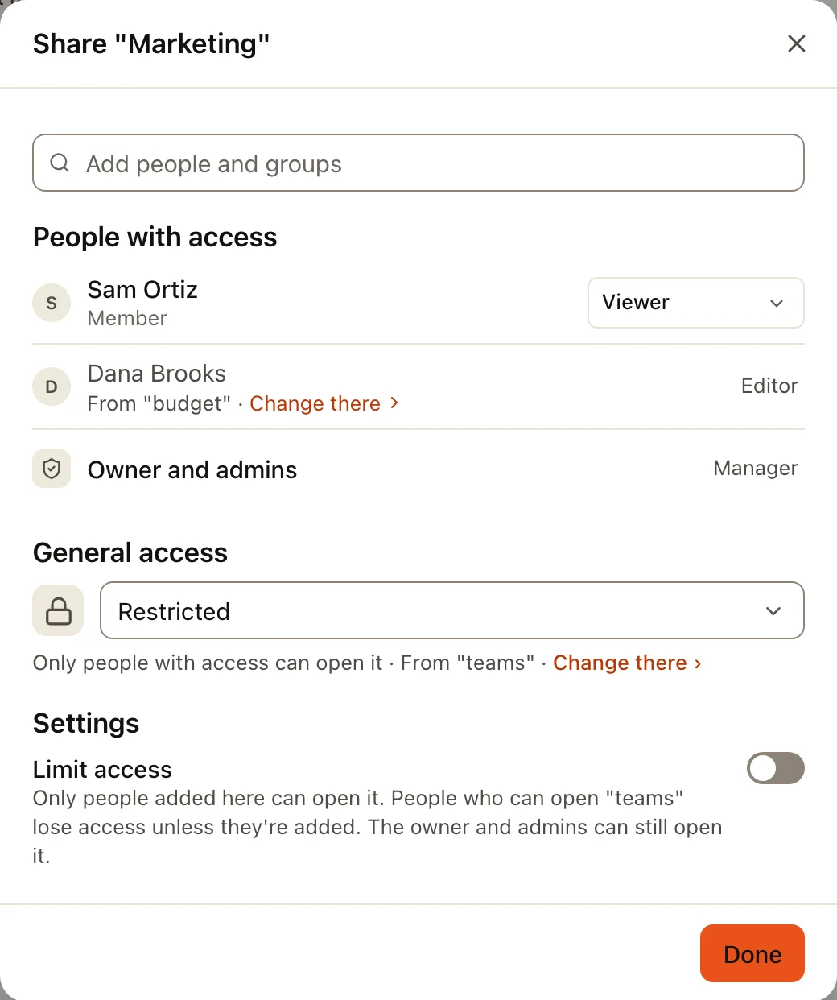
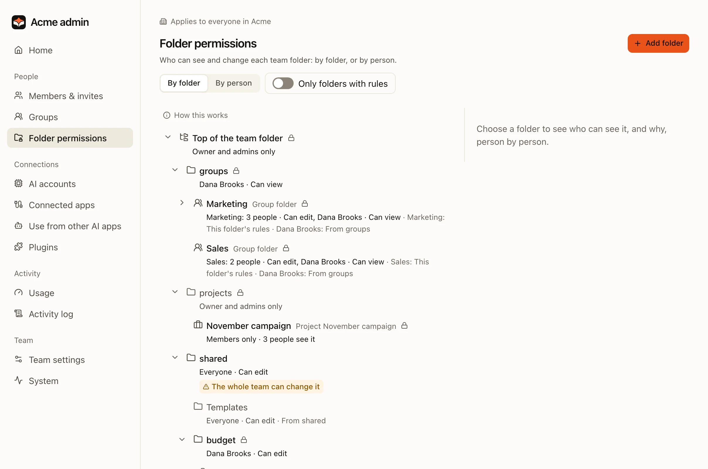
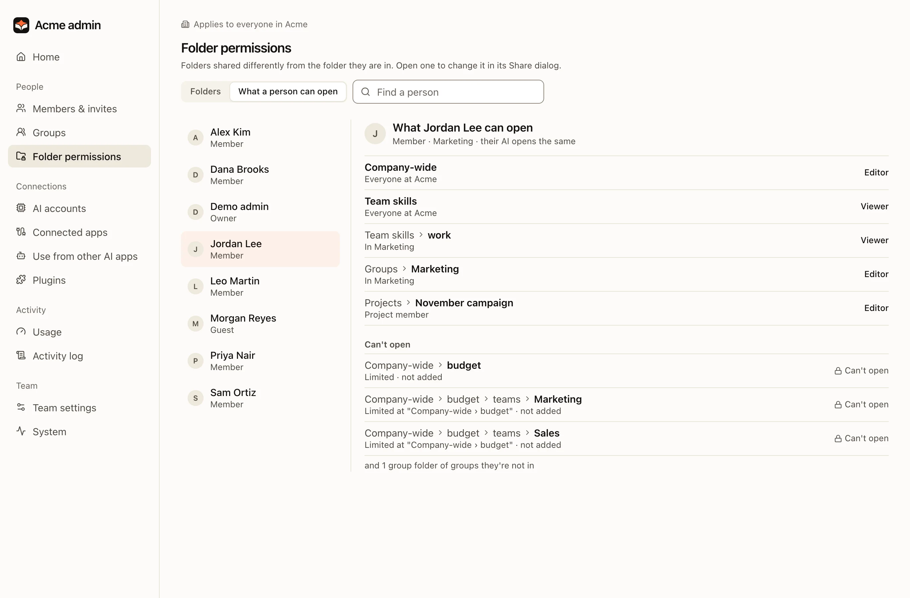
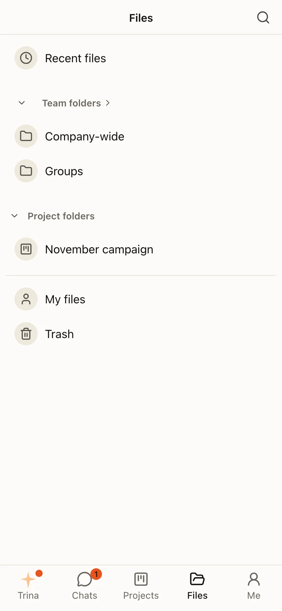

Pengetahuan perusahaan berada di satu folder tim di server. Aturan folder menentukan siapa melihat apa. AI tidak pernah melihat lebih dari orang yang bertanya.

## Folder tim

| Folder | Siapa yang melihatnya | Gunakan untuk |
|---|---|---|
| `shared/` | Sesuai aturan, biasanya semua orang | Dokumen untuk seluruh perusahaan |
| `groups/<group>/` | Grup itu, ditambah siapa pun yang ditambahkan aturan | Dokumen tim, misalnya Penjualan atau Keuangan; skill milik grup ada di `skills/` di dalamnya |
| `projects/<project>/` | Sesuai aturan | Pekerjaan dengan folder dan instruksinya sendiri |
| `skills/` | Semua orang membaca; pengelola skill menulis | Skill tim dan aturan tim |
| `users/<id>/` | Hanya orang itu | File pribadi dan skill pribadi |

## Cara akses ditentukan

Satu fungsi izin di server menentukan setiap akses. Sistem operasi mencegah AI melewatinya.

- File yang tidak bisa Anda buka **tidak terlihat**, bukan "ditolak". File, jawaban AI, pencarian, pratinjau, riwayat versi, sampah, dan pembaruan langsung semuanya mengikuti aturan yang sama.
- Akses seseorang berasal dari **aturan terdekat** di atas file yang menyebut orang itu. Aturan untuk orang didahulukan daripada aturan untuk grup. Jika ada beberapa grup, akses yang paling luas yang berlaku.
- Perubahan berlaku **seketika**. AI membaca ulang izin pada setiap pemanggilan alat.
- Mencabut akses tidak menghapus jawaban sebelumnya yang mengutip sebuah file.

## Membagikan folder

Owner dan admin membagikan folder seperti di Google Drive: **File › ⋯ pada folder › Bagikan**, atau **Admin › Izin folder › Bagikan**. Keduanya membuka dialog yang sama.

:::steps
#### Tambahkan orang dan grup
Ketik nama. Setiap orang atau grup mendapat **Pelihat** atau **Editor**. **Hapus akses** ada di menu yang sama.

#### Periksa Akses umum
**Dibatasi**: hanya orang yang tercantum yang bisa membukanya. Atau seluruh tim, sebagai **Pelihat** atau **Editor**. Folder yang tidak punya pengaturan sendiri menampilkan apa yang didapatnya dari folder di atasnya, dengan **Ubah di sana**.

#### Periksa sebelum menyimpan
Dialog menyebutkan siapa yang akan mendapat atau kehilangan akses. Tidak ada yang berubah sampai Anda menyimpan. Memberi akses lebih luas akan ditanyakan dulu, begitu juga pembatasan yang menutup akses orang yang diizinkan oleh folder di atasnya.
:::

Akses bertambah, seperti di Google Drive: apa yang diberikan sebuah folder ditambahkan di atas apa yang diberikan folder-folder di atasnya. Peran yang lebih rendah dari itu tidak bisa dipilih; barisnya menyebutkan dari mana peran yang lebih tinggi berasal ("Editor dari "Seluruh perusahaan"").

Untuk memberi sebuah folder akses lebih sedikit daripada folder di atasnya, nyalakan **Setelan › Batasi akses**. Setelah itu hanya orang dan grup yang ditambahkan di sana yang bisa membukanya. **Akses dihapus** mencantumkan orang yang bisa membuka folder di atasnya tetapi tidak folder ini; **Tambahkan** mengembalikan salah satunya sebagai Pelihat. Mematikan pembatasan lagi menaikkan setiap peran yang lebih rendah dari folder di atasnya ke tingkat itu.

Owner dan admin selalu bisa membuka folder tim, kecuali proyek yang tidak mereka ikuti. Mereka tampil sebagai satu baris **Pengelola**.

:::note
Setelah pembaruan yang membuat akses bertambah, beberapa folder mencantumkan orangnya berdasarkan nama (ditandai **Ditambahkan saat folder berubah**), dan Izin folder menampilkan pemberitahuan satu kali yang menyebut nama mereka. Orang yang ditambahkan berdasarkan nama tetap punya akses jika nanti keluar dari grup. **Admin › Grup** dan halaman orang itu menyebutkannya sebelum menyimpan, dengan **Keluarkan sekarang**.
:::

**Admin › Izin folder › Folder** hanya mencantumkan folder yang dibagikan secara berbeda dari folder tempatnya berada, dengan nama yang sama seperti di File, dan **Akses dibatasi** pada folder yang menutup akses orang. **Bagikan** membuka dialog Bagikan folder itu. Folder proyek tampil sebagai satu baris: anggotanya diubah di proyek.

**Yang bisa dibuka seseorang** menampilkan, untuk satu orang (dan dengan begitu AI-nya), setiap folder dengan Pelihat atau Editor beserta alasannya, dan folder yang tidak bisa ia buka.

:::warning
`skills/` berisi instruksi yang diikuti AI setiap anggota. Akses tulis di sana menjadikan seseorang pengelola skill. Sebelum AI menyimpan ke `skills/`, server meminta seseorang untuk mengonfirmasi. Hal yang sama berlaku untuk `groups/<group>/skills/` milik grup: AI setiap anggota grup itu mengikutinya, dan setiap anggota yang boleh menulis di folder grup bisa mengubahnya.
:::

## Membagikan file

Anda bisa membagikan file milik Anda kepada orang tertentu tanpa mengubah siapa yang bisa membuka foldernya: **File › ⋯ pada file › Bagikan**. Tambahkan orang atau grup, lalu tekan **Bagikan**. Mereka bisa melihat dan mengunduh file itu, tetapi tidak melihat isi folder lainnya. Setiap orang yang Anda tambahkan melihatnya di **Aktivitas**.

- **Semua orang di tim** adalah pilihan pertama di **Tambahkan orang atau grup**. Sebelum Anda menekan **Bagikan**, satu baris memberi tahu bahwa semua orang di tim akan bisa membuka file itu, termasuk yang bergabung nanti. Tamu tidak pernah bisa. Pilihan ini dihitung sebagai salah satu dari 50 orang dan grup yang bisa diberi akses ke satu file.
- Kalau Anda membagikan beberapa file sekaligus (misalnya di langkah terakhir **Cari file kerja di komputer ini**), setiap orang menerima satu pemberitahuan di **Aktivitas**, "Mina membagikan 5 file dengan Anda", yang membuka daftar file tersebut. Orang yang Anda tambahkan dengan nama juga mendapat notifikasi di ponsel.
- **Orang yang punya akses** menampilkan pemilik dan setiap orang atau grup dengan **Bisa melihat**. **✕** mencabut akses seseorang (Anda ditanya dulu).
- File tim juga bisa dibuka semua orang yang bisa membuka foldernya.
- **Salin tautan** memberi tautan khusus untuk file itu. Orang yang punya akses bisa membukanya; yang lain melihat **Anda perlu akses** dan bisa **Minta akses** dengan catatan. Permintaannya masuk ke pemilik di **Aktivitas** dengan tombol **Bagikan** dan **Tolak**. Halaman tautan tidak pernah menampilkan nama file kepada orang yang tidak bisa membukanya.
- Kalau Anda memindahkan file ke tempat yang bisa dibuka lebih sedikit orang, Anda diberi tahu berapa orang yang memegang file itu lewat tautannya.

Owner dan admin bisa membagikan file tim mana pun. Di **Admin › Pengaturan tim**, **Anggota bisa membagikan file milik mereka** mematikan pembagian untuk anggota (yang sudah dibagikan tetap berfungsi). Owner tim bisa **Hapus semua berbagi file** di sana sekaligus.

### File yang dibagikan kepada Anda

**File › Dibagikan ke saya** menampilkan file yang dibagikan orang lain kepada Anda, yang terbaru di atas, lengkap dengan siapa yang membagikan dan kapan. File yang sudah bisa Anda buka di foldernya hanya muncul di sini kalau seseorang menambahkan Anda dengan nama. Buka file dari sini untuk melihat atau mengunduhnya; **‹ Dibagikan ke saya** membawa Anda kembali ke daftar. Saat Anda membuka file, pemberitahuannya di **Aktivitas** ditandai sudah dibaca. File hilang dari daftar kalau akses Anda hilang (pemiliknya mencabutnya, memindahkannya ke sampah, atau sudah tidak bisa mengeditnya).

## Bekerja dengan file

- **Unggah** file atau seluruh folder dari layar File.
- **Riwayat versi**: setiap perubahan menyimpan versi yang bisa Anda buka atau pulihkan.
- **Sampah**: **File › Sampah** mencantumkan apa yang bisa Anda pulihkan, berdasarkan nama dan tempat asalnya ("price-sheet.xlsx · Seluruh perusahaan › Sales"). File yang dihapus lebih dari sekali tampil sebagai satu baris dengan salinan-salinannya: **Pulihkan** mengembalikan yang terbaru, dan membuka baris itu memulihkan salinan lainnya. Jika daftar berisi hapusan orang lain, **Dihapus oleh saya** hanya menampilkan milik Anda. Item dihapus permanen setelah masa simpan tim (Admin › Pengaturan tim, 30 hari secara bawaan); setiap baris menyebutkan kapan.
- **Format**: AI membaca teks dari file PDF, Office, dan HWP/HWPX, serta melihat foto dan halaman hasil pindaian sebagai gambar (admin bisa mematikannya). Server Linux tidak menjalankan OCR.
- **Konfirmasi**: jika AI akan menulis konten terbatas ke tempat yang bisa dilihat lebih banyak orang, server bertanya dulu.

## HTML ke PDF

File HTML, seperti penawaran harga atau laporan yang ditulis AI, menjadi PDF yang tampilannya sama dengan halamannya: warna dan latar belakangnya, sel tabel yang digabung, ukuran halaman dan margin dari aturan `@page` milik halaman itu (A4 jika tidak disebutkan), dan pemisah halamannya.

- **Di pratinjau**: buka file `.html` lalu tekan **Simpan sebagai PDF** di header pratinjau. PDF disimpan di samping halaman dengan nama yang sama, dan pemberitahuannya menautkan ke PDF itu. PDF kedua dari halaman yang sama disimpan sebagai `name (2).pdf`, tidak pernah menimpa yang pertama. Di folder yang hanya bisa Anda baca, PDF diunduh sebagai gantinya. Di ponsel, aksinya ada di menu **⋯**.
- **Minta ke AI**: "Jadikan quote.html sebagai PDF". AI mencetak halaman itu sendiri; AI tidak menulis ulang isinya sebagai Markdown.
- **Yang dipakai PDF**: halaman itu serta gambar, stylesheet, dan font miliknya di folder tim, berdasarkan path relatif. Alamat web tidak pernah dimuat: gambar dari web tampil sebagai kotak abu-abu, sama seperti di pratinjau. Simpan gambar ke folder tim dan rujuk dengan path-nya. Skrip di halaman tidak dijalankan, jadi bagian yang seharusnya digambar oleh skrip tidak muncul; tulis bagian itu sebagai HTML biasa.
- **Batas**: sampai 200 halaman dan 50 MB, dan sekitar satu menit per halaman. Hanya beberapa PDF yang dibuat sekaligus di satu server; sisanya menunggu.
- **Di mana ini berfungsi**: server mencetak dengan Chromium headless di sandbox konverternya, tanpa jaringan. Server Linux memilikinya jika paket `chromium` dari Debian terpasang (dev environment memasangnya, begitu juga image server hosting yang dibuat dengan dev environment). Di server Linux, setiap pencetakan berjalan dengan batas memorinya sendiri, terpisah dari konversi lain, dan memerlukan memori server setidaknya 3 GB (dua pencetakan sekaligus mulai 6 GB). Server tanpa browser, atau dengan memori lebih kecil, tidak menampilkan aksi ini, dan AI menyebutkan bahwa ia tidak bisa mencetak HTML. Administrator bisa menentukan browsernya dengan `MYCEL_HTML_PDF_BROWSER` ([environment](../../reference/environment.md) (bahasa Inggris)).

Detail lengkap: [Keamanan dan izin](../../../security-and-permissions.md) (bahasa Inggris) dan [model izin](../../../PERMISSIONS.md) (bahasa Korea).
