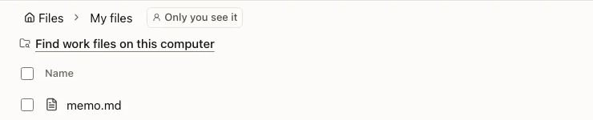
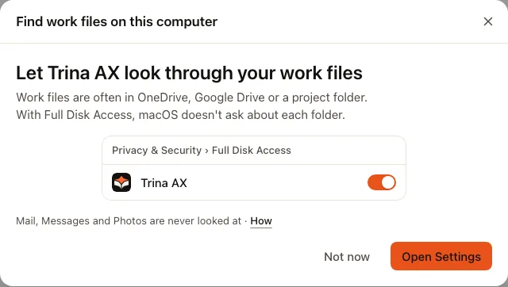
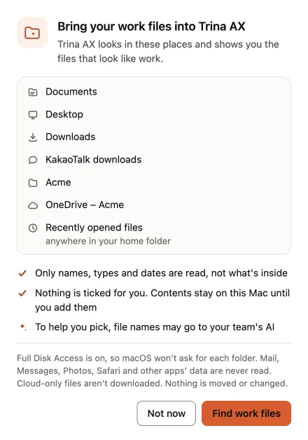
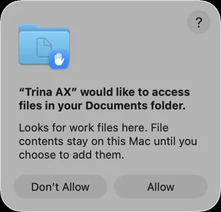
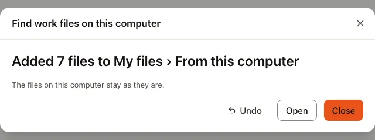
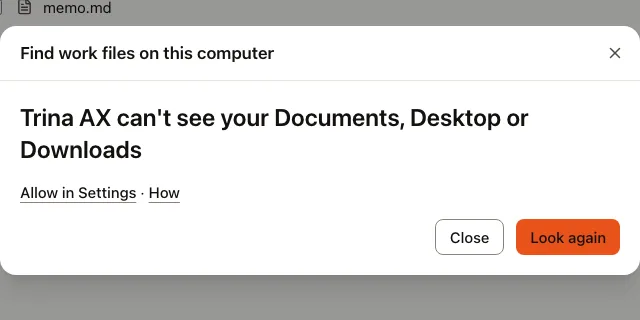

File kerja Anda tersebar di komputer: di OneDrive, di Unduhan, di folder proyek. Aplikasi desktop untuk **Windows** dan **aplikasi Mac dari situs web** menemukan file yang belakangan ini Anda kerjakan dan menyarankan yang tampak seperti file kerja: formulir, laporan, proposal, materi merek, dan sejenisnya. **Anda yang memilih** mana yang ditambahkan. Tidak ada yang ditambahkan, dibagikan, atau dipindahkan tanpa Anda, dan file di komputer Anda tetap seperti semula.

Aplikasi mencari di tempat-tempat berikut:

- **Dokumen**, **Desktop**, dan **Unduhan**.
- **Folder drive cloud** Anda di komputer ini: OneDrive (dan SharePoint), Google Drive, Dropbox, dan Box.
- **Folder kerja** di folder home Anda: folder yang namanya seperti nama perusahaan atau klien Anda, atau yang memuat kata tentang pekerjaan seperti
  *Work*, *Projects*, atau *Clients*.
- **Unduhan messenger**: folder tempat KakaoTalk, Telegram, WhatsApp, Teams, dan lainnya menyimpan file yang Anda terima.
- **File yang belakangan Anda buka**, di mana saja di folder home Anda. Di Windows juga di drive lain dan drive jaringan.

Aplikasi hanya menampilkan file **terbaru** (dibuka atau diubah dalam sekitar enam bulan terakhir) yang tampak seperti milik perusahaan Anda atau
dipilih oleh AI tim Anda, paling banyak 50. Anda bisa menemukan file lain yang dilihatnya lewat pencarian.

Yang tetap ada di komputer Anda:

- Aplikasi hanya membaca **nama, jenis, ukuran, dan tanggal** file. Aplikasi tidak pernah memindahkan, mengganti nama, atau mengubahnya.
- File yang **hanya ada di cloud** (misalnya "online only" di OneDrive) tidak diunduh selama aplikasi mencari. Daftar
  menampilkan **Di cloud**; jika Anda menambahkannya, file baru diunduh saat itu.
- **Data Mail, Pesan, Foto, Safari, dan aplikasi lain tidak pernah dilihat.** Satu-satunya data aplikasi yang dibaca adalah
  daftar dokumen yang baru dibuka yang disimpan oleh macOS, Windows, dan Office.
- Untuk membantu memilih file kerja, **nama file**, nama folder tempatnya berada, serta jenis, ukuran, dan tanggalnya
  bisa dikirim ke AI tim Anda. File yang tampak pribadi (slip gaji, dokumen pajak, kartu identitas, CV, dokumen medis) dipisahkan
  dan namanya tidak pernah dikirim.
- **Isi** file tetap di komputer Anda sampai Anda menekan **Tambahkan**. Setelah itu hanya file yang Anda centang yang dibaca dan ditambahkan.

## Memulai

1. Buka **File › File saya** di aplikasi desktop, di jendela yang cukup lebar untuk tampilan komputer.
2. Klik **Cari file kerja** di toolbar, di samping Unggah folder dan Unggah.

Jika Anda baru bergabung dengan tim, kartu sambutan di **Beranda** punya fitur yang sama sebagai baris opsional, **Bawa file kerja
dari komputer ini** (hanya di aplikasi desktop). Baris itu membuka jendela yang sama dan menambahkan ke tempat yang sama. Baris ditandai selesai
setelah ada file di sana, dan tidak pernah menahan bagian lain dari kartu.

Owner melihat tombol yang sama di **Persiapan awal › File tim**. Di sana file masuk ke folder utama tim, sama seperti
bagian lain dari langkah itu.

## Di Mac: berikan Akses Disk Penuh satu kali

Untuk mencari di luar Dokumen, Desktop, dan Unduhan, aplikasi Mac memerlukan **Akses Disk Penuh**. Karena itu, di Mac aplikasi lebih dulu menampilkan layar ini. Dari **File saya**, judulnya **Temukan file kerja Anda** (yang Anda tambahkan hanya terlihat oleh Anda); di **Persiapan awal › File tim**, judulnya **Temukan file yang perlu dimiliki tim Anda**.

1. Klik **Buka Pengaturan**. Pengaturan Sistem terbuka di **Privasi & Keamanan › Akses Disk Penuh**.
2. **Trina AX** sudah ada di daftar, dengan sakelar mati: aplikasi muncul di sana begitu membuka layar ini,
   jadi Anda tidak perlu **+**. Nyalakan sakelarnya. macOS meminta kata sandi Mac Anda atau Touch ID.
3. Kembali ke aplikasi. Layar berlanjut sendiri begitu aplikasi mendapat akses.

Jika Anda sudah menyalakannya tetapi layar masih menunggu, macOS mungkin baru menerapkan sakelar itu setelah aplikasi dimulai ulang. Klik **Mulai ulang Trina AX**: aplikasi dimulai ulang dan membuka layar yang sama lagi dengan sendirinya, lalu lanjut. (Jika Anda mengklik **Quit & Reopen** di System Settings, Anda juga kembali ke sana.)

Untuk mencabut akses nanti, matikan sakelarnya di tempat yang sama.

**Nanti saja** melewati langkah ini: aplikasi hanya mencari di Dokumen, Desktop, dan Unduhan, dan macOS menanyakan setiap
folder itu kepada Anda (lihat di bawah).

## Aplikasi bertanya dulu

Sebelum apa pun dilihat, aplikasi bertanya di jendelanya sendiri. Jendela itu mencantumkan setiap tempat yang akan diperiksa dan menyebutkan apa
yang dibacanya. Klik **Periksa tempat-tempat ini** (setelah **Nanti saja**: **Periksa folder ini**) untuk melanjutkan, atau
**Batal** untuk berhenti.

Di Windows, hanya itu pertanyaannya: aplikasi langsung mencari. Jika OneDrive menyimpan Dokumen atau Desktop Anda,
daftar menampilkan "Dokumen (OneDrive)".

## Tanpa Akses Disk Penuh (Mac): macOS bertanya untuk setiap folder

Setelah **Nanti saja**, aplikasi hanya mencari di Dokumen, Desktop, dan Unduhan. Pada kali pertama aplikasi membaca salah satunya,
macOS menanyakan folder itu kepada Anda: "“Trina AX” ingin mengakses file di folder Dokumen Anda." Di bawahnya Anda melihat
alasan dari aplikasi: *Mencari file kerja di sini. Isi file tetap di Mac ini sampai Anda memilih untuk menambahkannya.* Pertanyaan
datang satu per satu, satu untuk setiap folder.

- **Izinkan** (Allow): aplikasi mencari di folder itu.
- **Jangan Izinkan** (Don't Allow): aplikasi melewati folder itu, dan daftar menyebutkannya.

macOS mengingat jawaban Anda, jadi hanya bertanya sekali untuk setiap folder.

## Memilih file

- Setiap file menyebutkan **mengapa** file itu ditampilkan dan **di mana** lokasinya: "Menyebut Acme · Dibuka 2 hari lalu · OneDrive – Acme › Plans".
- **Tampak seperti file kerja** mencantumkan file terbaru yang tampak seperti milik perusahaan Anda, ditambah pilihan AI, yang terbaik di atas.
- **Mungkin pribadi** dilipat dan tidak pernah dikirim ke AI. Anda tetap bisa membukanya dan mencentang file: file itu masuk ke File saya,
  tempat hanya Anda yang melihatnya.
- **Tidak ada yang tercentang.** Centang file yang Anda inginkan, atau gunakan **Pilih semua**. Anda bisa menambahkan sampai 100 file dan 1 GB sekaligus.
- **Cari berdasarkan nama file** mencari di semua yang ditemukan aplikasi, termasuk file yang tidak masuk kedua kelompok itu.
- File di atas 50 MB tidak ditampilkan; tambahkan file seperti itu di halaman File. Folder yang sangat besar hanya diperiksa sebagian, dan
  daftar menyebutkannya.

Klik **Tambahkan n file**. File masuk ke **File saya › Dari komputer ini**, di dalam folder yang diberi nama sesuai tempat asalnya
(Dokumen › Clients › …, OneDrive – Acme › …).

## Bagikan sebagian ke tim

Setelah file masuk, jendela yang sama bertanya **Ada yang mau dibagikan ke tim?** dan menampilkan file yang baru Anda
tambahkan. **Tidak ada yang dicentang**, dan tidak ada yang dibagikan sampai Anda menekan **Bagikan**.

- **Cocok dibagikan: Formulir** (juga Profil perusahaan, Materi merek, Aturan dan kebijakan, Materi pelatihan, Notulen rapat)
  menandai jenis file yang biasanya disimpan bersama oleh tim. Ini hanya petunjuk, dari pilihan yang sama dengan daftar
  sebelumnya atau dari nama file: centang yang Anda mau.
- Di **Tambahkan orang atau grup**, tambahkan siapa yang boleh melihatnya: **Semua orang di tim** (pilihan pertama: semua
  orang di tim, termasuk yang bergabung nanti, tidak termasuk tamu; satu baris menyebutkannya sebelum Anda menekan
  **Bagikan**), rekan tim dengan nama, atau grup tempat Anda
  bergabung (pemilik tim dan admin bisa menambahkan grup mana pun). Tamu tidak bisa ditambahkan.
- Klik **Bagikan n file**. Setiap file yang dicentang dibagikan persis seperti dengan **Bagikan** di halaman File: orang
  yang Anda tambahkan bisa membuka dan mengunduhnya (hanya lihat), dan melihatnya di **Aktivitas**. File yang tidak
  dicentang tetap pribadi.
- **Nanti saja** tidak membagikan apa pun. Setelahnya, **Bagikan ke tim** di jendela yang sama membawa Anda kembali ke
  langkah ini, dan Anda selalu bisa membagikan file nanti lewat **⋯ › Bagikan** di halaman File, atau mencabut akses di
  sana.

Langkah ini tidak muncul jika tim Anda mematikan **Anggota bisa membagikan file milik mereka** (Admin › Pengaturan tim).

## Urungkan

Tepat setelah menambahkan, di jendela yang sama, **Urungkan** memindahkan file yang ditambahkan pada kali ini ke sampah, beserta folder yang dibuatnya jika
folder itu kosong. Tidak ada hal lain yang disentuh: file yang sudah ada di File saya tetap ada, meskipun namanya sama. Setelah
Anda menekan Urungkan, aplikasi menyebutkan sampai kapan Anda bisa mengembalikannya dari **Tempat sampah**. Setelah jendela itu ditutup, hapus file
dengan cara biasa di halaman File. File di komputer Anda tidak pernah diubah.

## Jika ada folder yang dilewati (Mac, tanpa Akses Disk Penuh)

Jika Anda menjawab **Jangan Izinkan**, daftar menampilkan **"Trina AX tidak dapat melihat Unduhan · Pilih sendiri"**. Jika aplikasi
tidak bisa melihat satu pun dari ketiga folder itu, aplikasi menyebutkannya sebagai ganti daftar.

- **Pilih sendiri** membuka jendela folder Mac di folder itu. Memilihnya di sana membuat aplikasi bisa memeriksanya.
- Atau berikan Akses Disk Penuh (lihat di atas) lalu cari lagi.
- Atau tambahkan file sendiri: **File › Unggah folder**, lalu pilih foldernya.

macOS tidak bertanya lagi setelah **Jangan Izinkan**, dan aplikasi yang dijawab dengan cara itu mungkin tidak tercantum di **Privasi &
Keamanan › File & Folder**, jadi menyalakannya di sana tidak selalu bisa dilakukan.

## Di mana fitur ini tidak tersedia

- **Di browser atau di ponsel.** Halaman web tidak punya cara untuk memeriksa folder Anda. Gunakan **Unggah folder**
  di halaman File.
- **Versi Mac App Store.** macOS hanya mengizinkan aplikasi dari App Store membaca folder yang Anda pilih, jadi versi itu
  tetap memakai **Unggah folder** di halaman File.
- **Tamu** tidak memilikinya, begitu juga aplikasi Linux.
