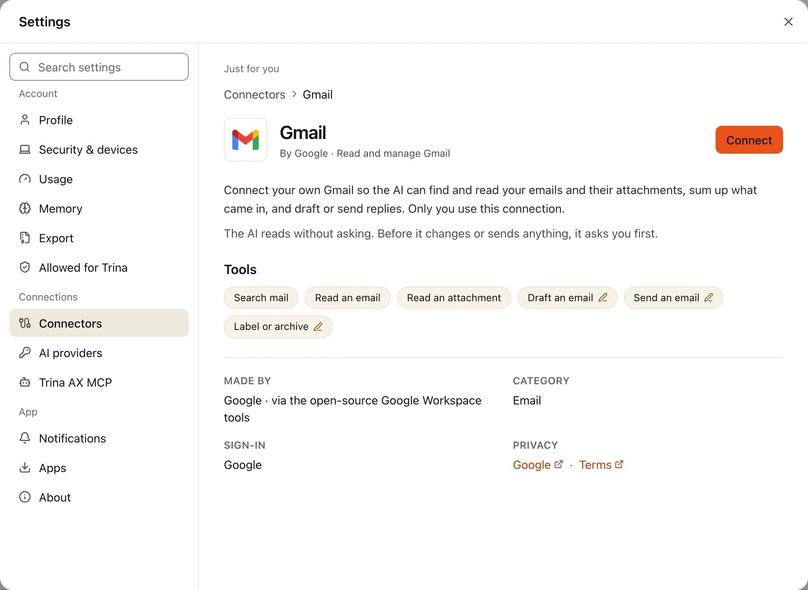
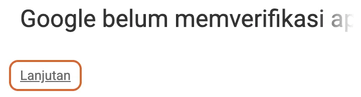
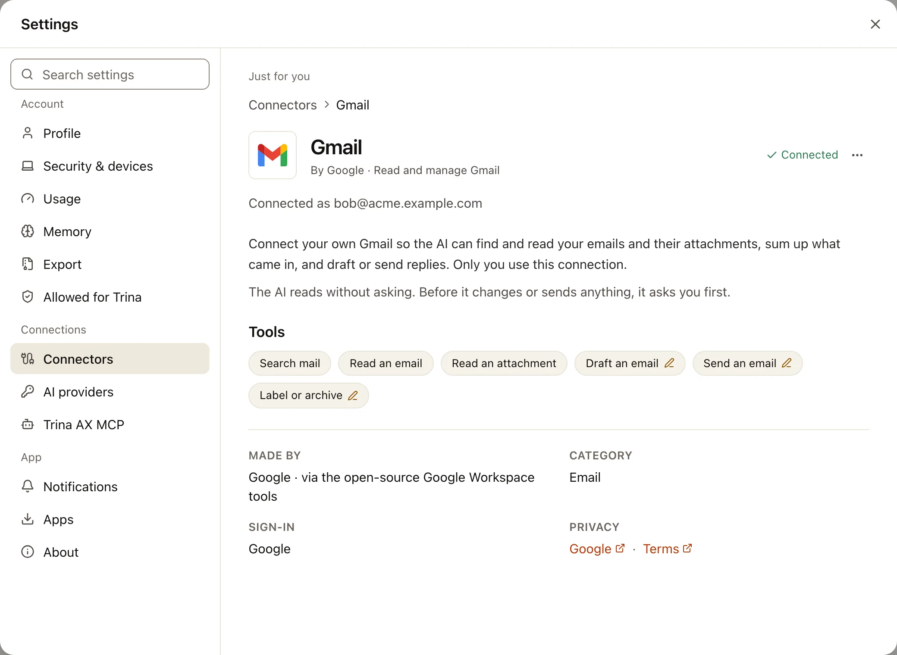
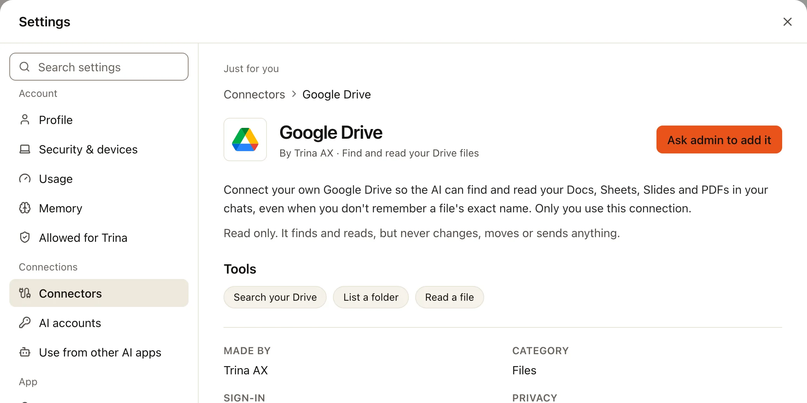
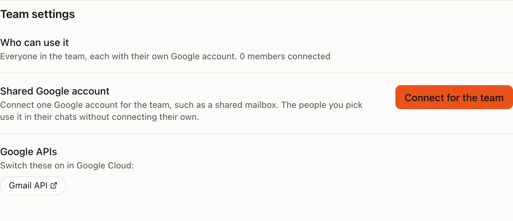
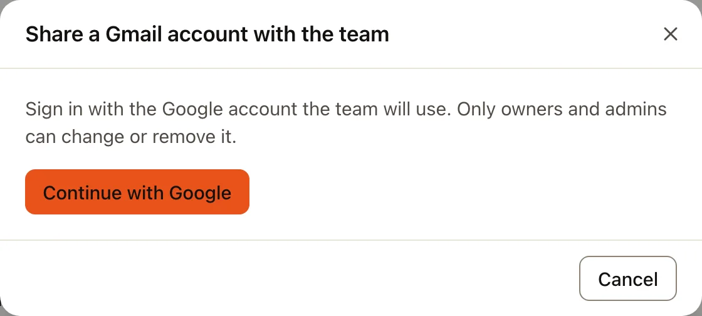
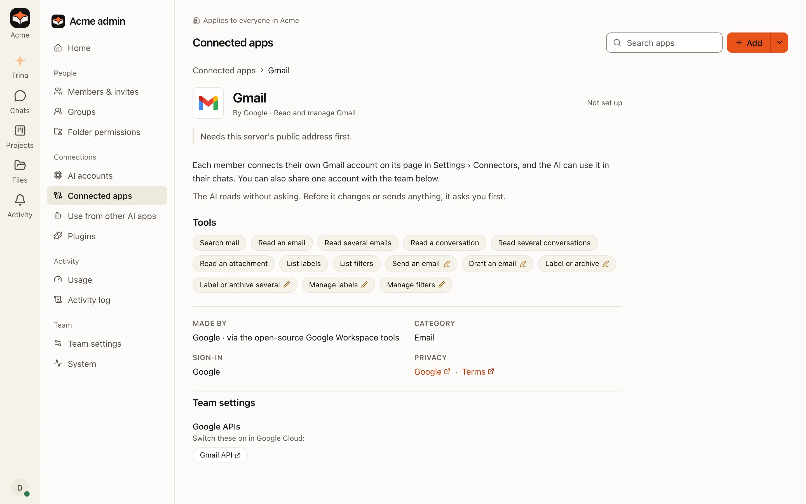

Google Drive, Gmail, Google Calendar, Google Docs, dan Google Sheets sudah tersedia di Trina AX. Setiap orang
menghubungkan akun Google-nya sendiri, sekali untuk setiap aplikasi, dan AI hanya memakainya di chat orang itu,
dengan izin Google milik orang itu.

Tidak ada yang perlu disalin atau ditempel: Anda masuk di Google.

## Menghubungkan aplikasi Google (semua orang)

:::tip
**Yang Anda perlukan**

- Akun Google Anda (akun Google Workspace perusahaan atau akun Gmail pribadi), yang sudah masuk di browser Anda.
:::

:::steps
#### Buka aplikasinya di Konektor
1. Pilih foto Anda di bagian bawah bilah kiri, lalu **Pengaturan**.
2. Di daftar sebelah kiri, pilih **Konektor**.
3. Di bawah **Jelajahi**, pilih aplikasinya, misalnya **Gmail**. (Ketik namanya di **Cari aplikasi** jika tidak terlihat.)

Halaman aplikasi itu terbuka. Halaman itu menjelaskan apa yang bisa dilakukan AI di sana dan mencantumkan setiap alat;
ikon pensil menandai alat yang mengubah sesuatu. **Hubungkan** ada di kanan atas.



#### Pilih Hubungkan
Jendela baru terbuka (di aplikasi desktop, di browser Anda). Di tim yang di-hosting oleh Trina, jendela itu lebih dulu
menampilkan halaman awal Trina, yang menyebut nama tim Anda dan apa yang boleh dilakukan Trina AX: pilih **Lanjutkan ke
Google**. Lalu halaman masuk Google sendiri terbuka. Jika Anda masuk ke lebih dari satu akun Google, Google menanyakan
akun yang mana: pilih akun yang Anda maksud.

#### Lewati peringatan Google
Selama Google masih meninjau aplikasi Google milik Trina, Google menampilkan **Google belum memverifikasi aplikasi ini**
sebelum izin-izinnya. Itu pemberitahuan Google tentang peninjauan tersebut, bukan masalah pada akun Anda. Cukup dua klik:

1. Pilih **Lanjutan** di bawah teksnya.

   

2. Pilih **Buka Trina AX (tidak aman)** di bagian bawah teks yang terbuka.

   ")

Perusahaan yang memakai Google Workspace bisa melewatkan peringatan ini untuk semua orang dengan memakai aplikasi Google
miliknya sendiri: lihat [Masuk Google yang mana](#masuk-google-yang-mana) di bawah.

#### Biarkan semua kotak tetap dicentang
Google menampilkan halaman yang menyebut Trina AX dan mencantumkan apa saja yang boleh dilakukannya, satu baris per izin,
misalnya "Read, compose and send emails". Sebagian baris punya kotak. Biarkan **semua** kotak tetap dicentang dan pilih
**Continue**. Proses masuk dengan kotak yang tidak dicentang akan ditolak: "Beberapa izin
tidak dicentang. Hubungkan lagi dan biarkan semua kotak tetap dicentang."

#### Konfirmasi akunnya
Kembali di Trina AX, periksa akun yang ditampilkan ("Hubungkan akun ini?") lalu pilih **Hubungkan akun ini**. Halaman
sekarang menampilkan **Terhubung** di kanan atas dan **Terhubung sebagai** dengan alamat Anda di bawah namanya.


:::

Membaca tidak perlu persetujuan. Sebelum AI mengirim email, menambahkan acara, atau mengedit dokumen, AI menampilkan kartu berisi
semua yang akan dilakukannya, lalu menunggu persetujuan Anda. Di kartu itu, atau di **Pengaturan** aplikasi itu (menu
**⋯**-nya), Anda bisa memilih **Selalu izinkan** alih-alih **Tanya saya dulu**. Google Drive hanya membaca: tidak pernah
mengubah, memindahkan, atau mengirim apa pun.

### Jika Anda melihat "Minta admin menambahkannya"

Aplikasinya belum disiapkan di tim Anda. Pilih **Minta admin menambahkannya**: owner dan admin mendapat pemberitahuan,
dan Anda akan diberi tahu saat sudah bisa menghubungkannya.



## Akun Google bersama untuk tim (admin)

Kotak surat atau kalender bersama, seperti `sales@acme.com`, bisa dihubungkan sekali untuk orang-orang yang
memerlukannya, seperti kotak surat bersama di Gmail yang dibuka beberapa orang. Mereka memakainya di chat tanpa
menghubungkan akun sendiri.

:::steps
#### Buka aplikasi Google di Admin
Pilih logo tim Anda di bagian atas bilah kiri, lalu **Admin › Aplikasi terhubung**, dan pilih aplikasi Google-nya
(misalnya Gmail). Gulir ke bawah ke **Pengaturan tim**. Baris **Akun Google bersama** punya **Hubungkan untuk tim** di
sebelah kanannya.



#### Masuk dengan akun bersama
Pilih **Hubungkan untuk tim**. Dialog **Bagikan akun Gmail dengan tim** terbuka. Pilih **Lanjutkan di Google** lalu
masuk di Google dengan akun bersama itu, bukan akun Anda sendiri. Biarkan semua kotak tetap dicentang, seperti di atas,
lalu periksa akunnya dan pilih **Hubungkan akun ini**.



#### Pilih siapa yang memakainya, lalu simpan
Di bawah **Siapa yang bisa memakainya**, pilih semua orang, grup, atau orang tertentu, lalu pilih **Simpan**. Tidak ada
yang memakainya sebelum Anda menyimpan; menutup dialog sebelum itu menghapusnya lagi. Baris itu lalu menampilkan akunnya,
siapa yang memakainya, dan siapa yang menghubungkannya, dengan menu **⋯**: **Ubah orang**, **Hubungkan kembali**, dan
**Hapus**.
:::

Google Drive memiliki **Dibagikan dengan tim** di tempat yang sama: **Bagikan Google Drive dengan tim** menghubungkan satu
akun Google dan membiarkan Anda memilih foldernya; orang yang Anda pilih memakainya di chat.

Dari chat caranya sama: saat pemilik atau admin meminta AI menghubungkan Google Drive atau Gmail (atau Calendar, Docs
atau Sheets), kartunya juga punya **Hubungkan untuk tim**, yang membuka dialog yang sama ini. Anggota hanya melihat
koneksi miliknya sendiri. Orang yang sudah memakai akun bersama, atau Drive yang dibagikan kepadanya, diberi tahu bahwa
itu sudah terhubung, tanpa perlu menghubungkan apa pun.

## Menyiapkan aplikasi Google (admin server yang Anda kelola sendiri)

Di tim yang di-hosting oleh Trina, masuk dengan Google sudah siap: tidak ada yang perlu disiapkan. Di server yang
dikelola perusahaan Anda sendiri, admin membuat aplikasi masuk Google sekali di Google Cloud lalu menambahkannya di
**Admin › Aplikasi terhubung**.

:::tip
**Yang Anda perlukan**

- **Alamat https publik** untuk server tim Anda (orang kembali ke alamat itu dari Google). Selama belum ada, aplikasi
  Google menampilkan "Perlu alamat publik server ini dulu." Orang yang mengelola server yang mengaturnya: lihat
  [Konfigurasi](../../operate/configuration.md) (bahasa Inggris).
- **Proyek Google Cloud**, **API** yang diperlukan setiap aplikasi dalam keadaan aktif, dan **klien masuk** berjenis
  **Web application**.
- Dari Google Cloud: **file JSON** klien itu (atau **Client ID** dan **Client secret**-nya).
- Untuk Google Cloud: **alamat kembali** yang ditampilkan Trina AX, satu untuk Google Drive dan satu untuk empat
  aplikasi lainnya.
:::



:::steps
#### Buat aplikasinya di Google Cloud
Ikuti [Di Google Cloud](google-own-app.md#di-google-cloud) di halaman aplikasi perusahaan: proyek, API, nama dan
audiens aplikasi (**Internal** untuk perusahaan dengan Google Workspace; selain itu **External** dengan pengguna uji),
izin, dan klien **Web application**.

#### Tambahkan alamat kembali
Di bawah **Authorized redirect URIs** milik klien, tambahkan alamat yang ditampilkan dialog **Siapkan** setiap aplikasi,
dengan tombol salinnya:

```
https://<your team address>/api/integrations/google-drive/callback
https://<your team address>/api/integrations/google-apps/callback
```

#### Unggah file di Trina AX
Di **Admin › Aplikasi terhubung**, buka **Google Drive** dan pilih **Siapkan**. Unggah file JSON yang Anda unduh, atau
tempel **Client ID** dan **Client secret**, lalu simpan. Kemudian buka Gmail, Google Calendar, Docs, dan Sheets satu per
satu, pilih **Siapkan**, dan nyalakan **Gunakan aplikasi Google yang sama dengan Google Drive**: tidak ada lagi yang
perlu diunggah.
:::

Halaman setiap aplikasi mencantumkan, di bawah **API Google**, API yang perlu diaktifkan untuknya:

| Aplikasi | API Google yang perlu diaktifkan |
|---|---|
| Google Drive | Google Drive API |
| Gmail | Gmail API |
| Google Calendar | Google Calendar API |
| Google Docs | Google Docs API, Google Drive API |
| Google Sheets | Google Sheets API, Google Drive API |

Aplikasi Gmail, Calendar, Docs, dan Sheets berjalan di server Linux. Di aplikasi Mac, halamannya menampilkan "Belum
tersedia di server tim".

## Masuk Google yang mana

Ada dua cara masuk ke Google. Tim Anda memakai salah satunya untuk kelima aplikasi Google.

| | Masuk milik Trina | Aplikasi Google milik perusahaan Anda |
|---|---|---|
| Siapa yang bisa menghubungkan | Akun Google apa pun: akun Google Workspace perusahaan atau akun Gmail pribadi | Hanya akun Google Workspace perusahaan Anda |
| Penyiapan | Tidak ada, di tim yang di-hosting oleh Trina | Sekitar 15 menit, sekali, oleh admin IT: [Memakai aplikasi Google milik perusahaan Anda](google-own-app.md) |
| Layar Google | **Google belum memverifikasi aplikasi ini** selama Google meninjau aplikasi Trina: [dua klik](#menghubungkan-aplikasi-google-semua-orang) | Nama aplikasi perusahaan Anda, tanpa peringatan |
| Berapa banyak orang | Dibatasi Google selama peninjauan berjalan | Tanpa batas |

Mulailah dengan masuk milik Trina. Jika perusahaan Anda memakai Google Workspace dan Anda tidak ingin ada peringatan,
atau Google mengatakan aplikasinya sudah mencapai batas, beralihlah ke aplikasi milik perusahaan Anda. Setelah itu orang
menghubungkan Google lagi sekali.

## Masalah

| Yang Anda lihat | Yang perlu dilakukan |
|---|---|
| **Beberapa izin tidak dicentang. Hubungkan lagi dan biarkan semua kotak tetap dicentang.** | Hubungkan lagi dan biarkan semua kotak di layar Google tetap dicentang. |
| **Google meminta Anda masuk lagi.** | Pilih **Hubungkan kembali** di halaman aplikasinya. Ini terjadi setelah kata sandi diganti, atau saat admin perusahaan Anda mencabut akses. |
| **`redirect_uri_mismatch`** di halaman Google (server yang dikelola sendiri) | Alamat kembali di Google Cloud berbeda dari yang ditampilkan Trina AX. Salin lagi dari dialog **Siapkan**. |
| **"This app is blocked"** atau **`admin_policy_enforced`** | Admin Google perusahaan Anda membatasi aplikasi mana yang boleh memakai akun Google. Minta mereka memercayai aplikasinya: lihat [Memercayai aplikasi di Admin console](google-own-app.md#opsional-memercayai-aplikasi-di-admin-console). |
| **Google belum memverifikasi aplikasi ini** | Dengan masuk milik Trina: pilih **Lanjutan**, lalu **Buka Trina AX (tidak aman)** ([gambar](#menghubungkan-aplikasi-google-semua-orang)). Dengan aplikasi buatan admin Anda yang masih dalam tahap Testing: pilih **Lanjutan** › **Buka …** hanya jika admin Anda yang membuatnya, atau minta mereka mengaturnya ke **Internal**. |
| **Akses diblokir** atau Google mengatakan aplikasi sudah mencapai batas penggunanya | Masuk milik Trina sudah mencapai batas Google selama peninjauan berjalan. Admin mengalihkan tim ke [aplikasi Google milik perusahaan Anda](google-own-app.md). |

Detail lengkap untuk pengembang dan operator: [Google apps](../../../GOOGLE-APPS.md) (bahasa Inggris) dan
[Google Drive](../../../GOOGLE-DRIVE.md) (bahasa Inggris).
