Saat orang menghubungkan Google Drive, Gmail, Google Calendar, Google Docs, atau Google Sheets, mereka masuk di Google
melalui aplikasi Google milik Trina. Perusahaan yang memakai Google Workspace bisa memakai **aplikasi Google miliknya
sendiri** sebagai gantinya. Admin IT-nya membuat aplikasi itu sekali di Google Cloud dan menambahkannya sekali ke Trina
AX. Sejak itu kelima aplikasi Google masuk dengan aplikasi tersebut, dan orang melihat nama perusahaan Anda di layar
Google, tanpa peringatan "unverified app" dan tanpa batas jumlah orang yang bisa masuk.

Prosesnya sekitar 15 menit: sebagian besar di Google Cloud, lalu satu dialog di Trina AX.

:::tip
**Yang Anda perlukan**

| Nilai | Dari mana asalnya | Ke mana perginya |
|---|---|---|
| Dua **alamat kembali** | Dialog Trina AX, langkah **Di Google Cloud**, masing-masing dengan **Salin** | Google Cloud › Clients › klien Anda › **Authorized redirect URIs** |
| Daftar **izin** (scope) | Blok di halaman ini, [Tambahkan izin](#di-google-cloud) | Google Cloud › **Data access** › **Manually add scopes** |
| **File JSON** klien (atau **Client ID** dan **Client secret**) | Google Cloud › **Clients** › **Download JSON**, tepat setelah Anda membuat klien | Dialog Trina AX, langkah **Tambahkan di sini** |
:::

:::note
Tangkapan layar di halaman ini memakai tim rekaan, "Acme", dan proyek Google Cloud rekaan, "acme-trina". Google
sesekali mengubah konsolnya: jika suatu layar terlihat berbeda, ikuti label yang dikutip di teks dan tautan ke halaman
Google Cloud.
:::

## Untuk siapa

- **Perusahaan yang memakai Google Workspace** (semua orang masuk dengan alamat perusahaan, seperti `name@acme.com`).
  Halaman ini untuk Anda. Anda harus menjadi owner tim atau admin di Trina AX, dan bisa membuat proyek di Google Cloud
  perusahaan Anda.
- **Orang dengan akun Gmail pribadi.** Tetap pakai masuk milik Trina: aplikasi Internal hanya mengizinkan akun milik
  perusahaan Anda sendiri.

Bagi anggota tidak ada yang berubah: halamannya sama, tombol **Hubungkan** juga sama. Mereka menghubungkan Google lagi
sekali, setelah Anda beralih.

:::tip
Tim kecil tanpa Google Workspace bisa membuat aplikasi **External** dalam tahap **Testing** sebagai gantinya. Hanya
orang yang Anda daftarkan sebagai pengguna uji yang bisa masuk (paling banyak 100), dan Google meminta mereka masuk
lagi setiap 7 hari. Bagi sebagian besar tim, masuk milik Trina lebih sederhana.
:::

## Di Google Cloud

Masuk ke [Google Cloud](https://console.cloud.google.com/) dengan akun perusahaan Anda.

:::steps
#### Buat proyek
Buka [New project](https://console.cloud.google.com/projectcreate). Beri **Project name** yang mudah Anda kenali,
misalnya "acme-trina". Di **Parent resource** (atau **Organization**), pilih perusahaan Anda: aplikasi hanya bisa
**Internal** jika proyeknya milik organisasi perusahaan Anda ("No organization" di gambar adalah akun rekaan). Pilih
**Create**, lalu pastikan proyek baru itu terpilih di bagian atas halaman sebelum langkah berikutnya.

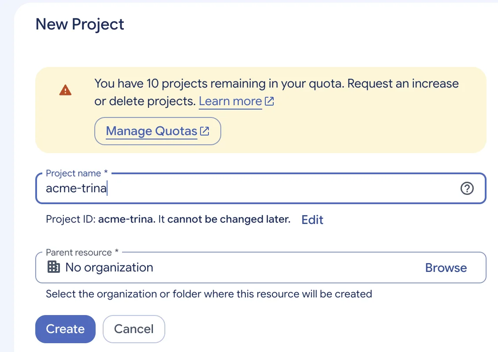

#### Aktifkan lima API
Buka setiap halaman di bawah dan pilih **Enable**:

- [Google Drive API](https://console.cloud.google.com/apis/library/drive.googleapis.com)
- [Gmail API](https://console.cloud.google.com/apis/library/gmail.googleapis.com)
- [Google Calendar API](https://console.cloud.google.com/apis/library/calendar-json.googleapis.com)
- [Google Docs API](https://console.cloud.google.com/apis/library/docs.googleapis.com)
- [Google Sheets API](https://console.cloud.google.com/apis/library/sheets.googleapis.com)

Aktifkan kelimanya, meskipun tim Anda saat ini baru memakai sebagian aplikasi Google. Setelah API aktif, halamannya
menampilkan **Manage** dan **API Enabled** di tempat **Enable**.

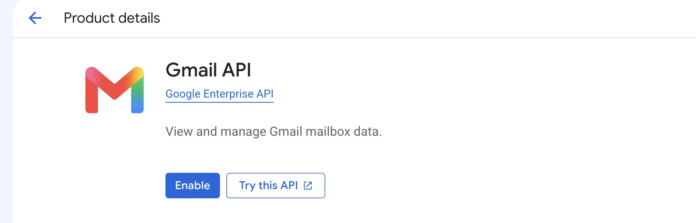

#### Beri nama aplikasi dan atur ke Internal
Buka [Google Auth Platform](https://console.cloud.google.com/auth/overview). Pertama kali, halaman ini menampilkan
**Get started**:

1. **App Information**: **App name** yang dikenali orang, misalnya "Acme Trina", dan **User support email**.
   Pilih **Next (Berikutnya)**.

   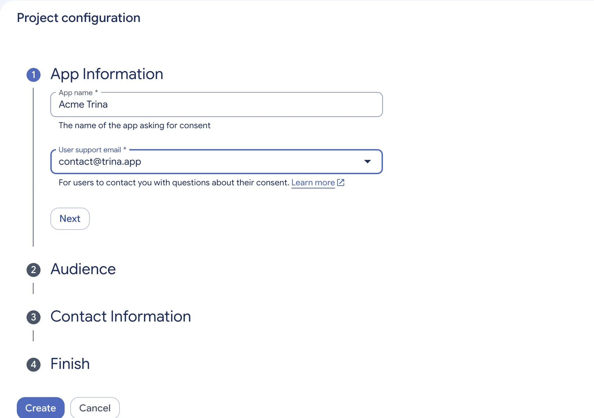

2. **Audience**: pilih **Internal**. Hanya akun perusahaan Anda yang bisa memakai aplikasi ini, dan Google tidak perlu
   meninjaunya. (Di gambar, **Internal** berwarna abu-abu karena akun rekaan itu tidak punya organisasi. Dengan akun
   perusahaan Anda, pilihan itu bisa dipilih.)

   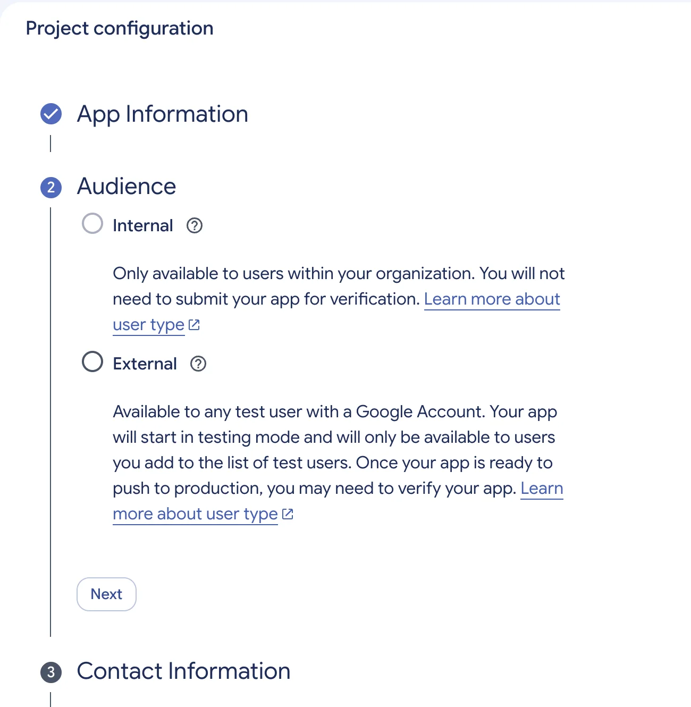
3. **Contact Information**: alamat email yang bisa dihubungi Google tentang proyek ini.
4. **Finish**: setujui kebijakan Google dan pilih **Create**.

Nanti Anda bisa mengubahnya di [Branding](https://console.cloud.google.com/auth/branding) dan
[Audience](https://console.cloud.google.com/auth/audience).

#### Tambahkan izin
Buka [Data access](https://console.cloud.google.com/auth/scopes) dan pilih **Add or remove scopes**.

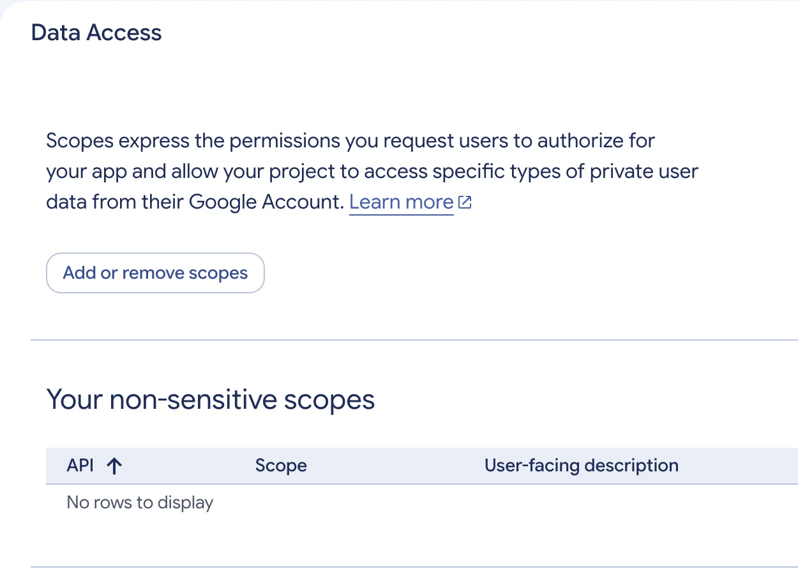

Panel terbuka di sebelah kanan. Di bagian bawahnya, di bawah **Manually add scopes**, tempel seluruh blok di bawah,
pilih **Add to table**, lalu **Update**, lalu **Save** di halamannya.

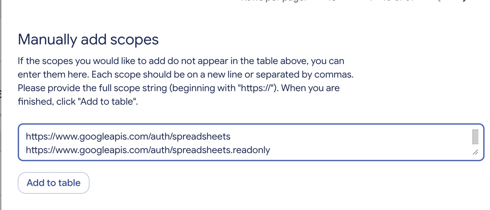

```
openid
https://www.googleapis.com/auth/userinfo.email
https://www.googleapis.com/auth/userinfo.profile
https://www.googleapis.com/auth/drive.readonly
https://www.googleapis.com/auth/drive.file
https://www.googleapis.com/auth/gmail.readonly
https://www.googleapis.com/auth/gmail.send
https://www.googleapis.com/auth/gmail.compose
https://www.googleapis.com/auth/gmail.modify
https://www.googleapis.com/auth/gmail.labels
https://www.googleapis.com/auth/gmail.settings.basic
https://www.googleapis.com/auth/calendar
https://www.googleapis.com/auth/calendar.readonly
https://www.googleapis.com/auth/calendar.events
https://www.googleapis.com/auth/documents
https://www.googleapis.com/auth/documents.readonly
https://www.googleapis.com/auth/spreadsheets
https://www.googleapis.com/auth/spreadsheets.readonly
```

Inilah tepatnya izin yang diminta Trina AX, untuk kelima aplikasi sekaligus. Jangan ada yang terlewat: proses masuk
tanpa salah satunya akan ditolak.

#### Buat klien masuk
Buka [Clients](https://console.cloud.google.com/auth/clients) dan pilih **Create client**.

1. **Application type**: **Web application**.
2. **Name**: apa saja, misalnya "Trina AX". Orang tidak melihatnya.

   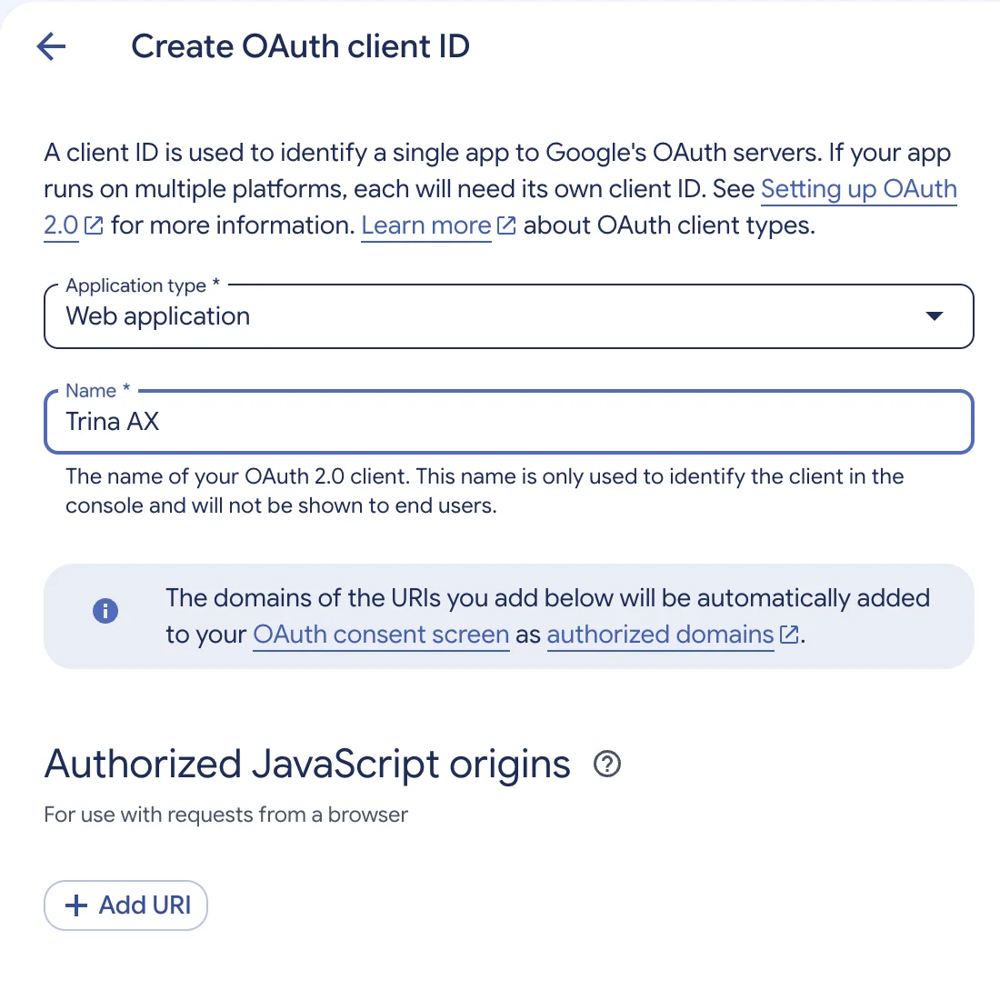

3. Di bawah **Authorized redirect URIs**, pilih **Add URI** dua kali dan tempel kedua alamat kembali. Salin dari Trina AX
   (dialog di bagian berikutnya menampilkannya, masing-masing dengan **Salin**). Bentuknya seperti ini, dengan alamat
   tim Anda:

   ```
   https://<your team address>/api/integrations/google-drive/callback
   https://<your team address>/api/integrations/google-apps/callback
   ```

   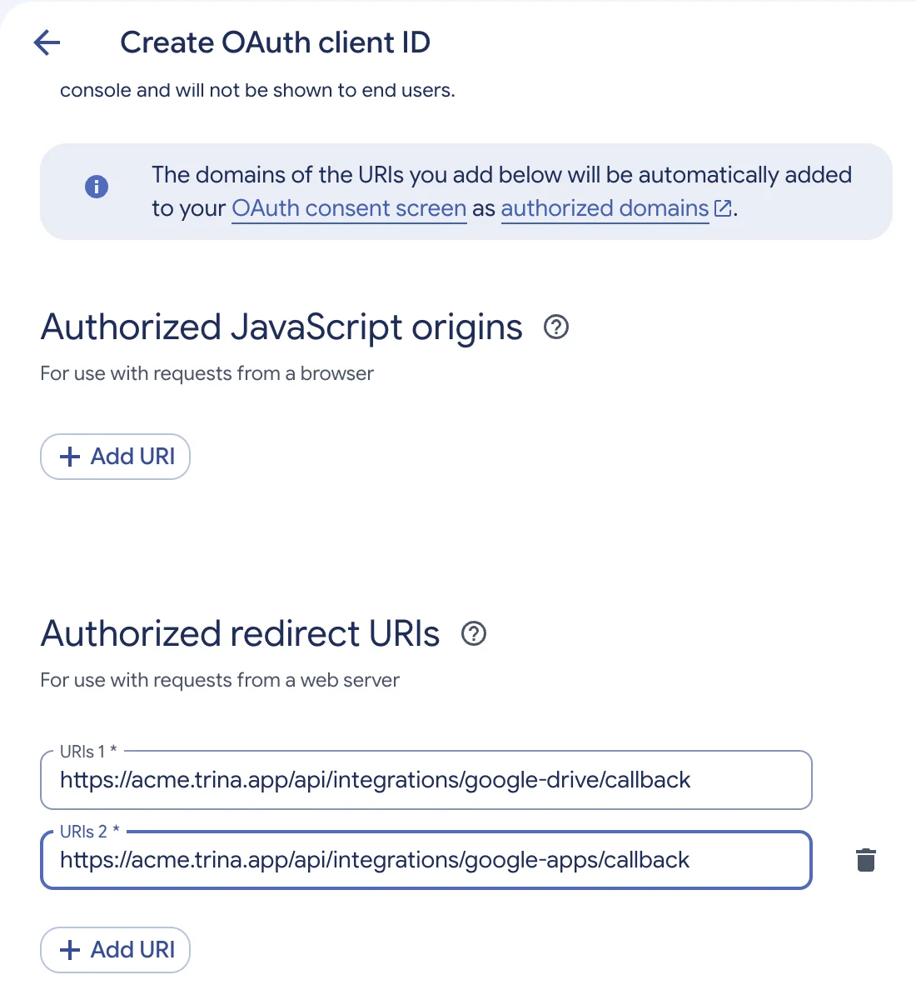

4. Pilih **Create**. Di **OAuth client created**, pilih **Download JSON** dan simpan file itu. Google hanya menampilkan
   rahasianya saat ini; jika hilang, buat rahasia baru untuk klien itu.

   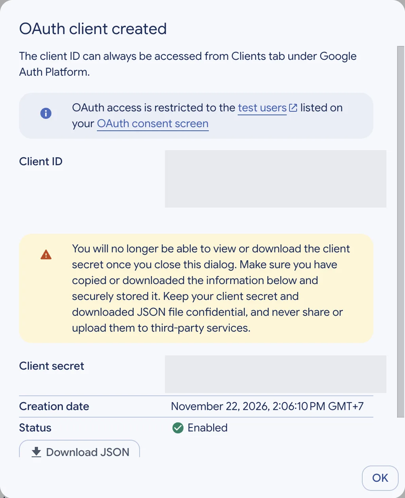
:::

## Di Trina AX

:::steps
#### Buka halaman Google
Di **Admin › Aplikasi terhubung**, pilih salah satu aplikasi Google, misalnya **Gmail**. Kelima halaman diakhiri dengan
**Pengaturan tim**, dan baris pertamanya adalah **Masuk Google**: "Semua orang masuk dengan aplikasi Google milik Trina.
Perusahaan Anda bisa memakai aplikasi Google sendiri sebagai gantinya, untuk semua aplikasi Google di sini."

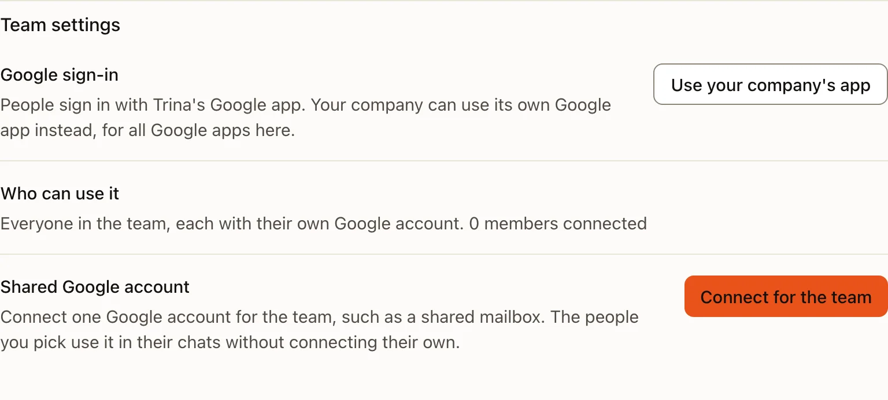

#### Tekan Pakai aplikasi perusahaan
Dialog **Pakai aplikasi Google perusahaan Anda** terbuka. Langkah pertamanya, **Sebelum mulai**, menjelaskan untuk siapa
fitur ini dan menautkan ke halaman ini.

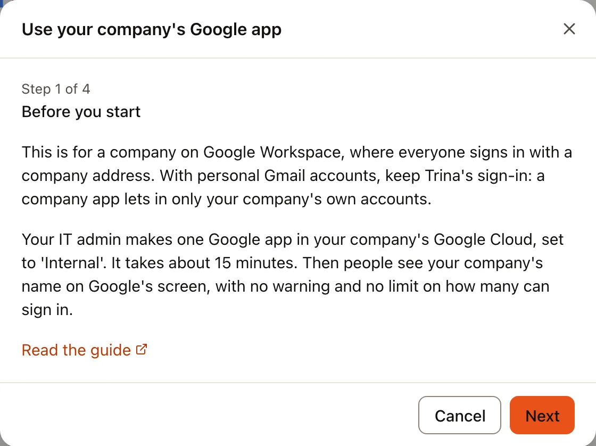

#### Di Google Cloud
Langkah kedua mencantumkan langkah-langkah Google Cloud di atas, dengan tautan ke setiap halaman, serta dua alamat
kembali tim Anda, masing-masing dengan **Salin**. Salin dari sini ke **Authorized redirect URIs**, agar alamatnya persis
benar.

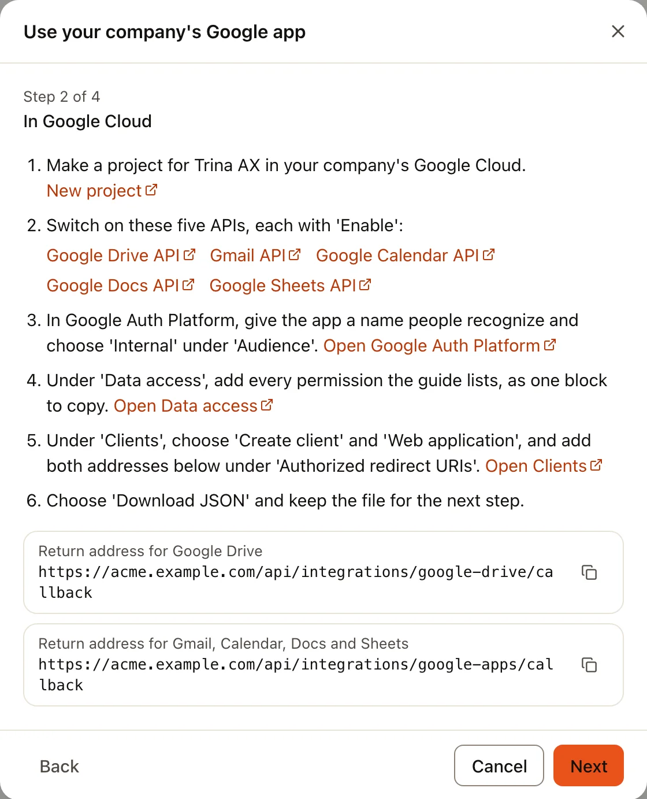

#### Tambahkan di sini
Letakkan file yang Anda unduh dari Google, atau pilih file itu. Jika Anda lebih suka mengetik, **Masukkan ID dan rahasia
sebagai gantinya** membuka dua kolom untuk **Client ID** dan **Client secret**. File yang tidak mencantumkan kedua alamat
kembali akan ditolak, dengan keterangan alamat mana yang perlu ditambahkan di Google Cloud.

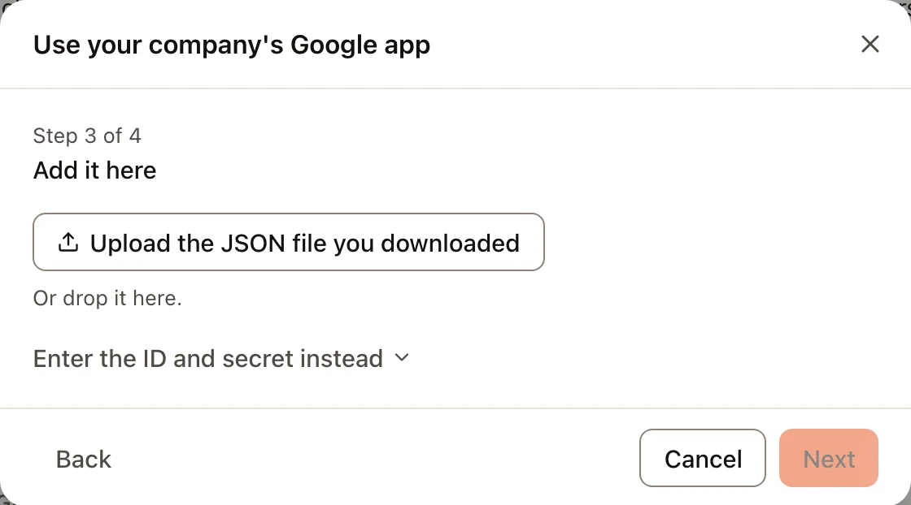

#### Periksa dan simpan
Langkah terakhir, **Sebelum menyimpan**, menjelaskan apa yang berubah, dengan angka tim Anda: berapa orang yang perlu
menghubungkan Google lagi, dan bahwa akun Google bersama serta Drive yang dibagikan dengan tim perlu dihubungkan ulang
oleh admin. Tidak ada yang berubah sampai Anda memilih **Simpan**. **Batal** membiarkan semuanya seperti semula.

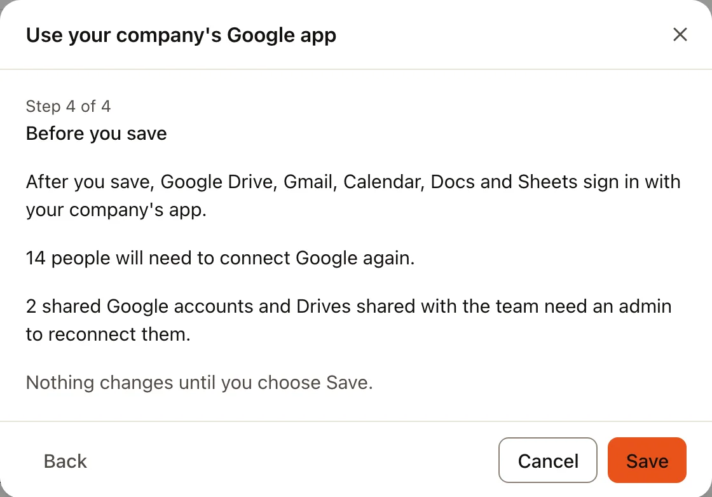
:::

Setelah **Simpan**, barisnya menampilkan "Semua orang masuk dengan aplikasi Google perusahaan Anda, untuk Google Drive,
Gmail, Calendar, Docs, dan Sheets." beserta siapa yang mengaturnya dan kapan. Menu ⋯-nya berisi **Ganti** (untuk
menambahkan file baru, misalnya setelah rahasia baru) dan **Pakai lagi masuk Google milik Trina**. Anda cukup mengaturnya
sekali: barisnya sama di kelima halaman Google.

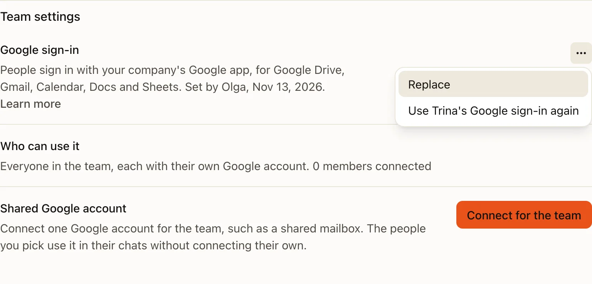

Di ponsel, ⋯ tetap berada di samping nama baris, seperti di pengaturan ponsel.

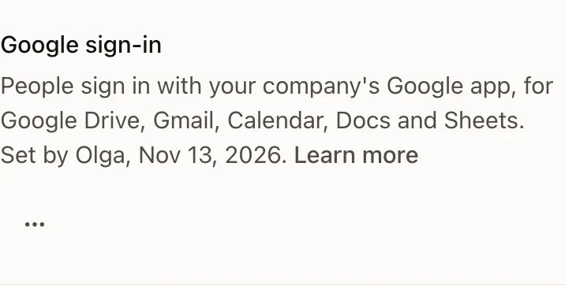

## Yang dilihat anggota

Setiap koneksi ke Google yang dibuat lewat aplikasi Trina berhenti berfungsi saat Anda beralih, karena Google mengikat
proses masuk ke aplikasi yang membuatnya.

- **Setiap orang** melihat **Hubungkan kembali** seperti biasa pada aplikasi Google mereka di **Pengaturan › Konektor**,
  sekali saja. Google lalu menampilkan nama aplikasi perusahaan Anda, tanpa peringatan.
- **Akun Google bersama dan Drive yang dibagikan dengan tim** menampilkan **Hubungkan kembali** di bawah **Pengaturan
  tim** pada halaman Google-nya. Admin yang menghubungkannya ulang; sampai saat itu AI tidak bisa memakainya.

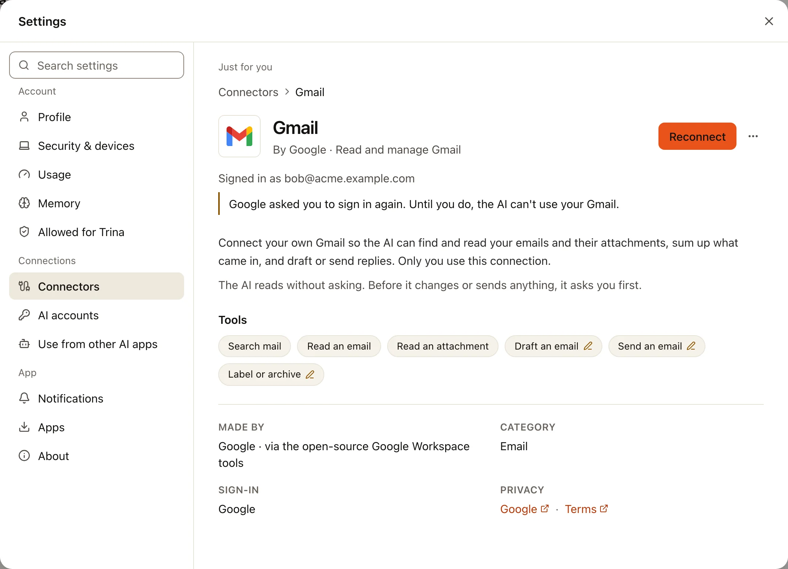

## Opsional: memercayai aplikasi di Admin console

Jika perusahaan Anda membatasi aplikasi mana yang boleh memakai akun Google, super admin Google Workspace menandai
aplikasi ini sebagai tepercaya. Tanpa ini, orang mungkin melihat `admin_policy_enforced` saat menghubungkan.

1. Cari client ID aplikasinya. Client ID ada di file JSON yang Anda unduh, setelah `"client_id":`, dan di halaman client
   itu di [Clients](https://console.cloud.google.com/auth/clients). Akhirannya `.apps.googleusercontent.com`.
2. Masuk ke [Admin console](https://admin.google.com/) sebagai super admin.
3. Di menu sebelah kiri, buka **Security**, lalu **Access and data control**, lalu **API controls**.
4. Pilih **Manage Third-Party App Access**, lalu **Configure new app**.
5. Tempel client ID ke kotak pencarian dan pilih aplikasi Anda di daftar.
6. Pilih untuk siapa pengaturan ini berlaku (biasanya seluruh organisasi), atur ke **Trusted**, lalu selesaikan dengan
   **Configure** (tombol terakhir Google; namanya bisa sedikit berbeda).

## Yang disimpan Trina AX

- ID dan rahasia aplikasi disimpan di **file privat di server tim Anda**, yang hanya bisa dibaca oleh server. Keduanya
  tidak pernah ditampilkan lagi: tidak di halaman, tidak di log, tidak di log aktivitas.
- Di tim yang di-hosting, **layanan hosting Trina yang menjalankan server itu**, jadi layanan itu berjalan di tempat
  file tersebut berada. Rahasia itu saja tidak membuka apa pun: setiap orang tetap masuk di Google dan memberi
  persetujuan di sana.
- Data masuk Google milik setiap orang tetap disimpan tersegel di server, seperti sebelumnya.

## Kembali ke masuk milik Trina

Di halaman Google mana pun, di **Pengaturan tim › Masuk Google**, buka ⋯ dan pilih **Pakai lagi masuk Google milik
Trina**. Pertama-tama ditampilkan angka yang sama seperti di **Sebelum menyimpan**. Setelah Anda mengonfirmasi, kelima
aplikasi Google kembali masuk lewat aplikasi Trina, orang menghubungkan Google lagi sekali, dan file aplikasi perusahaan
dihapus dari server. Setelah itu Anda bisa menghapus klien di Google Cloud.

Jika alamat tim Anda berubah, baris Masuk Google akan memberi tahu. Tambahkan dua alamat kembali yang baru ke klien di
Google Cloud, unduh lagi filenya, lalu buka ⋯ › **Ganti** di Trina AX: dialog terbuka di **Di Google Cloud** dengan
alamat baru untuk disalin. Sampai saat itu, tidak ada yang bisa menghubungkan Google.

## Masalah

| Yang Anda lihat | Yang perlu dilakukan |
|---|---|
| **`redirect_uri_mismatch`** di halaman Google | Ada alamat kembali di Google Cloud yang hilang atau berbeda satu huruf. Buka [Clients](https://console.cloud.google.com/auth/clients), pilih klien Anda, lalu tempel lagi kedua alamat dari langkah **Di Google Cloud** di dialog. Perubahan yang disimpan bisa butuh beberapa menit untuk berlaku. |
| **"Beberapa izin tidak dicentang. Hubungkan lagi dan biarkan semua kotak tetap dicentang."** | Orang itu menghapus centang sebuah kotak di layar Google, atau ada izin yang tidak ada di **Data access**. Pastikan seluruh blok di atas tercantum di sana, lalu hubungkan lagi dengan semua kotak dicentang. |
| **`admin_policy_enforced`** | Admin console perusahaan Anda memblokir aplikasi ini. Tandai sebagai tepercaya (lihat [di atas](#opsional-memercayai-aplikasi-di-admin-console)). |
| **Akun dari luar perusahaan** ditolak (Google mengatakan aplikasi hanya bisa dipakai di dalam organisasinya) | Itulah arti **Internal**. Pakai akun perusahaan Anda. Akun Google bersama juga harus akun perusahaan. |

Detail lengkap untuk pengembang dan operator: [Google apps](../../../GOOGLE-APPS.md) (bahasa Inggris) dan
[Google Drive](../../../GOOGLE-DRIVE.md) (bahasa Inggris).
