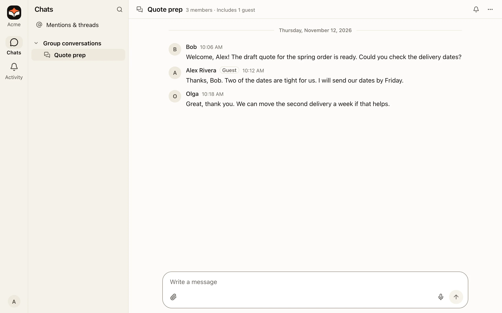

**Tamu** adalah orang dari luar tim Anda, misalnya klien, mitra, atau pekerja lepas. Tamu berada di paling banyak satu
obrolan grup dan satu proyek, dan tidak melihat apa pun lainnya di tim: tidak ada obrolan lain, file tim, proyek lain,
atau skill tim. Tamu tidak memakai kursi di paket Anda.

| | Anggota tim | Tamu |
|---|---|---|
| **Ke mana mereka bisa pergi** | Semua yang diizinkan grup dan izin folder mereka | Paling banyak satu obrolan grup dan satu proyek |
| **File tim** | Folder yang boleh mereka buka | Hanya file proyek mereka (tidak ada di obrolan grup) |
| **AI** | Pengaturan AI tim | Tanpa AI, kecuali ada AI yang dipilih untuk mereka |
| **Kursi** | Memakai satu | Tidak memakai |
| **Berkas terbesar yang bisa diunggah** | 10 GB di chat, 20 GB di Berkas | 100 MB, kecuali pemilik atau admin menaikkannya (1 GB atau 10 GB) di **Admin › Anggota & undangan**, di atas daftar **Tamu** |

Di samping nama tamu Anda melihat tanda **Tamu**, dan obrolan atau proyek yang memiliki tamu menyebutkannya di bagian
atas ("Termasuk 1 tamu").

## Siapa yang bisa mengundang tamu

- **Ke obrolan grup:** siapa pun di obrolan itu.
- **Ke proyek:** orang yang membuat proyek itu, atau owner atau admin.

Anda tidak perlu membuka obrolan atau proyeknya lebih dulu: **Obrolan baru** diawali dengan **Undang tamu**, dan owner
serta admin juga menemukan **Tamu** di **Undang orang** dan di **Admin › Anggota & undangan › Undang ke tim**. Lihat
[Tanpa membuka obrolan atau proyek](#tanpa-membuka-obrolan-atau-proyek) dan [Dari Admin](#dari-admin) di bawah.

Tamu tidak pernah berada di **Saluran** (saluran Semua dan saluran setiap grup). Tamu bisa mengirim pesan
langsung, tetapi hanya ke orang-orang di obrolan atau proyeknya sendiri.

## Mengundang tamu

:::steps
#### Buka daftar tambah
Di obrolan grup, pilih **⋯** di bagian atas, lalu **Undang orang** (atau klik nama obrolan, lalu **Undang orang**). Di
proyek, pilih **Kelola** di samping **Anggota** di halaman proyek. Baris pertamanya adalah **Undang tamu**.

#### Sebutkan untuk siapa dan pilih AI-nya
Ketik nama orang itu di **Untuk siapa?**. Di **AI untuk mereka**, **Tanpa AI** terpilih sejak awal. Pilihan lainnya
dijelaskan di bawah, di [AI tamu](#ai-tamu).

#### Salin tautannya dan kirim sendiri
**Buat tautan** membuat tautan untuk satu orang ini. Trina tidak mengirim email: pilih **Salin tautan** lalu kirimkan
sendiri kepada orang itu, lewat email atau chat. Tautan ini berlaku sekali, selama 7 hari; dialog menampilkan tanggal dan
jam berakhirnya.

:::

Tautan itu juga muncul di **Admin › Anggota & undangan**, di bawah **Link undangan**, bertanda **Tamu**, dengan nama orangnya, sampai dipakai atau kedaluwarsa.

Tautan hanya berlaku selama orang yang membuatnya masih bisa mengundang. Jika orang itu keluar dari obrolan, kehilangan proyeknya, dikeluarkan, atau (untuk **AI tim**) bukan admin lagi, tautan berhenti berfungsi dan hilang dari **Link undangan** di **Admin › Anggota & undangan**. Orang lain yang bisa mengundang membuat tautan baru.

### Tanpa membuka obrolan atau proyek

- **Obrolan baru** (tanda **+** di atas percakapan Anda): baris pertamanya adalah **Undang tamu**.
- **Undang orang** (owner dan admin: menu tim di bawah logo tim, pencarian, atau **Saya** di ponsel): pilih
  **Tamu** di bagian atas dialog (**Anggota tim** terpilih sejak awal).
- **Undang anggota tim** (langkah memulai dan target tim di Beranda): di bawah pesan, **Undang tamu**.

Masing-masing mencantumkan satu tempat yang bisa dimasuki tamu: obrolan grup yang Anda ikuti, dan proyek yang anggotanya
bisa Anda ubah (yang Anda buat; owner dan admin: proyek tim mana pun). Pilih satu, lalu isi dialog yang sama seperti di
atas. Jika belum ada obrolan atau proyek seperti itu, dialog memberitahukannya. Jika paket Anda tidak punya tempat untuk
tamu lagi, dialog menyebutkan hal itu.

Proyek Anda sendiri di bawah **Proyek saya** juga tercantum, bertanda **Hanya saya**. Memilih salah satunya membagikan
proyek itu dengan cara yang sama seperti **Tambah orang** di halaman proyek, dan dialog menyebutkannya dalam satu baris
sebelum **Buat tautan**:

- **Buat tautan** menjadikannya proyek tim. Sampai tamu bergabung, proyek itu masih hanya milik Anda dan tetap di bawah **Proyek saya**.
- Saat tamu bergabung, proyek itu pindah ke **Proyek tim**, dengan Anda dan tamu sebagai dua anggotanya.
- Tamu bisa membuka dan mengedit file-filenya. Mereka tidak melihat chat Anda, baik yang sebelumnya maupun yang Anda mulai nanti.
- Seperti **Tambah orang**, ini tidak bisa dikembalikan menjadi hanya milik Anda.

Jika tim Anda hanya mengizinkan owner dan admin membagikan proyek, proyek milik anggota sendiri tidak tercantum.

### Dari Admin

Owner dan admin bisa mengundang tamu tanpa membuka obrolan atau proyeknya lebih dulu. Di **Admin › Anggota & undangan**,
pilih **Undang ke tim**, lalu **Tamu** di bagian atas dialog (**Anggota tim** terpilih sejak awal). Pilih satu tempat
yang akan dimasuki tamu: obrolan grup yang Anda ikuti, proyek tim, atau salah satu proyek Anda sendiri (dibagikan seperti
di atas). Lalu isi dialog yang sama seperti di atas: namanya, AI-nya, **Buat tautan**, dan **Salin tautan**. Jika paket Anda
tidak punya tempat untuk tamu lagi, dialog menyebutkannya alih-alih mencantumkan tempat.

## Yang dilihat tamu

Tautan membuka halaman yang menyebutkan siapa yang mengundang mereka dan satu obrolan atau proyek yang akan mereka
masuki. Mereka memilih nama pengguna dan kata sandi, dan langsung masuk. Jika Anda memilih **Masuk dengan akun sendiri**, halaman itu juga memberi tahu bahwa mereka akan menghubungkan akun Claude atau ChatGPT miliknya sendiri. Jika tautan sudah tidak berlaku, halaman menjelaskan alasannya: kedaluwarsa, sudah dipakai,
dimatikan, orang yang membuatnya sudah tidak bisa mengundang mereka, atau obrolan atau proyeknya sudah tidak ada.

Setelah mereka masuk, Trina membuka obrolan atau proyek mereka. Bilah kiri hanya berisi apa yang bisa mereka pakai: tidak
ada **File**, tidak ada proyek atau saluran, dan tidak ada **Trina** jika AI mereka mati. **Pengaturan** mereka hanya
berisi hal milik mereka sendiri, seperti profil dan notifikasi.

Di sebuah proyek, anggota proyek bisa melihat chat yang dimiliki tamu di sana. Tamu yang bisa memakai AI diberi tahu hal ini di halaman proyek.

Tamu tidak menerima atau membagikan tautan file. Untuk memberi file kepada tamu, kirim file itu di obrolan grup atau proyek mereka.

## Satu obrolan grup dan satu proyek

Tamu bisa berada di satu obrolan grup dan satu proyek sekaligus, tidak pernah lebih. Satu undangan membuka satu tempat.
Untuk membawa tamu ke tempat keduanya, tambahkan mereka seperti orang lain: dari **Undang orang** di obrolan grup, atau
dari **Anggota** di proyek. Trina tidak mengizinkan Anda menambahkan tamu ke obrolan grup kedua atau proyek kedua. Di
daftar tambah, tamu yang sudah berada di tempat lain yang sejenis tidak bisa dicentang dan menunjukkan di mana mereka
berada (hanya nama tempat yang juga Anda ikuti).

Tamu yang berada di keduanya melihat orang-orang di keduanya: mereka bisa mengirim pesan kepada siapa pun di obrolan grup
atau proyek mereka, dan tidak kepada orang lain. Kedua pihak melihat tamu itu; orang yang hanya berada di obrolan grup
tidak melihat nama proyeknya, begitu pula sebaliknya.

Jika orang itu memerlukan lebih dari satu obrolan grup atau proyek, owner atau admin bisa memilih **Jadikan anggota tim**
(lihat di bawah).

Jika tamu keluar, dikeluarkan, atau obrolan atau proyeknya ditutup, mereka keluar dari tempat itu. Mereka masih bisa
masuk selama masih berada di tempat lainnya. Jika sudah keluar dari semua tempat, mereka tidak bisa masuk lagi, sama
seperti saat mereka dikeluarkan. Proyek di tempat sampah tetap milik mereka: selama di sana, mereka tidak bisa bergabung
ke proyek lain. Memindahkan proyek yang memiliki tamu ke tempat sampah akan memberitahukan hal ini sebelum Anda mengonfirmasi. Jika proyek mereka dikembalikan dari tempat sampah, mereka bisa masuk lagi dengan sendirinya, kecuali owner atau
admin sempat mengaktifkan atau menonaktifkan mereka di antara waktu itu. Mengganti nama obrolan atau proyek tidak mengubah apa pun bagi mereka.

## AI tamu

| Pilihan | Artinya | Siapa yang bisa memilihnya |
|---|---|---|
| **Tanpa AI** (bawaan) | Mereka hanya mengobrol dengan orang. | Siapa pun yang mengundang |
| **AI tim** | Mereka memakai salah satu akun AI tim, sampai jumlah bulanan dalam dolar AS yang Anda tetapkan. | Owner dan admin |
| **Masuk dengan akun sendiri** | Mereka menghubungkan akun Claude atau ChatGPT miliknya sendiri di **Pengaturan › Penyedia AI** dan memakainya. Itu paket mereka sendiri, jadi tim tidak membayar apa pun. | Siapa pun yang mengundang |

Tamu yang sudah menghabiskan jumlah bulanannya diberi tahu tanggal batasnya dimulai lagi. Jika akun AI tim yang dipakai
tamu dihapus, tamu membaca bahwa AI tidak bisa menjawab mereka sekarang, dan barisnya di **Admin › Anggota & undangan**
menyebutkan bahwa akun itu dihapus: pilih **Ubah AI** untuk memilih yang lain.

:::note
Jika tim Anda menjalankan Trina AX di Mac kantor yang dipasang tanpa kata sandi administrator, tamu tidak bisa memakai
AI di sana: satu-satunya pilihan adalah **Tanpa AI**. Memasangnya dengan penginstal admin (.pkg) membuat pilihan lain
tersedia.
:::

## Paket dan batas

Tamu tidak memakai kursi. Setiap paket mengizinkan sejumlah tamu dalam satu waktu:

| Paket | Tamu |
|---|---|
| Free trial | 10 |
| Starter | 10 |
| Team | 30 |
| Business | 100 |
| Server Anda sendiri (self-hosted) | Tanpa batas |

**Admin › Anggota & undangan** menampilkan jumlah tamu Anda di samping **Tamu**, misalnya "3 dari 10 tamu". Jika
paketnya penuh, dialog undangan memberitahukannya sebelum Anda mengisi apa pun. Mengeluarkan tamu yang tidak lagi Anda
perlukan membebaskan satu tempat.

Jika paket Anda berubah ke paket dengan jumlah tamu lebih sedikit dari yang Anda miliki, tidak ada yang dikeluarkan:
setiap tamu tetap bisa bekerja. Jumlahnya berubah menjadi oranye dengan catatan singkat, dan undangan baru menunggu sampai
Anda mengeluarkan tamu atau mengubah paket.

## Mengelola tamu (owner dan admin)

**Admin › Anggota & undangan** memiliki daftar **Tamu**. Untuk melihat tamu saja, pilih **Tamu** di daftar peran di bagian atas. Setiap baris
menunjukkan di mana tamu itu berada dan AI apa yang dimilikinya.

Menu **⋯** seorang tamu berisi:

- **Ubah AI**: pilih lagi Tanpa AI, AI tim, atau masuk dengan akun sendiri.
- **Jadikan anggota tim**: mereka menjadi anggota biasa dan memakai satu kursi. Mereka tetap di tempatnya, dan Anda bisa
  menambahkan mereka ke obrolan dan proyek lain. AI tamu dan jumlah bulanannya berakhir: AI mereka lalu mengikuti
  pengaturan tim, seperti anggota lain. Tamu yang sudah dikeluarkan lalu dijadikan anggota tim bisa masuk lagi.
- **Keluarkan tamu**: akunnya dimatikan dan mereka tidak bisa masuk lagi. Pesan dan file mereka tetap ada di tim. Tamu
  yang dikeluarkan disembunyikan di balik **Tampilkan yang dikeluarkan**.

Menu **⋯** tamu yang sudah dikeluarkan berisi **Aktifkan lagi** selama obrolan atau proyeknya masih ada untuk mereka, lalu
**Jadikan anggota tim** dan **Hapus**. Jika tidak ada tempat untuk mengembalikan mereka, barisnya menyebutkan alasannya
(mereka keluar, proyeknya ada di tempat sampah, atau obrolan atau proyeknya sudah tidak ada): undang mereka lagi atau jadikan anggota tim. Jika proyek mereka ada di tempat sampah, **Pulihkan proyek** di barisnya mengembalikan proyek itu, beserta tamunya selama paket masih punya tempat untuk satu tamu lagi.
