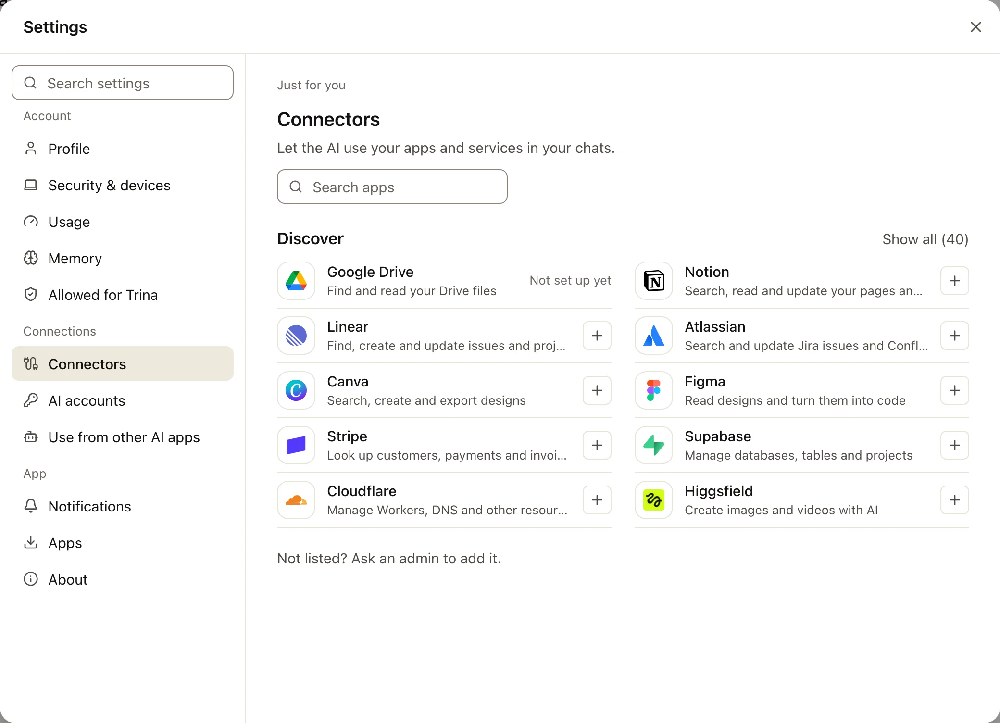
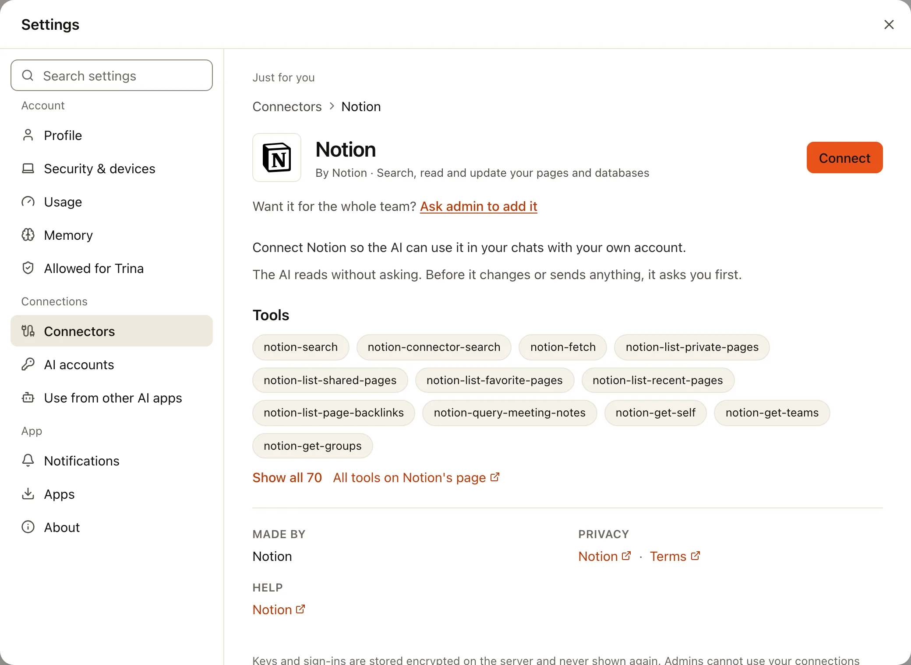
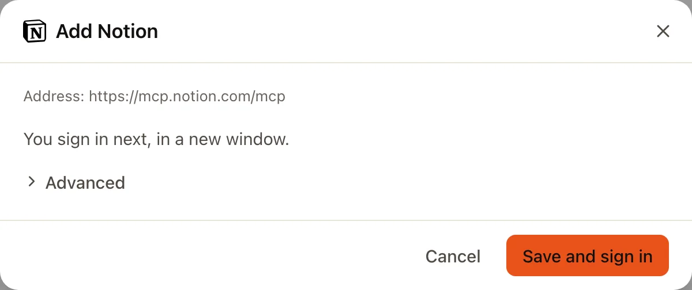
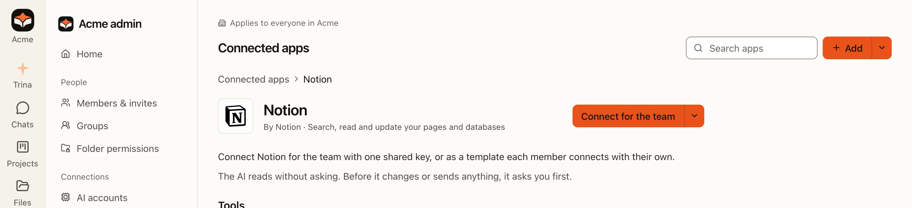
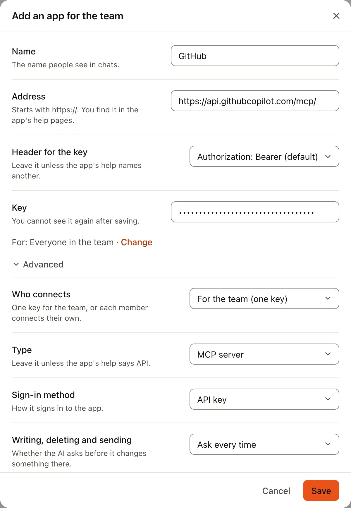

AI bisa memakai aplikasi di luar Trina AX untuk Anda: mencari halaman Notion Anda, membuka issue Linear, membaca tiket
Jira. Anda menghubungkan setiap aplikasi sekali. Untuk sebagian besar aplikasi tidak ada yang perlu disalin: Anda masuk
di halaman aplikasi itu sendiri. Beberapa aplikasi, seperti GitHub, memberi Anda kunci sebagai gantinya.

:::note
Sebelum versi 0.4.0, layar ini bernama **External services**. Koneksi ini memakai MCP, cara umum bagi aplikasi untuk
menyediakan alat bagi AI; Anda tidak perlu tahu lebih jauh untuk memakainya.
:::

## Cara aplikasi Anda terhubung

| Aplikasi | Yang Anda perlukan | Panduan |
|---|---|---|
| Notion, Linear, Atlassian (Jira, Confluence), Figma, Canva, Stripe, Supabase, Cloudflare, Higgsfield, dan aplikasi lain di **Jelajahi** | Akun Anda di aplikasi itu. Tidak ada yang perlu disalin | [Masuk ke aplikasi di Jelajahi](#masuk-ke-aplikasi-di-jelajahi) |
| GitHub | Personal access token | [GitHub](#github) |
| Aplikasi lain yang menyediakan alamat "MCP server" | Alamatnya, dan kunci jika aplikasi memintanya | [Menambahkan aplikasi lewat alamatnya](#menambahkan-aplikasi-lewat-alamatnya) |
| Sistem milik perusahaan Anda (sebuah API) | Alamat, kunci, dan catatan | [API perusahaan Anda](api-connections.md) |
| Google Drive, Gmail, Calendar, Docs, Sheets | Akun Google Anda | [Aplikasi Google](google-apps.md) |
| Slack | Tidak ada untuk anggota; admin menambahkannya sekali | [Slack](slack.md) |

## Untuk Anda atau untuk tim

| | Untuk Anda | Untuk tim |
|---|---|---|
| Tempat | **Pengaturan › Konektor** | **Admin › Aplikasi terhubung** (owner dan admin) |
| Akun siapa yang dipakai AI | Akun Anda | Akun yang masuk, atau kunci yang disimpan |
| Siapa yang memakainya | Hanya Anda, di chat Anda sendiri | Semua orang, grup, atau orang yang dipilih admin |
| Siapa yang melihatnya | Hanya Anda, admin pun tidak | Admin |

Koneksi tim masuk **sekali, sebagai satu akun**: semua orang yang dituju bertindak sebagai akun itu di aplikasi
tersebut. Jika setiap orang sebaiknya bertindak sebagai dirinya sendiri (halaman Notion miliknya, hak GitHub miliknya),
buat [templat](#templat-tiap-anggota-memakai-kuncinya-sendiri) sebagai gantinya, atau biarkan setiap orang
menghubungkannya untuk dirinya sendiri.

## Masuk ke aplikasi di Jelajahi

:::tip
**Yang Anda perlukan**

- Akun di aplikasi itu (Notion, Linear …), yang sudah masuk di browser Anda.
- Tidak ada yang perlu disalin atau ditempel: Trina AX mengisi alamat resmi aplikasi itu.
:::

:::steps
#### Buka Konektor
Pilih foto Anda di bagian bawah bilah kiri, lalu **Pengaturan › Konektor** (di ponsel, tab **Saya**). **Jelajahi**
mencantumkan aplikasi yang bisa Anda hubungkan. **Lihat semua** menampilkan semuanya; **Cari aplikasi** mencari
berdasarkan nama.

#### Buka aplikasinya lalu pilih Hubungkan
Halaman aplikasi menjelaskan apa yang bisa dilakukan AI di sana dan mencantumkan alatnya. Pilih **Hubungkan** (atau
**+** di daftar). Anggota juga melihat **Minta admin menambahkannya**, untuk memintanya bagi seluruh tim.

#### Simpan dan masuk
Dialog menampilkan alamat resmi aplikasi. Biarkan **Lanjutan** apa adanya lalu pilih **Simpan dan masuk**.

#### Izinkan akses di halaman aplikasi
Jendela baru terbuka di halaman aplikasi itu sendiri (Notion, Linear …). Masuk jika diminta, pilih workspace, lalu pilih
**Allow** (tombolnya mungkin bernama **Continue** atau **Accept**). Jendela tertutup dan Trina AX menampilkan **Berhasil
masuk.** Aplikasinya naik ke **Konektor Anda** dengan status **Terhubung**.
:::

Untuk tim, admin melakukan hal yang sama di **Admin › Aplikasi terhubung**: buka aplikasinya lalu pilih **Hubungkan untuk
tim**. Panah di sampingnya menawarkan **Sebagai templat: tiap anggota menghubungkan**. Lalu pilih siapa yang boleh
memakainya.

Proses masuk harus dilakukan di komputer, di browser atau aplikasi desktop. Setelah terhubung, koneksinya juga
berfungsi di ponsel Anda.

## GitHub

GitHub tidak mengizinkan aplikasi lain masuk dengan sendirinya, jadi Anda menghubungkannya dengan personal access token.
Hanya owner dan admin yang bisa menambahkan aplikasi lewat alamatnya; anggota meminta kepada admin, yang bisa membuat
[templat](#templat-tiap-anggota-memakai-kuncinya-sendiri) agar setiap orang memakai tokennya sendiri.

:::tip
**Yang Anda perlukan**

- **Alamat**: `https://api.githubcopilot.com/mcp/` (MCP server milik GitHub).
- **Kunci**: personal access token dari GitHub, diawali `github_pat_`.
:::

:::steps
#### Buat token di GitHub
Buka [GitHub › Settings › Developer settings › Personal access tokens › Fine-grained tokens](https://github.com/settings/personal-access-tokens/new)
lalu pilih **Generate new token**. Beri nama ("Trina AX"), tanggal kedaluwarsa, repositori yang boleh dibukanya
(**Only select repositories** paling aman), dan izin yang diperlukan AI, misalnya **Contents**, **Issues**, dan
**Pull requests** diatur ke **Read-only**, atau **Read and write** jika AI boleh mengubahnya. Pilih **Generate token** lalu
salin: GitHub hanya menampilkannya sekali. Detail: [panduan GitHub](https://docs.github.com/en/authentication/keeping-your-account-and-data-secure/managing-your-personal-access-tokens).

#### Tambahkan di Trina AX
Di **Admin › Aplikasi terhubung**, pilih **Tambahkan lewat alamatnya** (di bawah Jelajahi) atau **Tambah**. Isi:

- **Nama**: `GitHub`
- **Alamat**: `https://api.githubcopilot.com/mcp/`
- Buka **Lanjutan** dan atur **Cara masuk** ke **Kunci API**.
- **Header untuk kunci**: biarkan **Authorization: Bearer (bawaan)**.
- **Kunci**: tempel tokennya.

#### Simpan
Pilih **Simpan**. Trina AX memeriksa token itu ke GitHub dan mencantumkan alat yang tersedia. Barisnya menampilkan
**Terhubung**.
:::

## Menambahkan aplikasi lewat alamatnya

Aplikasi apa pun yang menyediakan alamat "MCP server" bisa ditambahkan, meskipun tidak ada di Jelajahi. Owner dan
admin menambahkannya di **Admin › Aplikasi terhubung** › **Tambahkan lewat alamatnya**. Anggota melihat "Tidak ada di
daftar? Minta admin untuk menambahkannya."

:::tip
**Yang Anda perlukan**

- **Alamat**: dari halaman bantuan aplikasi, biasanya halaman bernama "MCP", "MCP server", atau "Connect to AI tools".
  Diawali `https://` dan sering diakhiri `/mcp`.
- Cara aplikasi masuk: di halamannya sendiri (**Masuk (OAuth)**), dengan kunci (**Kunci API**), atau tanpa masuk
  (**Tidak ada**).
- Untuk kunci: **Kunci**, dari pengaturan aplikasi ("API keys", "Tokens", "Developer"), dan **Nama header** jika
  bantuan aplikasi menyebutkannya, seperti `X-API-Key`.
:::

Kolom-kolom di dialog:

| Kolom | Yang diisi |
|---|---|
| **Nama** | Nama yang dilihat orang di chat, misalnya "GitHub". |
| **Alamat** | Alamat MCP aplikasi. Diawali `https://`. |
| **Siapa yang menghubungkan** (Lanjutan) | **Satu untuk tim**, atau **Milik tiap anggota**. |
| **Jenis** (Lanjutan) | **Server MCP**. Pilih **API** hanya untuk web API biasa: lihat [API perusahaan Anda](api-connections.md). |
| **Cara masuk** (Lanjutan) | **Masuk (OAuth)**, **Kunci API**, atau **Tidak ada**, sesuai bantuan aplikasi. |
| **Header untuk kunci** | Biarkan **Authorization: Bearer (bawaan)** kecuali bantuan aplikasi menyebut header lain. Jika begitu, pilih **Header lain** dan ketik **Nama header**-nya persis. |
| **Kunci** | Kuncinya, ditempel utuh. Anda tidak bisa melihatnya lagi setelah menyimpan. |
| **Login dengan aplikasi saya** (Lanjutan) | Hanya untuk aplikasi yang meminta Anda membuat aplikasi masuk sendiri, seperti MCP server milik Google. Lihat [Masuk dengan aplikasi Anda sendiri](api-connections.md#masuk-dengan-aplikasi-anda-sendiri). |
| **Menulis, menghapus, dan mengirim** (Lanjutan) | Apakah AI bertanya dulu (lihat di bawah). |

:::warning
Taruh kunci di kolom **Kunci**, jangan pernah di alamat (`…?key=…`). Orang yang memakai koneksi tim bisa melihat
alamatnya, dan AI membacanya.
:::

## Perubahan perlu persetujuan

Membaca langsung dijalankan. Semua yang lain adalah penulisan, dan mengikuti pengaturan **Menulis, menghapus, dan
mengirim** pada koneksi itu:

| Pengaturan | Yang terjadi |
|---|---|
| **Selalu tanya** (bawaan) | Trina AX menampilkan kartu berisi semua yang akan dikirim. Tidak ada yang dikirim sampai seseorang menyetujui. |
| **Blokir penulisan** | Hanya pencarian; penulisan ditolak. |
| **Jalankan tanpa bertanya** | Penulisan dijalankan tanpa bertanya. Hanya admin yang bisa memilih ini, dan hanya untuk koneksi tim. |

Orang yang mengelola sebuah koneksi juga bisa mematikan alat tertentu di halamannya. Apa yang dikirim balik oleh sebuah
aplikasi diperlakukan sebagai data dari luar, tidak pernah sebagai perintah. Di tugas terjadwal tidak ada yang bisa
menyetujui, jadi penulisan ditolak, kecuali ke koneksi tim **Jalankan tanpa bertanya** yang diizinkan di kartu tugas itu.

## Templat: tiap anggota memakai kuncinya sendiri

Di banyak aplikasi, sebuah kunci membawa hak pemiliknya, dan setiap panggilan dicatat atas nama orang itu. Untuk aplikasi
seperti itu, admin menambahkan **templat**: aplikasinya didaftarkan sekali, dan setiap anggota menghubungkannya dengan
kunci atau akun masuknya sendiri.

:::steps
#### Tambahkan templat
Di **Admin › Aplikasi terhubung**, pilih **Tambahkan lewat alamatnya** (atau, di halaman aplikasi, panah di samping **Hubungkan untuk tim** › **Sebagai templat: tiap anggota menghubungkan**). Di bawah **Lanjutan**, atur **Siapa yang menghubungkan** ke **Milik tiap anggota**. Isi
alamat, cara masuk, dan untuk siapa. Tidak ada kolom kunci, dan alamatnya tidak boleh memiliki bagian `?…`: kunci di
sana akan sampai ke setiap anggota. Gunakan **Catatan untuk anggota (opsional)** untuk memberi tahu orang tempat
mendapatkan kuncinya.

#### Anggota menghubungkan
Anggota yang dituju mendapat pemberitahuan di **Aktivitas**, dan melihatnya di **Pengaturan › Konektor** di bawah
**Konektor Anda**, dengan label **Tim** dan **Hubungkan**. Mereka memasukkan kuncinya sendiri atau masuk. Koneksi itu
menjadi koneksi miliknya sendiri, yang hanya dipakai di chat-nya.
:::

| | Koneksi tim (satu kunci) | Templat |
|---|---|---|
| Kunci | Satu, ditambahkan oleh admin | Milik tiap anggota |
| Hak siapa yang dipakai AI | Hak pemilik kunci, untuk semua orang | Hak tiap anggota sendiri |
| Yang dilihat admin | Koneksinya | Siapa yang menghubungkannya dan kapan, serta kunci siapa yang berhenti berfungsi; tidak pernah kuncinya |

Di baris templat di Admin › Aplikasi terhubung, **Templat · N terhubung** membuka daftar orang yang dituju:
**Terhubung**, **Belum terhubung**, atau **Kunci berhenti berfungsi**. Tugas terjadwal yang memerlukan templat tidak
berjalan tanpa kunci Anda sendiri: hasilnya menampilkan "Perlu kunci Anda sendiri untuk …" dan menautkan ke
**Hubungkan**.

Anggota hanya bisa mengubah kunci atau akun masuknya dan pengaturan penulisan, dan bisa memutuskan koneksi kapan saja.
Jika admin mengubah alamat atau cara masuk sebuah templat, kunci setiap anggota dihapus dan mereka menghubungkan lagi;
nama atau catatan baru tidak memutuskan siapa pun. Menghapus templat, atau mengeluarkan seseorang darinya, menghapus
koneksi orang itu.

## Meminta anggota menghubungkan

Admin juga bisa mengirim permintaan ke satu anggota dengan aplikasi yang sudah terisi: **Admin › Aplikasi terhubung** ›
panah di samping **Tambah** › **Minta anggota menghubungkan**. Anggota mendapat pemberitahuan dan menghubungkannya dengan
kuncinya sendiri, atau menolak. Admin tidak pernah melihat kuncinya.

## Menghubungkan dari chat

Anda juga bisa meminta di chat: "Hubungkan Linear." AI mengisi alamat resmi aplikasi itu dan menampilkan kartu. Anda
hanya perlu masuk atau menempelkan kunci ke kartu itu. Kuncinya tidak pernah sampai ke AI.

## Masalah

| Yang Anda lihat | Yang perlu dilakukan |
|---|---|
| **Perlu masuk** | Masa masuk berakhir atau kunci dicabut di aplikasi. Buka koneksinya dan pilih **Masuk lagi**, atau **Ganti kunci**. |
| **Proses masuk belum selesai.** | Jendela masuk sudah ditutup atau tertutup jendela lain. Pilih **Buka jendela masuk**, atau batalkan lalu coba lagi. |
| **Login dihentikan di layanan.** | Anda memilih Cancel atau Deny di halaman aplikasi. Masuk lagi dan izinkan. |
| **Koneksi tidak bisa diperiksa.** dengan "401" atau "unauthorized" di alasannya | Kuncinya salah, kedaluwarsa, atau tersalin dengan spasi. Salin lagi dengan tombol salin milik aplikasi. Untuk header selain Bearer, periksa **Nama header** huruf demi huruf. |
| **Layanan ini tidak memberi alat apa pun.** | Alamatnya bukan alamat MCP (sering kali yang ditempel adalah halaman beranda aplikasi). Pakai alamat dari halaman bantuan MCP aplikasi itu. |
| Anggota tidak menemukan aplikasinya | Anggota hanya bisa menghubungkan aplikasi dari **Jelajahi**. Minta admin menambahkannya lewat alamatnya, atau sebagai templat. |

## Arah sebaliknya

Claude Anda sendiri (Claude Code, Claude Desktop, atau claude.ai) bisa terhubung **ke** Trina AX dan memakai file Anda
dengan izin Anda. [Baca tentang konektor Team AX MCP](../../agents/mcp-connector.md) (bahasa Inggris).

Detail lengkap untuk pengembang: [Integrations](../../../INTEGRATIONS.md) (bahasa Inggris).
