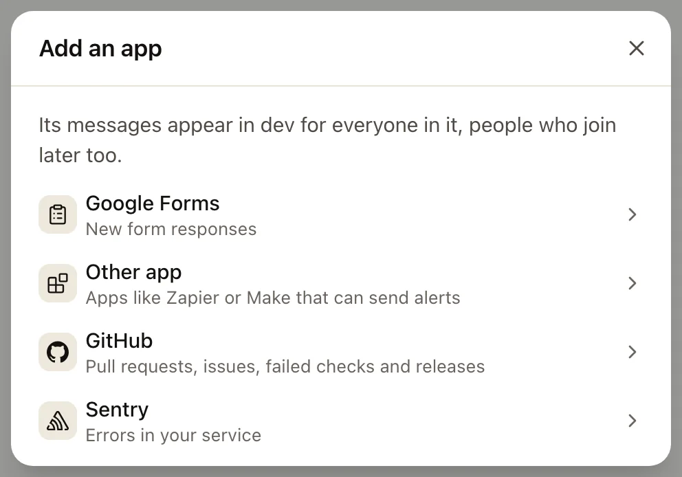
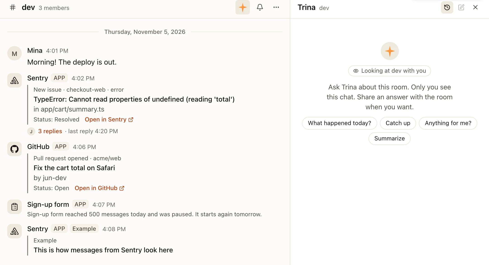
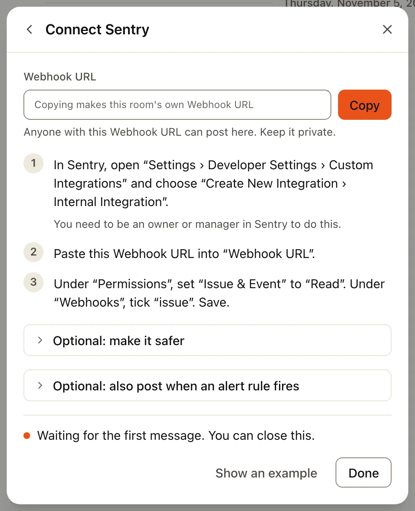
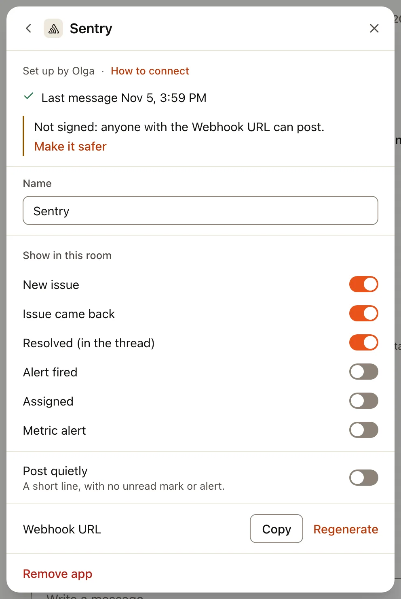

Ruang obrolan bisa menerima kabar terbaru dari layanan yang sudah dipakai tim Anda: jawaban baru dari **Google Forms**, error dari
**Sentry**, pull request dan pemeriksaan yang gagal dari **GitHub**, atau apa pun yang bisa mengirim pesan ke Webhook URL.
Kabar itu datang sebagai kartu dari aplikasinya, dengan logo dan label **APP**, tidak pernah sebagai orang. Kabar berulang tentang hal yang sama (error
yang sama, pull request yang sama, jawaban yang diedit) masuk ke satu utas di bawah kartu pertama, dan baris status kartu pertama
berubah seiring perkembangannya.

## Menambahkan aplikasi

1. Buka ruang obrolan, lalu **⋯ › Tambah aplikasi**.
2. Pilih layanan. Layanan dikelompokkan: **Formulir** (Google Forms, Typeform, Tally, Jotform), **Pembayaran & pesanan**
   (Stripe, Shopify), **Kerja** (Notion, Zendesk, Jira, HubSpot), dan **Untuk developer** (GitHub, Sentry). **Tampilkan layanan
   lain** membuka beberapa layanan lagi (Toss Payments, Channel Talk, PortOne). **Aplikasi lain**, di urutan terakhir, menerima apa saja. Layanan yang memerlukan paket atau peran tertentu menyebutkannya di barisnya (misalnya *Perlu: paket Notion berbayar*).
   Aplikasi lain diberi nama lebih dulu (misalnya *Peringatan backup*): pesan-pesannya tampil dengan nama itu.
3. Tekan **Salin** di samping Webhook URL (Google Forms: **Salin kode**) lalu ikuti langkah bernomor di layanan tersebut.
   Tidak ada yang ditambahkan ke ruang obrolan sampai Anda menyalin, jadi Anda bisa melihat-lihat dulu lalu menutup panduannya.
4. Panduan menampilkan apa yang terjadi secara langsung: *Menunggu pesan pertama*, *Terhubung*, atau alasan kiriman terakhir tidak ditampilkan.
   Setelah dua menit tanpa kiriman, **Belum ada apa-apa?** menampilkan kesalahan yang biasa terjadi pada layanan itu dan cara mengirim tes.
   **Tampilkan contoh** menunjukkan, di dalam panduan, seperti apa pesan-pesannya nanti. Tidak ada yang dikirim.

Anda juga bisa mulai dari **Pengaturan › Konektor**. Sentry, Notion, Stripe, dan Atlassian (untuk Jira) punya
**Tambah ke percakapan** di bawah barisnya. Hanya percakapan tempat Anda boleh menambah aplikasi yang muncul; pilih
satu dan percakapan itu terbuka dengan panduan layanan tersebut. Jika belum ada, mulai satu dengan **Percakapan baru**.



Siapa yang bisa melakukannya: di ruang tim atau ruang semua orang, owner dan admin ruang itu; di obrolan 1:1 atau obrolan grup, siapa pun di dalamnya.
Semua orang lain di ruang obrolan melihat kartunya, membalas di utasnya, dan bertanya ke Trina tentangnya. Mengetuk nama aplikasi
menunjukkan siapa yang memasangnya.

Semua orang di ruang obrolan melihat pesan aplikasi, termasuk orang yang bergabung belakangan. Pilih ruang obrolan dengan hati-hati: laporan error atau
jawaban formulir bisa berisi data pelanggan.

### Di dalam ruang obrolan

Setiap kabar adalah kartu di bawah nama aplikasi, dengan label **APP**, apa yang terjadi, baris status, dan tautan untuk membukanya di
layanan tersebut. Balasan masuk ke utas kartu, sama seperti pesan lainnya. Chat samping **✦** di ruang obrolan menawarkan **Apa yang terjadi
hari ini?** (ruang Google Forms juga menawarkan **Ringkas jawaban hari ini**), yang merangkum pesan-pesan aplikasi dengan hal yang perlu ditangani lebih dulu; di dalam utas, chat samping menawarkan **Ringkas utas
ini**.



### Google Forms

Google Forms tidak punya tempat untuk menempelkan URL, jadi Trina memberi Anda skrip pendek untuk formulir itu
([pemicu Apps Script](https://developers.google.com/apps-script/guides/triggers/installable)).

- Di formulir, buka **⋮ › Apps Script**, hapus isinya, tempelkan kode, lalu simpan.
- Pilih **setUp** di bagian atas lalu tekan **Run**. Google menampilkan **Google hasn't verified this app**: ini memang wajar, karena
  skrip itu milik Anda sendiri dan hanya berjalan di akun Anda. Pilih **Advanced › Go to … (unsafe)**, lalu izinkan akses.
- Jika formulir mengumpulkan alamat email, setiap jawaban menampilkan email pengisinya. Matikan **Email pengisi** di
  pengaturan aplikasi agar email tidak ditampilkan. Siapa pun yang bisa mengedit formulir bisa melihat kodenya.

### Formulir, pembayaran, dan alat kerja

Typeform, Tally, Jotform, Stripe, Shopify, Notion, Zendesk, Jira, dan HubSpot masing-masing punya panduan sendiri dengan langkah-langkah
di layanan itu, dengan nama menu seperti yang dipakai layanan tersebut. Singkatnya:

- **Typeform**: di formulir, **Connect › Webhooks › Add a webhook**, tempelkan lalu simpan, kemudian nyalakan (sakelarnya awalnya
  mati dan baru berfungsi setelah disimpan).
- **Tally**: di formulir, **Integrations › Webhooks › Connect**, tempelkan ke **Endpoint URL**.
- **Jotform**: di formulir, **Settings › Integrations**, cari **WebHooks**, tempelkan Webhook URL, lalu tekan
  **Complete Integration** dan **Finish** (kedua tombol baru berfungsi setelah URL dimasukkan; jangan tekan **Add New Web Hook**).
- **Stripe** (peran Admin atau Developer): **Developers › Workbench › Webhooks › Create an event destination**, centang
  event yang tercantum di panduan, pilih **Webhook endpoint** lalu tempelkan ke **Endpoint URL**.
- **Shopify** (pemilik toko atau staf dengan akses Settings): **Settings › Notifications › Webhooks › Create webhook** untuk
  **Order creation**; jika perlu, ulangi untuk Order payment, Order cancellation, dan Refund create.
- **Notion** (paket berbayar): **Automations** pada database, aksi **Send webhook**; centang setidaknya judul dan Status.
- **Zendesk** (paket Team atau lebih tinggi, admin): buat webhook, lalu trigger yang mengirim isi (body) dari panduan
  (**Salin isi**, di langkah itu).
- **Jira** (admin space): **Space settings › Automation › Create flow** pada space, trigger **Work item created**,
  aksi **Send web request** dengan isi dari panduan (**Salin isi**). Flow kedua dan ketiga yang opsional untuk
  **Work item transitioned** dan **Work item commented** memasukkan perubahan status dan komentar ke utas work item tersebut
  ([aksi otomatisasi Jira](https://support.atlassian.com/cloud-automation/docs/jira-automation-actions/)).
- **HubSpot** (Data Hub Professional atau Enterprise): workflow berbasis deal dengan aksi **Data ops › Send a
  webhook**, **Customize request body** dengan kunci yang tercantum di panduan; jika perlu, satu lagi untuk kontak dan satu untuk tiket
  ([workflow HubSpot](https://knowledge.hubspot.com/workflows/how-do-i-use-webhooks-with-hubspot-workflows)). Kontak
  menampilkan nama dan perusahaannya, tidak pernah email atau nomor teleponnya.

Jawaban formulir tampil di ruang obrolan apa adanya, termasuk alamat email; file yang diunggah hanya ditampilkan namanya (Google
Forms: hanya jumlahnya, sehingga skrip tidak memerlukan akses ke Drive Anda). Kartu pembayaran
dan pesanan menampilkan nama pelanggan (dan kota untuk Shopify), tidak pernah email, nomor telepon, atau kartunya.

Stripe, Shopify, Zendesk, Typeform, dan Tally bisa menandatangani apa yang mereka kirim. **Opsional: buat lebih aman** di panduan menerima
signing secret layanan tersebut (atau memberi Anda satu untuk ditempelkan di sana); setelah itu hanya pesan yang ditandatangani yang ditampilkan. Rahasia yang diberikan Trina
(Typeform, Tally, GitHub) mulai berlaku sejak pesan pertama yang ditandatangani dengannya (Tally mengisi rahasianya sendiri
di **Add a signing secret**: ganti dengan milik Trina): sampai saat itu, pesan tanpa tanda tangan tetap
tampil, jadi tidak ada yang hilang sebelum Anda menempelkannya di layanan. Jira dan HubSpot
tidak bisa menandatangani: Webhook URL mereka adalah satu-satunya kunci, jadi rahasiakan.

### Layanan lainnya

**Tampilkan layanan lain** di pemilih membuka layanan yang kebanyakan dipakai di Korea. Daftar yang sama tampil untuk semua orang.

- **Toss Payments**: di developer center, **웹훅 › 웹훅 등록하기** (Webhooks › Register webhook), tempelkan Webhook URL lalu centang
  **PAYMENT_STATUS_CHANGED** ([webhook Toss Payments](https://docs.tosspayments.com/guides/v2/webhook)). Kartu menampilkan
  jumlah, nama pesanan, dan metode pembayaran; tidak pernah nomor kartu, rekening, atau nomor telepon. Opsional: kunci keamanan
  developer center (**API 키 › 보안 키**, API keys › Security key).
- **Channel Talk**: **Settings › Webhook › Create new webhook**, tempelkan Webhook URL lalu nyalakan notifikasi chat dan
  pesan ([webhook Channel Talk](https://developers.channel.io/en/articles/Webhook-events-7bd9b8e2)). Chat
  baru menampilkan nama pelanggan dan pesan pertamanya; pesan berikutnya (dan, jika Anda menyalakannya, balasan tim
  Anda) masuk ke utasnya. Obrolan grup internal tim tidak pernah ditampilkan. Opsional: token webhook.
- **PortOne** (V2): **결제 연동 › 연동 관리 › 결제알림(Webhook) 관리** (Payment integration › Integration settings ›
  Payment notifications), versi webhook **결제모듈 V2** (Payment module V2), tempelkan Webhook URL
  ([webhook PortOne](https://developers.portone.io/opi/ko/integration/webhook/readme-v2)). PortOne hanya mengirim
  id dan status pembayaran, sehingga kartunya tidak menampilkan jumlah atau nama. Opsional: webhook secret (**웹훅 시크릿 발급**,
  Issue webhook secret).

### Aplikasi lain

Alat yang meminta **webhook URL Slack, Discord, atau JANDI** bisa mengirim ke sini: tempelkan Webhook URL Trina di kolom itu.
Alat yang tidak punya keduanya bisa dihubungkan lewat Zapier atau Make; **Aplikasimu tidak ada?** di panduan menunjukkan satu
contoh untuk masing-masing.

Apa pun yang bisa mengirim pesan ke Webhook URL (Zapier, Make, Grafana, Uptime Kuma, skrip Anda sendiri) bisa dipakai. Tempelkan
Webhook URL di tempat layanan itu mengirim pesan, lalu kirim tes. Panduan dan pengaturan aplikasi menampilkan **Cara mengirim**
dengan contoh untuk disalin:

```json
{ "text": "Backup finished: 1,204 files", "title": "Nightly backup", "url": "https://example.com/report", "thread": "nightly-backup" }
```

- `text` adalah pesannya, dan satu-satunya kolom yang wajib (`content` juga bisa).
- `title` menambahkan judul, `url` menambahkan satu tautan, dan pesan dengan `thread` yang sama masuk ke satu utas.
- Pesan gaya Slack (`blocks`, `attachments`), teks biasa, dan kiriman formulir biasa (`text=…`, dengan kolom yang sama; atau kolom
  `payload` milik Slack) juga diterima. Header `Idempotency-Key` membuat
  kiriman ulang hanya tampil satu kali.

```bash
curl -X POST -H 'Content-Type: application/json' -d '{"text":"Hello from my app"}' <Webhook URL>
```

### GitHub

Per repositori; Anda memerlukan akses admin ke repositori itu ([dokumentasi GitHub](https://docs.github.com/en/webhooks/using-webhooks/creating-webhooks)).

- Di repositori, buka **Settings › Webhooks › Add webhook**.
- Tempelkan Webhook URL ke **Payload URL** lalu pilih **application/json**.
- Pilih **Send me everything** lalu tekan **Add webhook**. Trina hanya menampilkan yang Anda nyalakan di pengaturan aplikasi.
- *Opsional, lebih aman:* **Salin rahasia** di panduan lalu tempelkan ke **Secret**. Sejak kiriman pertama yang ditandatangani dengannya
  (ping dari GitHub saat Anda menyimpan), Trina hanya menampilkan yang ditandatangani GitHub ([memvalidasi kiriman](https://docs.github.com/en/webhooks/using-webhooks/validating-webhook-deliveries)).

Jika tidak ada yang masuk, **Recent Deliveries** di halaman webhook di GitHub menunjukkan apa yang sudah dikirim.

### Sentry

Sentry menyebut ini internal integration ([dokumentasi Sentry](https://docs.sentry.io/organization/integrations/integration-platform/)).
Anda harus menjadi owner atau manager di Sentry.



- Di Sentry, buka **Settings › Developer Settings › Custom Integrations** lalu pilih **Create New Integration › Internal
  Integration**.
- Tempelkan Webhook URL ke **Webhook URL**.
- Di **Permissions**, atur **Issue & Event** ke **Read**; di **Webhooks**, centang **issue**. Simpan.
- *Opsional, lebih aman:* tempelkan **Client Secret** milik integrasi itu ke panduan. Sejak saat itu Trina hanya menampilkan yang ditandatangani
  Sentry ([cara Sentry menandatangani](https://docs.sentry.io/organization/integrations/integration-platform/webhooks/)).
- *Opsional:* agar juga mengirim kabar saat alert rule terpicu, tambahkan aksi **Send a notification via an integration** ke
  rule itu dan pilih integrasi ini, lalu nyalakan **Peringatan terpicu** di pengaturan aplikasi.

## Pengaturan

**⋯ › Integrasi** menampilkan aplikasi di ruang obrolan di bawah **Aplikasi**, dengan **Tambah Aplikasi**. Halaman satu aplikasi berisi:

- Siapa yang memasangnya, dan **Cara menghubungkan** (langkah-langkahnya lagi).
- **Baris status**: pesan terakhir, *Dijeda*, *Menunggu pesan pertama*, atau, setelah **Buat ulang** dan sampai
  pesan pertama masuk lewat URL baru, *Menunggu GitHub memakai Webhook URL baru* (baris di daftar juga menyebutkannya).
- **Peringatan**, masing-masing dengan satu aksi: alasan kiriman terakhir tidak ditampilkan (**Periksa rahasia**), *Seseorang yang sudah keluar mengetahui
  Webhook URL ini* (**Buat ulang**), dan, untuk layanan yang bisa menandatangani tetapi belum punya rahasia, *Tidak ditandatangani: siapa pun yang tahu Webhook URL bisa
  mengirim* (**Buat lebih aman**).
- **Nama**: nama yang menyertai pesan-pesannya.
- **Tampilkan di ruangan ini**: jenis kabar yang dikirim (untuk aplikasi yang mengirim lebih dari satu jenis). Event opsional yang
  belum pernah Anda atur di layanan itu (misalnya refund di Shopify) menampilkan *Belum diatur di Shopify*, dengan tautan ke langkah tersebut.
- **Kirim dengan tenang**: satu baris pendek, tanpa tanda belum dibaca atau peringatan.
- **Cara mengirim** (Aplikasi lain).
- **Webhook URL**: **Salin** lagi, atau **Buat ulang** (yang lama langsung berhenti berfungsi; tempelkan yang baru ke
  layanan).
- **Hapus aplikasi**: aplikasi tidak bisa mengirim lagi; pesan-pesannya tetap ada.



## Batas

Satu aplikasi mengirim paling banyak 500 pesan per hari (Google Forms: 500 jawaban). Setelah itu aplikasi dijeda sampai tengah malam (zona waktu
tim Anda): ruang obrolan mendapat satu baris, dan orang yang mengelolanya mendapat pemberitahuan di **Aktivitas** (juga di ponsel dan browser mereka) dengan **Lanjutkan sekarang**
(satu kali per hari). Semua aplikasi tim bersama-sama mengirim paling banyak 5.000 pesan per hari: setelah itu semua aplikasi dijeda sampai
tengah malam, dan baris serta pemberitahuannya berbunyi *Aplikasi tim Anda mencapai 5.000 pesan hari ini*, tanpa **Lanjutkan sekarang**. Jawaban
formulir yang dilewati tetap ada di tab Responses formulir itu. Kartu berupa teks biasa: tidak ada isinya yang bisa menyebut seseorang,
menjalankan sesuatu, atau menyembunyikan tautan.

## Jika aplikasi tidak bisa menjangkau server

Aplikasi memerlukan koneksi dari luar untuk mengirim pesan ke tim Anda. Tim yang di-hosting dan server yang memakai relay Trina sudah
memilikinya. Server yang hanya ada di jaringan kantor tidak: **Tambah aplikasi** di ruang obrolan menyebutkannya, dan owner bisa **Nyalakan
koneksi** di **Admin › Sistem › Koneksi**. Server dengan alamat publik sendiri dan daftar negara atau jaringan
tetap menerima pesan aplikasi dari mana saja; Admin › Sistem › Koneksi menyebutkannya.
