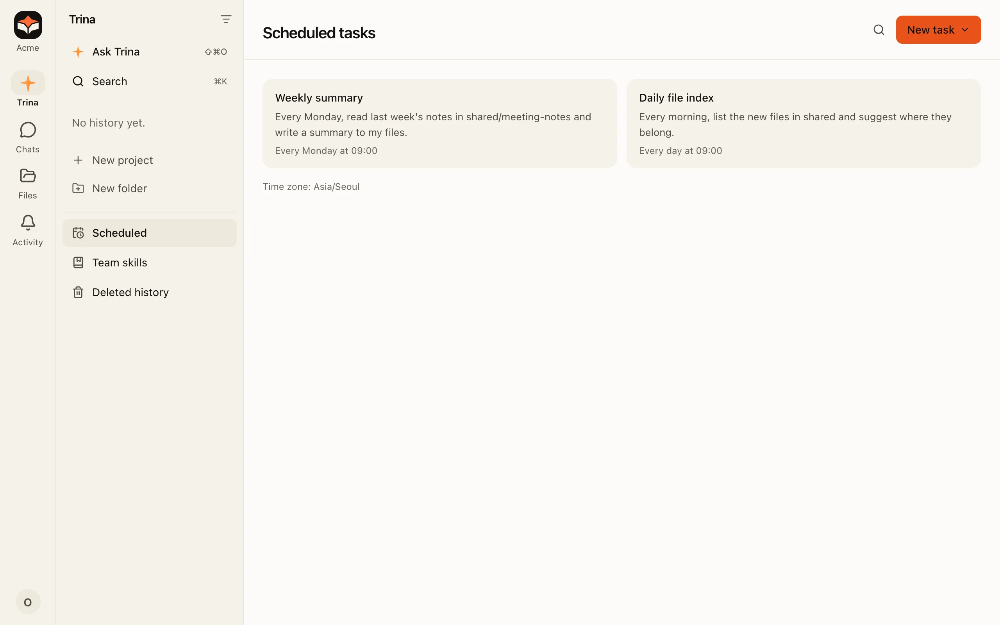
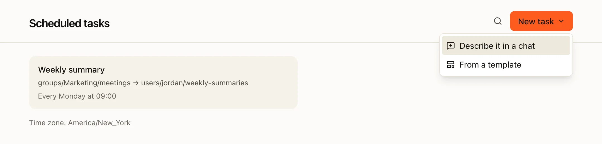
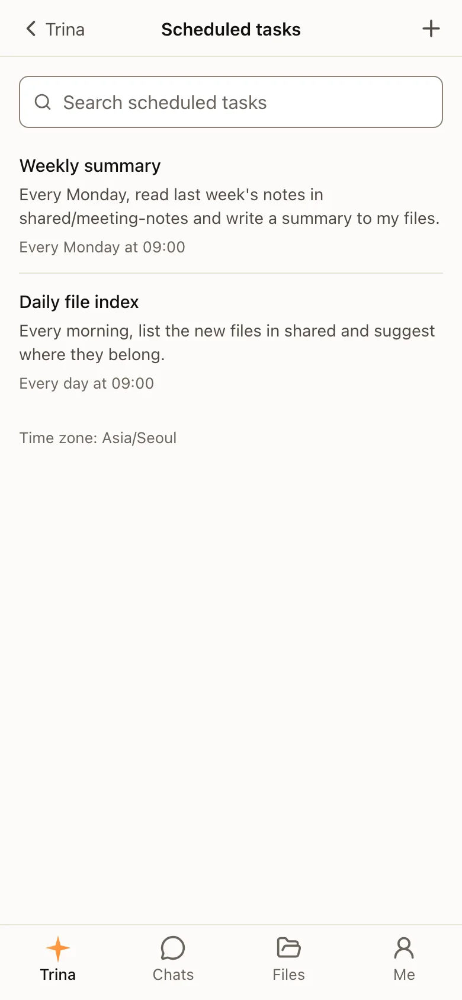

Tugas terjadwal menjalankan sebuah permintaan berulang kali: setiap pagi hari kerja, setiap Senin, setiap tanggal satu. Tugas berjalan atas nama orang yang membuatnya.

:::note
Mulai 0.4.0, tugas terjadwal punya halaman sendiri, **Terjadwal**: sebuah baris di dekat bagian atas daftar Trina Anda (di ponsel, di menu **☰** pada tab **Trina**); **Tugas terjadwal baru** di ⌘K juga membukanya. Sebelum versi itu, tugas terjadwal ada di **Pengaturan › Tugas terjadwal**.
:::

## Membuat tugas

Pilih **Tugas baru**. Ada dua cara:

- **Jelaskan di chat.** Misalnya: "Setiap Senin pukul 9.00, ringkas catatan minggu lalu di shared/sales." AI membuat jadwalnya dan menampilkannya.
- **Dari templat.** Pilih templat, isi folder dan waktunya, lalu simpan.

## Yang bisa dilakukan saat tugas berjalan

| Topik | Saat tugas terjadwal berjalan |
|---|---|
| **Izin** | Izin folder dan skill milik pemilik tugas. |
| **Waktu** | Zona waktu tim. |
| **Pertanyaan** | Tidak ada orang yang bisa menjawab, jadi langkah yang memerlukan orang tidak dijalankan, kecuali yang diizinkan oleh kartu tugas (lihat di bawah). |
| **Web** | Paling banyak 8 alamat web baru yang tidak memerlukan orang, setiap kali tugas berjalan. |
| **Unduhan besar** | File di atas 1 GB dilewati, bukan ditanyakan. |

## Menyimpan dan mengirim tanpa bertanya

Saat tugas berjalan tidak ada orang yang bisa menjawab konfirmasi, jadi kartu tugas bertanya satu kali, saat tugas dibuat, diubah, atau diperiksa lagi:

- **Folder simpan.** "Menyimpan ke: shared/Weekly reports (30 orang bisa melihatnya sekarang). Isi yang boleh masuk: Folder saya, obrolan #Sales". Setiap kali berjalan, tugas menaruh file **baru** di sana dan di subfoldernya tanpa bertanya, paling banyak 20 file. Tugas tidak pernah mengubah atau mengganti file di sana yang tidak dibuatnya, dan tidak pernah menyentuh skill atau file instruksi. Jika tugas membaca sesuatu yang boleh dilihat lebih sedikit orang dan tidak tercantum di kartu (folder lain, percakapan lain), hasilnya disimpan di folder Anda sendiri dan disertai alasannya.
- **Koneksi Anda sendiri.** "Tempat yang boleh dikirimi: Notion saya · 'Daily notes'". Tugas hanya mengirim ke penerima yang ada di kartu.

Jika folder simpan dipindahkan, diganti namanya, atau dihapus, izinnya berubah, atau Anda tidak bisa lagi menulis di sana, tugas menampilkan **Periksa folder simpan lagi** dengan **Periksa lagi**, dan Anda mendapat satu pemberitahuan. Sampai Anda memeriksanya, hasil disimpan di folder Anda sendiri. Orang yang bergabung atau keluar dari grup tidak mengubah apa pun.

Di **Ubah**, kolom **Folder simpan** bisa memilih folder lain atau menghapusnya (×), dan setiap item isi yang boleh masuk ke sana bisa dihapus (×).

## Mengelola tugas

Buka tugas untuk melihat jadwal, instruksi, waktu jalan berikutnya, dan kapan terakhir dijalankan.

- **Jalankan sekarang** langsung menjalankannya.
- Sakelar menjeda dan melanjutkannya.
- Menu pada namanya berisi **Ubah** dan **Hapus**.

Tugas satu kali yang sudah selesai, atau tugas yang tidak bisa berjalan lagi, menyebutkan alasan tugas itu tidak bisa dinyalakan.

## Di ponsel

Tugas tampil sebagai satu daftar, dengan kotak pencarian di atasnya dan **+** di bagian atas untuk tugas baru.

