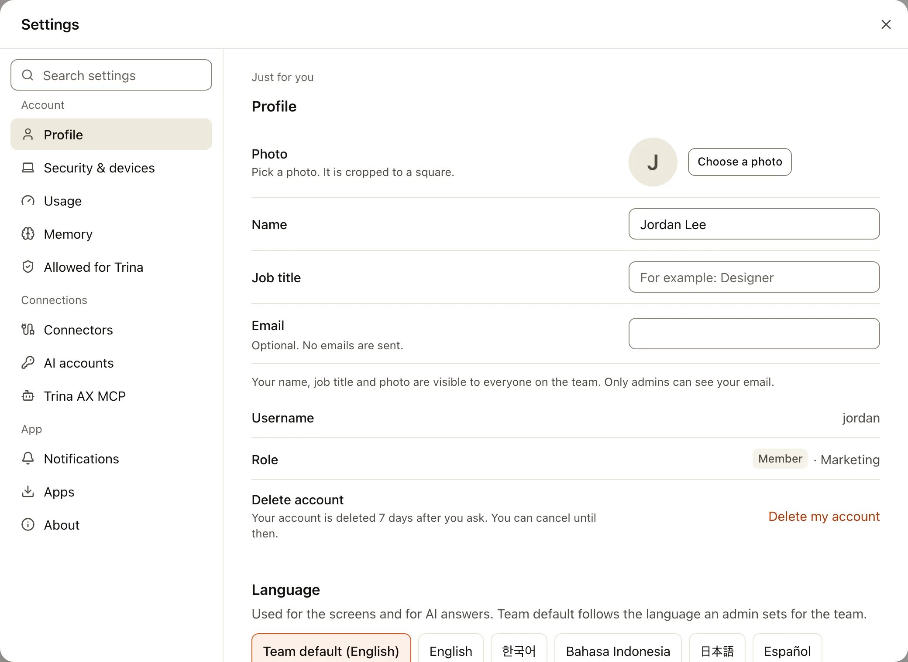
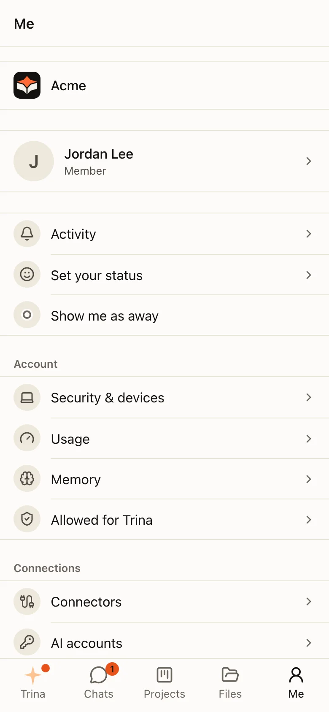
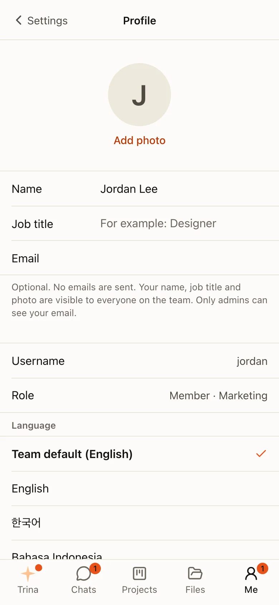
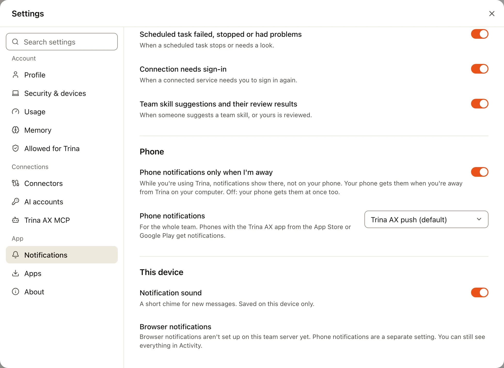
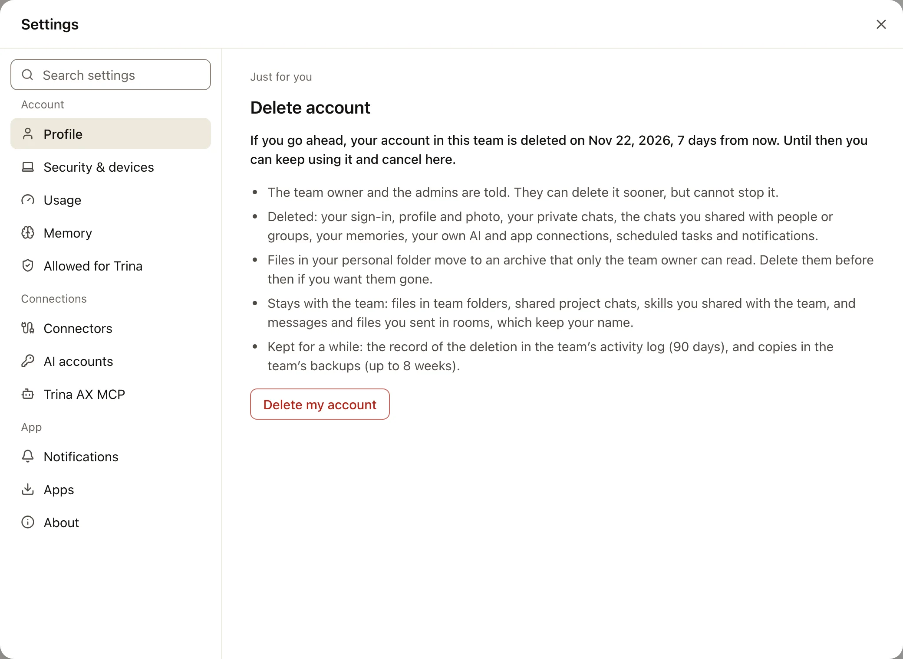
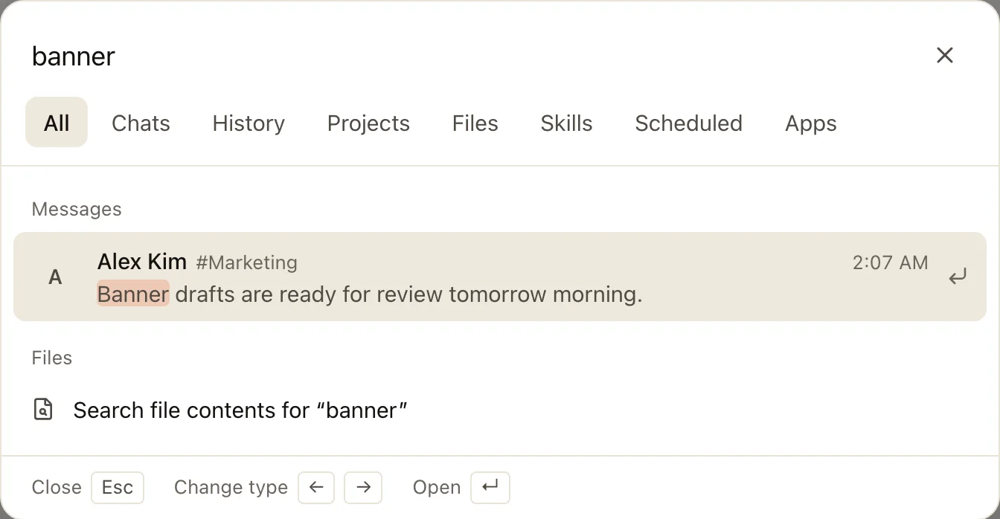

Semua hal tentang akun Anda sendiri hanya berjarak satu klik: foto Anda di bagian bawah bilah kiri.

## Menu akun

Klik foto Anda di bagian bawah bilah kiri. Di ponsel, buka tab **Saya**.

| Item | Fungsinya |
|---|---|
| **Tampilkan saya tidak di tempat** | Orang lain melihat Anda sedang tidak di tempat sampai Anda mengembalikannya |
| **Atur status** | Status singkat dengan emoji, tampil di samping nama Anda |
| **Pengaturan** | Membuka jendela Pengaturan, di bagian profil Anda |
| **Keluar** | Mengakhiri sesi ini |

Pemakaian Anda ada di **Pengaturan › Penggunaan**, dan chat yang Anda hapus ada di **Riwayat terhapus**, di menu **⋯** di samping **Riwayat Trina** pada daftar
Trina Anda (di ponsel, di bagian bawah menu **☰** pada tab **Trina**).

### Berpindah tim

Di aplikasi desktop, klik logo tim Anda di bagian atas bilah kiri lalu pilih **Ganti
tim**: daftar tim Anda tampil, sama seperti menu **Tim** di aplikasi (⌘1–9). Di aplikasi ponsel, pilihan ini ada di tab **Saya**, di bawah
tim Anda. Di browser web, setiap tim punya alamatnya sendiri, jadi tidak ada yang perlu dipindah.

## Jendela Pengaturan

Pengaturan terbuka sebagai jendela di atas halaman yang sedang Anda buka. Tautan seperti `/settings/usage` membukanya langsung di bagian itu.
Semua yang ada di dalamnya hanya untuk Anda; hal yang berlaku untuk seluruh tim ada di Admin.

| Kelompok | Bagian |
|---|---|
| **Akun** | Profil, Keamanan & perangkat, Penggunaan, Memori, Diizinkan untuk Trina (dan Browser, lihat di bawah) |
| **Koneksi** | Konektor, Penyedia AI (jika tim mengizinkan anggota menambahkan akun mereka sendiri), Trina AX MCP |
| **Aplikasi** | Notifikasi, Aplikasi, Tentang |

[Tamu](guests.md) hanya melihat bagian miliknya sendiri, seperti Profil dan Notifikasi. Tamu yang memakai akunnya sendiri menghubungkan akun Claude atau ChatGPT-nya di **Penyedia AI**.

**Konektor** berisi koneksi Anda ke layanan lain: Google Drive, Gmail dan aplikasi Google lainnya, Slack, serta
layanan yang tercantum. Buka salah satunya untuk menghubungkan, melihat apa yang boleh dilakukan AI dengannya, atau memutuskannya; **Konektor** di atas namanya
(di ponsel **‹ Konektor**) kembali ke daftar. Tautan lama seperti `/connectors` juga membukanya. Lihat
[koneksi MCP](mcp.md).

:::steps
#### Temukan bagiannya
Pilih bagian di sebelah kiri, atau ketik di **Cari pengaturan**.

#### Ubah yang Anda perlukan
Profil, bahasa (English, 한국어, Bahasa Indonesia, 日本語, Español, atau 简体中文), tema (terang, gelap, atau mengikuti sistem, di Profil), mesin bawaan Anda, notifikasi, dan lainnya.

#### Tutup
Tekan **Esc** atau pilih **✕**. Anda kembali ke tempat semula.
:::

**Diizinkan untuk Trina** mencantumkan hal yang Anda pilih **Selalu izinkan** pada kartu konfirmasi, serta folder ruang obrolan tempat Anda
mengizinkan file baru. Hapus salah satunya, dan Anda akan ditanya lagi lain kali.

**Browser** (di aplikasi desktop, dan di web selama **Izinkan semua situs web** menyala) berisi **Izinkan semua situs web**. Jika menyala, AI membuka situs web publik tanpa bertanya saat Anda memintanya, di chat Anda dan di ruang obrolan. Tugas terjadwal tetap bertanya. Alamat dengan rangkaian karakter panjang yang sulit dibaca atau query yang panjang tetap ditanyakan, tetapi itu hanya menangkap token yang jelas terlihat: instruksi tersembunyi di dokumen, halaman, atau pesan ruang obrolan bisa membuat AI mengirim apa pun yang bisa dibacanya ke situs mana pun. Anda juga bisa menyalakannya dari kartu alamat ("Izinkan semua situs web (matikan di Pengaturan)"). Di aplikasi desktop, sakelar yang sama juga berlaku untuk browser bawaan aplikasi, yang bertanya sekali lagi di jendelanya sendiri. Bagian ini ada selama tim Anda mengizinkannya.

Di ponsel, Pengaturan memenuhi layar. Daftar bagian tampil lebih dulu, dan **←** kembali ke daftar itu.

## Notifikasi

**Pengaturan › Notifikasi** memilih apa yang sampai kepada Anda: pesan di percakapan (percakapan langsung dan grup serta
mention, setiap pesan baru, atau tidak ada), balasan di utas Anda, jam **Jangan ganggu**, tugas terjadwal,
koneksi, skill tim, dan **Obrolan yang dibagikan ke saya**. Di bawah **Ponsel**, **Notifikasi ponsel hanya saat saya tidak di depan Trina** membuat
ponsel Anda tetap tenang selama Anda memakai Trina di komputer. **Perangkat ini** berisi suara dan, di browser, **Notifikasi
browser**.

Untuk owner dan admin, **Ponsel › Notifikasi ponsel** memilih ke mana notifikasi ponsel seluruh tim dikirim:
**Push Trina AX (bawaan)**, **Mati**, atau **Kustom**, yaitu alamat layanan push Anda sendiri untuk build aplikasi ponsel
milik Anda sendiri. Notifikasi di ponsel tidak pernah berisi isi file atau percakapan.

Lonceng setiap percakapan memilih levelnya sendiri: **Semua pesan**, **Hanya sebutan**, atau **Mati**. Kanal memakai
**Hanya sebutan** kecuali Anda mengubahnya; percakapan langsung dan grup memakai **Semua pesan**. Pada **Hanya sebutan**,
pesan baru membuat nama percakapan tebal tetapi tidak menambah angka, di daftar, di **Obrolan**, maupun di ikon aplikasi;
pesan yang menyebut Anda tampil sebagai **@** dan dihitung. Pada **Mati**, angkanya abu-abu dan tidak dihitung di mana pun.

## Menghapus akun Anda

**Pengaturan › Profil › Hapus akun** menghapus akun Anda di tim ini 7 hari setelah Anda memintanya, dengan kata sandi Anda. Halaman
itu menyebutkan tanggalnya, apa yang dihapus, apa yang dipindahkan ke arsip owner tim, dan apa yang tetap ada di tim. Sampai saat itu Anda
tetap bisa memakai akun dan menekan **Pertahankan akun saya**. Owner tim dan para admin diberi tahu; mereka bisa menghapusnya
lebih cepat tetapi tidak bisa menghentikannya. Akun owner sendiri tidak bisa dihapus di sini: serahkan tim ke orang lain lebih dulu.

## Mencari dengan ⌘K

Tekan **⌘K** (Ctrl+K di Windows), atau pilih **Cari** di bawah **Tanya Trina**.

- **Tab** mempersempit pencarian: Semua, Obrolan, Riwayat, Proyek, File, Skill, Terjadwal, dan Aplikasi.
- **Jika belum mengetik apa pun**, jendela ini menampilkan hal yang memerlukan perhatian Anda, chat dan proyek terbaru Anda, serta aksi cepat seperti **Tanya Trina**.
- **Percakapan dan orang** berdasarkan nama tampil paling atas di tab Semua: ketik sebagian nama, atau konsonan awal nama Korea ("ㄱㅈ" menemukan "견적"). Percakapan langsung terbuka. Orang membuka chat 1:1 Anda dengannya; jika belum ada, daftar chat baru terbuka dengan orang itu sudah tercentang, dan chat baru dimulai saat Anda menekan tombolnya.
- **Pesan** di percakapan Anda (saluran, pesan langsung, dan obrolan grup) ditemukan di tab Semua, setelah chat Anda: siapa yang menulisnya, di mana, kapan, dan kata-kata di sekitar yang Anda ketik. Hanya yang akan Anda lihat jika membuka percakapan itu sekarang yang ditemukan. Pilih salah satu untuk membuka percakapan di pesan itu (balasan membuka utasnya); **Ke pesan terbaru** membawa Anda kembali ke pesan terbaru. Sebagian kata juga bisa: "견적" menemukan "견적서를".
- **File yang dikirim di percakapan** ditemukan berdasarkan nama di tab Semua dan File, setelah file tim Anda: file itu, siapa yang mengirimnya, di mana, dan kapan. Hanya file dari pesan yang bisa Anda lihat yang ditemukan. Pilih salah satu untuk membuka percakapan di pesan tempat file itu dikirim.
- **Setiap kata dihitung**, dalam urutan apa pun: "견적서 보내" menemukan "견적서를 보내드렸어요" di pesan, chat, dan nama file.
- **Tombol:** ↑ dan ↓ untuk berpindah, Enter untuk membuka, ← dan → untuk mengganti tab, Esc untuk menutup.

