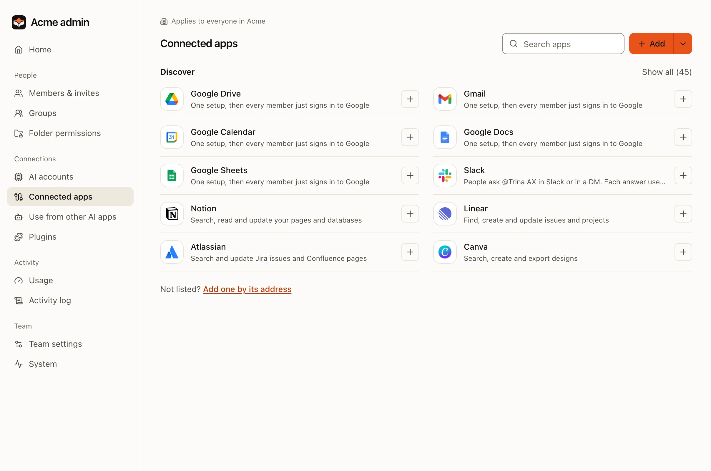
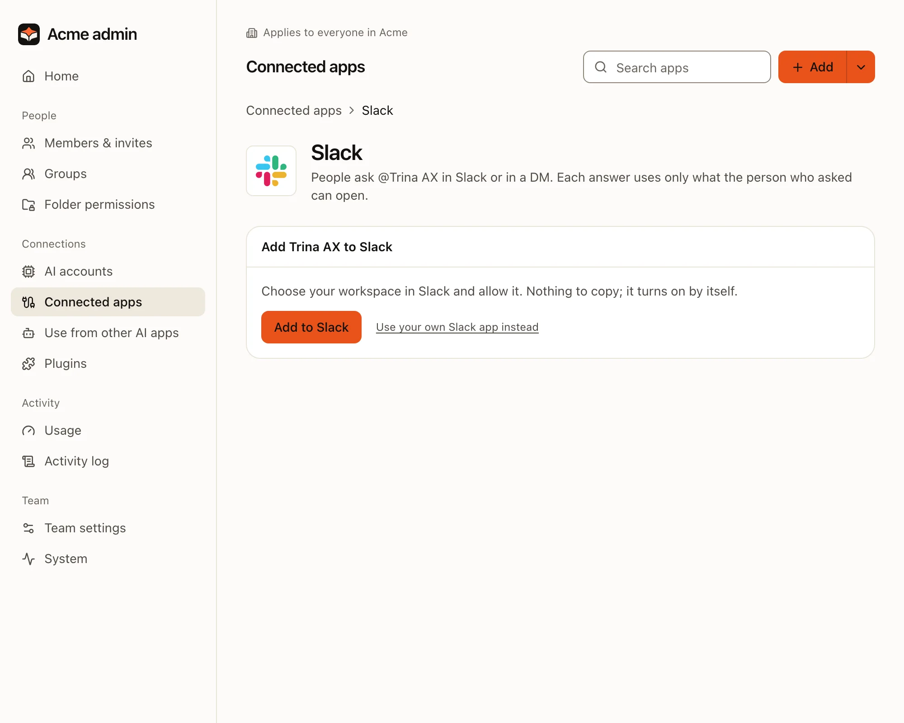
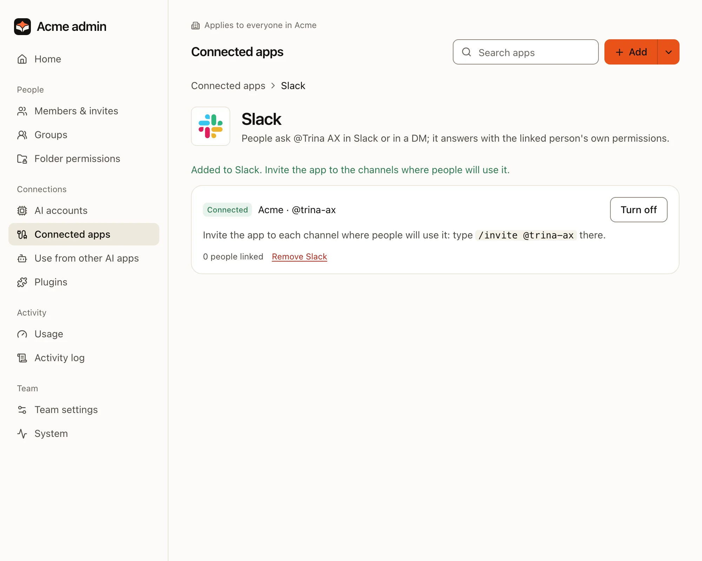
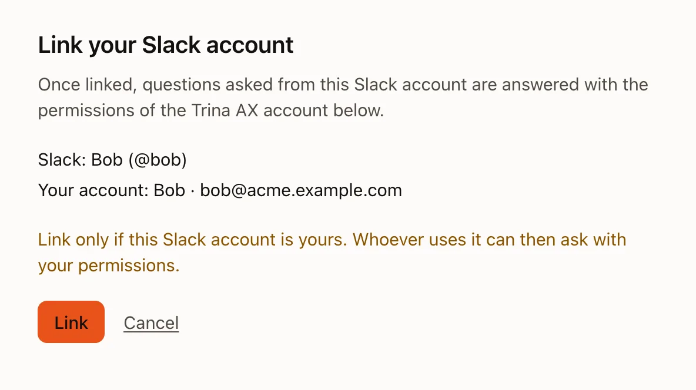
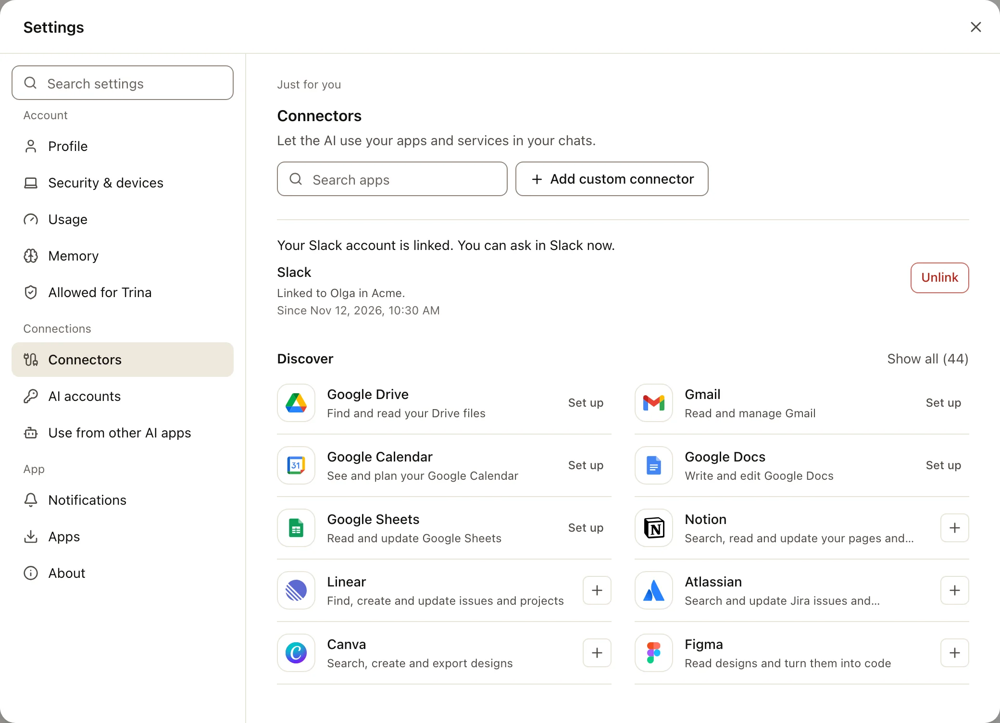
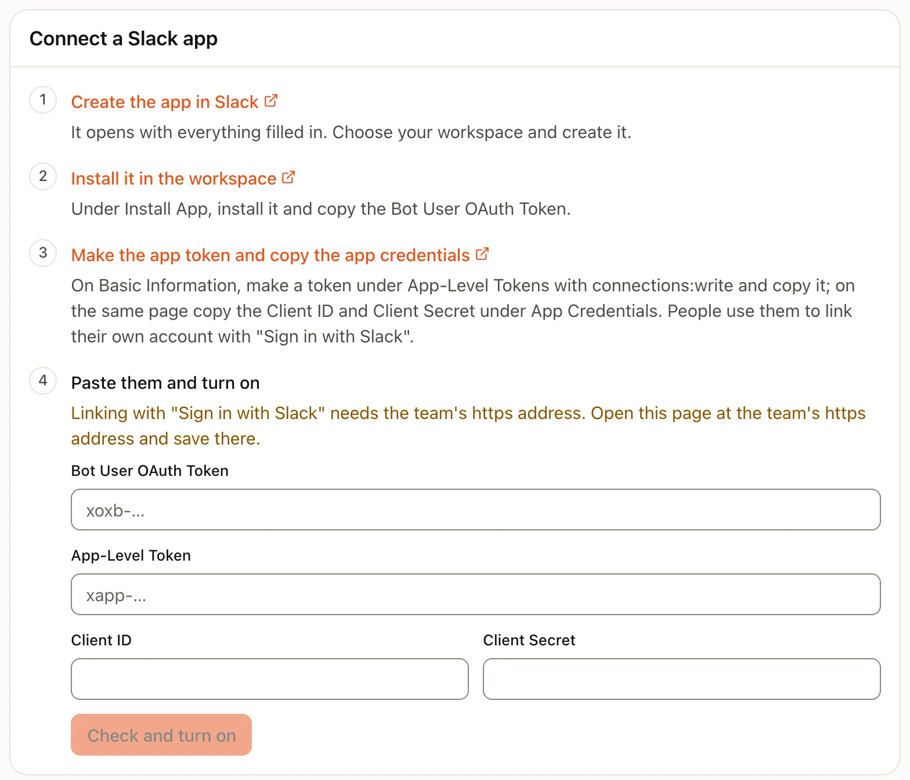
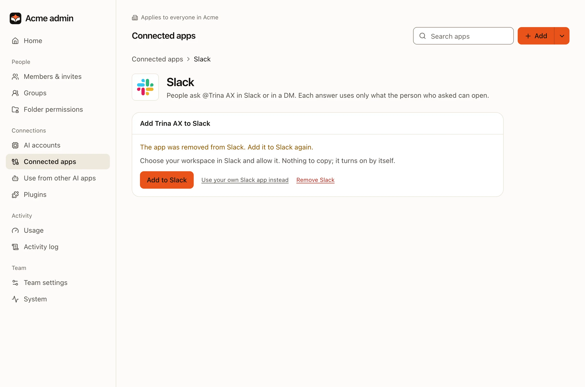

Setelah Slack terhubung, orang bisa bertanya ke Trina AX tanpa meninggalkan Slack: sebut **@Trina AX** di sebuah kanal,
atau kirimi pesan langsung. Setiap pertanyaan dijalankan atas nama orang yang bertanya, dengan izin folder, mesin AI, dan
batas miliknya sendiri, dan seluruh jawabannya juga disimpan sebagai chat di Trina AX.

Caranya dua langkah singkat. Owner tim atau admin menambahkan aplikasinya ke Slack sekali, lalu setiap orang
menautkan akun Slack-nya sendiri sekali.

:::tip
**Yang Anda perlukan**

- **Untuk menambahkan aplikasi** (sekali): owner tim atau admin di Trina AX, dan seseorang yang bisa menyetujui
  aplikasi di workspace Slack Anda (admin atau pemilik workspace Slack). Tidak ada yang perlu disalin atau ditempel.
- **Untuk menautkan akun Anda** (setiap orang, sekali): akun Slack Anda sendiri. Tidak ada yang perlu disalin atau
  ditempel.
- **Hanya di server tanpa Tambahkan ke Slack**: empat nilai dari aplikasi Slack Anda sendiri, lihat
  [di bawah](#jika-tambahkan-ke-slack-tidak-ada).
:::

:::note
Tangkapan layar di halaman ini memakai tim dan workspace rekaan, "Acme".
:::

## Menambahkan Trina AX ke Slack (owner atau admin)

:::steps
#### Buka Slack di Admin › Aplikasi terhubung
Di **Admin**, pilih **Aplikasi terhubung**. Slack adalah salah satu layanan di sana: di bawah **Jelajahi** selama belum
ditambahkan, lalu di bawah **Terhubung**. Owner tim dan admin bisa melihatnya.



Pilih **Slack**. Halamannya menampilkan **Tambahkan Trina AX ke Slack**.



#### Tekan Tambahkan ke Slack
**Tambahkan ke Slack** membuka halaman Slack sendiri. Ini juga bisa dilakukan di ponsel.

#### Pilih workspace Anda dan izinkan
Halaman Slack menyebutkan nama workspace di pojok kanan atas dan mencantumkan apa yang bisa dilihat dan dilakukan Trina
AX di sana. Periksa workspace-nya lebih dulu: Slack terbuka di workspace yang terakhir Anda pakai, yang mungkin bukan
workspace yang Anda maksud. Ganti di pojok itu jika perlu, lalu pilih **Allow**.

#### Anda kembali di halaman Slack di Trina AX
Halaman menampilkan "Sudah ditambahkan ke Slack. Undang aplikasi ke kanal tempat orang akan memakainya." Barisnya
menampilkan workspace dan aplikasi Anda, **Menghubungkan** selama beberapa detik, lalu **Terhubung**. Tidak ada yang
perlu disalin atau ditempel. Selama Trina AX menunggu jendela Slack, tersedia **Coba lagi** dan **Batal**; penantian
berakhir sendiri setelah lima menit.


:::

Hanya admin atau pemilik workspace Slack yang bisa menambahkan aplikasi ini. Orang lain akan kembali ke pesan "Admin
workspace Slack yang harus menambahkannya. Minta admin untuk melakukannya.", dan aplikasinya dikeluarkan lagi dari
workspace.

### Mengundang aplikasi ke kanal

Slack hanya memberi tahu Trina AX tentang kanal tempat aplikasi itu berada, sama seperti untuk aplikasi Slack mana pun. Di
setiap kanal tempat orang akan bertanya:

1. Buka kanal itu di Slack.
2. Di kotak pesan, ketik `/invite @trina-ax` lalu tekan Enter. (Slack mungkin menyarankan aplikasinya saat Anda mengetik:
   pilih aplikasi itu.)
3. Slack memasang satu baris di kanal yang menyebut aplikasinya sudah ditambahkan. Sejak itu, siapa pun di kanal bisa
   menyebutnya.

```
/invite @trina-ax
```

Pesan langsung tidak memerlukan undangan: cari **Trina AX** di bawah **Apps** di bilah samping Slack lalu tulis pesan
kepadanya.

## Menautkan akun Anda dan bertanya (semua orang)

Setiap orang menautkan akun Slack-nya sendiri ke akun Trina AX-nya sendiri, sekali. Tidak ada yang bisa menautkan akun
orang lain.

:::steps
#### Bertanya di Slack
Sebut **@Trina AX** di kanal tempat aplikasi itu diundang, atau kirimi pesan langsung. Misalnya: "@Trina AX rangkum
catatan minggu lalu di shared/sales".

#### Hubungkan akun Anda pertama kali
Pertama kali, Trina AX hanya menjawab Anda: "Untuk bertanya ke Trina AX di sini, hubungkan dulu akun Trina AX Anda.
Tautan ini berlaku sekali, selama 10 menit, dan hanya untuk Anda."

1. Pilih **Hubungkan akun Trina AX** di pesan itu.
2. Trina AX terbuka di browser Anda (masuk jika diminta). Halaman **Tautkan akun Slack Anda** menampilkan kedua akun: nama
   Slack Anda, serta nama dan e-mail Trina AX Anda.
3. Pastikan akun Slack itu milik Anda lalu pilih **Tautkan**. Halaman menampilkan "Tertaut. Kembali ke Slack dan tanyakan
   lagi."

**Tautkan** tersedia jika akun Slack Anda memakai e-mail yang sama dengan akun Trina AX Anda. Jika tidak, halaman
menjelaskan alasannya dan menawarkan **Masuk dengan Slack untuk menautkan** sebagai gantinya.



#### Atau tautkan dari Trina AX
**Pengaturan › Konektor** memiliki baris **Slack**: "Masuk dengan akun Slack Anda di … untuk menautkannya." **Tautkan**
membawa Anda ke Slack lalu kembali, dan barisnya kemudian menampilkan akun yang tertaut.



#### Bertanya lagi
Kembali ke Slack dan ajukan pertanyaan Anda lagi. Mulai sekarang Trina AX langsung menjawab.
:::

### Di mana jawabannya muncul

| Tempat Anda bertanya | Yang Anda dapatkan |
|---|---|
| **Kanal** | "Sedang dikerjakan…" lalu jawabannya, hanya terlihat oleh Anda, dengan **Kirim ke kanal**. Tekan tombol itu untuk mengirim jawaban ke utas, dengan "Ditanyakan oleh" dan nama Anda. |
| **Pesan langsung** | Jawabannya, di utas pesan Anda. |

- **Lanjutkan di utas yang sama.** Sebut aplikasi lagi di utas itu, atau balas di utas DM: chat yang sama berlanjut.
  Utas baru memulai chat baru.
- **Dalam bahasa Anda.** Kalimat Trina AX sendiri di Slack ("Sedang dikerjakan…", "Menjawab sebagai …", "Buka di Trina
  AX") memakai bahasa Trina AX Anda. Jawabannya sendiri mengikuti bahasa yang Anda pilih untuk jawaban AI.
- **Seluruh jawaban juga ada di Trina AX.** Jawaban yang panjang dipersingkat di Slack, dengan tautan ke sisanya.
  "Sedang dikerjakan…" juga menyebut akun yang dipakai untuk menjawab, jadi Anda tahu itu akun Anda.
- **Sebelum Anda mengirim.** Jika jawaban memakai tempat yang tidak bisa dilihat semua orang di tim, seperti folder grup
  atau folder Anda sendiri, **Kirim ke kanal** meminta konfirmasi lebih dulu, dengan **Tetap kirim** dan **Batal**. Di
  kanal yang dibagi dengan organisasi lain, jawaban tidak pernah dikirim.

## Jika Tambahkan ke Slack tidak ada

**Tambahkan ke Slack** muncul di tempat layanan hosting Trina melayani server Anda: tim yang di-hosting, atau server
yang Anda pasang sendiri dan sudah didaftarkan oleh layanan hosting. Di tempat lain, halaman Slack di **Admin ›
Aplikasi terhubung** menampilkan **Hubungkan aplikasi Slack** sebagai gantinya: empat langkah untuk membuat aplikasi
Slack milik tim Anda dari manifest kami dan menempelkan kuncinya. Hanya owner tim yang bisa melakukan ini, karena
langkah ini berarti menempelkan kunci aplikasi; admin melihat "Hanya pemilik tim yang bisa menghubungkan Slack di
sini." Buka halamannya di alamat `https://` tim Anda: tautan **Masuk dengan Slack** milik setiap orang kembali ke sana.



:::tip
**Yang Anda perlukan, semuanya dari pengaturan aplikasi Slack Anda di api.slack.com/apps**

| Kolom di Trina AX | Tempatnya di Slack | Bentuknya |
|---|---|---|
| **Bot User OAuth Token** | **Install App** (atau **OAuth & Permissions**), setelah **Install to Workspace** | `xoxb-…` |
| **App-Level Token** | **Basic Information › App-Level Tokens › Generate Token and Scopes**, dengan scope `connections:write` | `xapp-…` |
| **Client ID** | **Basic Information › App Credentials** | angka dengan titik |
| **Client Secret** | **Basic Information › App Credentials**, **Show** | huruf dan angka |
:::

:::steps
#### Buat aplikasi di Slack
Pilih **Buat aplikasi di Slack**. Slack membuka "Create an app" dengan semua isian dari manifest kami. Pilih workspace
Anda lalu pilih **Create**. Ini membuat aplikasi khusus untuk workspace Anda.

#### Pasang di workspace
Pilih **Pasang di workspace** (halaman **Install App** di Slack), lalu **Install to Workspace** dan **Allow**. Salin
**Bot User OAuth Token**, yang diawali `xoxb-`.

#### Buat token aplikasi dan salin kredensial aplikasi
Pilih **Buat token aplikasi dan salin kredensial aplikasi** (halaman **Basic Information** di Slack). Di bawah
**App-Level Tokens**, pilih **Generate Token and Scopes**, beri nama apa saja, tambahkan scope `connections:write`, lalu
pilih **Generate**. Salin tokennya, yang diawali `xapp-`. Di halaman yang sama, di bawah **App Credentials**, salin
**Client ID** dan **Client Secret** (pilih **Show** dulu).

#### Tempel dan nyalakan
Tempel keempat nilai itu ke kolomnya masing-masing lalu pilih **Periksa dan nyalakan**. Trina AX memeriksanya ke Slack.
Nilai yang ditolak Slack disebutkan di bawah kolomnya sendiri, beserta halaman Slack tempat Anda memperbaikinya.
:::

Lalu undang aplikasi ke kanal seperti di atas. Detail untuk operator:
[Setting up the team's own app](../../../SLACK.md#setting-up-the-teams-own-app-the-owner) (bahasa Inggris).

| Yang Anda lihat | Yang perlu dilakukan |
|---|---|
| "Ini bukan token bot." atau "Slack tidak menerima token ini." | Salin lagi **Bot User OAuth Token** (`xoxb-`) dari **Install App**, dengan tombol salin milik Slack. |
| "Slack tidak menerima token aplikasi ini." | Buat App-Level Token baru dengan scope `connections:write` lalu tempel. |
| "Kedua token berasal dari aplikasi Slack yang berbeda." | Kedua token harus berasal dari aplikasi Slack yang sama. |
| "Ini bukan Client ID." atau "Ini bukan Client Secret." | Salin lagi dari **Basic Information › App Credentials**; kedua kolom mungkin tertukar. |
| "Nyalakan Pengaturan aplikasi Slack › Socket Mode." | Manifest menyalakannya; jika ada yang mematikannya, nyalakan lagi di Slack. |
| **Masuk dengan Slack** gagal dengan galat pengalihan (redirect) | Halaman disimpan dari alamat selain alamat `https://` tim. Buka di alamat tim lalu simpan lagi. |

Anda juga melihat keempat langkah itu jika aplikasi Slack milik tim Anda sudah disiapkan. Untuk beralih, owner
menghapusnya lebih dulu (**Ganti token**, lalu **Hapus Slack**), lalu menekan **Tambahkan ke Slack**. Admin bisa mematikan
dan menyalakan aplikasi milik tim, tetapi hanya owner yang bisa mengubah atau menghapusnya. Jika Slack sama sekali tidak
ada di Admin › Aplikasi terhubung, Anda bukan owner tim atau admin: mintalah kepada mereka.

## Menghubungkan kanal Slack ke percakapan

Klien Anda berbicara dengan Anda di kanal Slack, tetapi tim Anda bekerja di Trina AX? Hubungkan kanal itu ke satu percakapan tim atau proyek: pesannya muncul di percakapan saat ditulis, dan yang ditulis tim Anda di sana kembali ke kanal. Klien tetap di Slack dan tidak merasakan perubahan apa pun.

#### Buka menu percakapan › Tambah aplikasi › Slack

Hanya pemilik atau admin tim yang ada di percakapan itu yang bisa melakukannya. Pertama kali, dialog meminta Anda **Masuk dengan Slack** agar tahu akun Slack Anda.

#### Pilih kanal lalu tekan Hubungkan

Daftar berisi kanal tempat Anda dan aplikasi Trina AX sama-sama berada. Kanal tidak ada: undang aplikasinya dulu di Slack (`/invite @trina-ax`). Baca kalimat di atas tombol: **mulai sekarang semua orang di percakapan ini akan melihat pesan kanal itu**, dan yang mereka tulis dikirim ke Slack atas nama mereka. Tekan **Hubungkan**.

#### Yang dilihat orang

- Di percakapan, pesan Slack menampilkan nama dan foto Slack pengirimnya dengan tanda Slack kecil. Utas, sebutan, suntingan, dan penghapusan ikut. Bagian atas menampilkan **#kanal · Slack**.
- Di Slack, pesan dari percakapan tampil sebagai **Mina (Trina AX)**. Tidak perlu akun Slack untuk menulis.
- Jawaban AI dan file tidak dikirim ke Slack; pesan seperti itu bertanda **Tidak dikirim ke Slack**. Jika Slack menolak sebuah pesan, tertulis **Tidak dikirim ke Slack** dengan **Coba lagi**.
- Percakapan yang ada tamunya belum bisa dihubungkan, dan tamu tidak bisa diundang selama terhubung.

Untuk berhenti, buka dialognya lagi (atau tekan **#kanal · Slack** di bagian atas) lalu tekan **Putuskan**. Yang sudah dibicarakan tetap ada di percakapan.

## Menghapus atau menghubungkan ulang

Halaman Slack di **Admin › Aplikasi terhubung** selalu menunjukkan keadaannya, dan barisnya di daftar menunjukkan
keadaan yang sama: **Aktif**, **Menghubungkan**, **Mati**, atau apa yang memerlukan tindakan Anda. Jika Slack belum
merespons selama beberapa menit, halaman menampilkan **Tidak merespons**, beserta apa yang perlu dilakukan. Jika aplikasi
dihapus di Slack, barisnya menampilkan **Hubungkan kembali** dan halamannya menawarkan **Tambahkan ke Slack** lagi, atau
**Hapus Slack** jika Anda tidak ingin memakainya lagi.



| Yang terjadi | Yang perlu dilakukan |
|---|---|
| **Seseorang menghapus aplikasi di Slack** | Halaman Slack menampilkan "Aplikasi sudah dihapus dari Slack. Tambahkan lagi ke Slack." Tekan **Tambahkan ke Slack** lagi. Tautan setiap orang tetap ada: jika ditambahkan ke workspace yang sama, tidak ada yang perlu menautkan lagi. Jika Anda tidak ingin memakainya lagi, tekan **Hapus Slack**: Slack kembali ke bawah **Jelajahi** dan tautan akun semua orang dihapus. |
| **Anda ingin mematikannya sementara** | Tekan **Matikan**. Trina AX berhenti menjawab di Slack; tautan tetap ada. **Nyalakan** mengaktifkannya kembali. |
| **Anda ingin menghapusnya sama sekali** | Tekan **Hapus Slack** dan konfirmasi. Aplikasinya dikeluarkan dari workspace Slack Anda dan tautan akun semua orang dihapus. Jika nanti Anda menambahkannya lagi, semua orang menautkan lagi. |

Siapa pun bisa **Putuskan** akun Slack-nya sendiri di **Pengaturan › Konektor**, di baris Slack, kapan saja.

## Tanya jawab

### Siapa yang bisa menambahkan Trina AX ke Slack?

Owner tim atau admin menekan **Tambahkan ke Slack** di Trina AX, dan di Slack hal itu harus diizinkan oleh admin atau
pemilik workspace. Admin juga bisa mematikan dan menyalakannya, menambahkannya lagi, dan menghapusnya. Menyiapkan
aplikasi Slack milik tim Anda sendiri (menempelkan kuncinya) hanya untuk owner tim. Anggota tidak pernah melihat
Admin; mereka menautkan akun Slack-nya sendiri di **Pengaturan › Konektor**.

### Apakah setiap orang harus masuk?

Ya, sekali. Sampai seseorang menautkan akun Slack-nya, Trina AX hanya mengirimkan tautan untuk menghubungkan. Orang yang
akun Trina AX-nya dinonaktifkan atau dihapus langsung diputuskan tautannya.

### Apa yang dilihat Trina AX di Slack?

Pesan yang menyebut @Trina AX di kanal tempat aplikasi itu diundang, dan pesan langsung yang dikirim kepadanya. Saat
Anda bertanya di sebuah utas, AI juga membaca utas itu. Jika Anda memintanya, AI bisa membaca kanal atau utas tempat
aplikasi diundang dan Anda juga berada di sana. Pesan dari aplikasi lain di sana, seperti notifikasi formulir atau
pemantauan, ikut terbaca beserta detailnya. AI tidak membaca file, dan tidak bisa membaca kanal tempat aplikasi tidak
diundang. Untuk menautkan akun dan menyebut siapa yang bertanya, AI membaca nama dan alamat e-mail orang-orang di
workspace. Di kanal, jawaban hanya terlihat oleh orang yang bertanya sampai orang itu mengirimnya.

### Izin siapa yang dipakai sebuah jawaban?

Izin penanya: izin folder, mesin AI, dan batas miliknya. Jawabannya dihitung dalam pemakaian orang itu, seperti chat
lainnya.

### Bisakah kami menghubungkan lebih dari satu workspace?

Tidak, satu workspace per tim. Workspace yang sudah terhubung ke tim lain akan ditolak: "Workspace Slack ini sudah
tersambung ke tim lain. Hapus di sana, atau hapus aplikasinya di Slack, lalu coba lagi." Orang dari organisasi lain di
kanal bersama, dan bot, tidak mendapat jawaban.

Detail lengkap: [Slack connector](../../../SLACK.md) (bahasa Inggris).
