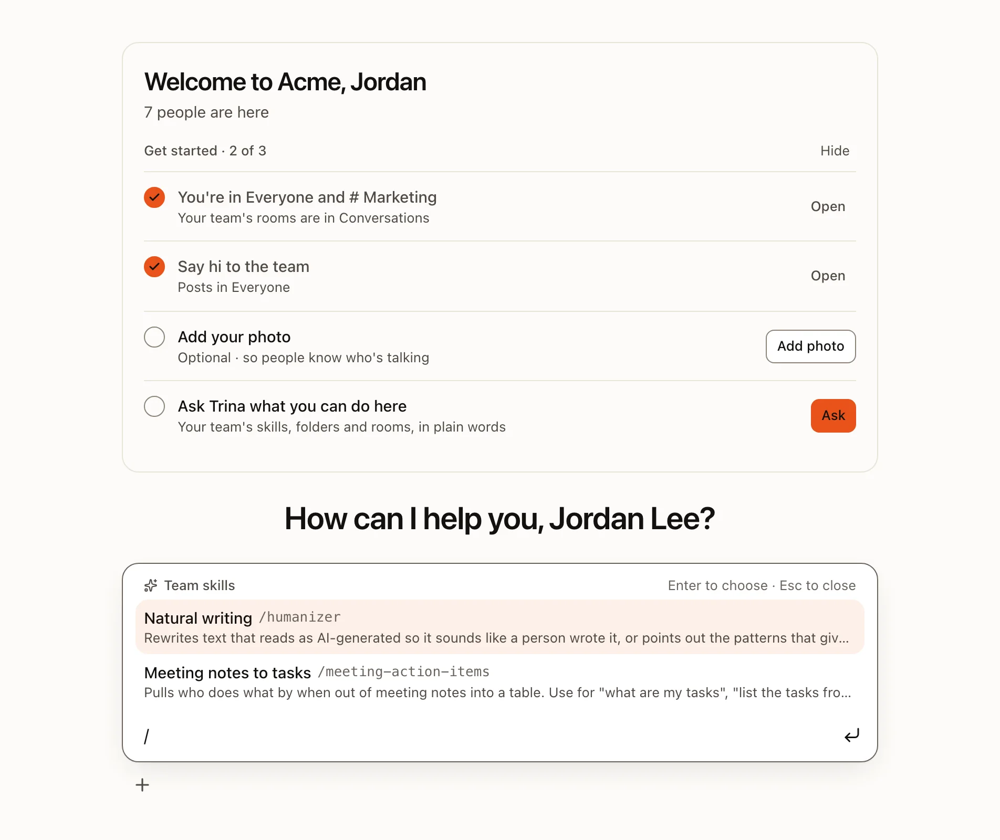
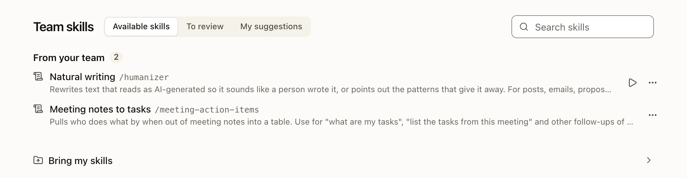

Skill adalah prosedur yang bisa dipakai ulang dalam sebuah file `SKILL.md`. Skill memberi tahu AI cara tim Anda mengerjakan suatu tugas. Skill tidak melatih model dan tidak pernah memberi akses tambahan.

## Memakai skill

- Di chat, ketik `/` lalu pilih skill, atau tulis `/nama-skill` di pesan Anda.
- AI juga bisa menemukan dan memuat skill sendiri jika skill itu cocok dengan permintaan.
- **Skill tim**, baris di dekat bagian atas daftar Trina Anda (di ponsel, di menu **☰** pada tab **Trina**), menampilkan skill yang bisa Anda pakai.





## Skill yang disarankan

Empat skill siap pakai disertakan dalam produk, dalam bahasa tim (Korea atau Inggris; bahasa lain mendapat teks bahasa Inggris). Tidak ada yang menambahkannya secara otomatis: setiap skill baru masuk ketika seseorang menekan tombol yang menyebut namanya.

| Folder | Skill | Cara masuknya |
|---|---|---|
| `skills/general/` | Company profile, Promo cards, Promo video | Owner memilihnya di langkah penyiapan **Pilih skill yang akan dipakai tim**, atau owner atau admin menambahkannya nanti di **Skill yang tersedia** |
| `skills/work/` | Natural writing | Sama seperti di atas |

- **Di langkah penyiapan**, setiap skill punya satu baris dan **Contoh**. Company profile, Promo cards, dan Promo video sudah tercentang jika profil perusahaan sudah disimpan (skill itu dibuat dari profil tersebut); Natural writing awalnya tidak tercentang. Tombolnya menyebut apa yang akan masuk, misalnya **Tambahkan Company profile·Promo cards·Promo video**.
- **Di Skill yang tersedia**, owner dan admin melihat satu baris terlipat di bawah daftar, **Skill yang disiapkan Trina AX · 2 lagi**, berisi skill yang belum dimiliki tim. Buka baris itu, centang yang Anda inginkan (awalnya tidak ada yang tercentang), lalu tekan **Tambahkan ke tim**. Baris ini tersembunyi selama Anda mencari dan hilang jika tim sudah memiliki semuanya. Skill yang disertakan di versi berikutnya hanya menambah jumlahnya: tidak ada pemberitahuan.
- **Contoh** menunjukkan apa yang dibuat skill itu untuk perusahaan rekaan, Example Coffee, dan dari mana skill itu berasal.

Jika tim memiliki salah satunya di akhir langkah penyiapan, layar terakhir menawarkan untuk membuat hasil pertama dengannya (Promo cards lebih dulu): menekannya membuka formulir skill, dan tidak ada yang berjalan sampai Anda menekan **Jalankan**.

Skill-skill ini adalah file milik tim Anda sendiri: pengelola skill bisa mengedit, memindahkan, atau menghapusnya. Menambahkan lagi hanya menambahkan yang belum ada; skill yang sudah Anda edit tidak pernah diganti, dan skill yang namanya sudah dipakai skill tim lain dilewati. Skill yang Anda hapus hanya kembali jika seseorang menambahkannya lagi berdasarkan namanya.

**Natural writing** menulis ulang teks yang terasa ditulis AI agar terdengar seperti ditulis manusia, tanpa mengubah fakta apa pun. Versi bahasa Korea ditulis oleh perusahaan dan memahami genre tulisan Korea (blog, judul Shorts, Instagram, proposal, pengumuman); versi bahasa Inggris diadaptasi dari skill open-source "humanizer" (Lisensi MIT, pemberitahuannya ada di dalam skill).

Hanya skill yang asal-usulnya jelas yang disertakan. Versi sebelumnya juga menambahkan skill untuk tugas rapat, ringkasan dokumen, pemasaran, pekerjaan sehari-hari, dan dokumen HR Korea; tim yang sudah memilikinya tetap menyimpannya sebagai file mereka sendiri.

## Tempat skill disimpan

| Lokasi | Siapa yang melihatnya |
|---|---|
| `skills/<name>/SKILL.md` | Semua orang yang bisa membaca `skills/` (biasanya seluruh tim) |
| `skills/<folder>/<name>/SKILL.md` | Hanya orang yang bisa membaca folder itu, misalnya `skills/finance/` |
| `groups/<group>/skills/<name>/SKILL.md` | Hanya anggota grup itu. Owner atau admin di luar grup tidak. |
| `projects/<project>/skills/<name>/SKILL.md` | Hanya di chat proyek itu, bagi orang yang bisa membaca folder proyek. |
| `users/<you>/skills/<name>/SKILL.md` | Hanya Anda. Owner dan admin pun tidak. |

Jika dua skill punya nama yang sama, yang paling dekat yang dipakai, hanya untuk Anda: skill pribadi Anda, lalu skill grup Anda, lalu skill tim, lalu skill proyek. Skill proyek hanya menambah nama baru. Jika dua grup Anda punya skill dengan nama yang sama, keduanya ditampilkan beserta foldernya, dan `/nama` memakai skill dari grup yang namanya muncul lebih dulu.

## Skill grup

Setiap grup punya skill sendiri di foldernya: `groups/<group>/skills/`, di samping file grup. Hanya anggota grup yang melihat dan memakainya: di **Skill tim** (satu bagian per grup, di bawah nama grup), di menu `/` (ditandai dengan nama grup), dan dalam hal yang diketahui AI. Owner dan admin tidak mendapat skill sebuah grup kecuali mereka ada di grup itu.

- Setiap anggota grup bisa menambah atau mengubah skill grup, sama seperti file grup lainnya. AI menanyakan Anda lewat kartu sebelum menyimpan skill di sana, sama seperti untuk skill tim, dan setiap perubahan dicatat dengan nama grup.
- Anggota bisa mengusulkan skill ke grupnya (**Usulkan sebagai skill**, lalu folder grup); anggota grup yang meninjaunya.
- Mengganti nama grup tetap mempertahankan foldernya; bagian di **Skill tim** langsung menampilkan nama baru. Menghapus grup menghapus skill-skillnya dari daftar anggotanya.

Skill grup ditulis oleh anggota grup, bukan oleh pengelola skill tim: apa yang disimpan satu anggota di sana, diikuti oleh AI setiap anggota.

## Skill proyek

Proyek tim di `projects/<project>/` bisa punya skill sendiri di folder `skills/`-nya, satu folder dengan `SKILL.md` per skill. AI hanya memakainya di chat proyek itu (chat Anda, chat bersama, dan tugas terjadwal di proyek), tidak pernah di ruang obrolan atau chat Anda yang lain. **Skill tim** menampilkan satu bagian per proyek, **Dari proyek <proyek>**, dan menu `/` menandainya di dalam proyek.

- Siapa pun yang bisa menulis di folder proyek bisa menambah atau mengubahnya; AI bertanya lebih dulu lewat kartu yang menyebut nama proyek, dan setiap perubahan dicatat dengan nama proyek.
- Skill proyek hanya menambah nama baru. Nama yang sudah dipakai tim, grup, atau Anda sendiri ditandai **Nama sama: seluruh tim** di halaman itu, dan kartu AI menawarkan nama lain alih-alih menyimpan skill yang tidak akan pernah berjalan.
- Untuk memindahkan skill antara tim, grup, proyek, dan skill Anda sendiri, gunakan **Pindahkan** di menu skill: menu itu menunjukkan siapa yang mendapatkan dan siapa yang kehilangan skill di setiap tingkat, serta seluruh teksnya sebelum lebih banyak orang mendapatkannya. Anda juga bisa meminta AI di chat proyek; AI hanya memindahkan skill ke tempat yang lebih sedikit orangnya, setelah kartu yang mencantumkan setiap file.

## Menulis skill

:::steps
#### Buat foldernya
Buat `skills/<name>/` di File. Namanya memakai `a`–`z`, `0`–`9`, dan tanda hubung, dan harus sama dengan nama folder.

#### Tulis SKILL.md
Mulai dengan header, lalu prosedurnya.
```markdown
---
name: meeting-summary
description: Summarize permitted meeting notes into decisions, actions and open questions.
---

# Inputs
Ask for the source paths before reading.

# Procedure and output
Return decisions, an action table and open questions. Cite the source paths.
```

#### Pastikan skill termuat
**Skill tim** menampilkan alasan yang jelas jika sebuah skill tidak bisa dimuat. Perbaiki header lalu coba lagi.
:::

[Baca format lengkap SKILL.md](../../agents/skills-format.md) (bahasa Inggris).

## Membawa skill Anda dari Claude Code atau Codex

Owner dan admin bisa membawa skill yang sudah mereka pakai ke tim dengan **Bawa skill saya** di bawah daftar di **Skill yang tersedia**, atau dari tautan usulan. Langkah penyiapan hanya menawarkan skill siap pakai. Di ponsel, halaman ini memberi tahu bahwa hal ini dilakukan di komputer.

| Dari | Pilih atau seret | Yang dibaca |
|---|---|---|
| Claude Code | `~/.claude` (atau `.claude` milik sebuah proyek) | `skills/`, `commands/*.md`, `CLAUDE.md` |
| Codex | `~/.codex`, dan `~/.agents` untuk skill pribadi versi sekarang | `skills/` (tidak pernah `.system`), `prompts/*.md`, `AGENTS.md`, server jarak jauh di `config.toml` |

Atau, setelah Claude Code atau Codex terhubung ke tim ([konektor MCP](../../agents/mcp-connector.md) (bahasa Inggris)), tempelkan satu baris ke dalamnya dan ia akan mengirim usulan.

- Tidak ada hal lain di folder-folder itu yang dibuka. Skill yang berisi kunci atau token tidak pernah meninggalkan komputer Anda; hanya namanya yang ditampilkan.
- Server memeriksa ulang setiap skill dan menyarankan skill yang bisa dipakai seluruh tim. Jika pemeriksaan itu lebih dari 30 detik, daftar ditampilkan tanpa ada yang tercentang dan Anda memilih sendiri. Tidak ada yang sampai ke tim sebelum Anda menekan tombol yang menambahkannya.
- File aturan menjadi satu aturan tim. Server MCP jarak jauh menjadi templat koneksi tanpa kunci: setiap anggota menghubungkan dengan kuncinya sendiri.
- Skill yang namanya sama dengan skill tim digabungkan di sebuah chat yang hanya bisa membaca keduanya dan menyimpan skill tim, setelah Anda konfirmasi.
- **Ke salah satu grup Anda saja.** Di halaman usulan, **Bagikan ke** memilih seluruh tim (bawaan) atau salah satu grup Anda; Claude Code dan Codex juga bisa menyebut grupnya. Usulan ke grup hanya menambahkan skill (tanpa aturan tim, tanpa koneksi) dan tidak pernah mengubah skill tim: skill yang namanya sama dengan skill grup digabungkan ke dalamnya atau disimpan di sampingnya, dan skill yang namanya sama dengan skill tim menjadi salinan milik grup. Anggota grup melihatnya di **Skill tim › Tinjau** (hanya yang ditujukan ke grup) dan siapa pun dari mereka bisa menambahkannya ke grup.

## Siapa yang bisa mengubah skill

**Pengelola skill** mengubah skill tim: owner, admin, serta orang atau grup yang ditambahkan admin. Di balik layar, itu sekadar akses tulis ke `skills/` atau ke folder di dalamnya.

Owner dan admin melihat siapa saja mereka di bawah judul **Skill tim**: "Yang bisa mengubah: owner dan admin, Sales: 3 orang, Alex [Ubah]". Daftar ini sesuai dengan yang tertulis di Izin folder untuk `skills/`, sehingga termasuk orang yang bisa mengedit lewat grup, aturan untuk semua orang, atau aturan pada seluruh folder tim. Folder di dalamnya yang punya aturan tulis sendiri (untuk orang, grup, atau semua orang) dihitung di bagian akhir ("2 folder punya aturan tulis sendiri"). **Ubah** membuka satu jendela:

- Jendela itu mencantumkan owner dan admin (selalu) serta setiap orang dan grup yang punya aturan tulis sendiri pada `skills/`, beserta foldernya jika aturan itu ada di subfolder seperti `skills/finance/`. **Hapus** menghapus aturan itu setelah konfirmasi; jendela memberi tahu jika masih ada aturan lain yang membuat orang itu bisa mengedit (aturan grup, aturan semua orang, atau aturannya sendiri pada `skills/`).
- **Tambah orang atau grup** mencarinya berdasarkan nama. Baca peringatannya, lalu **Aktifkan**: mereka bisa mengedit seluruh `skills/`.
- Untuk menyerahkan satu folder saja, ikuti **Untuk menyerahkan satu folder, gunakan Izin folder** dan berikan akses tulis pada folder itu di sana.

Anggota dan pengelola skill lainnya tidak melihat baris ini.

- Anggota bisa **mengusulkan** skill pribadi ke tim. Pengelola skill pada folder tujuan yang meninjaunya.
- Setiap perubahan pada `skills/` dicatat, dan owner serta admin mendapat pemberitahuan dengan tautan ke riwayat versi.
- Skill grup diubah oleh anggota grup (lihat [Skill grup](#skill-grup)); perubahannya dicatat dan diumumkan dengan cara yang sama.

## Anggota membawa skill mereka sendiri

Anggota memakai **Bawa skill saya** di bawah daftar di **Skill yang tersedia** (di komputer), atau satu baris di bawah jawaban setelah hasil bagus pertama, yang menanyakan apakah mereka juga ingin membawa skill atau file yang mereka pakai ke tim. Keduanya membuka satu lembar yang sama:

- Anggota memilih atau menyeret folder `.claude`, `.codex`, atau `.agents` mereka, yang dibaca dengan cara yang sama seperti di atas. Skill yang berisi kunci tidak pernah meninggalkan komputer mereka.
- Awalnya tidak ada yang tercentang. Mereka mencentang sampai 10 skill dan mengirimnya sebagai usulan; sampai 20 usulan mereka bisa menunggu sekaligus. File aturan dan server MCP tidak dikirim.
- Server memeriksa ulang setiap skill (kunci, skrip, ukuran, nama, path di komputer mereka) dan menyimpannya di luar file tim. Tidak ada AI yang menilainya.
- Jika mereka bisa menulis di folder tim, lembar itu juga menautkan ke folder tersebut untuk file. Di ponsel, baris itu hanya menawarkan folder tersebut, dan tidak menawarkan apa pun jika mereka tidak bisa menulis di folder mana pun.

Owner dan admin mendapat satu pemberitahuan di **Aktivitas** per pengiriman ("Mina ingin membawa 2 skill ke tim"), yang membuka **Tinjau**, dikelompokkan per orang. Hanya owner dan admin yang melihat dan menyetujui skill seperti itu: skill disimpan sebagai `skills/<folder name>/` beserta file-filenya, anggota itu diberi tahu, dan skill tersebut menampilkan "Diusulkan oleh Mina" di daftar. Menyetujui tidak pernah mengubah skill yang dibuka oleh undangan atau yang disebut oleh target 7 hari. Baris ini bisa ditutup selamanya dengan ✕.

## Skill awal

Repositori ini punya enam skill awal dengan input fiktif: laporan mingguan, tindak lanjut penjualan, brief merek, peninjauan biaya, panduan karyawan baru, dan ringkasan rapat. [Lihat contohnya](../../../../examples/README.md) (bahasa Inggris).
