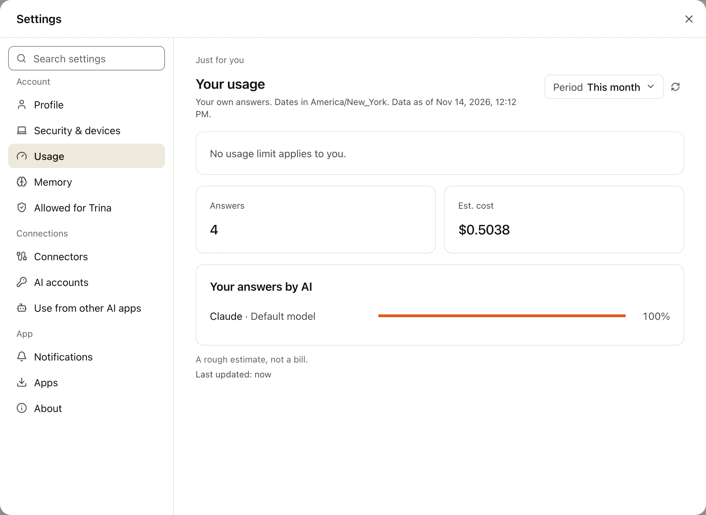

Trina AX menghitung setiap jawaban: siapa yang bertanya, mesin dan model mana, berapa token, dan perkiraan biayanya.

:::note
Biaya adalah perkiraan harga API yang setara, bukan tagihan. Koneksi berlangganan menambah 0 per permintaan, tetapi tokennya tetap dihitung.
:::

## Pemakaian Anda sendiri

Buka **Pengaturan › Penggunaan** (foto Anda di bagian bawah bilah kiri › **Pengaturan**; di ponsel, tab **Saya**). Halaman ini menampilkan jawaban Anda dan perkiraan biayanya, AI mana yang menjawabnya, dan seberapa penuh setiap batas yang berlaku untuk Anda. Anda hanya bisa melihat angka Anda sendiri.

:::note
Pemakaian pribadi baru ada sejak 0.4.0. Sebelumnya, hanya admin yang melihat pemakaian, di **Admin › Pemakaian**.
:::

## Pemakaian tim

Admin membuka **Admin › Pemakaian**. Tata letaknya mirip halaman pemakaian di Claude Console.

- **Filter** di bagian atas, masing-masing berupa tombol kecil yang menunjukkan pilihan saat ini:
  - **Grup** (hanya jika tim punya grup) dan **Rentang**: hari ini, 7 atau 30 hari terakhir, bulan ini, atau rentang khusus.
  - **Orang**, **Mesin**, **Model**, dan **Koneksi AI**, untuk melihat salah satunya. **Hapus filter** menampilkan semuanya lagi.
  - **Kelompokkan per** orang, grup, mesin, model, hari, koneksi AI, atau skill.
- **Kartu** berisi total: token masuk, token keluar, jawaban, dan perkiraan biaya.
- **Penggunaan token**: token per hari sebagai batang bertumpuk, satu warna per nilai pengelompokan (lima terbesar, sisanya sebagai "Lainnya"). Arahkan kursor ke sebuah hari, atau fokuskan grafik lalu gunakan tombol panah, untuk melihat angka hari itu.
- **Rincian**: satu baris per nilai pengelompokan dengan jawaban, token, porsinya, dan perkiraan biaya.
- Tombol **unduh** menyimpan rincian sebagai CSV.

Skill pribadi tidak pernah dihitung berdasarkan nama, jadi tidak ada admin yang melihat apa yang disimpan seseorang secara pribadi. Skill grup dihitung seperti skill tim.

## Mengatur batas

Secara bawaan tidak ada batas. Admin menambahkannya di **Admin › Pengaturan tim**, di bagian **Batas pemakaian**.

Untuk satu orang, lebih cepat dari **Admin › Anggota & undangan**: buka menu **…** orang itu dan pilih **Batas penggunaan…**. Dialog
langsung ditujukan untuk orang itu dan terbuka dengan batas yang ia miliki, beserta berapa banyak yang sudah ia pakai. Pilih **Per hari** atau
**Per bulan** untuk melihat atau mengatur masing-masing, dan **Hapus batas** untuk menghapusnya. Orang yang punya batas menampilkannya dalam satu baris tenang
di bawah namanya, dengan **Melebihi batas** setelah batasnya habis. Di ponsel, buka orang itu lalu ketuk **Batas penggunaan**.

| Batas untuk | Periode |
|---|---|
| Satu orang | per hari atau per bulan |
| Satu grup | per hari atau per bulan |
| Seluruh tim | per hari atau per bulan |

Jika batas tercapai, orang yang dicakupnya tidak bisa memulai jawaban baru sampai periodenya diatur ulang. Halaman pemakaian mereka menyebutkan kapan itu terjadi.
