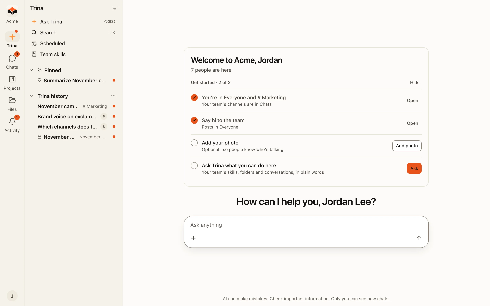

:::note
Want to see it first? [Try it in 1 minute, no sign-up](https://demo.trina.app).

Just want to try it? Run the [local demo](get-started/quickstart.md). It needs no AI account.
:::

Trina AX is a company AI workspace. You set up Claude Code once on a server, and everyone uses it from a browser.

| | What it means |
|---|---|
| **One server** | Claude Code and Codex run on your server, not on each laptop. |
| **Your files** | The AI works from the team folders: `shared/`, `groups/`, `projects/` and personal folders. |
| **Team skills** | A `SKILL.md` file turns how your team works into a reusable instruction. |
| **Permissions** | The server checks every file the AI opens, as the person asking. |

---

## Use Trina AX at work

Not a developer? Start here. Each page has numbered steps with the exact button names and pictures of the screens.

:::cards cols=2
- icon=message-square | [Chats and projects](use/chats-and-projects.md) | Ask the AI, share a chat like a Google Drive file, and keep one piece of work in a project.
- icon=folder-lock | [Files and permissions](use/files-and-permissions.md) | Share a file or a folder, and keep a folder for fewer people.
- icon=bell | [Settings and search](use/settings-and-search.md) | Your profile, language and notifications, and ⌘K search.
- icon=clock | [Scheduled tasks](use/scheduled-tasks.md) | Let the AI do the same work every Monday, in a few clicks.
:::

## Recommended path for new developers

:::steps
#### Run the demo
Start a fictional team on your computer in about 10 minutes. [Go to the quickstart](get-started/quickstart.md).

#### Learn the words
Teams, groups, folders, skills, engines and MCP in one page. [Read the key concepts](get-started/key-concepts.md).

#### See how it fits together
The server, the web app, the engines and the permission check. [Read the architecture](develop/architecture.md).

#### Make your first change
Set up a development server, run the checks and open a pull request. [Read the local development guide](develop/local-development.md).

#### Put it in front of a team
Choose hosting, a Linux server or an office Mac. [Compare the setups](operate/install.md).
:::

---

## Develop with Trina AX

:::cards cols=3
- icon=code | [Developer guide](develop/architecture.md) | Architecture, repository layout, tests and conventions.
- icon=bot | [For AI agents](agents/overview.md) | Rules for coding agents, and how AI works inside Trina AX.
- icon=braces | [HTTP API](reference/http-api.md) | Every endpoint, grouped by area, with who may call it.
:::

## Key capabilities

:::cards cols=2
- icon=folder-lock | [Files and permissions](use/files-and-permissions.md) | Each person and their AI see only the folders they may open.
- icon=book-open | [Team skills](use/team-skills.md) | Reusable instructions, governed like files.
- icon=plug | [MCP connections](use/mcp.md) | Let the AI use Notion, Linear and other services.
- icon=clock | [Scheduled tasks](use/scheduled-tasks.md) | Ask once and let the AI repeat the work.
:::

## Support

:::cards cols=2
- icon=life-buoy | [Support](resources/support.md) | Where to ask, report a bug or send a security report.
- icon=wrench | [Troubleshooting](operate/troubleshooting.md) | Fixes for common problems, by symptom.
:::
