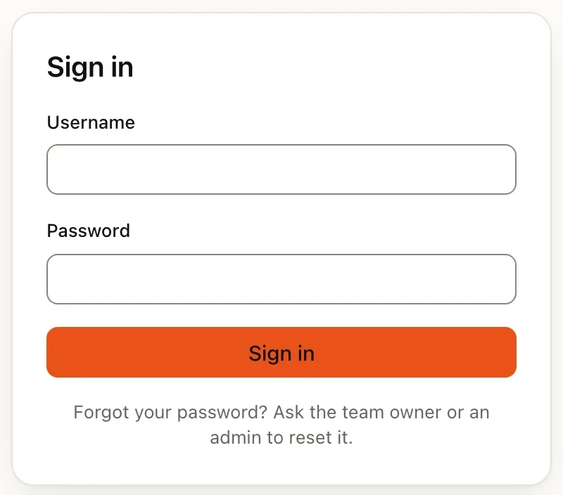
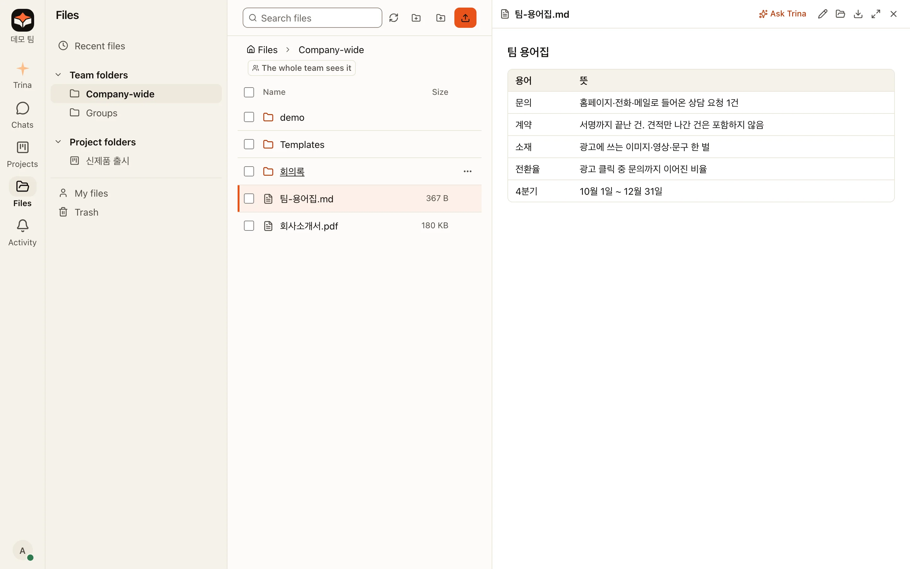

デモでは、最初から使えるスキルが 6 つ入った架空のチームが起動します。AI はオフなので、AI のアカウントは必要ありません。

:::warning
デモは本番用のインストールではありません。OS による分離がありません。架空のデータだけを使ってください。
:::

## 始める前に

| 必要なもの | バージョン |
|---|---|
| macOS または Linux | Windows の方は、用意されたサーバーをブラウザーで開いてください |
| Git | 最近のバージョンならどれでも |
| Bun | 1.3.12（CI で固定しているバージョン） |
| Go | 1.27 以降 |
| ネイティブのビルドツール | macOS では Xcode コマンドラインツール |
| 空いているポート | 19760 |

## デモを起動する

:::steps
#### クローンしてインストールする
```sh
git clone https://github.com/trina-app/trina-ax.git
cd trina-ax
bun install --frozen-lockfile
```

#### デモを起動する
```sh
bun run demo
```
このターミナルは開いたままにしてください。ビルドが終わると http://127.0.0.1:19760 で起動し、架空のチームのデータが入ります。

#### ログインする
http://127.0.0.1:19760 を開き、`alice` とパスワード `teamax-demo-1` でログインします。ほかのアカウントは `bob`、`admin1`、オーナーの `dion` です。このパスワードはあえて公開しています。



#### フォルダー権限を確かめる
**ファイル → 全社共有 → 팀-용어집.md** を開きます。次に、プライベートウィンドウで `bob` としてログインします。Bob には経理のグループは見えますが、マーケティングのグループは見えません。


:::

:::tip
`localhost` ではなく `127.0.0.1` を使ってください。この 2 つは Cookie の発行元が別になるため、ログインをやり直すことになります。
:::

## さらに試す

いちばん早く始められるのはデモです。もっと試したいときは、次のどれかを選んでください。

:::tabs
@tab ポートと言語
別のポート、新しいデータフォルダー、韓国語の画面を選べます。

```sh
bun run demo --port 19761 --data "$HOME/.trina-evaluation-new" --locale ko
```

データフォルダーは、まだ存在しないものを指定してください。使用中のポートや、すでにあるフォルダーは受け付けられません。

@tab AI を試す
デモからは AI を呼び出せません。自分の Claude Code または Codex のログインを使う開発サーバーを動かすには、先にデモを止めてから、次を実行します。

```sh
TEAM_AX_DEV_DIR="$HOME/.trina-ai-evaluation-new" TEAM_AX_DEV_PORT=19761 bun run dev --no-relay
# In a second terminal, before you create a team:
TEAM_AX_DEV_DIR="$HOME/.trina-ai-evaluation-new" bun run demo:seed --base http://127.0.0.1:19761
```

:::warning
開発モードでは、エンジンは自分の OS ユーザーとして動き、本番のような分離はありません。この使い方をしてよいアカウントだけを接続してください。
:::

@tab tailnet で共有する
Tailscale ネットワークにいるチームのメンバーにプレビューを触ってもらうには、AI をオフにし、許可するオリジンを 1 つ追加した開発サーバーを動かします。

:::steps
#### AI をオフにした設定ファイルを書く
次の内容を `preview.json` として、`~/.trina-preview` のような短い名前の新しいフォルダーに保存します。デモが書くものと同じ設定です。
```json
{"mode":"dev","listen":{"host":"127.0.0.1","port":19780},
 "engine":{"authMode":"local-login","claudeBin":"/nonexistent/trina-demo-no-ai","codexBin":""},
 "relay":{"url":null,"officialAvailable":false},"update":{"feedUrl":null,"auto":false}}
```

#### tailnet のオリジンを指定してサーバーを起動する
`<your-tailnet-host>` は、そのマシンの Tailscale での名前に置き換えてください。
```sh
MYCEL_CONFIG="$HOME/.trina-preview/preview.json" MYCEL_HOST=127.0.0.1 \
TEAM_AX_DEV_DIR="$HOME/.trina-preview" TEAM_AX_DEV_PORT=19780 \
MYCEL_PUBLIC_ORIGINS="https://<your-tailnet-host>:8443,http://127.0.0.1:19780" \
bun scripts/dev.ts --no-relay
```

#### 架空のチームのデータを入れる
```sh
TEAM_AX_DEV_DIR="$HOME/.trina-preview" bun run demo:seed --base http://127.0.0.1:19780
```

#### tailnet の中だけに公開する
```sh
tailscale serve --bg --https=8443 http://127.0.0.1:19780
```
`tailscale serve` を使い、`tailscale funnel` は絶対に使わないでください。funnel を使うとインターネットに公開されます。

#### デモのパスワードを変える
デモのパスワードは公開されています。アドレスを共有する前に、すべてのアカウントのパスワードを変えてください。
:::

止めるときは、サーバーのターミナルで Ctrl-C を押してから、`tailscale serve --https=8443 off` を実行します。
:::

## 次のステップ

:::cards cols=2
- icon=book-open | [基本概念](key-concepts.md) | このドキュメント全体で使う用語です。
- icon=terminal | [ローカル開発（英語）](../../develop/local-development.md) | コードをビルドし、テストし、変更します。
:::
