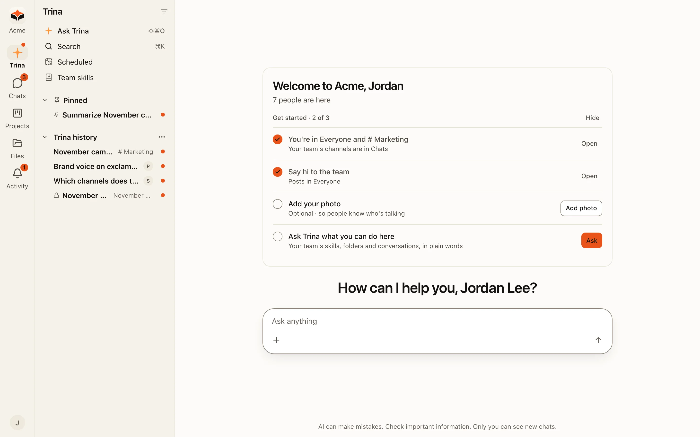

:::note
まず見てみたい場合は、[登録なしで1分お試し](https://demo.trina.app)。

まず試してみたい場合は、[ローカルデモ](get-started/quickstart.md)を動かしてください。AI のアカウントは必要ありません。
:::

Trina AX は会社のための AI ワークスペースです。Claude Code をサーバーに一度設定すれば、全員がブラウザーから使えます。

| | 内容 |
|---|---|
| **サーバーは 1 台** | Claude Code と Codex は、各自のノートパソコンではなく会社のサーバーで動きます。 |
| **チームのファイル** | AI はチームのフォルダー（`shared/`、`groups/`、`projects/`、個人フォルダー）をもとに作業します。 |
| **チームのスキル** | `SKILL.md` ファイル 1 つで、チームの仕事の進め方を繰り返し使える指示にできます。 |
| **権限** | AI が開くファイルはすべて、依頼した本人の権限でサーバーが確認します。 |

---

## 仕事で Trina AX を使う

開発者でない方は、ここから始めてください。各ページに、押すボタンの名前どおりの番号つき手順と、画面の画像があります。

:::cards cols=2
- icon=message-square | [チャットとプロジェクト](use/chats-and-projects.md) | AI に質問し、チャットを Google Drive のファイルのように共有し、1 つの仕事をプロジェクトにまとめます。
- icon=folder-lock | [ファイルと権限](use/files-and-permissions.md) | ファイルやフォルダーを共有し、一部のフォルダーを少ない人だけのものにします。
- icon=bell | [設定と検索](use/settings-and-search.md) | プロフィール、言語、通知、そして ⌘K の検索。
- icon=clock | [定期タスク](use/scheduled-tasks.md) | 毎週月曜日の同じ作業を、数回のクリックで AI に任せます。
:::

## 新しい開発者におすすめの進め方

:::steps
#### デモを動かす
架空のチームを自分のパソコンで起動します。10 分ほどで終わります。[クイックスタートへ](get-started/quickstart.md)。

#### 用語を知る
チーム、グループ、フォルダー、スキル、エンジン、MCP を 1 ページで説明しています。[基本概念を読む](get-started/key-concepts.md)。

#### 全体の仕組みを知る
サーバー、Web アプリ、エンジン、権限チェックの関係です。[アーキテクチャを読む](../develop/architecture.md)（英語）。

#### 最初の変更をする
開発サーバーを用意し、チェックを実行して、プルリクエストを出します。[ローカル開発ガイドを読む](../develop/local-development.md)（英語）。

#### チームで使えるようにする
ホスティング、Linux サーバー、社内の Mac から選びます。[構成を比べる](../operate/install.md)（英語）。
:::

---

## Trina AX で開発する

:::cards cols=3
- icon=code | [開発者ガイド（英語）](../develop/architecture.md) | アーキテクチャ、リポジトリの構成、テスト、決まりごと。
- icon=bot | [AI エージェント向け（英語）](../agents/overview.md) | コーディングエージェントのルールと、Trina AX の中での AI の動き方。
- icon=braces | [HTTP API（英語）](../reference/http-api.md) | すべてのエンドポイントを分野ごとに、呼び出せる人と一緒に載せています。
:::

## 主な機能

:::cards cols=2
- icon=folder-lock | [ファイルと権限](use/files-and-permissions.md) | 一人ひとりとその人の AI には、開いてよいフォルダーだけが見えます。
- icon=book-open | [チームスキル](use/team-skills.md) | 繰り返し使える指示を、ファイルと同じように管理します。
- icon=plug | [MCP 接続](use/mcp.md) | AI に Notion や Linear などのサービスを使わせます。
- icon=clock | [定期タスク](use/scheduled-tasks.md) | 一度頼めば、AI が同じ作業を繰り返します。
:::

## サポート

:::cards cols=2
- icon=life-buoy | [サポート（英語）](../resources/support.md) | 質問、不具合の報告、セキュリティの報告の窓口です。
- icon=wrench | [トラブルシューティング（英語）](../operate/troubleshooting.md) | よくある問題を症状ごとにまとめた解決方法です。
:::
