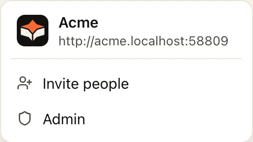
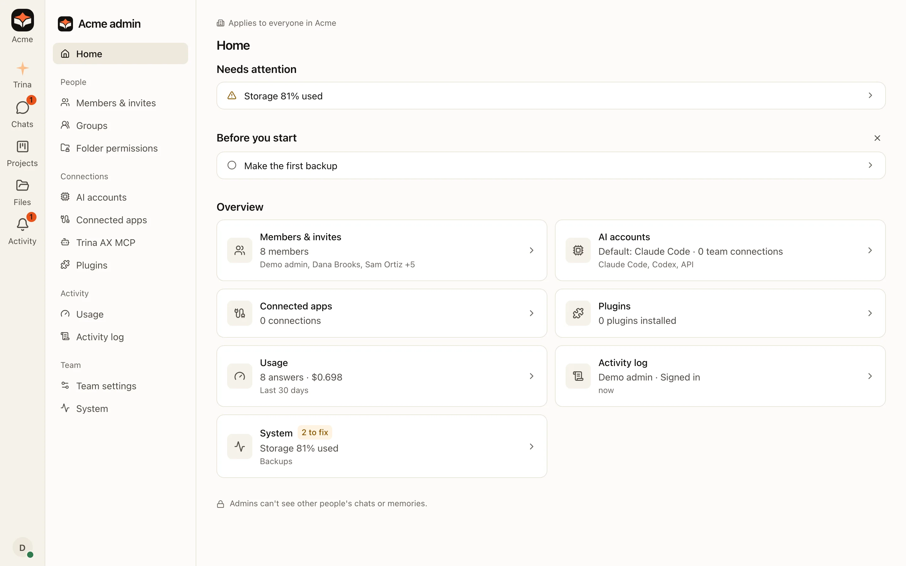
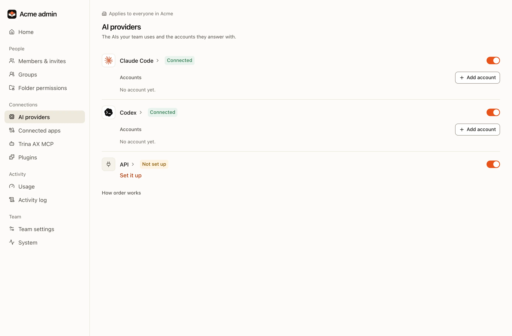
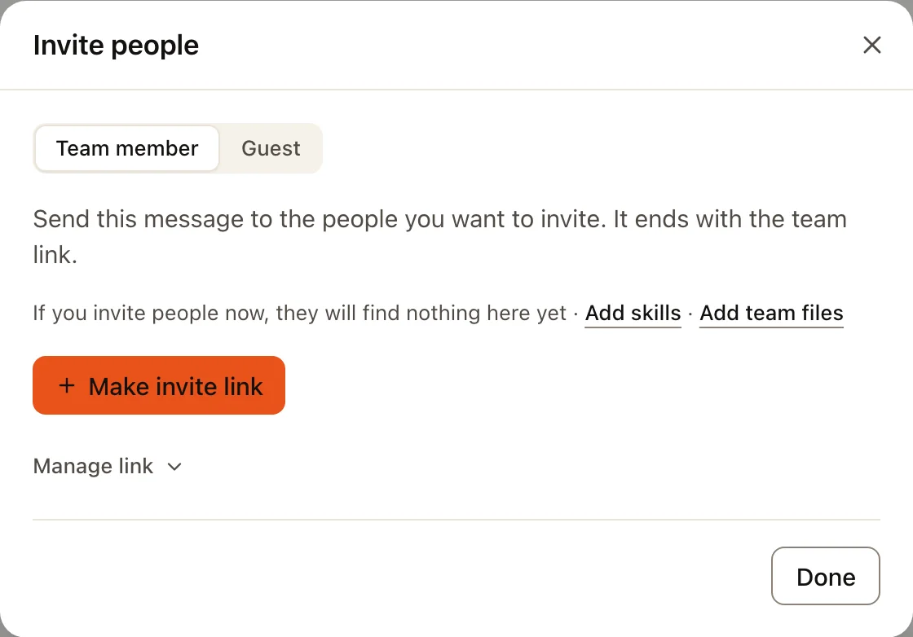
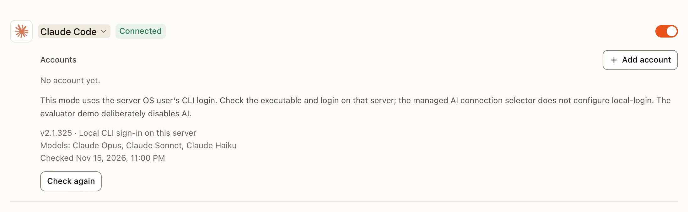
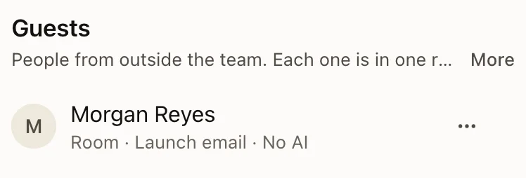
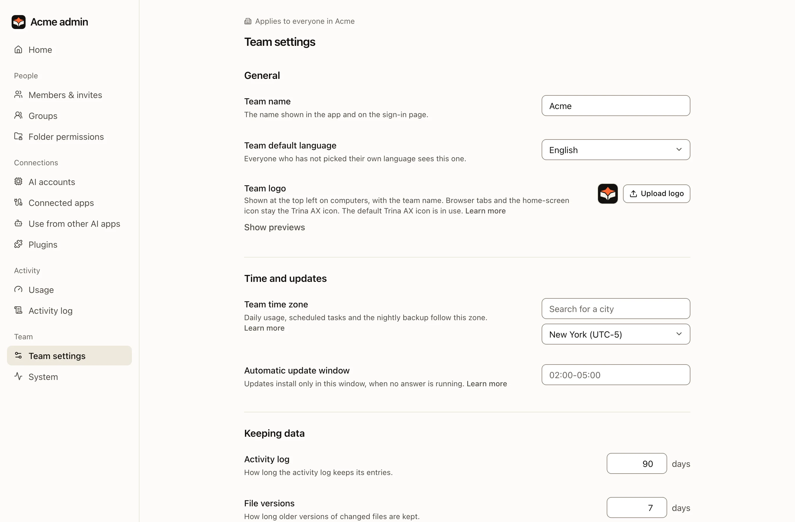
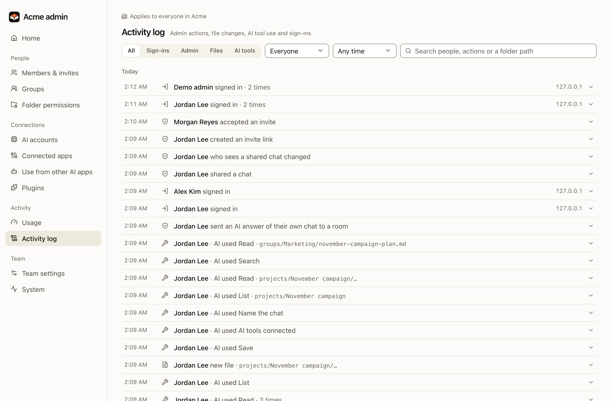
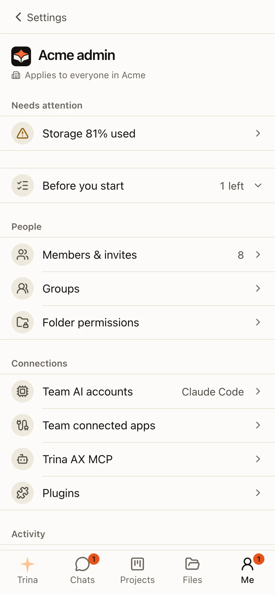

**管理** はオーナーと管理者のための画面です。ここにあるページはすべてチーム全体のためのものです。メニューのタイトルにはチームの名前とロゴ（「Acmeの管理」）が表示され、各ページのタイトルの上には「Acmeの全員に適用されます」と表示されます。自分の設定は **設定** に残り、ページの名前も同じです。管理 › 連携サービスはチームの接続で、あなた自身の接続は **設定 › コネクター** にあります。

パソコンで管理を開くには：

1. 左のバーの上にあるチームのロゴを選びます。チームメニューが開き、チームのアドレス、**チームメンバーを招待**、
   **管理**、**別のチームに切り替え** が表示されます。（メンバーには、アドレスと **別のチームに切り替え** だけが表示されます。）
2. **管理** を選びます。最初に開くのは **ホーム** で、まず対応が必要なことが一覧になっています。

⌘K（Windows では Ctrl+K）で「管理」と入力しても見つかります。スマートフォンでは **自分** タブを開き、**管理** を選びます。

オーナーには、ホームにまだ終わっていない最初の設定手順も表示されます。AI の接続の確認、フォルダーの権限の設定、チームの招待、チームスキルの準備、最初のバックアップです。終わった手順は一覧から消えます。

## 管理メニュー

| グループ | ページ |
|---|---|
| **メンバー** | メンバーと招待、グループ、フォルダーの権限 |
| **接続** | AIプロバイダー、連携サービス（Google アプリ、[Slack](slack.md)、Notion などのほかのサービス）、Trina AX MCP、プラグイン |
| **アクティビティ** | 使用量、操作ログ |
| **チーム** | チーム設定、システム |

**メンバーと招待** にはゲストも表示されます。ゲストとは、最大で 1 つのプライベートチャンネルかグループトークと 1 つのプロジェクトに参加しているチーム外の人です。[ゲストについて読む](guests.md)。

:::note
以前のバージョンでは、AI アカウントは **AI engines** の隣にある専用の **AI connections** ページにありました。今はどちらも 1 つの **AIプロバイダー** ページになっており（しばらく **AI accounts** という名前でした）、古いアドレスを開くとこのページが開きます。チームの AI の設定（既定値、エンジンを選べる人、メンバー自身のアカウント、使用量の上限）は **チーム設定** にあります。**Slack** にも専用のメニュー項目がありましたが、今は **連携サービス** の 1 行になっていて、古いアドレスを開くとそこが開きます。
:::

Google Workspace を使う会社では、Google アプリのログインに会社独自の Google アプリを使えます。設定は 5 つのアプリ全体で 1 回だけです。[会社独自の Google アプリを使う](google-own-app.md)。

## 最初の 1 週間

:::steps
#### 権限を設定する
フォルダーをグループに割り当て、2 つのテスト用アカウントでアクセスを確かめます。[権限について読む](files-and-permissions.md)。

#### AI をつなぐ
**AIプロバイダー** で、オーナーまたは管理者が Claude Code か Codex の行の **アカウントを追加** を選び、利用が認められた Claude または OpenAI のアカウントをつなぎます。各行に、そのエンジンが使える状態かどうかが表示されます。

#### チームを招待する
まず少人数の試験グループから始め、役割とフォルダーへのアクセスを確かめます。

1. チームのロゴを選び、**チームメンバーを招待** を選びます。
2. **チームメンバー** のまま（**ゲスト** はチームの外の人用です）、**招待リンクを作成** を選びます。
3. **メッセージをコピー** を選び、Slack、Teams、メールに貼り付けます。メッセージの最後にリンクが入っています。
   リンクを開いた人は、アカウントを作ってチームに参加します。

**メンバーと招待** には、チームの [ゲスト](#ゲスト) も表示されます。一覧の下の **招待リンク** には、まだ使えるリンクだけが表示されます。チームの招待リンクと、まだ誰も使っていない招待リンクです。使用済みや期限切れのリンク、プライベートチャンネル、グループトークやプロジェクトがなくなったゲスト用のリンクは一覧から消えます。誰が参加したかは、メンバーの一覧と [操作ログ](#操作ログ) で確認できます。

#### 最初のスキルを追加する
スターター用のスキルをコピーし、その結果を元の資料と照らし合わせて確かめます。[スキルについて読む](team-skills.md)。

#### 最初のバックアップを取る
バックアップを取り、IT 担当者と一緒に復元を練習します。[バックアップについて読む](../../operate/backups.md)（英語）。
:::

## 管理者にできないこと

- 他の人のチャットを読むこと。操作ログには AI が読んだファイルは表示されますが、会話は表示されません。
- `users/<id>/` にある個人フォルダーや個人スキルを見ること。
- ルールで名前が挙がっていない限り、チームの MCP 接続を使うこと。

:::warning
サーバー、その OS、ストレージを運用する人は、保存されたファイルやチャットを読めます。ホスト型のプランでは、Trina の運用担当者もこれに含まれます。
:::

## AIプロバイダー

接続グループの最初にある **管理 › AIプロバイダー** には、エンジン（Claude Code、Codex、API）ごとに 1 行があり、ロゴ、状態、オン/オフのスイッチが表示されます。問題があるときは、名前の下に直し方が 1 行で表示されます。Claude Code と Codex の下には、チームが回答に使うアカウントが、試す順に並びます。それぞれにロゴ、プラン、状態が表示され、オーナーと管理者には **アカウントを追加** があります。上にある使えるアカウントから使い、拒否されたり上限に達したりすると次のアカウントに切り替えます。順番を変えるには、オーナーと管理者がアカウントの左にあるつまみ（⠿）をドラッグします。パソコンでもスマートフォンでもできます。キーボードでは、Tab でつまみに移動し、スペースで持ち上げ、矢印キーで動かし、スペースで置きます。Esc で取り消します。

エンジンの名前をクリックすると詳細が開きます。ログインの方法、すべてのモデル、最後に確認した日時、**再確認**、そしてオーナーと管理者には API エンジンのフォームです。アカウントの名前をクリックすると、使う人、今月の使用量、最後に使われた日時が表示されます。アカウントの **⋯** メニューには、再確認、上に移動 / 下に移動、名前の変更、置き換え、オフ、削除があります。

## ゲスト

**管理 › メンバーと招待** の最後は **ゲスト** です。チームの外の人で、それぞれ最大で 1 つのプライベートチャンネルかグループトークと 1 つのプロジェクトにいて、席を使いません。各行に、ゲストのいる場所と使える AI が表示されます。**⋯** メニューには **AIを変更**（AI なし、本人のアカウントでサインイン、または月の上限付きのチームの AI アカウント）、**チームメンバーにする**、**ゲストを外す** があります。メンバーはプライベートチャンネル、グループトークやプロジェクトから自分でゲストを招待します（[ゲスト](chats-and-projects.md#ゲスト)）。オーナーと管理者は、ここで **チームに招待** › **ゲスト** を選び、プライベートチャンネル、グループトークかプロジェクトを 1 つ選ぶこともできます（[ゲスト：管理から招待する](guests.md#管理から招待する)）。ゲストのいないチームには **ゲスト** の欄はありません。確かめるには、役割の一覧で **ゲスト** を選びます。

## 連携サービス

**管理 › 連携サービス** には、チームの接続が **接続済み** に、追加できるサービスが **見つける** に表示されます。各行にアプリの状態（たとえば **オン**、**接続中**、**要確認**）が表示され、行のどこを選んでもアプリのページが開き、そこにも同じ状態が表示されます。ブラウザーのウィンドウが開くアプリ（Google アプリ、サービスのログイン、**Slackに追加**）の接続は、いつでもやめられます。待っている間は **再試行** と **キャンセル** があり、ウィンドウが閉じられていれば 5 分で待機は自動的に終わります。Slack には専用のガイドがあります：[Slack](slack.md)。

## チームの AI の設定

**管理 › チーム設定** の最後に、チームの AI の設定があります。

| グループ | 内容 |
|---|---|
| **AIの既定値** | 既定のエンジンとモデル、同時に進められる回答の数。 |
| **エンジンを選べる人** | メンバーが別のエンジンを選べるかどうか、Claude が上限に達したときに Codex に切り替えるかどうか。 |
| **メンバー自身のアカウント** | メンバーが自分のアカウントを追加できるかどうか、サブスクリプションを共有できるかどうか、メンバーが追加したアカウント。 |
| **使用量の上限** | 個人、グループ、チームごとの、1 日または 1 か月のトークンまたはドルの上限。 |

キャンセルと保存は、そのグループで何かを変更したときにだけ表示されます。グループごとに別々に保存されます。

:::note
0.4.0 からです。0.3.0 以前では、これらとエンジンはすべて 1 つの **AI engines** ページにあります。
:::

## 操作ログ

**管理 › 操作ログ** には、ログイン、管理者の操作、ファイルの変更、AI のツールの使用が日ごとにまとめて表示されます。スクロールしてもフィルターは上部に残ります。チャットの内容が表示されることはありません。

## システム

**管理 › システム** には、チームのストレージ、バージョンと更新、サーバーの状態、チームからサーバーへの接続方法、接続したフォルダー、バックアップとエクスポートが、シンプルな項目に分けて表示されます。ストレージでは、トークで送られたファイルが **トークのファイル** として別の 1 行に表示されます。チーム全体で 1 つの数字で、人ごと・トークごとには分けません。削除したチャットとトークのファイルは **チームのファイル** に数えられます（「チームのファイルには、削除したチャットとトークのファイル 120 MB が含まれます。30日後に削除されます」）。元に戻せるよう 30 日間保管されるためです。ディスクが 80% まで埋まったとき、さらに 95% になったとき、オーナーと管理者の **アクティビティ** に通知が残り（それぞれ 1 日 1 回まで）、開くとこのカードが表示されます。トークで送ったファイルが入りきらないときは、メンバーとゲストには空き容量が足りないので管理者に頼むよう表示され（**自分が送ったファイルを見る** 付き）、オーナーと管理者には **何が容量を使っているか見る** が表示されます。項目の下の **整理を依頼する** を押すと、トークで送ったファイルが最も多くの容量を使っている人に、不要になったファイルの削除を依頼する通知が届きます（1 日 1 回。誰に届いたかは表示されません）。状態の欄には、エンジンがない、確認に失敗した、自動更新がオフになっているなど、対応が必要なことが先に並びます。問題のなかった確認は **詳細を表示** 付きの 1 行にまとまります。オーナーではない管理者には、プラン、ストレージ、そしてオフィスの Mac では自動更新が表示されます。小さなディスクがいっぱいにならないよう、バックアップには自動で作り直されるフォルダーを含めず、14 日間誰も使わなかったキャッシュは消去されます。あなた自身のファイルに手が加えられることはありません。実行中のタスクが終わるのを待ってから更新する場合は、システムにそう表示され、**待ってから更新** または **今すぐ更新する** を選べます。

ヘルスチェックの下の **再起動…** は、パスワードの確認のあと **AIのみ**（回答が出てこない、AIが止まったとき。10秒ほど）または **Trina AX全体**（画面が固まる、遅いとき。30秒ほど全員の接続が切れます）を再起動します。**回答が終わったら再起動** は実行中の回答が終わるのを最長10分待ち、件数だけを表示します（誰の回答かは表示しません）。待っている間は **今すぐ** と **やめる** を選べます。**今すぐ再起動** を選べるのはオーナーだけで、オーナーではない管理者にはヘルスチェックの下にこの行だけが表示されます。更新やバックアップの実行中、復元の準備ができているときは再起動できず、1時間に5回までです。再起動はアクティビティログに記録されます。サーバーが何度も応答しなくなり、自動では再起動しなくなったときは、この行でお知らせします。

誰も開けなくなったトーク（グループトークから全員が退出した、またはグループが削除された）で送ったファイルは、トークが閉じてから30日後にディスクから削除されます。メッセージは残りますが、誰も読めません。
