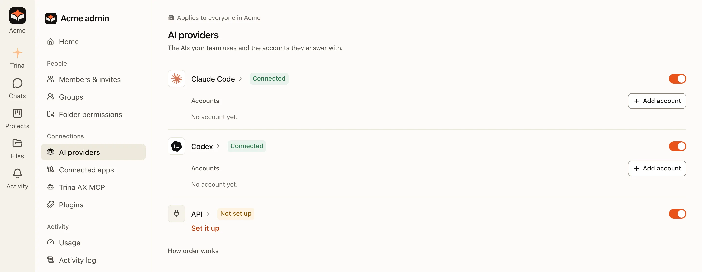
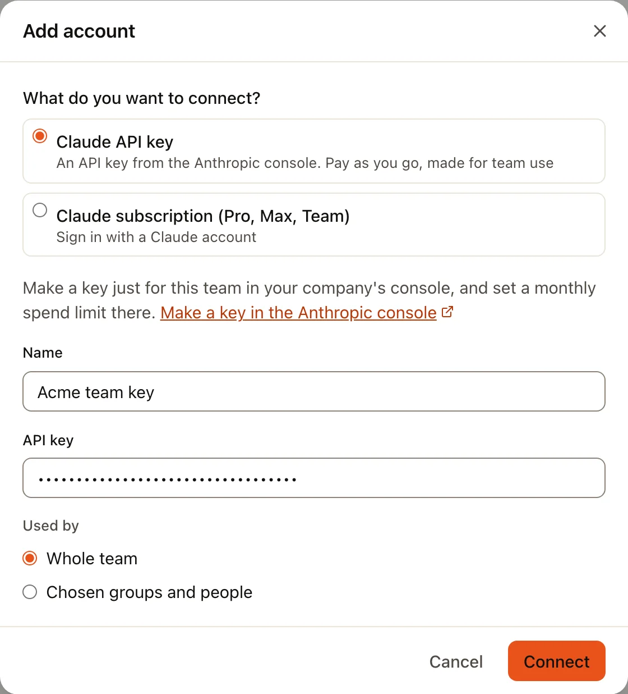
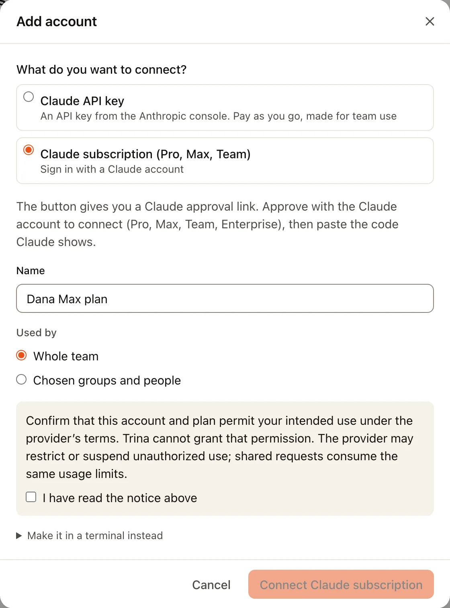
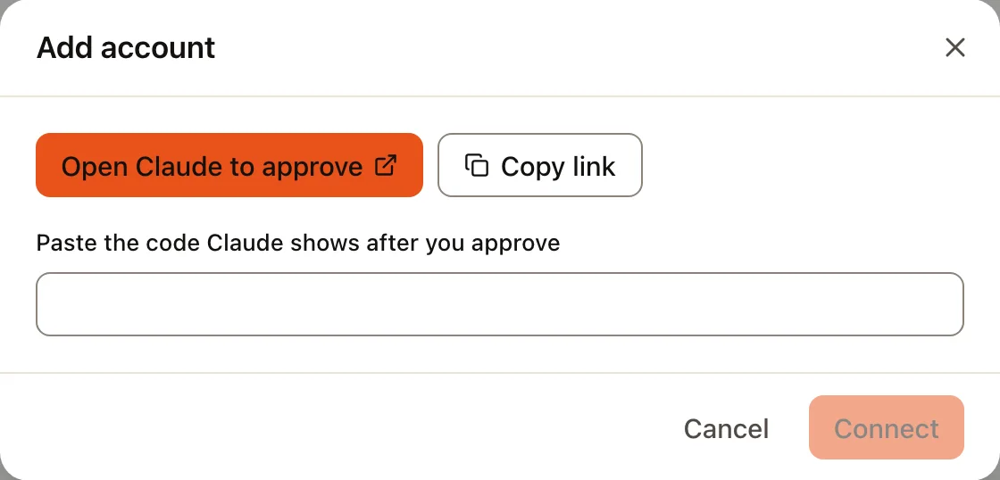
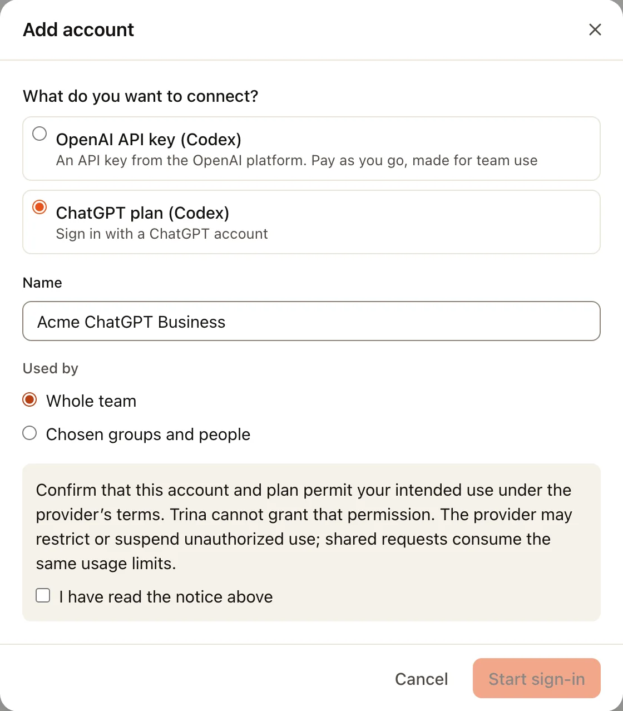
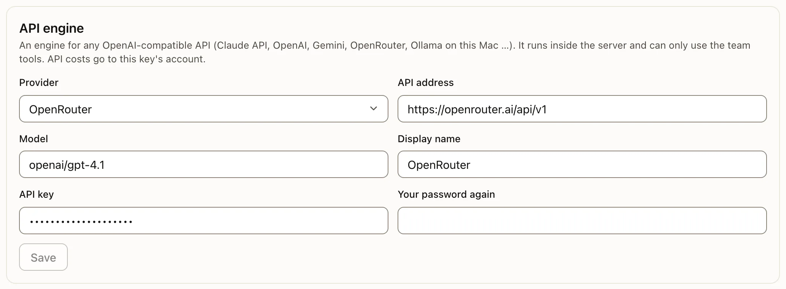
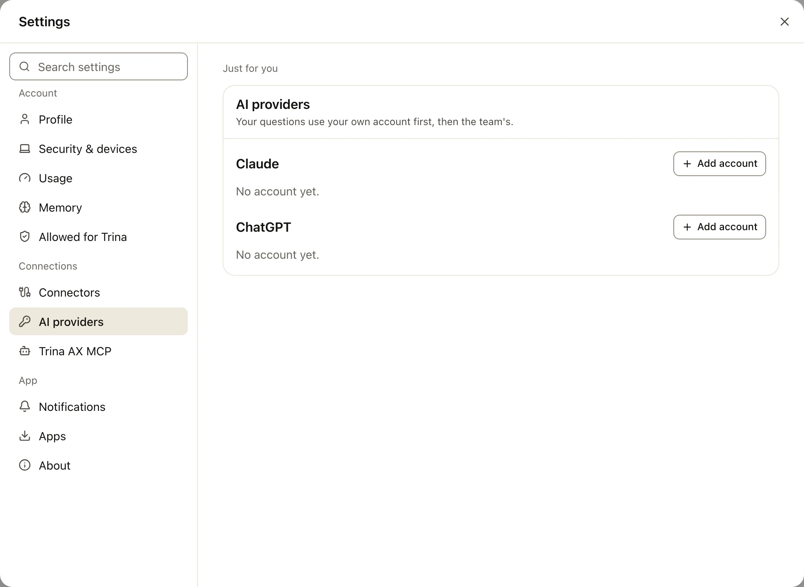

Trina AX は、チームがつないだ AI アカウント（Claude や ChatGPT のアカウント、または API キー）で回答します。AI の利用料は Trina AX に含まれていません。つないだアカウントやキーには、Anthropic、OpenAI などの AI 会社が、その会社の規約に沿って料金を請求します。

チームのアカウントは、オーナーまたは管理者が **管理 › AIプロバイダー** でつなぎます。チームが許可している場合は、各自も **設定 › AIプロバイダー** で自分のアカウントを追加できます。自分の質問には、まずそのアカウントが使われます。

## どれを選ぶか

| Trina AX での選択肢 | 必要なもの | 請求元 | 向いている使い方 |
|---|---|---|---|
| **Claude APIキー** | Claude Console で作る API キー | Anthropic（使った分だけ） | チームで使う。月の上限は Anthropic 側で設定 |
| **Claudeサブスクリプション（Pro、Max、Team）** | 有料プランの Claude アカウント | Anthropic（あなたのプラン） | 1 人が自分のアカウントで使う |
| **OpenAI APIキー（Codex）** | OpenAI platform で作る API キー | OpenAI（使った分だけ） | OpenAI を使うチーム |
| **ChatGPTプラン（Codex）** | 有料プランの ChatGPT アカウント | OpenAI（あなたのプラン） | 1 人が自分のアカウントで使う |
| **APIエンジン** | OpenAI 互換のサービスのアドレス、モデル、キー | そのサービス | OpenRouter、Gemini、または自分のコンピューター上のモデル |

:::warning
サブスクリプション（Claude または ChatGPT）は、契約した本人が使うためのものです。他の人のためにつなぐ前に、提供元の規約で認められているか確認してください。ダイアログでは **上の案内を読みました** にチェックするよう求められます。チームで使うなら、API キーのほうが安全です。
:::

## Claude API キーを追加する

:::tip
**必要なもの**

- **APIキー**：`sk-` で始まる長いコードです。[Claude Console](https://platform.claude.com/settings/keys) で作ります。
- **名前**：「Acme チームキー」など、チームでわかる名前なら何でもかまいません。
:::

:::steps
#### Anthropic でキーを作る
会社のアカウントで [Claude Console](https://platform.claude.com/settings/keys) にログインします。**API keys** を開き、**Create Key** を選びます。「Trina AX」などの名前を付けてキーをコピーします。キーは一度しか表示されません。ついでに **Limits** で組織の月の利用上限も設定しておきます。詳しくは Anthropic の [API キーガイド](https://docs.claude.com/en/api/admin-api/apikeys/get-api-key) を見てください。

#### アカウントの追加を開く
Trina AX で **管理 › AIプロバイダー** を開きます。**Claude Code** の行で **アカウントを追加** を選び、**Claude APIキー** を選びます。ダイアログには Claude Console へのリンク（**Anthropicコンソールでキーを作成**）もあります。

#### 貼り付けて接続する
**名前** を入力し、**APIキー** にキーを貼り付けます。**利用者** は **チーム全体** のままにするか、**選択したグループと個人** を選びます。**接続** を選ぶと、Trina AX が Anthropic にキーを確認し、アカウントに **稼働中** と表示されます。

:::

## Claude サブスクリプションを追加する

:::tip
**必要なもの**

- Pro、Max、Team、Enterprise のいずれかのプランの **Claude アカウント**（ブラウザーでログインしておきます）。
- コンソールからコピーするものはありません。承認すると Claude が **コード** を表示するので、それを貼り付けます。
:::

:::steps
#### アカウントの追加を開く
**管理 › AIプロバイダー**（自分用なら **設定 › AIプロバイダー**）で、Claude の下の **アカウントを追加** を選び、**Claudeサブスクリプション（Pro、Max、Team）** を選びます。**名前** を入力し、使う人を選び、案内を読んで **上の案内を読みました** にチェックします。

チーム用（管理）では、オーナーが **管理 › チーム設定** の **メンバー自身のアカウント** で **サブスクリプションの共有を許可** をオンにするまで、サブスクリプションは選べません。それまでは画面に「サブスクリプションの共有はオフです。」と表示されます。

#### Claude で承認する
1. **Claudeサブスクリプションを接続** を選びます。数秒後に、**Claudeを開いて承認**、**リンクをコピー** と空の欄が
   表示されます。
2. **Claudeを開いて承認** を選びます。新しいタブで Claude 自身のページが開きます。（別のブラウザーで Claude に
   ログインしているときは、代わりに **リンクをコピー** を選び、そのブラウザーでリンクを開きます。）
3. Claude のページで、求められたらログインし、意図したアカウントが表示されていることを確かめて承認します。
   Claude がコードを表示します。

#### コードを貼り付ける
1. Claude のページで、コピーボタンを使ってコードを全部コピーします（途中に `#` が入っています）。
2. Trina AX のタブに戻り、**承認後にClaudeが表示するコードを貼り付けてください** の欄に貼り付けて、**接続** を
   選びます。
3. Trina AX に **接続しました · Claudeサブスクリプション** と表示され、Claude Code の行にアカウントが表示されます。
:::

Claude のパスワードが Trina AX に届くことはありません。ログインは Claude 自身のページで行い、Trina AX は Claude が発行したアクセス権だけを保存します。

案内の下にある **ターミナルで作成する** は、Claude Code をインストールしている人向けの別の方法です。ターミナルで `claude setup-token` を実行し、開いたブラウザーで承認して、表示されたトークン全体（どの行かはターミナルに表示されます）を **トークン** に貼り付けます。有効期間は 1 年です。

## OpenAI API キーを追加する

:::tip
**必要なもの**

- **APIキー**：`sk-` で始まります。[OpenAI platform](https://platform.openai.com/api-keys) で作ります。
:::

:::steps
#### OpenAI でキーを作る
[OpenAI platform](https://platform.openai.com/api-keys) にログインし、**API keys** を開いて **Create new secret key** を選びます。キーが属するプロジェクトを選んでキーをコピーします。キーは一度しか表示されません。そのプロジェクトの予算を **Limits** で設定しておきます。

#### Trina AX に貼り付ける
**管理 › AIプロバイダー** の **Codex** の行で **アカウントを追加** を選び、**OpenAI APIキー（Codex）** を選びます。**名前** を入力し、**APIキー** にキーを貼り付け、使う人を選んで **接続** を選びます。
:::

## ChatGPT プランを追加する

:::tip
**必要なもの**

- 有料プランの **ChatGPT アカウント**。コンソールからコピーするものはありません。Trina AX が表示するアドレスとコードを OpenAI 側で入力します。
:::

:::steps
#### ログインを始める
**管理 › AIプロバイダー** の **Codex** の行で **アカウントを追加** を選び、**ChatGPTプラン（Codex）** を選びます。**名前** を入力し、使う人を選び、**上の案内を読みました** にチェックして **ログインを開始** を選びます。

#### OpenAI でコードを入力する
1. Trina AX に **ChatGPTのログインページを開いてください** と、**このコードを入力してください（15分以内）** の下に
   `WXYZ-12AB3` のような短いコードがコピーボタンつきで表示されます。
2. ページを開きます。OpenAI で ChatGPT アカウントにログインします。
3. そこにコードを入力するか貼り付けて、承認します。Trina AX のタブは開いたままにしてください。自動で次に進みます。

#### 完了
Trina AX にプラン名とともに **接続済み · ChatGPT** と表示されます。意図と違うアカウントでログインしてしまったときは、chatgpt.com でログアウトしてから **やり直す** を選びます。
:::

## APIエンジン

API エンジンは、OpenAI 互換の API を提供するサービスなら何とでもやり取りできます。まだ **試験機能** の扱いで、回答、ツール、費用が Claude Code や Codex と異なる場合があります。

:::tip
**必要なもの**

- **プロバイダー**：選ぶと、Trina AX がその **APIアドレス** と **モデル** を入力します。
- **モデル**：その提供元でのモデルの正確な名前です。
- **APIキー**：提供元のキーのページで作ります。
- **パスワードを再入力**：確認のため、あなた自身の Trina AX のパスワードを入力します。
:::

| プロバイダー | APIアドレス | キーを作る場所 |
|---|---|---|
| OpenAI | `https://api.openai.com/v1` | [platform.openai.com/api-keys](https://platform.openai.com/api-keys) |
| Claude API (Anthropic) | `https://api.anthropic.com/v1` | [platform.claude.com/settings/keys](https://platform.claude.com/settings/keys) |
| Google Gemini | `https://generativelanguage.googleapis.com/v1beta/openai` | [aistudio.google.com/apikey](https://aistudio.google.com/apikey) |
| OpenRouter | `https://openrouter.ai/api/v1` | [openrouter.ai/settings/keys](https://openrouter.ai/settings/keys) |
| Ollama（サーバーのコンピューター） | `http://127.0.0.1:11434/v1` | キーは不要：サーバーと同じコンピューターで動くモデル。このアドレスを設定できるのはオーナーだけです |

:::steps
#### API の行を開く
**管理 › AIプロバイダー** で、**API** の下の **設定する** を選びます。

#### フォームに入力する
**プロバイダー** を選び、**モデル** を確認し、**表示名** を付け、**APIキー** を貼り付けて **パスワードを再入力** にパスワードを入力します。**保存** を選びます。

:::

## 自分のアカウント

管理者が **メンバーによる個人AI接続の追加を許可** をオンにすると（**管理 › チーム設定** の **メンバー自身のアカウント**）、全員に **設定 › AIプロバイダー** が表示されます。「あなたの質問には、まず自分のアカウントが使われ、次にチームのアカウントが使われます。」**Claude** または **ChatGPT** の下の **アカウントを追加** を選び、上と同じ手順で進めます。そのアカウントを使うのはあなた自身の質問だけです。管理者は使うこともキーを見ることもできません。

## 音声入力

音声入力は、OpenRouter を通して話した言葉を文字にします。自分たちのサーバーでは、管理者が **管理 › チーム設定** の **音声入力** に **OpenRouter APIキー** を追加します。キーは [openrouter.ai/keys](https://openrouter.ai/keys) で作ります。

## 困ったとき

| 表示 | 対処 |
|---|---|
| **この種類のAPIキーではありません。** | 別の種類のキー（Claude の欄に OpenAI のキー、またはその逆）か、空白付きでコピーされています。もう一度コピーしてください。 |
| **コード全体を貼り付けてください（途中に#が入っています）。** | Claude のコードの一部が欠けています。Claude のコピーボタンでもう一度コピーしてください。 |
| **そのコードは使えませんでした。最初からやり直し、承認して新しいコードを貼り付けてください。** | コードがすでに使われたか、古くなっています。もう一度 **Claudeサブスクリプションを接続** を選んでください。 |
| **制限時間を過ぎました。**（ChatGPT） | コードの有効時間は 15 分です。**やり直す** を選んでください。 |
| **接続は安全な通信（https）でのみ追加できます。** | Trina AX を `https://` のアドレスで開いてください。 |
| アカウントに **拒否されました** または **再接続が必要** と表示される | キーが取り消されたか、ログインが切れています。アカウントの **⋯** メニューから **トークンまたはキーを置換** または **再接続** を選んでください。 |
| アカウントに **月間上限を使い切りました** と表示される | **⋯** › **月間上限** で設定した上限に達しました。上限を上げるか、翌月まで待ってください。 |

アカウントが使われる順番、上限、エンジンについて詳しくは、[管理](admin.md#aiプロバイダー) と [使用量と上限](usage-and-limits.md) を見てください。
