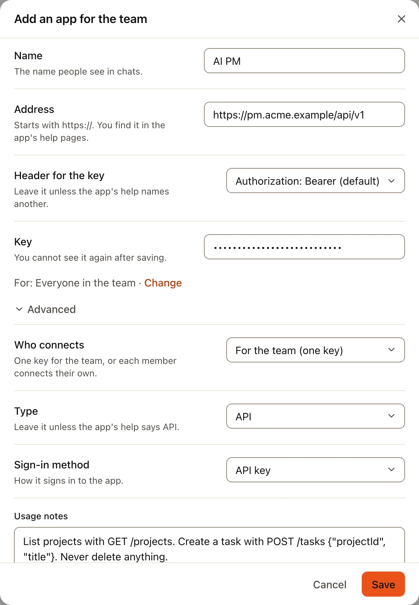
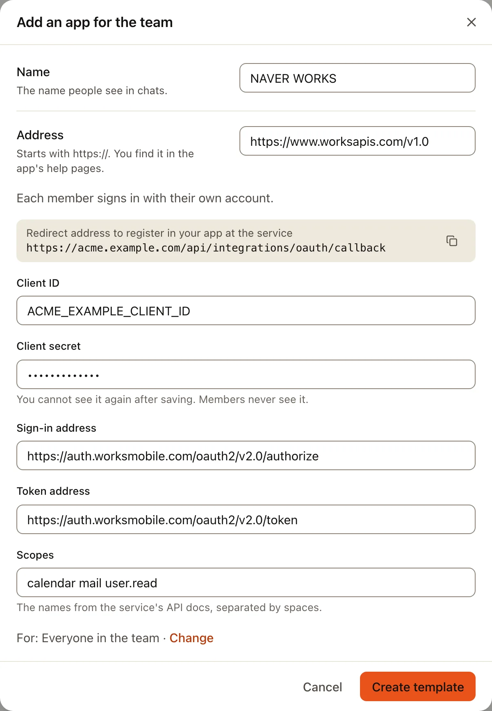

会社には独自のシステム（プロジェクト管理、受注システム、社内ツールなど）があるかもしれません。Web API があれば、AI はそれを使えます。オーナーまたは管理者が **管理 › 連携サービス** で、アドレス、キー、使い方の短いメモを付けて 1 回追加します。AI が呼び出せるのは、そのアドレスの下にあるアドレスだけです。

NAVER WORKS のように、キーを発行しないサービスもあります。その場合は、会社がそのサービスで作ったログイン用アプリを通して、各自がログインします。それが[このページの後半](#自分のアプリでログインする)です。

下の値については、そのシステムをよく知っている人（管理者や開発者）が必要です。コードは一切必要ありません。

## キーで API をつなぐ

:::tip
**必要なもの**

- **アドレス**：API のベースアドレス（`https://pm.acme.example/api/v1` など）。システムの管理者に聞くか、API のドキュメント（「base URL」）を見ます。
- **キー**：そのシステムの API キーまたはトークン。Trina AX 専用のキーを、AI に必要な分だけの権限で作ります。
- **キーを送るヘッダー**：ほとんどの API は `Authorization: Bearer <key>` を受け付けます。API のドキュメントに `X-API-Key` など別のヘッダーが書かれていれば、その正確な名前を控えておきます。
- **使用上の注意**：AI が呼び出すべきアドレスについての短いメモ。システムの API ドキュメントに載っています。
:::

:::steps
#### ダイアログを開く
1. 左のバーの上にあるチームのロゴを選び、**管理 › 連携サービス** を選びます。
2. **見つける** の最後までスクロールします。一覧の下の「一覧にありませんか？」の横にある **アドレスで追加** を選びます。
   **チームのサービスを追加** のダイアログが開きます。
3. ダイアログの下のほうにある **詳細設定**（折りたたまれています）を開きます。**種類** を **API** に、**ログイン方法** を
   **APIキー** にします。ダイアログに次の欄が表示されます。

#### 欄に入力する
- **名前**：チャットで表示される名前（「AI PM」など）。
- **アドレス**：ベースアドレス。AI はその下のパスしか呼び出せません。
- **キーを送るヘッダー**：**Authorization: Bearer（既定）** のままにするか、**別のヘッダー** を選んで、ドキュメントのとおりに **ヘッダー名** を正確に入力します。
- **キー**：キーを貼り付けます。
- **使用上の注意**：主なパス、それに必要な値、AI がしてはいけないこと。4,000 文字まで入力できます。



#### 使える人を選んで保存する
**使える人: チーム全員 · 変更** で、グループや個人を選びます。**書き込み・削除・送信** は、最初は **毎回確認** のままにしておきます。**保存** を選ぶと、Trina AX がアドレスとキーを確認し、行に **接続済み** と表示されます。
:::

よい使用上の注意は、たとえば次のようなものです。

```
List projects with GET /projects.
Create a task with POST /tasks and a JSON body {"projectId", "title", "dueDate"}.
Dates are YYYY-MM-DD. Never call DELETE.
```

AI は API を使うたびにこのメモを読むので、短く正確に書いてください。

## 自分のアプリでログインする

ログイン（OAuth）はできても、サービスに登録したアプリを通してしかログインできないサービスがあります。NAVER WORKS と、Google 自身の MCP サーバーです。そのサービスの開発者コンソールでアプリを 1 回作り、その値を Trina AX に貼り付けます。ふつうは **テンプレート** として追加し、各メンバーが自分のアカウントでログインするようにします。

:::tip
**サービスの開発者コンソールから用意するもの**

- そこで作ったアプリの **クライアントID** と **クライアントシークレット**。
- **ログインアドレス** と **トークンアドレス**（API の場合。MCP サーバーは自分で見つけます）。
- **スコープ**：AI に必要な権限。空白で区切ります。

**サービスに渡すもの**

- Trina AX が表示する **リダイレクトアドレス**：`https://<your team address>/api/integrations/oauth/callback`。
:::

:::steps
#### 先に Trina AX でダイアログを開く
1. **管理 › 連携サービス** で **アドレスで追加**（**見つける** の一覧の下）を選びます。
2. **詳細設定** を開きます。**接続する人** を **メンバーごとに各自** に、**種類** を **API**（または **MCPサーバー**）に、
   **ログイン方法** を **ログイン（OAuth）** にします。MCP サーバーの場合は **自分のアプリでログイン** もオンにします。
3. ダイアログに、コピーボタン付きで **サービスのアプリ設定に登録するリダイレクトアドレス** が表示されます。文字を選択するのではなく、
   そのボタンでコピーし、ダイアログは開いたままにしておきます。

#### サービスでアプリを作る
サービスの開発者コンソールでアプリを作ります（「OAuth app」「client」「integration」などと呼ばれます）。リダイレクト URL の欄にリダイレクトアドレスを貼り付け、スコープを選び、**クライアントID** と **クライアントシークレット** をコピーします。

#### 残りを入力して保存する
Trina AX に戻り、**名前**、**アドレス**、**クライアントID**、**クライアントシークレット**、**ログインアドレス** と **トークンアドレス**（API の場合）、**スコープ** を入力します。**テンプレートを作成** を選びます。メンバーには **設定 › コネクター** に表示され、各自が自分のアカウントでログインします。


:::

### NAVER WORKS

| Trina AX の欄 | 値 |
|---|---|
| **種類** | **API** |
| **アドレス** | `https://www.worksapis.com/v1.0` |
| **ログインアドレス** | `https://auth.worksmobile.com/oauth2/v2.0/authorize` |
| **トークンアドレス** | `https://auth.worksmobile.com/oauth2/v2.0/token` |
| **クライアントID**、**クライアントシークレット** | NAVER WORKS Developer Console のあなたのアプリから |
| **スコープ** | AI に必要なもの。たとえば `calendar mail file user.read` |
| **使用上の注意** | NAVER WORKS の API ドキュメントにある、AI が呼び出すべき API のアドレス |

NAVER WORKS Developer Console であなたのアプリを開き（または API 2.0 で追加し）、**Redirect URL** に Trina AX が表示するアドレスを設定し、同じ **OAuth Scopes** にチェックを入れて、**Client ID** と **Client Secret** をコピーします。ログインについては、NAVER WORKS の [OAuth ガイド](https://developers.worksmobile.com/kr/docs/auth-oauth) に説明があります。

### Google の MCP サーバー

Google も、Gmail、カレンダー、Drive などの MCP サーバー（`https://gmailmcp.googleapis.com/mcp/v1` など）を、Google のプレビュープログラムで提供しています。これらには自分の Google ログイン用アプリが必要です。作り方は [会社独自の Google アプリ](google-own-app.md#google-cloud-で) と同じですが、リダイレクトアドレスは上のものを使います。ふだん使うだけなら、組み込みの [Google アプリ](google-apps.md) には自分のアプリは必要ありません。

## 困ったとき

| 表示 | 対処 |
|---|---|
| **サービスがこのアプリのクライアントIDまたはシークレットを受け付けませんでした。** | クライアント ID やシークレットのコピーを間違えたか、サービス側でシークレットが更新されました。接続を編集し、**詳細設定** でシークレットを入れ直して、もう一度ログインしてください。 |
| リダイレクトアドレスが違うとサービスに表示される（`redirect_uri_mismatch`、「invalid redirect」） | サービスのコンソールのリダイレクト URL が、Trina AX の表示と違います。コピーボタンでもう一度コピーし、`https`、チームのアドレス、末尾にスラッシュがないことを確認してください。 |
| **保存したクライアントシークレットは新しいアドレスには引き継がれません。もう一度入力してください。** | アドレスまたはログインアドレスを変えました。安全のためシークレットは引き継がれないので、もう一度貼り付けてください。 |
| 呼び出しに 401 や 403 が返る | キーが期限切れ、権限が足りない、または空白付きでコピーされています。新しいキーを作るか、サービス側で足りないスコープを追加してもう一度ログインしてください。 |
| AI が違うパスを呼び出す | **使用上の注意** をもっと正確にします。パスごとにメソッドを書いてください。 |

開発者向けの詳しい情報：[Integrations](../../../INTEGRATIONS.md#your-own-app-client-id)（英語）。
