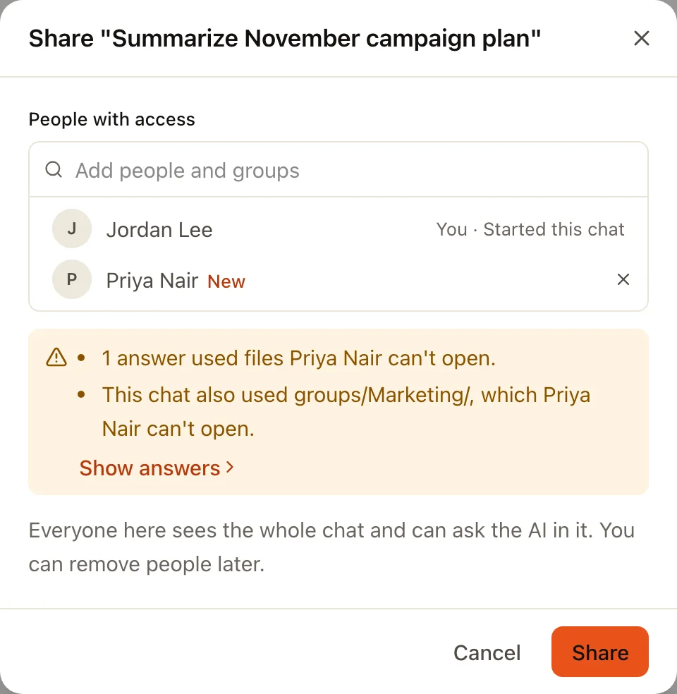
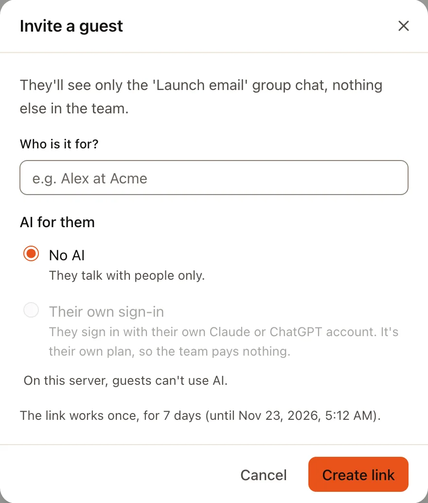

チャットは AI との会話です。新しいチャットは、[共有する](#チャットを共有する)まで自分だけのものです。チームのプロジェクトの中のチャットは、**自分だけ** を選ばない限り、プロジェクトのメンバーに共有されます。管理者に見えるのは AI が読んだファイルだけで、会話の内容は見えません。

## チャットを始める

:::steps
#### 新しいチャットを開く
トリナの一覧（左のバーの **トリナ**）のいちばん上にある **トリナに聞く** を選ぶか、⇧⌘O（Windows では Ctrl+Shift+O）を押すか、ホームページの入力欄に入力します。スマートフォンでは、**トリナ** タブを開くとホームが表示されます。下の入力欄に入力してください。最初は、入力欄の下の **チームで用意したもの** に、チームが用意したものが表示されます。スキル（**例** で結果の見本を表示、**使ってみる** でスキルを開く）は、どれかを一度実行するまで表示され、チームのファイル（**聞いてみる** で、そのファイルについての質問が入力欄に入ります。送信はされません）も表示されます。まだ何も用意されていない場合は、**まずはここから** に、送れる質問が 1 つ表示されます。

#### ふつうの言葉で頼む
たとえば「shared/sales にある先週の営業メモをまとめて」と頼みます。`/` を入力すると、チームスキルを選べます。

メッセージ欄は、上に入力した文章、その下の欄の中に 1 列のボタンが並びます。左の **+** でファイル（パソコンのファイルかチームのファイル）を追加します。右には、AI の選択（管理者が許可した人のみ）、オンになっている場合はマイク、送信（**↑**）があります。Enter で送信します。

#### 作業を確認する
回答の下の **Nステップ** を開くと、AI が使ったツールと読んだファイルが 1 つずつ表示されます。
:::

## 回答のしくみ

| 項目 | 内容 |
|---|---|
| **エンジン** | メンバーにはチームの標準のエンジンが使われます。管理者が許可した人は、チャットの中でエンジンとモデルを選べます。 |
| **ファイル** | AI は Trina のファイル用ツールを使います。呼び出しのたびに、自分の権限で確認されます。 |
| **質問** | AI が選択や確認を必要とするときは、カードを表示します。AI がそのカードに自分で答えることはできません。 |
| **ヘルパー** | 大きな依頼では、AI が作業を小さなタスクに分けられます。同時に 4 つまでです。どのヘルパーも、依頼した本人として作業します。 |
| **長さ** | 1 つの回答でツールを使えるのは、標準で 500 回までです（管理者は 10〜2,000 回から選べます。予定したタスク、Slack からの質問、ゲストは 150 回まで）。上限に達したら、**続ける** で続きを進めます。 |
| **Web** | AI は Web ページを開けます。サーバーがアドレスを 1 つずつ確認し、危険なものは開く前に確認を求めます。 |
| **ヘルプ** | Trina AX の使い方、設定、困ったときの対処を聞くと、AI がこのドキュメントで調べて答え、最後にページのリンクを付けます。ドキュメントはバージョンに合わせてサーバーに入っています。 |

:::note
選ばれた内容は、接続した AI の提供元に送られます。自社のサーバーで動かしていても、オフラインで処理されるわけではありません。[データの流れを読む](../../operate/security.md)（英語）。
:::

## トリナの一覧

パソコンでは、左のバーの **トリナ** を押すと、ページの横にトリナのチャットの一覧が開きます。いちばん上に **トリナに聞く**、**検索**、**定期タスク**、**チームスキル** があります。その下に、上から順に次のものが並びます。

| 部分 | 中身 |
|---|---|
| **あなたの回答を待っています** | チャットが自分の回答を待っている間だけ表示され、押すとそのチャットが開きます |
| **固定済み** | 固定したチャット |
| **トリナの履歴** | そのほかのすべてのチャット。新しい順です。プロジェクトの中のチャットは、行の最後にプロジェクト名が表示されます |

チャットを誰が見られるかは、小さな印で分かります。チームのプロジェクトの中で自分だけが見られるチャットはタイトルの前に鍵、共有したチャットには人のアイコンがつきます。ほかの人が書き込んだ共有チャットには、代わりにその人たちの顔が行の最後に表示されます（3 人まで。スマートフォンでは 2 人まで）。ポインターを合わせると名前が表示されます。履歴、プロジェクトのページ、検索のどこでも同じです。

バーの **トリナ** に **?** が表示されているときは、押すと待っているチャットも開きます。削除したチャットは **削除した履歴** にあり、**トリナの履歴** の横の **⋯** メニューから開けます。一覧の上にある絞り込みのボタンで、たとえば回答中のチャットや、自分の回答を待っているチャットだけを表示できます。プロジェクトには専用の場所があります。バーの **プロジェクト** です。

スマートフォンでは、**トリナ** タブを開くとホームが表示されます。上の **☰** を押すと履歴が開きます。**検索**、**定期タスク**、**チームスキル**、その下に **トリナの履歴**（固定したチャットが先、そのあと新しい順に日付ごと）、いちばん下に **ステータスを設定** と **削除した履歴** があります。

### セクション

トリナのチャットにはフォルダーがありません。1 つの仕事のチャットをまとめておくには、[プロジェクト](#プロジェクト)に入れてください。

**トーク** の一覧では、Slack のサイドバーのセクションのように、チャンネルとダイレクトメッセージを自分だけの
**セクション** にまとめられます。セクションは自分の一覧を整理するだけのものです。ファイルは入らず、ほかの人には見えず、
トークのメンバーが変わることもありません。

1. 左のバーの **トーク** を開きます。
2. **チャンネル** の行にポインターを合わせ、行の端の **+** を押します。**チャンネルを作成** と **新しいセクション** の
   小さなメニューが開きます。
3. **新しいセクション** を選び、名前（たとえば「取引先」）を入力して **作成** を押します。
4. 自分のトークの一覧が開きます。入れたいものにチェックを付けて **2件の会話を追加** を押します（数はチェックした数に
   合わせて変わります）。あとで入れるときは **スキップ** を押します。

トークの一覧の **チャンネル** の上に、選んだトークが入った新しいセクションが表示されます。

- **トークを 1 つ移す：** その行の **···** › **セクションに移動** で、セクション（または **新しいセクション…**）を選びます。
  パソコンでは、行をセクションにドラッグしてもかまいません。**セクションから外す** で、元の場所（**チャンネル**、
  **プロジェクト**（プロジェクトのトークルーム）、**ダイレクトメッセージ** のどれか）に戻ります。
- **セクションを変える：** セクションの **···** に **会話を追加**、**セクション名を変更**、**上へ**、**下へ**、
  **セクションを削除** があります。セクションを削除しても消えるのは見出しだけで、中のトークは **チャンネル** と
  **ダイレクトメッセージ** に戻ります。

## 複数のチャットを同時に進める

トリナのチャットの一覧では、それぞれのチャットの行の右端に、印が最大 1 つ表示されます。

| 印 | 意味 |
|---|---|
| 黄色の **?** | AI が自分を待っています。質問や確認のカード、または失敗したか上限で止まった回答です。カードの **?** は、答えるまで消えません。 |
| 灰色の輪 | AI が回答中か、回答が順番を待っています。 |
| 点とタイトルの太字 | まだ開いていない新しい回答があります。 |

チャットを開くと、どの端末でも、点と、失敗したか止まった回答の **?** が消えます。折りたたんだ部分には、中のチャットのいちばん強い印が表示されます。トークでは、AI がそこで自分の回答を待っている間、件数の代わりに **?** が表示されます。

ブラウザーのタブが裏にある間は、タブのタイトルに、自分を待っているチャットとトークの数が表示されます。たとえば「(2) Trina」です。デスクトップアプリでは、Mac の Dock に同じ数が表示されます。また、ほかの画面を見ている間にカードが開いたときや、1 分以上かかった回答が終わったときに通知が届き、クリックするとそのチャットが開きます。定期タスクには印だけがつきます。Slack から聞いた質問は Slack で答えるため、そのチャットには点がつきません。左のバーの **トリナ**（スマートフォンでは **トリナ** タブ）には、チャットが自分を待っているときに **?** か点が表示されます。**トーク** には、トークで AI が自分の回答を待っている間 **?** が表示されます。スマートフォンでは、アプリの中に **開く** つきの短いメッセージが表示されます。

## チャットを共有する

自分のチャットは、Google Drive のファイルと同じように、人やグループに共有できます。共有された人には、追加される前の会話も含めてチャット全体が見え、そのチャットで自分から AI に聞くこともできます。

:::steps
#### 共有を開く
チャットのタイトルのメニュー、または一覧の行の **···** で、**共有** を選びます。

#### ユーザーやグループを追加する
**ユーザーやグループを追加** に名前を入力します。自分は **このチャットを開始** として一覧に載っています。**✕** で人を外せます（保存するまでは **元に戻す** で戻せます）。

#### 保存する
**共有する** を押します（すでに共有している場合は **保存**）。保存していない変更があるまま閉じようとすると、確認されます。
:::

- **新しい人を追加する前に**、アプリはその人たちに新しく何が見えるようになるかを確認します。チャットで使った場所の中に、一部の人が開けない場所があれば、そのことが表示されます。たとえば「1 人はこのチャットで使ったものの一部を開けません：groups/Marketing/」です。回答が名指しされている場合（「ここにある 2 つの回答は、Priya が開けない場所を使っています」）は、**回答を見る** で一覧が表示されます。**このまま共有** でチャットを共有し、**キャンセル** で元のままにします。
- **ファイル。** 共有する前にパソコンから添付したファイルは、追加した人にも見えるようになります。ダイアログにその件数が表示されます。添付したあとに変更したファイルは自分のものとして残り、件数に含まれず、ほかの人には見えません。共有チャットでは、参加している人なら誰でもパソコンからファイルを添付できます（1 ファイル 50 MB まで）。ファイルはチャットと一緒に保存され、チャットを見られる人だけが開いたり、トリナに聞いたりできます。チャットを削除すると、ファイルも削除されます。
- **回答を見られる人。** 共有チャットの回答が、参加している人に隠されることはありません。あとから追加された人も同じです。回答はそれぞれ、質問した人として、その人が開けるものを使って作られます。一部の人が開けないものを AI が読む前には、先に自分に確認が求められます。
- **ほかの人に見えるもの。** チャットはその人たちのトリナの一覧に表示され、**アクティビティ** に「Jordanさんがチャットを共有しました」と表示されます。名前で追加した人には、スマートフォンとブラウザーにも通知が届きます（**設定 › 通知 › 自分に共有されたチャット** でオフにできます）。共有された人は、自分の権限でチャットを続けることも、メニューの **自分のリストから非表示** を選ぶこともできます。もう一度開くと一覧に戻ります。
- **見られる人を変える。** 見られる人を変えられるのは、チャットを始めた人だけです。もう一度 **共有** を押すか、欄の下の **見られるユーザーを変更**を使います。外された人は、すぐにチャットとそのファイルが見られなくなり、「このチャットはもう共有されていません。」と表示されます。あとでリンクを開いたときも同じです。入力途中だった内容は、**コピー** つきでそこに残ります。名前で外した人が、共有したグループにも入っている場合は、そのグループを通じて引き続き見られます。ダイアログにそのことが表示されます。全員を外すと、また自分だけのチャットになります。
- **アクセスをリクエスト。** 見られないチャットのリンクを開いたチームのメンバーには、**アクセスをリクエスト** とメモ欄が表示されます。チャットのタイトルや、誰が参加しているかは一切表示されません。押すとボタンは **リクエスト済み** に変わります。リクエストは自分の **アクティビティ** に **共有** と **断る** のボタンつきで届き、スマートフォンとブラウザーにも通知されます（**設定 › 通知 › 共有**。ファイルを開くリクエストと合わせて 1 日 10 件まで）。**共有** を押すと、共有ダイアログと同じ確認のあとで、その人を名前で追加します。**断る** と、承認されなかったことだけが相手に伝わり、相手はもう一度リクエストできます。プロジェクトのリンクも同じです。メンバーを変えられる人にリクエストが届き、**追加** を押すとその人がメンバーになります。チームのプロジェクトの共有チャットのリンクからは、そのプロジェクトへの参加のリクエストになります。リクエストできない場合（個人のプロジェクトの中のチャットのように共有されないチャットや、答えられる人がいない場合）は、理由は示さず、ボタンなしでリクエストできないことだけが表示されます。ゲストはリクエストできません。すでに開ける人は、そのまま開けます。
- **個人のものは使われません。** 共有チャットでは、AI は自分のメモリ、ブラウザー、メール、定期タスクを使いません。使いたい場合は、チャットのメニューで **自分だけのチャットで続ける** を選びます。
- 個人のプロジェクトの中のチャットは自分のものです。**共有** を押すと、先にプロジェクトの外に移すよう案内されます。チームのプロジェクトの中のチャットは、プロジェクトのメンバーに共有されます（[プロジェクト](#プロジェクト)を参照）。

## チャットを固定する

トリナのチャットの一覧で、チャットの **···**（または行の右クリック、スマートフォンでは長押し）に **上部に固定** があります。固定したチャットは、パソコンでもスマートフォンでも、トリナの一覧の最初に、最後に固定したものから順に並び、タイトルの前に小さなピンが表示されます。プロジェクトのページでも、固定したチャットが最初に並びます。**固定を解除** で元に戻ります。固定は自分だけのもので、共有されたプロジェクトのチャットでも同じです。チャットが削除されたときや、自分が見られなくなったときは固定も外れます。固定できるのは 50 件までです。

**トーク** の会話（チャンネル、ダイレクトメッセージ（1:1 とグループトーク））も、行の **···** やトーク自体の **···** から同じように固定できます。固定した会話は、パソコンでもスマートフォンの **トーク** タブでも、すべての会話の一覧で最初に並び、名前のあとに小さなピンが表示されます。固定は自分にしか見えません。トークを抜けたときや非表示にしたときは、固定も外れます。固定できる会話は 50 件までです。

**トーク** の一覧には、すべての会話が表示されます。固定したもの、自分のセクション、その下に **チャンネル**（全員チャンネルが先、そのあと名前順。プライベートチャンネルには鍵が付きます）、**ダイレクトメッセージ**（1:1 トークと名前のないグループトークをまとめて、新しい順で、メンバーの顔つき）です。非表示にした会話は **非表示の会話 N** の中にあります。

**チャンネル** の横の **+** を押すと、小さなメニューが開きます。**チャンネルを作成** では、メンバーを選んで名前を付けると、その人たちだけが見られるプライベートチャンネルになります。**新しいセクション** では、上の「セクション」で説明した自分だけのセクションを作ります。**ダイレクトメッセージ** の横の **+** は **新規メッセージ** です。1 人を選ぶとダイレクトメッセージ、複数人を選ぶとその人たちの名前で表示されるグループトークになります（同じメンバーのグループトークがすでにあれば、それが開きます）。グループトークをプライベートチャンネルにするには、**···** › **プライベートチャンネルにする** で名前を付けます。

チームを離れた人との 1:1 トークには「<名前>さんはチームを離れました」と表示され、メッセージ欄はありません。これまでの会話は読めます。

## チームのトーク

左のバーの **トーク**（スマートフォンでは **トーク** タブ）は、人どうしが話す場所です。**チャンネル**（チーム全員のチャンネル、グループごとのチャンネル、参加しているプライベートチャンネル）と **ダイレクトメッセージ**（1:1 トークとグループトーク）があります。自分の名前が出たメッセージと、参加しているスレッドの新しい返信は、ほかの通知と一緒に **アクティビティ** に集まります。

1 人にだけ話しかけたいときは、メッセージの横の写真か名前をクリックします（メッセージ内の @メンションや、会話のメンバー一覧の行でもできます）。名前と肩書きの小さなカードが開き、**メッセージを送る** でその人との 1:1 トークが開きます。スマートフォンでは、カードは画面の下から開きます。自分のカードには **プロフィールを編集** があります。アプリと、チームを離れた人にはカードがありません。ゲストがメッセージを送れるのは、自分のグループトークやプロジェクトにいる人だけです。

チームの外の人を招くには、プライベートチャンネル、グループトークやプロジェクトに人を追加するときに **ゲストを招待** を選びます。[ゲストについて読む](guests.md)。

#### トークの横でトリナに聞く

トークの上にある **✦** ボタンを押すと、その横にトリナとのサイドチャットが開きます。このチャットは自分にしか見えず、AI は自分が開けるものを使って答えます。共有する価値のある回答なら、その下の **送信** で、自分のメッセージとしてトークに投稿できます（1 つのメッセージについて聞いた場合は **スレッドに送る**）。回答で使ったファイルを開けない人がトークにいる場合は、先にアプリがそのことを知らせ、了承を待ちます。

スレッドを開いているときに **✦** を押すと、サイドチャットがスレッドの横に開き、両方が画面に残ります（ウィンドウが狭いときは、トークが 2 つに場所を譲ります）。サイドチャットの入力欄には **このスレッドを確認中** と表示されます。質問はそのスレッドについてのものになり、回答をそのままスレッドに送れます。トーク全体について聞きたいときは、その行の **✕** を押します。

#### スレッドで返信する

メッセージの **スレッドで返信** を使うと、そのメッセージの下で別の会話を続けられるため、トークが読みやすいままになります。トークには、スレッドの返信の数が表示されます。**トークにも送信** を選ぶと、返信がトークにも投稿されます。

#### メッセージへのリンク

メッセージの **⋯** メニューの **リンクをコピー**（スマートフォンでは、メッセージを長押し）で、そのメッセージのアドレスをコピーします。どのチャンネル、グループトーク、ダイレクトメッセージ、スレッドにも貼り付けられます。貼り付けると会話の名前が表示され、その下に、書いた人、日時、本文、ファイルが入ったカードとしてメッセージが表示されます。カードをクリックすると、そのメッセージが開きます。

カードが見えるのは、そのメッセージを見られる人だけです。それ以外の人にはふつうのリンクとして表示され、開いても会話が見つからないと表示されます。会話の中にそのメッセージを見られない人がいる場合は、送る前に入力欄にそのことが表示されます。**リンクだけ表示**（標準）ではリンクだけを送ります。**メッセージを表示** では、自分が共有したという印つきで、メッセージのコピーをその人たちに見せます。元のメッセージが削除されると、コピーも消えます。自分のメッセージからカードを外すには、カードにポインターを合わせて **✕** をクリックします（またはメッセージのメニューで **プレビューを削除** を選びます）。

### トークが表示される場所

トーク一覧の順番は、パソコンでもスマートフォンでも同じです。**固定**、自分のセクション、**チャンネル**、**プロジェクト**、**ダイレクトメッセージ** の順です。

- **プロジェクト** には、チームのプロジェクトごとのトークが名前順に、フォルダーのアイコン付きで並びます。だれかが書き込むと表示され、それまではプロジェクトから開きます。**+** はありません。プロジェクトはプロジェクトのページか、トークから作ります（[トークをプロジェクトにする](#トークをプロジェクトにする) を参照）。
- トークは1か所にだけ表示されます。固定したり、自分のセクションにドラッグしたりしたプロジェクトのトークは **プロジェクト** から外れます。**プロジェクト** の見出しにドラッグすると戻ります。
- プロジェクトをゴミ箱に移すと、そのトークは一覧から外れます。プロジェクトを元に戻すと、また表示されます。

### 部署のチャンネルと部署のフォルダー

部署（**管理 › グループ** のグループ）には、それぞれチャンネルがあります。部署に自分が開けるフォルダーがあると、チャンネル上部に部署名の付いたフォルダーのボタンが表示され、ファイルの画面でそのフォルダーが開きます。

- **チャンネルで送ったファイルは、部署フォルダーの「チャット添付」フォルダーに保存されます。** 部署のファイルが1か所にまとまります。ファイルの横に、どこに保存されたか（例：「営業 › チャット添付」）が表示されます。
- 部署以外の人もフォルダーを開けるとき、チャンネルのだれかが「チャット添付」を開けないとき、自分がフォルダーを見るだけのときは、ファイルはトークだけに残り、**このトークだけ** と表示されます。そのときチャンネルには、それらのファイルを一覧できる **ファイル** も表示されます。
- **メッセージを削除しても消えるのはメッセージだけです。** 部署フォルダーのファイルはそのまま残り、確認画面に場所が表示されます。ファイルも消したいときは、ファイルの画面で削除します。
- 管理者はチームのすべてのフォルダーを開けるので、部署に入っていなくてもファイルの画面でこれらのファイルを開けます。トークは見えません。
- あとから部署に入った人は、「チャット添付」にあるこれまでのファイルをすべて開けますが、それまでのメッセージは見られません。プロジェクトと同じです。
- 部署フォルダーがプロジェクトの中にあるときは、チャンネルで送ったファイルはトークだけに残ります。
- この変更より前に送ったファイルは、チャンネルの **ファイル** 一覧に残ります。

### ゲスト

代理店や取引先など、チームの外の人は、ゲストとしてプライベートチャンネル、グループトークやプロジェクトに参加でき、最大で 1 つのプライベートチャンネルかグループトークと 1 つのプロジェクトに参加できます。プライベートチャンネルかグループトークでは、メンバー（上の名前）を開き、**メンバーを招待**、**ゲストを招待** の順に選びます。プロジェクトでは、**メンバー** の **メンバーを追加** を使います。誰に送るリンクかと、AI を使えるかどうかを決めて、**リンクを作成** を押します。リンクは 1 回だけ使えます。相手には自分で送ってください。

- ゲストに見えるのはその場所だけです。ファイル画面も、ほかのグループトークやプロジェクトも、チームの場所も見えません。
- **本人のアカウントでサインイン** を選ぶか、管理者が月の上限つきの **チームのAI** のアカウントを割り当てない限り、ゲストの AI はオフです。
- 名前の横に **ゲスト** のタグが表示され、上部には **ゲスト1人を含む** と表示されます。
- 管理者は、すべてのゲストを **管理 › メンバーと招待 › ゲスト** で確認できます（[管理](admin.md#ゲスト)）。

## プロジェクト

プロジェクトは、1 つの仕事のチャット、ファイル、指示を、自分だけ、または追加した人たちとまとめておく場所です。製品の発売、取引先、四半期の報告書など、同じファイルを何度も使う仕事に使います。

:::steps
#### プロジェクトを作る
左のバーの **プロジェクト**（スマートフォンでは **プロジェクト** タブ）を開き、**新しいプロジェクト** を選びます。名前をつけます。新しいプロジェクトは **自分だけ** です。人を追加するまでは、自分にしか見えません。

#### 指示を書く
どんな仕事か、AI にどう手伝ってほしいかを書きます。最初の段落が、プロジェクトのタイトルの下に表示されます。

#### プロジェクトの中でチャットする
プロジェクトのページからチャットを始めるか、チャットのタイトルのメニューの **プロジェクトに移動** でチャットを移します。すると、AI がプロジェクトのファイルと指示を使います。

:::

- 自分のプロジェクトは、左のバーとスマートフォンの **プロジェクト** タブの **プロジェクト** にあります。**チームのプロジェクト**（ほかの人にも見えます）と **自分のプロジェクト**（自分だけ）です。プロジェクト名を押すと、そのページが開きます。プロジェクトから開いたチャットは、そのプロジェクトに戻ります。プロジェクトのチャットは、トリナの一覧の **トリナの履歴** にも表示されます。チームのフォルダーとそのゴミ箱は **ファイル** にあります。
- プロジェクトにはメンバーがいます。プロジェクトのページの **メンバー** に誰がいるかが表示され、**メンバーを追加** で、自分だけのプロジェクトを共有できます。保存する前に、追加した人がファイルと指示を見たり編集したりできること、これまでの自分のチャットは自分のものとして残ること、自分だけに戻せないことが表示されます。チームによっては、プロジェクトを共有できるのはオーナーと管理者だけです。
- プロジェクトには、1 人以上のゲストも入れられます。チームの外の人で、このプロジェクトだけが見えます。メンバーは、ゲストがそこで行ったチャットを見られます。[ゲストについて読む](guests.md)。
- プロジェクトの中身が見えるのは、そのメンバーだけです。オーナーと管理者はメンバーを変更できますが、自分がメンバーでない限り、チャット、ファイル、指示は見えません。
- **プロジェクト名を変更するには**、プロジェクトのページ上部の名前をクリックし、新しい名前を入力して Enter を押します（Esc で取り消し）。
  **プロジェクト** の一覧でプロジェクトの **···**（または右クリック）や、ページ上部の名前のメニューにある **名前を変更** でも変更できます。
  スマートフォンでは、上部バーのプロジェクト名をタップします。変更できるのはプロジェクトを作った人、オーナー、管理者だけで、ほかの人には
  名前がただの文字として表示されます。プロジェクト名を変えても、フォルダー名は変わりません。
- 1 つのフォルダーには 1 つのプロジェクトが入ります。プロジェクトになったフォルダーを移動、名前の変更、削除できるのは管理者だけです。
- チームのプロジェクトのメニューの **ゴミ箱に移動** で、プロジェクトをファイルごとゴミ箱に移します。メンバーの画面にはプロジェクトのカードが **ゴミ箱の中** という印つきで残ります。ページには、誰がいつゴミ箱に移したかと、管理者か作成者が復元できることが表示されます。それまでは、誰もファイル、チャット、指示を開けません。管理者か作成者は、そのページか **ファイル › ゴミ箱** で復元できます。ゴミ箱では、プロジェクト名の 1 行にまとまっています。**完全に削除** できるのは管理者だけです。
- 自分だけで書いたのではない指示は、外部の内容として扱われます。それを読んだあと、AI は何かを覚える前に確認します。
- **チームのプロジェクトのチャットは、メンバーに共有されます。** プロジェクトのメッセージ欄の **+** のあとにある小さなチップに、始めようとしているチャットを誰が見られるかが表示されます（たとえば **👥 3人**）。押すと、そのチャットを自分だけのものにできます（**🔒 自分だけ**）。次の新しいチャットは、また共有の状態で始まります。自分だけが見られるチャットには鍵が表示されます。質問にはすべて、送った人の写真と名前が表示されます。回答はそれぞれ、質問した人として、その人の権限で作られます。一部の人が開けないものを AI が読もうとするときは、先に自分に確認が求められます（**読んで共有する** / **読まない**）。
- **取り込んだチャットや移したチャットは、自分のものとして残ります。** プロジェクトのページにその件数（「自分だけが見られるチャット 1 件」）が表示され、**共有するチャットを選ぶ**（またはチャットの **⋯** メニューの **共有**）で共有できます。共有は取り消せません。**既存の会話を取り込む** で、ほかのチャットを移せます。
- **プロジェクトのチャットのファイル。** 共有されたプロジェクトのチャットでパソコンから添付したファイル（**+**、貼り付け、ドロップ）は、プロジェクトのフォルダーの **チャット添付** サブフォルダー（チームの言語の名前）に保存されます。プロジェクトの人はそこで開くことができ、その下の行にそのことが表示されます。プロジェクトのフォルダーへの書き込み権限が必要です（ない場合、**+** で選べるのはチームのファイルだけです）。送信する前に **✕** を押すと、ファイルはゴミ箱に移ります。

### プロジェクトのチャットを自分だけのものにする

チームのプロジェクトで始めた新しいチャットは、共有の Google Drive のフォルダーで作った文書のように、プロジェクトの
全員に共有されます。自分だけが見るべきことを聞くには：

1. プロジェクトのページを開きます。
2. メッセージ欄の **+** のすぐあとを見ます。チップに、そのチャットを誰が見るかが表示されています（たとえば **👥 3人**）。
3. チップを押します。**🔒 自分だけ** に変わります。
4. 質問を入力して送ります。

そのチャットには、プロジェクトの一覧とトリナの履歴で鍵が表示されます。見られるのは自分だけです。プロジェクトの次の
新しいチャットはまた共有の状態で始まるので、毎回チップを確認してください。あとで共有するには、チャットの **⋯** メニューで
**共有** を選びます（チャットの右上の **共有** でも同じです）。共有すると、これまでの会話もすべてプロジェクトのメンバーに
表示され、共有は取り消せません。

### プロジェクトのトーク

チームのプロジェクトには、それぞれ専用のトークがあります。プロジェクトのメンバーがトークのメンバーで、トークのファイルはプロジェクトのファイルです。メンバーの一覧も、ファイルの置き場所も1つです。

- プロジェクトのページの **トーク**（スマートフォンではプロジェクト名の下の行）でトークが開きます。初めて開くとき、プロジェクトの名前でトークが作られます。**プロジェクト** 一覧の行にある小さなチャットのアイコン（未読があると点が付きます）や、プロジェクトのAIチャット上部の **トーク** からも開けます。
- トーク上部の、プロジェクト名のフォルダーのボタンでプロジェクトのページ（ファイルとAIチャット）が開きます。だれかが書き込むと、トークはフォルダーのアイコン付きでトーク一覧の **プロジェクト** に表示されます。
- **メンバーはプロジェクトに合わせて変わります。** プロジェクトに人を追加するとトークにも入り、これまでの会話もすべて見られます。プロジェクトから外すとトークからも外れます。追加する前に、メンバーの画面でそのことが表示されます。変えるには上部のトーク名を開き、**メンバーを管理** を選びます（プロジェクトのメンバーを変えられる人だけ）。**通知をオフ** で静かにでき、**プロジェクトから抜ける** でプロジェクトとトークの両方から抜けます。
- **トークで送ったファイルは、プロジェクトの「チャット添付」フォルダーに保存されます。** プロジェクトのメンバーはファイルの画面で見つけられます。プロジェクトを見るだけの人はメッセージを書けますが、ファイルは追加できません。
- **メッセージを削除しても消えるのはメッセージだけです。** ファイルはプロジェクトの「チャット添付」に残ります。ファイルも消したいときは、ファイルの画面で削除します。
- トーク横のトリナとのチャットで保存した新しい文書はプロジェクトのフォルダーに保存され、プロジェクトのAIチャットはトークを読めます。どちらも同じ人が見るので、だれが見られるかは聞かれません。
- トークの **✦** の横のチャットは自分だけのものです。空のときはそう表示され、プロジェクトのメンバーがいっしょにトリナに聞けるプロジェクトのページへのリンクが付きます。
- プロジェクトのメンバーが1つの部署のメンバーとまったく同じとき、トークの最初とトークの情報に「#営業と同じメンバーです。Atlasの話はここでしましょう。」と表示され、部署のチャンネルへのリンクが付きます。

### トークをプロジェクトにする

本格的な仕事になったプライベートチャンネルやグループトークは、これまでの会話を残したままプロジェクトにできます。

1. トークの **⋯**（上部、一覧の行、またはスマートフォンで行を長押し）を開き、**プロジェクトにする** を選びます。チームのプロジェクトを作れる人にだけ表示されます。管理者だけがプロジェクトを作るチームでは、メンバーには表示されません。
2. 名前を確認します。最初はトークの名前が入っています（名前のないグループトークでは、メンバーの名前）。同じ名前のプロジェクトがすでにあるときは、新しいフォルダーに「-2」が付き、画面にそう表示されます。
3. 何が変わるかを読んで、**プロジェクトを作成** を選びます。
   - トークの全員がプロジェクトのメンバーになります。
   - トークで送ったファイルは、プロジェクトの **チャット添付** フォルダーに移動します。トークの全員が見られなかったファイル（だれかが入る前に送ったものなど）はトークに残り、いくつ残るかが画面に表示されます。
   - あとからプロジェクトに追加された人は、そのときからのメッセージを見られ、移動したファイルも開けます。

トークは開いたままで、プロジェクトのトークになります。上部にプロジェクトのフォルダーのボタンが付き、だれがプロジェクトにしたかが1行残ります。ファイルを移動している間は上部に **ファイルを移動中…** と表示され、終わるといくつ移動していくつ残ったかがもう1行残ります。残ったファイルには **このトークだけ** と表示され、トークにはそれらのファイルの **ファイル** 一覧が残ります。

固定、セクション、通知、既読の位置はそのままです。画面を開いている間にだれかが入ったり抜けたりすると、**メンバーが変わりました** と表示され、新しい人数が出ます。すでにほかのプロジェクトがあるゲストがいるときは作れません。先に管理者がその人をチームメンバーにします。

ダイレクトメッセージの **⋯** には、代わりに **〇〇さんと新しいプロジェクト** があります。2人の新しいプロジェクトとそのトークを作り、ダイレクトメッセージはそのまま残ります。

## 何でも探す

⌘K（Windows では Ctrl+K）を押すか、**トリナに聞く** の下の **検索** を選ぶと、チャット、トークのメッセージ、プロジェクト、ファイル、スキル、定期タスク、MCP 接続を探せます。[検索と設定について読む](settings-and-search.md)。

**自分が送ったファイル。** 検索で「自分が送ったファイル」と入力するか通知から開くと、自分のトークで送ったファイルが大きい順に、使っている容量とともに表示されます。ファイルを削除すると、一緒に送ったメッセージもトークの全員から削除されます。

## 削除したチャット

チャットを削除すると、iPhone の「最近削除した項目」アルバムのように **削除した履歴** に移り、標準では 7 日間は
元に戻せます。管理者は 1〜365 日から選べます。

チャットを元に戻すには：

1. 左のバーの **トリナ** を開きます。スマートフォンでは **トリナ** タブを開き、上の **☰** を押します。
2. **トリナの履歴** の見出しの端にある **⋯** を押し、**削除した履歴** を選びます。スマートフォンでは、
   **削除した履歴** はメニューのいちばん下にあります。
3. チャットを見つけ（行ごとに削除した日時が表示されます）、**復元** を押します。

その行が一覧から消え、チャットがトリナの履歴に戻ります。

- 共有チャットは、作った人の **削除した履歴** に入ります。プロジェクトの作成者や管理者がほかの人の共有チャットを削除した場合は、元に戻せる間、その人の **削除した履歴** にも入ります。
- プロジェクトを完全に削除すると、その共有チャットは、それぞれ作った人の **削除した履歴** に移ります。元に戻したチャットは、プロジェクトのない、作った人だけのチャットになります。
