チャットは AI との会話です。新しいチャットは、[共有する](#チャットを共有する)まで自分だけのものです。チームのプロジェクトの中のチャットは、**自分だけ** を選ばない限り、プロジェクトのメンバーに共有されます。管理者に見えるのは AI が読んだファイルだけで、会話の内容は見えません。

## チャットを始める

:::steps
#### 新しいチャットを開く
トリナの一覧（左のバーの **トリナ**）のいちばん上にある **トリナに聞く** を選ぶか、⇧⌘O（Windows では Ctrl+Shift+O）を押すか、ホームページの入力欄に入力します。スマートフォンでは、**トリナ** タブを開くとホームが表示されます。下の入力欄に入力してください。最初は、入力欄の下の **チームで用意したもの** に、チームが用意したものが表示されます。スキル（**例** で結果の見本を表示、**使ってみる** でスキルを開く）は、どれかを一度実行するまで表示され、チームのファイル（**聞いてみる** で、そのファイルについての質問が入力欄に入ります。送信はされません）も表示されます。まだ何も用意されていない場合は、**まずはここから** に、送れる質問が 1 つ表示されます。

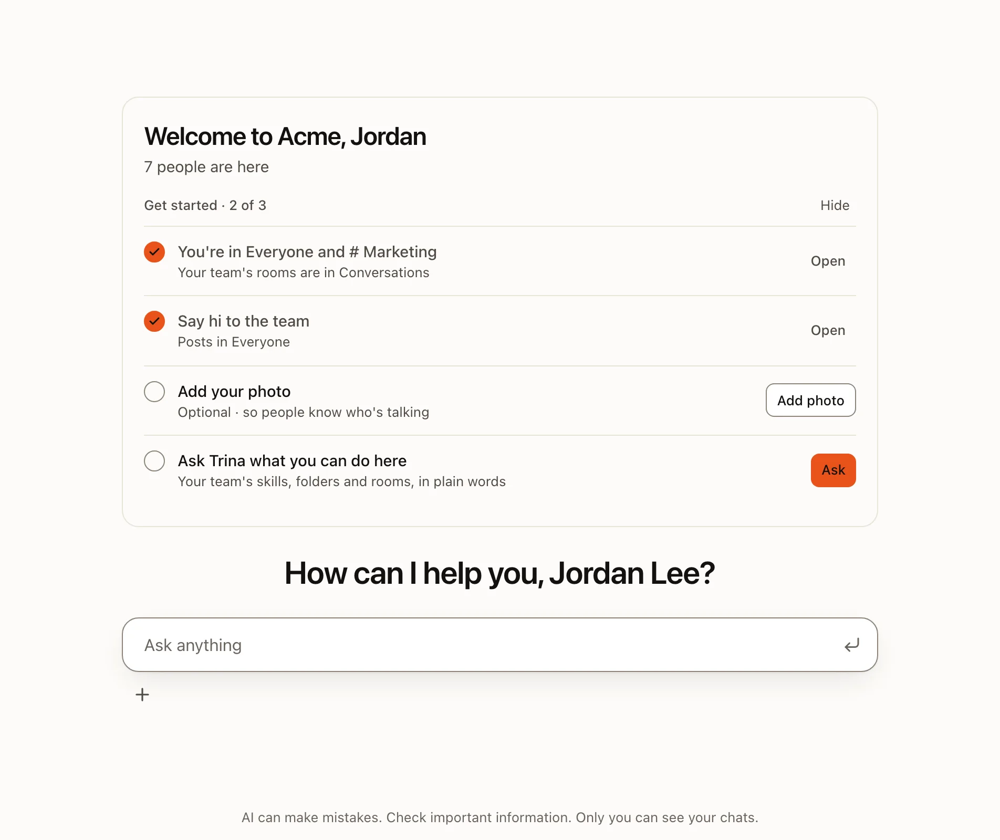

#### ふつうの言葉で頼む
たとえば「shared/sales にある先週の営業メモをまとめて」と頼みます。`/` を入力すると、チームスキルを選べます。

メッセージ欄は、上に入力した文章、その下の欄の中に 1 列のボタンが並びます。左の **+** でファイル（パソコンのファイルかチームのファイル）を追加します。右には、AI の選択（管理者が許可した人のみ）、オンになっている場合はマイク、送信（**↑**）があります。Enter で送信します。

#### 作業を確認する
回答の下の **Nステップ** を開くと、AI が使ったツールと読んだファイルが 1 つずつ表示されます。
:::

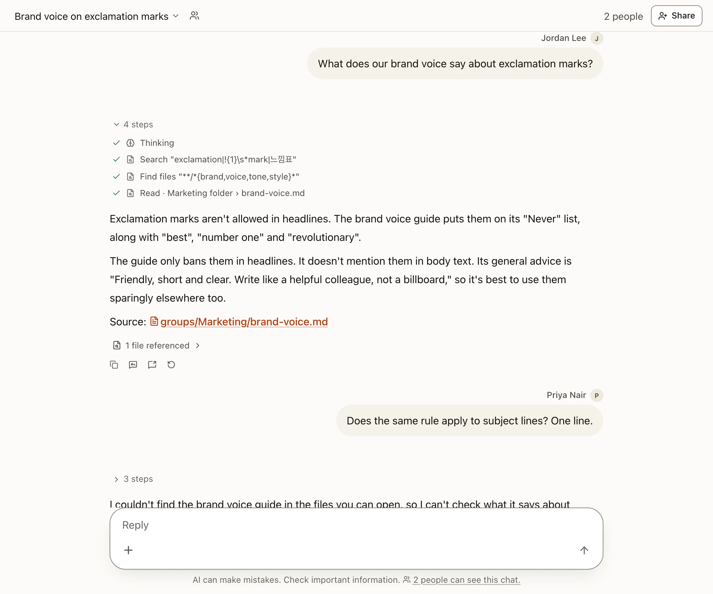

## 回答のしくみ

| 項目 | 内容 |
|---|---|
| **エンジン** | メンバーにはチームの標準のエンジンが使われます。管理者が許可した人は、チャットの中でエンジンとモデルを選べます。 |
| **ファイル** | AI は Trina のファイル用ツールを使います。呼び出しのたびに、自分の権限で確認されます。 |
| **質問** | AI が選択や確認を必要とするときは、カードを表示します。AI がそのカードに自分で答えることはできません。 |
| **ヘルパー** | 大きな依頼では、AI が作業を小さなタスクに分けられます。同時に 4 つまでです。どのヘルパーも、依頼した本人として作業します。 |
| **長さ** | 1 つの回答でツールを使えるのは、標準で 150 回までです（管理者は 10〜500 回から選べます）。上限に達したら、**続ける** で続きを進めます。 |
| **Web** | AI は Web ページを開けます。サーバーがアドレスを 1 つずつ確認し、危険なものは開く前に確認を求めます。 |

:::note
選ばれた内容は、接続した AI の提供元に送られます。自社のサーバーで動かしていても、オフラインで処理されるわけではありません。[データの流れを読む](../../operate/security.md)（英語）。
:::

## トリナの一覧

パソコンでは、左のバーの **トリナ** を押すと、ページの横にトリナのチャットの一覧が開きます。いちばん上に **トリナに聞く**、**検索**、**定期タスク**、**チームスキル** があります。その下に、上から順に次のものが並びます。

| 部分 | 中身 |
|---|---|
| **あなたの回答を待っています** | チャットが自分の回答を待っている間だけ表示され、押すとそのチャットが開きます |
| **固定済み** | 固定したチャット |
| **トリナの履歴** | そのほかのすべてのチャット。新しい順です。プロジェクトの中のチャットは、行の最後にプロジェクト名が表示されます |

チャットを誰が見られるかは、小さな印で分かります。チームのプロジェクトの中で自分だけが見られるチャットはタイトルの前に鍵、共有したチャットには人のアイコンがつきます。ほかの人が書き込んだ共有チャットには、代わりにその人たちの顔が行の最後に表示されます（3 人まで。スマートフォンでは 2 人まで）。ポインターを合わせると名前が表示されます。履歴、プロジェクトのページ、検索のどこでも同じです。

バーの **トリナ** に **?** が表示されているときは、押すと待っているチャットも開きます。削除したチャットは **削除した履歴** にあり、**トリナの履歴** の横の **⋯** メニューから開けます。一覧の上にある絞り込みのボタンで、たとえば回答中のチャットや、自分の回答を待っているチャットだけを表示できます。プロジェクトには専用の場所があります。バーの **プロジェクト** です。

スマートフォンでは、**トリナ** タブを開くとホームが表示されます。上の **☰** を押すと履歴が開きます。**検索**、**定期タスク**、**チームスキル**、その下に **トリナの履歴**（固定したチャットが先、そのあと新しい順に日付ごと）、いちばん下に **ステータスを設定** と **削除した履歴** があります。

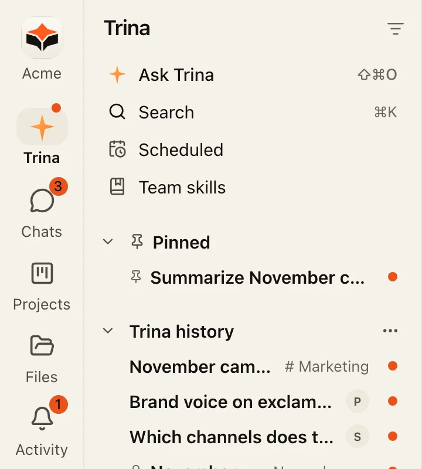

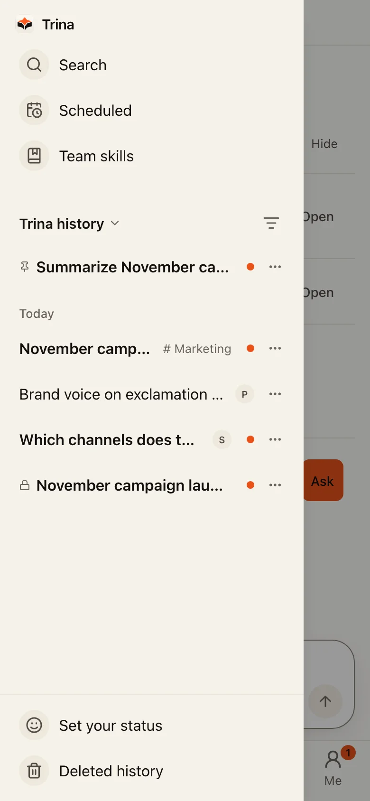

### フォルダー

トリナのチャットにはフォルダーがありません。1 つの仕事のチャットをまとめておくには、[プロジェクト](#プロジェクト)に入れてください。

**トーク** の一覧には、チャンネルとダイレクトメッセージ用の **トークのフォルダ** があります。フォルダーは一覧を整理するだけのものです。ファイルは入らず、トークを見られる人が変わることもありません。**新しいフォルダ** で作り、トークの **···** › **フォルダへ移動** で入れます。フォルダーの **···** では、名前の変更、上下への移動、削除ができます。フォルダーを削除しても、中のトークは一覧に残ります。

## 複数のチャットを同時に進める

トリナのチャットの一覧では、それぞれのチャットの行の右端に、印が最大 1 つ表示されます。

| 印 | 意味 |
|---|---|
| 黄色の **?** | AI が自分を待っています。質問や確認のカード、または失敗したか上限で止まった回答です。カードの **?** は、答えるまで消えません。 |
| 灰色の輪 | AI が回答中か、回答が順番を待っています。 |
| 点とタイトルの太字 | まだ開いていない新しい回答があります。 |

チャットを開くと、どの端末でも、点と、失敗したか止まった回答の **?** が消えます。折りたたんだ部分には、中のチャットのいちばん強い印が表示されます。トークルームでは、AI がそこで自分の回答を待っている間、件数の代わりに **?** が表示されます。

ブラウザーのタブが裏にある間は、タブのタイトルに、自分を待っているチャットとトークの数が表示されます。たとえば「(2) Trina」です。デスクトップアプリでは、Mac の Dock に同じ数が表示されます。また、ほかの画面を見ている間にカードが開いたときや、1 分以上かかった回答が終わったときに通知が届き、クリックするとそのチャットが開きます。定期タスクには印だけがつきます。Slack から聞いた質問は Slack で答えるため、そのチャットには点がつきません。左のバーの **トリナ**（スマートフォンでは **トリナ** タブ）には、チャットが自分を待っているときに **?** か点が表示されます。**トーク** には、トークルームで AI が自分の回答を待っている間 **?** が表示されます。スマートフォンでは、アプリの中に **開く** つきの短いメッセージが表示されます。

## チャットを共有する

自分のチャットは、Google Drive のファイルと同じように、人やグループに共有できます。共有された人には、追加される前の会話も含めてチャット全体が見え、そのチャットで自分から AI に聞くこともできます。

:::steps
#### 共有を開く
チャットのタイトルのメニュー、または一覧の行の **···** で、**共有** を選びます。

#### ユーザーやグループを追加する
**ユーザーやグループを追加** に名前を入力します。自分は **このチャットを開始** として一覧に載っています。**✕** で人を外せます（保存するまでは **元に戻す** で戻せます）。

#### 保存する
**共有する** を押します（すでに共有している場合は **保存**）。保存していない変更があるまま閉じようとすると、確認されます。
:::

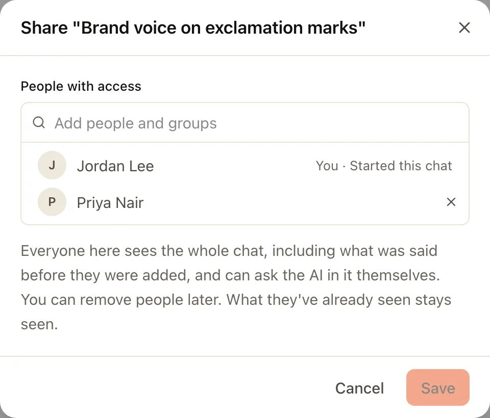

- **新しい人を追加する前に**、アプリはその人たちに新しく何が見えるようになるかを確認します。チャットで使った場所の中に、一部の人が開けない場所があれば、そのことが表示されます。たとえば「1 人はこのチャットで使ったものの一部を開けません：groups/Marketing/」です。回答が名指しされている場合（「ここにある 2 つの回答は、Priya が開けない場所を使っています」）は、**回答を見る** で一覧が表示されます。**このまま共有** でチャットを共有し、**キャンセル** で元のままにします。
- **ファイル。** 共有する前にパソコンから添付したファイルは、追加した人にも見えるようになります。ダイアログにその件数が表示されます。添付したあとに変更したファイルは自分のものとして残り、件数に含まれず、ほかの人には見えません。共有チャットでは、参加している人なら誰でもパソコンからファイルを添付できます（1 ファイル 50 MB まで）。ファイルはチャットと一緒に保存され、チャットを見られる人だけが開いたり、トリナに聞いたりできます。チャットを削除すると、ファイルも削除されます。
- **回答を見られる人。** 共有チャットの回答が、参加している人に隠されることはありません。あとから追加された人も同じです。回答はそれぞれ、質問した人として、その人が開けるものを使って作られます。一部の人が開けないものを AI が読む前には、先に自分に確認が求められます。
- **ほかの人に見えるもの。** チャットはその人たちのトリナの一覧に表示され、**アクティビティ** に「Jordanさんがチャットを共有しました」と表示されます。名前で追加した人には、スマートフォンとブラウザーにも通知が届きます（**設定 › 通知 › 自分に共有されたチャット** でオフにできます）。共有された人は、自分の権限でチャットを続けることも、メニューの **自分のリストから非表示** を選ぶこともできます。もう一度開くと一覧に戻ります。
- **見られる人を変える。** 見られる人を変えられるのは、チャットを始めた人だけです。もう一度 **共有** を押すか、欄の下の **見られるユーザーを変更**を使います。外された人は、すぐにチャットとそのファイルが見られなくなり、「このチャットはもう共有されていません。」と表示されます。あとでリンクを開いたときも同じです。入力途中だった内容は、**コピー** つきでそこに残ります。名前で外した人が、共有したグループにも入っている場合は、そのグループを通じて引き続き見られます。ダイアログにそのことが表示されます。全員を外すと、また自分だけのチャットになります。
- **アクセスをリクエスト。** 見られないチャットのリンクを開いたチームのメンバーには、**アクセスをリクエスト** とメモ欄が表示されます。チャットのタイトルや、誰が参加しているかは一切表示されません。押すとボタンは **リクエスト済み** に変わります。リクエストは自分の **アクティビティ** に **共有** と **断る** のボタンつきで届き、スマートフォンとブラウザーにも通知されます（**設定 › 通知 › 共有**。ファイルを開くリクエストと合わせて 1 日 10 件まで）。**共有** を押すと、共有ダイアログと同じ確認のあとで、その人を名前で追加します。**断る** と、承認されなかったことだけが相手に伝わり、相手はもう一度リクエストできます。プロジェクトのリンクも同じです。メンバーを変えられる人にリクエストが届き、**追加** を押すとその人がメンバーになります。チームのプロジェクトの共有チャットのリンクからは、そのプロジェクトへの参加のリクエストになります。リクエストできない場合（個人のプロジェクトの中のチャットのように共有されないチャットや、答えられる人がいない場合）は、理由は示さず、ボタンなしでリクエストできないことだけが表示されます。ゲストはリクエストできません。すでに開ける人は、そのまま開けます。
- **個人のものは使われません。** 共有チャットでは、AI は自分のメモリ、ブラウザー、メール、定期タスクを使いません。使いたい場合は、チャットのメニューで **自分だけのチャットで続ける** を選びます。
- 個人のプロジェクトの中のチャットは自分のものです。**共有** を押すと、先にプロジェクトの外に移すよう案内されます。チームのプロジェクトの中のチャットは、プロジェクトのメンバーに共有されます（[プロジェクト](#プロジェクト)を参照）。

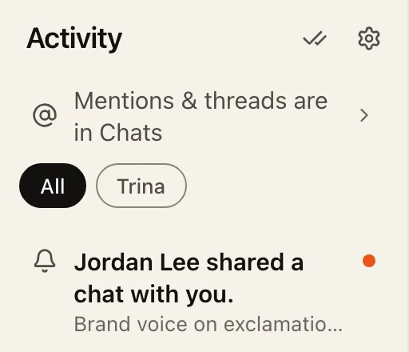

## チャットを固定する

トリナのチャットの一覧で、チャットの **···**（または行の右クリック、スマートフォンでは長押し）に **上部に固定** があります。固定したチャットは、パソコンでもスマートフォンでも、トリナの一覧の最初に、最後に固定したものから順に並び、タイトルの前に小さなピンが表示されます。プロジェクトのページでも、固定したチャットが最初に並びます。**固定を解除** で元に戻ります。固定は自分だけのもので、共有されたプロジェクトのチャットでも同じです。チャットが削除されたときや、自分が見られなくなったときは固定も外れます。固定できるのは 50 件までです。

**トーク** の会話（チャンネル、ダイレクトメッセージ（1:1 とグループトーク））も、行の **···** やトーク自体の **···** から同じように固定できます。固定した会話は、パソコンでもスマートフォンの **トーク** タブでも、すべての会話の一覧で最初に並び、名前のあとに小さなピンが表示されます。固定は自分にしか見えません。トークを抜けたときや非表示にしたときは、固定も外れます。固定できる会話は 50 件までです。

**トーク** の一覧には、すべての会話が表示されます。固定したもの、自分のフォルダー、その下に **チャンネル**（全員チャンネルが先、そのあと名前順。プライベートチャンネルには鍵が付きます）、**ダイレクトメッセージ**（1:1 トークと名前のないグループトークをまとめて、新しい順で、メンバーの顔つき）です。非表示にした会話は **非表示の会話 N** の中にあります。

**チャンネル** の横の **+** は **チャンネルを作成** です。メンバーを選んで名前を付けると、その人たちだけが見られるプライベートチャンネルになります。**ダイレクトメッセージ** の横の **+** は **新規メッセージ** です。1 人を選ぶとダイレクトメッセージ、複数人を選ぶとその人たちの名前で表示されるグループトークになります（同じメンバーのグループトークがすでにあれば、それが開きます）。グループトークをプライベートチャンネルにするには、**···** › **プライベートチャンネルにする** で名前を付けます。

チームを離れた人との 1:1 トークには「<名前>さんはチームを離れました」と表示され、メッセージ欄はありません。これまでの会話は読めます。

## チームのトーク

左のバーの **トーク**（スマートフォンでは **トーク** タブ）は、人どうしが話す場所です。**チャンネル**（チーム全員のチャンネル、グループごとのチャンネル、参加しているプライベートチャンネル）と **ダイレクトメッセージ**（1:1 トークとグループトーク）があります。いちばん上の **メンション・スレッド** には、自分の名前が出たメッセージと、参加しているスレッドが集まります。

1 人にだけ話しかけたいときは、メッセージの横の写真か名前をクリックします（メッセージ内の @メンションや、会話のメンバー一覧の行でもできます）。名前と肩書きの小さなカードが開き、**メッセージを送る** でその人との 1:1 トークが開きます。スマートフォンでは、カードは画面の下から開きます。自分のカードには **プロフィールを編集** があります。アプリと、チームを離れた人にはカードがありません。ゲストがメッセージを送れるのは、自分のグループトークやプロジェクトにいる人だけです。

チームの外の人を招くには、プライベートチャンネル、グループトークやプロジェクトに人を追加するときに **ゲストを招待** を選びます。[ゲストについて読む](guests.md)。

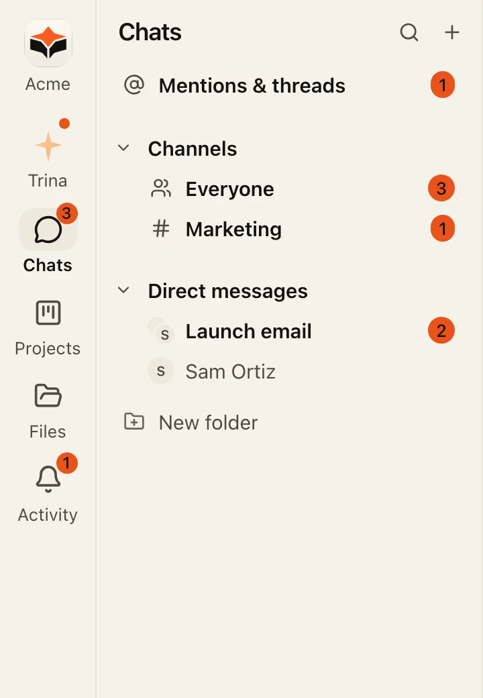

#### トークルームの横でトリナに聞く

トークルームの上にある **✦** ボタンを押すと、その横にトリナとのサイドチャットが開きます。このチャットは自分にしか見えず、AI は自分が開けるものを使って答えます。共有する価値のある回答なら、その下の **ルームに送る** で、自分のメッセージとしてトークルームに投稿できます（1 つのメッセージについて聞いた場合は **スレッドに送る**）。回答で使ったファイルを開けない人がトークルームにいる場合は、先にアプリがそのことを知らせ、了承を待ちます。

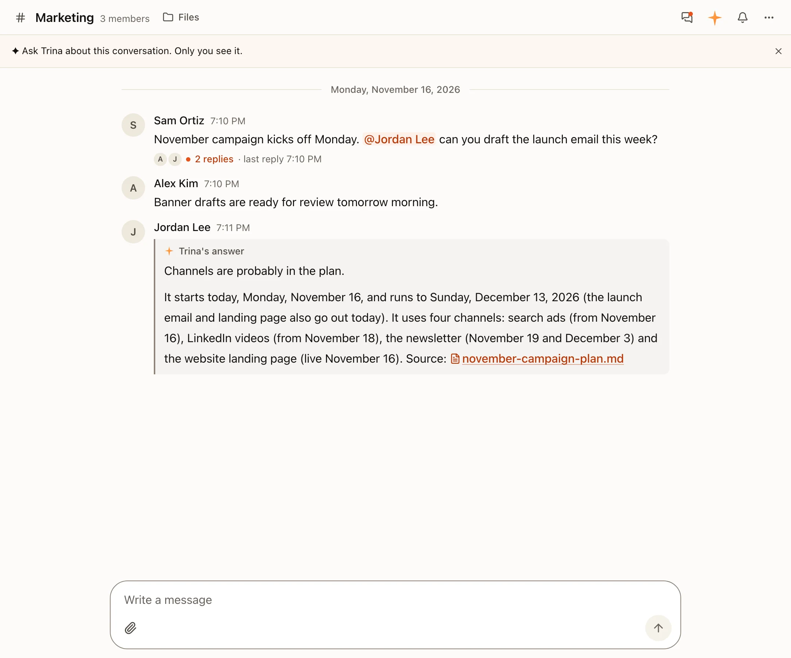

#### スレッドで返信する

メッセージの **スレッドで返信** を使うと、そのメッセージの下で別の会話を続けられるため、トークルームが読みやすいままになります。トークルームには、スレッドの返信の数が表示されます。**トークルームにも送信** を選ぶと、返信がトークルームにも投稿されます。

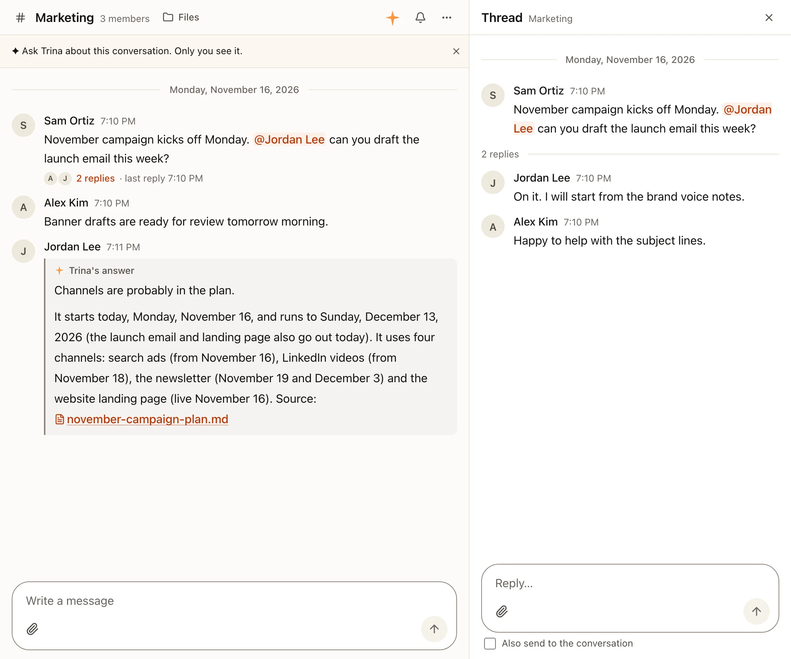

#### メッセージへのリンク

メッセージの **⋯** メニューの **リンクをコピー**（スマートフォンでは、メッセージを長押し）で、そのメッセージのアドレスをコピーします。どのチャンネル、グループトーク、ダイレクトメッセージ、スレッドにも貼り付けられます。貼り付けると会話の名前が表示され、その下に、書いた人、日時、本文、ファイルが入ったカードとしてメッセージが表示されます。カードをクリックすると、そのメッセージが開きます。

カードが見えるのは、そのメッセージを見られる人だけです。それ以外の人にはふつうのリンクとして表示され、開いても会話が見つからないと表示されます。会話の中にそのメッセージを見られない人がいる場合は、送る前に入力欄にそのことが表示されます。**リンクだけ表示**（標準）ではリンクだけを送ります。**メッセージを表示** では、自分が共有したという印つきで、メッセージのコピーをその人たちに見せます。元のメッセージが削除されると、コピーも消えます。自分のメッセージからカードを外すには、カードにポインターを合わせて **✕** をクリックします（またはメッセージのメニューで **プレビューを削除** を選びます）。

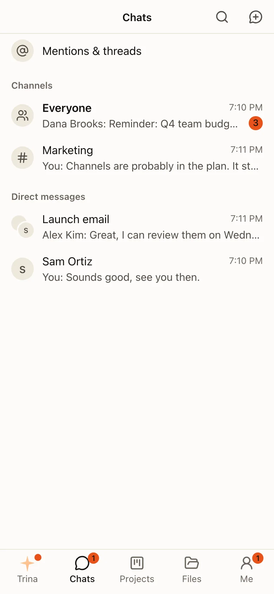

### ゲスト

代理店や取引先など、チームの外の人は、ゲストとしてプライベートチャンネル、グループトークやプロジェクトに参加でき、最大で 1 つのプライベートチャンネルかグループトークと 1 つのプロジェクトに参加できます。プライベートチャンネルかグループトークでは、メンバー（上の名前）を開き、**メンバーを招待**、**ゲストを招待** の順に選びます。プロジェクトでは、**メンバー** の **メンバーを追加** を使います。誰に送るリンクかと、AI を使えるかどうかを決めて、**リンクを作成** を押します。リンクは 1 回だけ使えます。相手には自分で送ってください。

- ゲストに見えるのはその場所だけです。ファイル画面も、ほかのグループトークやプロジェクトも、チームの場所も見えません。
- **本人のアカウントでサインイン** を選ぶか、管理者が月の上限つきの **チームのAI** のアカウントを割り当てない限り、ゲストの AI はオフです。
- 名前の横に **ゲスト** のタグが表示され、上部には **ゲスト1人を含む** と表示されます。
- 管理者は、すべてのゲストを **管理 › メンバーと招待 › ゲスト** で確認できます（[管理](admin.md#ゲスト)）。

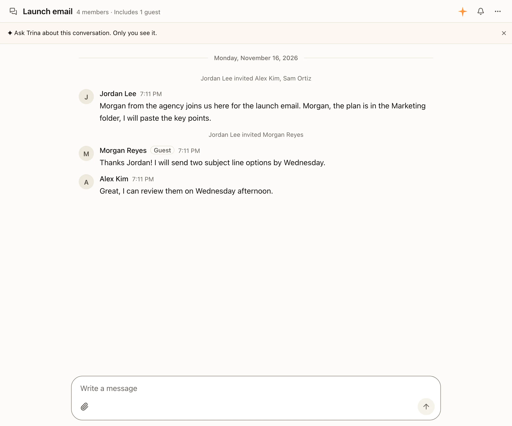

## プロジェクト

プロジェクトは、1 つの仕事のチャット、ファイル、指示を、自分だけ、または追加した人たちとまとめておく場所です。製品の発売、取引先、四半期の報告書など、同じファイルを何度も使う仕事に使います。

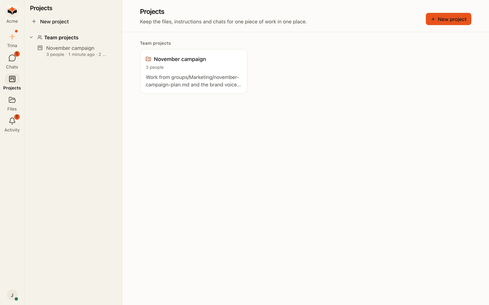

:::steps
#### プロジェクトを作る
左のバーの **プロジェクト**（スマートフォンでは **プロジェクト** タブ）を開き、**新しいプロジェクト** を選びます。名前をつけます。新しいプロジェクトは **自分だけ** です。人を追加するまでは、自分にしか見えません。

#### 指示を書く
どんな仕事か、AI にどう手伝ってほしいかを書きます。最初の段落が、プロジェクトのタイトルの下に表示されます。

#### プロジェクトの中でチャットする
プロジェクトのページからチャットを始めるか、チャットのタイトルのメニューの **プロジェクトに移動** でチャットを移します。すると、AI がプロジェクトのファイルと指示を使います。

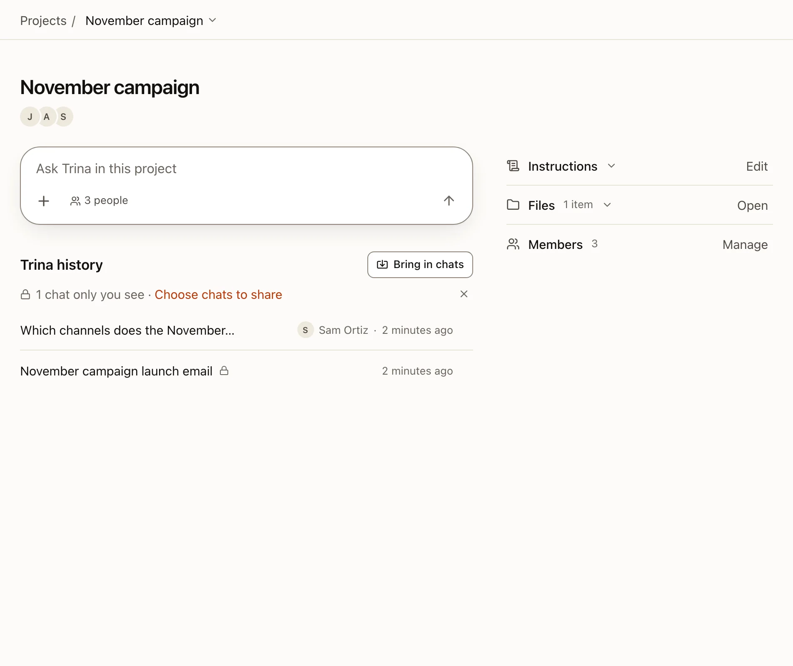
:::

- 自分のプロジェクトは、左のバーとスマートフォンの **プロジェクト** タブの **プロジェクト** にあります。**チームのプロジェクト**（ほかの人にも見えます）と **自分のプロジェクト**（自分だけ）です。プロジェクト名を押すと、そのページが開きます。プロジェクトから開いたチャットは、そのプロジェクトに戻ります。プロジェクトのチャットは、トリナの一覧の **トリナの履歴** にも表示されます。チームのフォルダーとそのゴミ箱は **ファイル** にあります。
- プロジェクトにはメンバーがいます。プロジェクトのページの **メンバー** に誰がいるかが表示され、**メンバーを追加** で、自分だけのプロジェクトを共有できます。保存する前に、追加した人がファイルと指示を見たり編集したりできること、これまでの自分のチャットは自分のものとして残ること、自分だけに戻せないことが表示されます。チームによっては、プロジェクトを共有できるのはオーナーと管理者だけです。
- プロジェクトには、1 人以上のゲストも入れられます。チームの外の人で、このプロジェクトだけが見えます。メンバーは、ゲストがそこで行ったチャットを見られます。[ゲストについて読む](guests.md)。
- プロジェクトの中身が見えるのは、そのメンバーだけです。オーナーと管理者はメンバーを変更できますが、自分がメンバーでない限り、チャット、ファイル、指示は見えません。
- **プロジェクト名を変更するには**、プロジェクトのページ上部の名前をクリックし、新しい名前を入力して Enter を押します（Esc で取り消し）。
  **プロジェクト** の一覧でプロジェクトの **···**（または右クリック）や、ページ上部の名前のメニューにある **名前を変更** でも変更できます。
  スマートフォンでは、上部バーのプロジェクト名をタップします。変更できるのはプロジェクトを作った人、オーナー、管理者だけで、ほかの人には
  名前がただの文字として表示されます。プロジェクト名を変えても、フォルダー名は変わりません。
- 1 つのフォルダーには 1 つのプロジェクトが入ります。プロジェクトになったフォルダーを移動、名前の変更、削除できるのは管理者だけです。
- チームのプロジェクトのメニューの **ゴミ箱に移動** で、プロジェクトをファイルごとゴミ箱に移します。メンバーの画面にはプロジェクトのカードが **ゴミ箱の中** という印つきで残ります。ページには、誰がいつゴミ箱に移したかと、管理者か作成者が復元できることが表示されます。それまでは、誰もファイル、チャット、指示を開けません。管理者か作成者は、そのページか **ファイル › ゴミ箱** で復元できます。ゴミ箱では、プロジェクト名の 1 行にまとまっています。**完全に削除** できるのは管理者だけです。
- 自分だけで書いたのではない指示は、外部の内容として扱われます。それを読んだあと、AI は何かを覚える前に確認します。
- **チームのプロジェクトのチャットは、メンバーに共有されます。** プロジェクトのメッセージ欄の **+** のあとにある小さなチップに、始めようとしているチャットを誰が見られるかが表示されます（たとえば **👥 3人**）。押すと、そのチャットを自分だけのものにできます（**🔒 自分だけ**）。次の新しいチャットは、また共有の状態で始まります。自分だけが見られるチャットには鍵が表示されます。質問にはすべて、送った人の写真と名前が表示されます。回答はそれぞれ、質問した人として、その人の権限で作られます。一部の人が開けないものを AI が読もうとするときは、先に自分に確認が求められます（**読んで共有する** / **読まない**）。
- **取り込んだチャットや移したチャットは、自分のものとして残ります。** プロジェクトのページにその件数（「自分だけが見られるチャット 1 件」）が表示され、**共有するチャットを選ぶ**（またはチャットのメニューの **プロジェクトのメンバーと共有**）で共有できます。**既存の会話を取り込む** で、ほかのチャットを移せます。
- **プロジェクトのチャットのファイル。** 共有されたプロジェクトのチャットでパソコンから添付したファイル（**+**、貼り付け、ドロップ）は、プロジェクトのフォルダーの **チャット添付** サブフォルダー（チームの言語の名前）に保存されます。プロジェクトの人はそこで開くことができ、その下の行にそのことが表示されます。プロジェクトのフォルダーへの書き込み権限が必要です（ない場合、**+** で選べるのはチームのファイルだけです）。送信する前に **✕** を押すと、ファイルはゴミ箱に移ります。

## 何でも探す

⌘K（Windows では Ctrl+K）を押すか、**トリナに聞く** の下の **検索** を選ぶと、チャット、トークのメッセージ、プロジェクト、ファイル、スキル、定期タスク、MCP 接続を探せます。[検索と設定について読む](settings-and-search.md)。

## 削除したチャット

チャットを削除すると **削除した履歴** に移り、標準では 7 日間は元に戻せます。管理者は 1〜365 日から選べます。

- 共有チャットは、作った人の **削除した履歴** に入ります。プロジェクトの作成者や管理者がほかの人の共有チャットを削除した場合は、元に戻せる間、その人の **削除した履歴** にも入ります。
- プロジェクトを完全に削除すると、その共有チャットは、それぞれ作った人の **削除した履歴** に移ります。元に戻したチャットは、プロジェクトのない、作った人だけのチャットになります。
