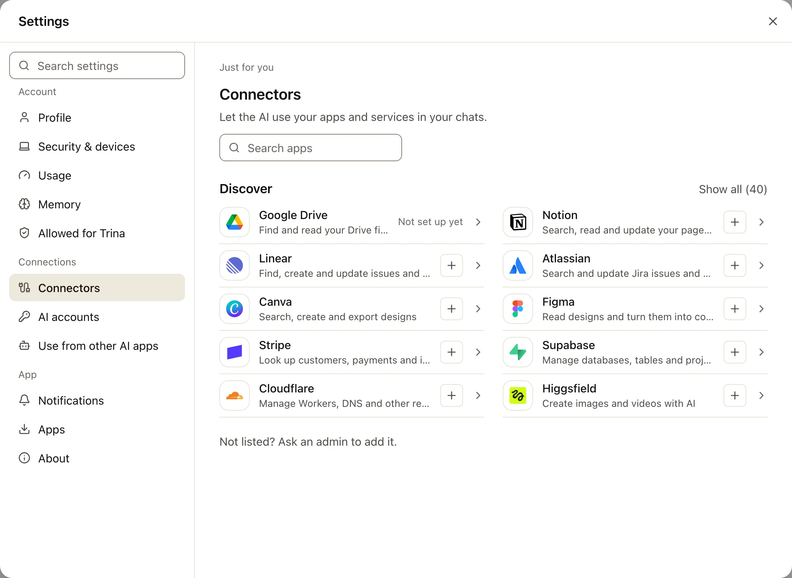
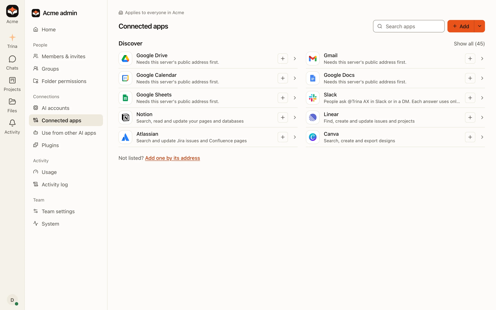

Trina AX がつなぐものは 2 種類あります。

- 質問に答える **AI アカウント**：Claude や ChatGPT のアカウント、または Anthropic、OpenAI などの AI 会社の API キーです。Trina AX には AI の利用は含まれていません。チームが自分たちのアカウントをつなぎ、その会社がつないだアカウントに料金を請求します。
- AI があなたの代わりに使う **アプリ**：Google Drive、Gmail などの Google アプリ、Slack、Notion、Linear、GitHub、または会社独自のシステムです。

このページでは、どのガイドを見ればよいかを案内します。各ガイドの冒頭に、必要な値とその入手先をすべて載せています。

:::note
これらのガイドのスクリーンショットには、架空の会社「Acme」と架空のキーを使っています。本物のキーがページや画像に表示されることはありません。
:::

## どこで設定するか

| やりたいこと | 担当 | Trina AX での場所 | ガイド |
|---|---|---|---|
| AI が回答できるようにする | オーナーまたは管理者 | **管理 › AIプロバイダー** | [AIプロバイダー](ai-accounts.md) |
| 自分の質問に自分の Claude または ChatGPT アカウントを使う | あなた（チームが許可している場合） | **設定 › AIプロバイダー** | [AIプロバイダー](ai-accounts.md#自分のアカウント) |
| AI に Google Drive、Gmail、カレンダー、ドキュメント、スプレッドシートを読ませる | あなた | **設定 › コネクター** | [Google アプリ](google-apps.md) |
| Google のログイン画面に会社名を表示する | Google Workspace を使う会社の管理者 | **管理 › 連携サービス** › Google アプリ | [会社独自の Google アプリ](google-own-app.md) |
| Slack から Trina AX に質問する | 管理者が 1 回、そのあと各自が 1 回 | **管理 › 連携サービス › Slack** | [Slack](slack.md) |
| AI に Notion、Linear、Atlassian、Figma、GitHub などのアプリを使わせる | 自分用はあなた、チーム用は管理者 | **設定 › コネクター** または **管理 › 連携サービス** | [Notion、Linear などのアプリ](mcp.md) |
| AI に会社独自のシステム（API）や、NAVER WORKS のように独自のログインアプリが必要なサービスを使わせる | 管理者 | **管理 › 連携サービス** › **アドレスで追加** | [会社の API](api-connections.md) |
| Claude や ChatGPT から Trina AX のファイルを使う | あなた | **設定 › Trina AX MCP** | [Trina AX MCP コネクター](../../agents/mcp-connector.md)（英語） |

### 設定と管理の場所

- **設定**（自分の接続）：左のバーの下にある自分の写真を選び、**設定** を選びます。スマートフォンでは **自分** タブを
  開きます。設定はページの上に開き、一覧の **接続** の下に **コネクター** と **AIプロバイダー** があります。
- **管理**（チームの接続。オーナーと管理者用）：左のバーの上にあるチームのロゴを選び、**管理** を選びます。
  [管理](admin.md) を参照してください。

## 入力する値と、その入手先

すべてが必要になることはありません。つなぐアプリの行を探せば、何を用意すればよいかがわかります。

| つなぐもの | Trina AX に入力するもの | 入手先 |
|---|---|---|
| Claude API キー | **APIキー**（`sk-` で始まる長いコード） | [Claude Console › API keys](https://platform.claude.com/settings/keys) › **Create Key** |
| Claude サブスクリプション | 承認後に **Claude が表示するコード**（途中に `#` が入っています） | claude.ai（**Claudeを開いて承認** で開くウィンドウ） |
| OpenAI API キー | **APIキー**（`sk-` で始まります） | [OpenAI platform › API keys](https://platform.openai.com/api-keys) › **Create new secret key** |
| ChatGPT プラン | なし：コードは **OpenAI 側** で入力します | Trina AX がアドレスとコードを表示します |
| API エンジン（OpenRouter、Gemini など） | **APIアドレス**、**モデル**、**APIキー** | その AI 会社の API ページ（[APIエンジン](ai-accounts.md#apiエンジン) を参照） |
| Google Drive、Gmail、カレンダー、ドキュメント、スプレッドシート | なし：Google でログインします | あなたの Google アカウント |
| 会社独自の Google アプリ | Google Cloud の **JSON ファイル**（または **クライアントID** と **クライアントシークレット**） | Google Cloud › Google Auth Platform › **Clients** |
| Slack（ホスト型のチーム） | なし：**Slackに追加** | Slack ワークスペースの管理者が許可します |
| Slack（自分たちの Slack アプリ） | **Bot User OAuth Token**（`xoxb-`）、**App-Level Token**（`xapp-`）、**Client ID**、**Client Secret** | api.slack.com › あなたのアプリ |
| Notion、Linear、Atlassian、Figma、Canva など「見つける」にあるアプリ | なし：アプリ自身のページでログインします | そのアプリのあなたのアカウント |
| GitHub | なし：GitHub でサインインします | 自分の GitHub アカウント |
| Asana、HubSpot、Box | 管理者が一度だけ：チームがそのサービスで作ったアプリの **クライアント ID** と **クライアントシークレット**（画面に各サービスのガイドへのリンクがあります）。その後はなし：各自がサービスでサインインします | Asana：My apps › **MCP app**。HubSpot：Development › **MCP Connectors**。Box：Admin Console › Integrations › **Box MCP server** |
| キーを発行するその他のアプリ | **アドレス** と **キー**（**ヘッダー名** が必要な場合もあります） | アプリのヘルプページ（「MCP server」「API keys」） |
| 会社の API | **アドレス**、**キー**、**使用上の注意** | そのシステムの担当者 |
| NAVER WORKS など、独自のアプリでログインするサービス | **クライアントID**、**クライアントシークレット**、**ログインアドレス**、**トークンアドレス**、**スコープ** | そのアプリの開発者コンソール |

## 個人用かチーム用か

| | 個人用 | チーム用 |
|---|---|---|
| 作る場所 | **設定 › コネクター** または **設定 › AIプロバイダー** | **管理 › 連携サービス** または **管理 › AIプロバイダー** |
| 使う人 | あなただけ（自分のチャットで） | 管理者が選んだ人：全員、グループ、または個人 |
| キーを見られる人 | 誰も見られません（管理者も見られません） | 誰も見られません。管理者にはキーが保存済みであることだけが表示されます |

キーとログイン情報はサーバーに暗号化して保存され、二度と表示されません。キーを変えるときは置き換えます。

## よくある間違い

| 起きたこと | 原因 | 対処 |
|---|---|---|
| 「キーを入力してください。」または「この種類のAPIキーではありません。」 | キーをコピーしたときに空白や改行が入った、または末尾が欠けた | 文字を選択するのではなく、提供元のコピーボタンでもう一度コピーします |
| Google で `redirect_uri_mismatch` が出る、またはアドレスが違うというログインエラーが出る | 提供元のコンソールに入れた戻り先アドレスが、Trina AX の表示と 1 文字、`http`、またはスラッシュだけ違う | Trina AX のダイアログのコピーボタンでアドレスをコピーし、コンソールに貼り直します |
| 「一部の権限にチェックが入っていませんでした。」 | Google の画面でチェックを外した項目がある | もう一度接続し、すべての項目にチェックを入れたままにします |
| 接続に「ログインが必要」と表示される | キーが取り消された、期限が切れた、またはログインが切れた | 開いて **再ログイン** を選ぶか、キーを置き換えます |
| メンバーに「一覧にありませんか？管理者に追加を頼んでください。」と表示される | アドレスでアプリを追加できるのはオーナーと管理者だけ | 管理者がチーム用に追加するか、各メンバーが自分でつなぐテンプレートとして追加します |
| つないだアプリを AI が「使えない」 | その接続が他の人のものか、チームの接続の対象にあなたが入っていない | **設定 › コネクター** で、そのアプリが **自分のコネクター** にあるか確認します |
