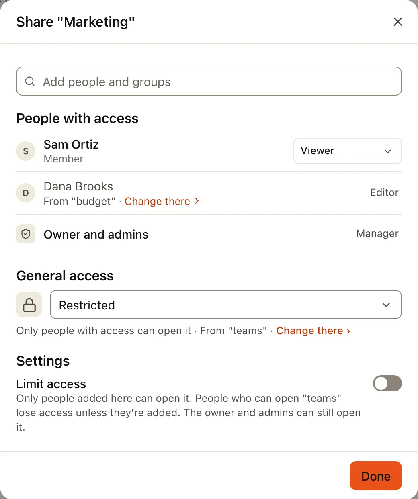
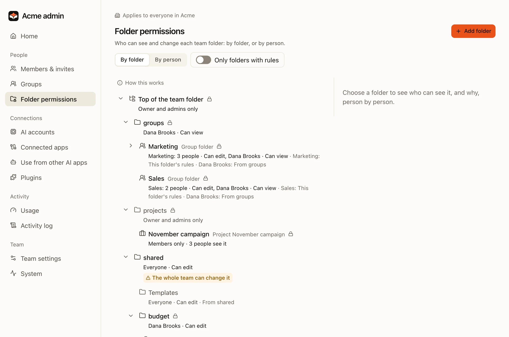
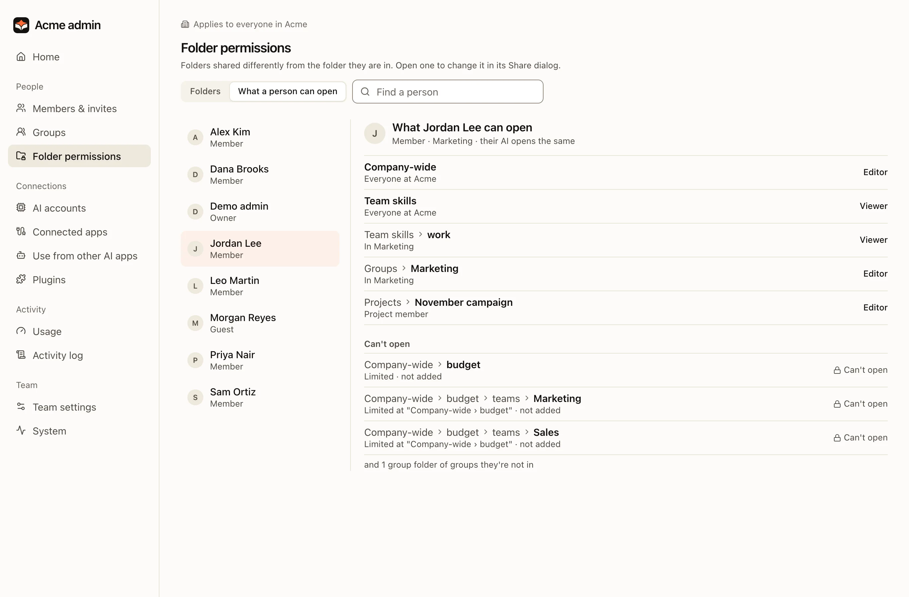
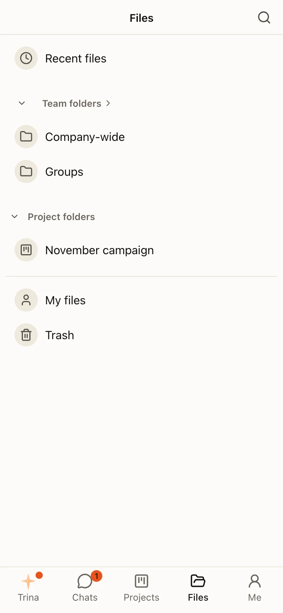

会社の知識は、サーバー上の 1 つのチームフォルダーに入っています。誰が何を見られるかは、フォルダーのルールで決まります。AI が依頼した本人より多くのものを見ることはありません。

## チームのフォルダー

| フォルダー | 見える人 | 用途 |
|---|---|---|
| `shared/` | ルールのとおり。ふつうは全員 | 全社向けの資料 |
| `groups/<group>/` | そのグループと、ルールで追加された人 | 営業や経理などのチームの資料。そのグループのスキルは中の `skills/` に置きます |
| `projects/<project>/` | ルールのとおり | 専用のフォルダーと指示を持つ仕事 |
| `skills/` | 全員が読めます。書き込めるのはスキル管理者です | チームスキルとチームのルール |
| `users/<id>/` | 本人だけ | 個人のファイルと個人のスキル |

## アクセスの決まり方

サーバー上の 1 つの権限チェックが、すべてのアクセスを判断します。AI がそれを迂回できないよう、OS が防いでいます。

- 開けないファイルは「拒否」されるのではなく、**見えなくなります**。ファイル画面、AI の回答、検索、プレビュー、バージョン履歴、ゴミ箱、リアルタイムの更新もすべて同じルールに従います。
- ある人のアクセスは、ファイルの上にあって、その人を指定している **いちばん近いルール** で決まります。人のルールはグループのルールより優先されます。複数のグループに入っている場合は、いちばん広いアクセスが適用されます。
- 変更は **すぐに** 反映されます。AI はツールを使うたびに権限を読み直します。
- アクセスを外しても、それまでにそのファイルを引用した回答は消えません。

## フォルダーを共有する

オーナーと管理者は、Google Drive と同じようにフォルダーを共有します。**ファイル › フォルダーの ⋯ › 共有**、または **管理 › フォルダーの権限 › 共有** を使います。どちらも同じダイアログが開きます。

:::steps
#### ユーザーやグループを追加する
名前を入力します。一人ひとり、またはグループごとに **閲覧者** か **編集者** を選びます。**アクセス権を削除** も同じメニューにあります。

#### 一般的なアクセスを確認する
**制限付き** の場合は、一覧にある人だけが開けます。またはチーム全体を **閲覧者** か **編集者** にします。独自の設定がないフォルダーには、上のフォルダーから受け継いだ内容が **そこで変更** と一緒に表示されます。

#### 保存する前に確認する
ダイアログには、誰がアクセスできるようになるか、誰ができなくなるかが表示されます。保存するまで何も変わりません。アクセスを広げるときは先に確認されます。上のフォルダーで入れる人を締め出す制限をかけるときも、同じく確認されます。
:::

アクセスは Google Drive と同じように足し算です。フォルダーで与えたアクセスは、上のフォルダーで与えたアクセスに上乗せされます。それより低い役割は選べません。その行には、高い役割がどこから来ているかが表示されます（「「全社共有」から受け継いだ編集者」）。

上のフォルダーより少ないアクセスにするには、**設定 › アクセスを制限** をオンにします。すると、そこに追加した人とグループだけが開けるようになります。**アクセス権が削除されました** には、上のフォルダーは開けてもこのフォルダーは開けない人が一覧で表示されます。**追加** を押すと、その人を閲覧者として戻せます。制限をまたオフにすると、上のフォルダーより低い役割は、上のフォルダーと同じレベルに引き上げられます。

オーナーと管理者は、チームのフォルダーをいつでも開けます。ただし、自分がメンバーでないプロジェクトは除きます。オーナーと管理者は、**管理権限** の 1 行にまとめて表示されます。

:::note
アクセスが足し算になったアップデートのあと、一部のフォルダーでは人が名前で一覧に載っています（**フォルダーの仕組みが変わったときに追加** というタグつき）。フォルダーの権限には、その人たちの名前を示すお知らせが 1 回だけ表示されます。名前で追加された人は、あとでグループを抜けてもアクセスが残ります。**管理 › グループ** とその人のページでは、保存する前にそのことが表示され、**今すぐ外す** を選べます。
:::

**管理 › フォルダーの権限 › フォルダー** には、入っているフォルダーと違う共有のしかたをしているフォルダーだけが、ファイル画面と同じ名前で一覧表示されます。人を締め出しているフォルダーには **制限あり** と表示されます。**共有** を押すと、そのフォルダーの共有ダイアログが開きます。プロジェクトのフォルダーは 1 行にまとまります。メンバーはプロジェクトの側で変更します。

**人が開けるもの** には、1 人の人（つまりその人の AI）について、フォルダーごとに閲覧者か編集者かとその理由、そして開けないフォルダーが表示されます。

:::warning
`skills/` には、メンバー全員の AI が従う指示が入っています。ここに書き込める人はスキル管理者になります。AI が `skills/` に保存する前に、サーバーが人に確認を求めます。グループの `groups/<group>/skills/` も同じです。そのグループのメンバー全員の AI が従い、グループのフォルダーに書き込めるメンバーなら誰でも変更できます。
:::

## ファイルを共有する

自分のファイルは、フォルダーを開ける人を変えずに、選んだ人だけに共有できます。**ファイル › ファイルの ⋯ › 共有** を使います。ユーザーまたはグループを追加して **共有** を押します。相手はそのファイルを見たりダウンロードしたりできますが、フォルダーのほかの中身は見えません。追加した人には **アクティビティ** に表示されます。

- **チームの全員** は、**ユーザーまたはグループを追加** の最初の選択肢です。**共有** を押す前に、チームの全員がそのファイルを開けるようになること、あとから参加する人もそうなることが一行で表示されます。ゲストは開けません。1 つのファイルを共有できる 50 人・グループのうちの 1 つとして数えます。
- 複数のファイルをまとめて共有すると（たとえば **このコンピューターで仕事のファイルを探す** の最後のステップ）、相手には **アクティビティ** に「Mina が 5 件のファイルを共有しました」という通知が 1 件だけ届き、開くとそのファイルの一覧が表示されます。名前で追加した人には、スマートフォンにも通知が届きます。
- **アクセスできるユーザー** には、オーナーと、**閲覧可** の各ユーザー・グループが並びます。**✕** でアクセスを外せます（先に確認が出ます）。
- チームのファイルは、そのフォルダーを開けるすべての人も開けます。
- **リンクをコピー** で、そのファイル専用のリンクをコピーします。アクセスできる人はそのまま開けます。それ以外の人には **アクセス権が必要です** と表示され、メモを添えて **アクセスをリクエスト** できます。リクエストはオーナーの **アクティビティ** に、**共有** と **断る** のボタン付きで届きます。開けない人には、リンクのページでもファイルの名前は表示されません。
- 開ける人が少ない場所へファイルを移すときは、リンクでそのファイルを持っている人が何人いるかが表示されます。

オーナーと管理者は、チームのファイルならどれでも共有できます。**管理 › チーム設定** の **メンバーが自分のファイルを共有できる** をオフにすると、メンバーは共有できなくなります（すでにした共有は使えたままです）。チームのオーナーは、同じ場所で **ファイルの共有をすべて削除** を使って一度に外せます。

### あなたに共有されたファイル

**ファイル › 自分に共有されたファイル** には、ほかの人があなたに共有したファイルが、新しい順に、共有した人と日時とともに並びます。フォルダーですでに開けるファイルは、誰かがあなたを名前で追加したときだけここに表示されます。ここからファイルを開くと、見たりダウンロードしたりできます。**‹ 自分に共有されたファイル** で一覧に戻ります。ファイルを開くと、**アクティビティ** のその通知は既読になります。アクセスできなくなったファイルは一覧から消えます（オーナーがあなたを外した、ゴミ箱に移した、編集できなくなったなど）。

## ファイルを扱う

- **アップロード**：ファイル画面から、ファイルやフォルダーごとアップロードします。
- **バージョン履歴**：変更のたびにバージョンが残り、開いたり復元したりできます。
- **ゴミ箱**：**ファイル › ゴミ箱** には、復元できるものが、名前と元の場所つきで表示されます（「price-sheet.xlsx · 全社共有 › Sales」）。何度も削除されたファイルは、コピーをまとめて 1 行で表示されます。**復元** を押すと最新のものが戻り、行を開くとほかのコピーも復元できます。ほかの人が削除したものも一覧にある場合は、**自分が削除** で自分の分だけを表示できます。チームの保存期間（管理 › チーム設定。標準は 30 日）が過ぎると、完全に削除されます。それぞれの行に、いつ削除されるかが表示されます。
- **形式**：AI は PDF、Office、HWP/HWPX のファイルから文字を読み取り、写真やスキャンしたページは画像として見ます（管理者はこれをオフにできます）。Linux サーバーでは OCR は行いません。
- **確認**：見られる人が限られた内容を、より多くの人が見られる場所に AI が書き込もうとするときは、サーバーが先に確認します。

## HTML を PDF にする

AI が作った見積書や報告書などの HTML ファイルを、ページと同じ見た目の PDF にできます。色や背景、結合した表のセル、ページ自身の `@page` ルールで決めた用紙サイズと余白（指定がなければ A4）、改ページもそのまま反映されます。

- **プレビューから**：`.html` ファイルを開き、プレビューの上部にある **PDFとして保存** を押します。PDF はページと同じ名前で、その隣に保存され、お知らせにリンクが表示されます。同じページの PDF を 2 つ目に作ると `name (2).pdf` として保存され、1 つ目を上書きすることはありません。読み取りしかできないフォルダーでは、代わりに PDF がダウンロードされます。スマートフォンでは **⋯** メニューにあります。
- **AI に頼む**：「quote.html を PDF にして」と頼みます。AI はページをそのまま印刷します。Markdown に書き直すことはありません。
- **PDF に使われるもの**：ページと、チームのフォルダーにあるそのページ用の画像、スタイルシート、フォントを相対パスで使います。Web のアドレスは読み込みません。Web 上の画像は、プレビューと同じく灰色の四角で表示されます。画像をチームのフォルダーに保存して、パスで指定してください。ページの中のスクリプトは動かないため、スクリプトで描く部分は表示されません。その部分はふつうの HTML で書いてください。
- **上限**：200 ページ、50 MB まで。1 ページにつき約 1 分かかります。サーバーでは一度にいくつかの PDF だけを作り、残りは順番を待ちます。
- **使える環境**：サーバーは、変換用のサンドボックスの中で、ネットワークなしのヘッドレス Chromium を使って印刷します。Linux サーバーでは、Debian の `chromium` パッケージが入っていれば使えます（開発環境はこれをインストールします。開発環境で作ったホスティング用のサーバーイメージにも入っています）。Linux サーバーでは、印刷ごとにほかの変換とは別のメモリ上限がかかり、サーバーに 3 GB 以上のメモリが必要です（同時に 2 つ印刷するには 6 GB から）。ブラウザーがないサーバーや、メモリが足りないサーバーでは、この操作は表示されず、AI は HTML を印刷できないと答えます。管理者は `MYCEL_HTML_PDF_BROWSER` でブラウザーを指定できます（[環境変数](../../reference/environment.md)（英語））。

詳しくは、[セキュリティと権限](../../../security-and-permissions.md)（英語）と[権限モデル（韓国語）](../../../PERMISSIONS.md)を参照してください。
