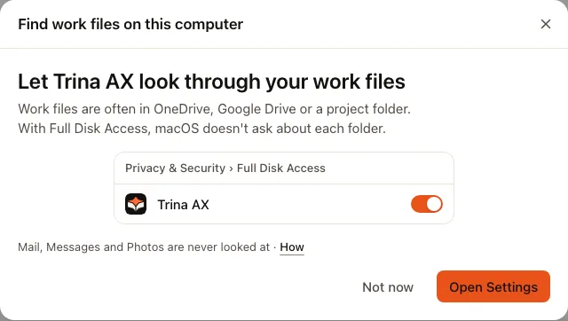
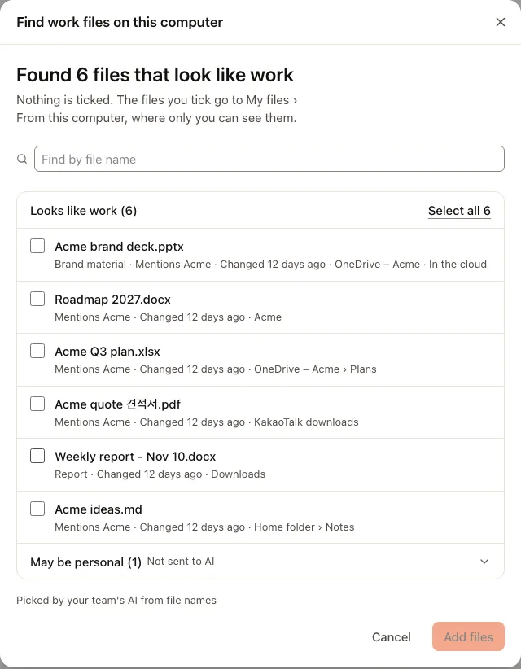

仕事のファイルはパソコンのあちこちにあります。OneDrive、ダウンロード、プロジェクトのフォルダーなどです。**Windows** のデスクトップアプリと **Web サイトからダウンロードした Mac アプリ** は、最近作業したファイルを探して、仕事のものらしいファイルを提案します。書式、報告書、提案書、ブランドの資料などです。どれを追加するかは**あなたが選びます**。あなたが選ばない限り、ファイルが追加・共有・移動されることはなく、パソコン上のファイルもそのままです。

探す場所は次のとおりです。

- **書類**、**デスクトップ**、**ダウンロード**。
- このパソコンにある **クラウドドライブのフォルダー**：OneDrive（と SharePoint）、Google Drive、Dropbox、Box。
- ホームフォルダーの中の **仕事のフォルダー**：会社や取引先と同じような名前のフォルダーや、*Work*、*Projects*、*Clients* のような仕事に関する言葉を含むフォルダー。
- **メッセンジャーのダウンロード**：KakaoTalk、Telegram、WhatsApp、Teams などが受け取ったファイルを保存するフォルダー。
- **最近開いたファイル**：ホームフォルダーの中ならどこでも。Windows では、ほかのドライブやネットワークドライブも含みます。

表示されるのは **最近の** ファイル（だいたい過去 6 か月以内に開いたか変更したもの）のうち、会社のものらしいファイルか、チームの AI が選んだファイルだけで、最大 50 件です。それ以外に見つかったファイルは、検索で探せます。

パソコンに残るもの：

- アプリが読むのは、ファイルの **名前、種類、サイズ、日付** だけです。ファイルを移動したり、名前を変えたり、変更したりすることはありません。
- **クラウドにしかない** ファイル（たとえば OneDrive の「オンライン専用」）は、探している間にダウンロードされません。一覧には **クラウド上** と表示されます。追加したときに初めてダウンロードされます。
- **メール、メッセージ、写真、Safari など、ほかのアプリのデータは一切見ません。** アプリが読むほかのアプリのデータは、macOS、Windows、Office が記録している最近開いた書類の一覧だけです。
- 仕事のファイルを選びやすくするため、**ファイル名**、ファイルが入っているフォルダーの名前、種類、サイズ、日付がチームの AI に送られることがあります。個人のものらしいファイル（給与明細、税金の書類、身分証、履歴書、医療関係の書類）は別に分けられ、名前が送られることはありません。
- ファイルの **中身** は、**追加** を押すまでパソコンから出ません。押したあとも、読み込まれて追加されるのはチェックを入れたファイルだけです。

## 始める

1. デスクトップアプリで、パソコン用のレイアウトになる広さのウィンドウで **ファイル › 自分のファイル** を開きます。
2. ツールバーの、フォルダをアップロードとアップロードの横にある **仕事のファイルを探す** をクリックします。

最近チームに参加した場合は、**ホーム** のようこそカードにも、任意の行として同じ **このコンピューターから仕事のファイルを取り込む** があります（デスクトップアプリのみ）。同じウィンドウが開き、同じ場所に追加されます。ファイルが入るとこの行は完了と表示され、カードのほかの部分を止めることはありません。

オーナーには、**はじめの設定 › チームのファイル** にも同じボタンが表示されます。そこでは、この手順のほかの部分と同じく、ファイルはチームのホームフォルダーに入ります。

## Mac の場合：フルディスクアクセスを一度だけ与える

書類、デスクトップ、ダウンロード以外の場所も探すには、Mac アプリに**フルディスクアクセス**が必要です。そのため、Mac ではアプリが最初に次の画面を表示します。**自分のファイル**から開くと見出しは**仕事のファイルを探す**（追加したファイルは自分だけが見られます）、**はじめの設定 › チームのファイル**からは**チームに必要なファイルを探す**です。

1. **設定を開く** をクリックします。システム設定が **プライバシーとセキュリティ › フルディスクアクセス** の画面で開きます。
2. 一覧にはすでに **Trina AX** があり、スイッチはオフになっています。アプリがこの画面を開いた時点で一覧に載るため、**+** を押す必要はありません。スイッチをオンにします。macOS が Mac のパスワードか Touch ID を求めます。
3. アプリに戻ります。アクセスが与えられると、画面は自動的に先へ進みます。

オンにしたのに画面が待ったままの場合は、アプリを再起動するまで macOS がスイッチを反映しないことがあります。**Trina AX を再起動** をクリックすると、アプリが再起動して同じ画面が自動で開き、そのまま先に進みます。（システム設定で **終了して再度開く** をクリックした場合も、同じ画面に戻ります。）

あとでアクセスを取り消すには、同じ場所でスイッチをオフにします。

**あとで** を押すと、この手順を飛ばします。その場合、アプリは書類、デスクトップ、ダウンロードだけを探し、macOS がそれぞれのフォルダーについて確認します（下記を参照）。

## アプリが最初に確認する

何かを見る前に、アプリが自分のウィンドウで確認します。探す場所がすべて一覧で表示され、何を読むかが説明されます。**これらの場所を確認**（**あとで** を選んだ場合は **これらのフォルダーを見る**）をクリックすると先に進み、**キャンセル** で中止します。

Windows では、確認はこれだけです。アプリはすぐに探し始めます。書類やデスクトップを OneDrive で管理している場合は、一覧に「書類 (OneDrive)」と表示されます。

## フルディスクアクセスがない場合（Mac）：macOS がフォルダーごとに確認する

**あとで** を選んだ場合、アプリは書類、デスクトップ、ダウンロードだけを探します。そのフォルダーを初めて読むときに、macOS がそのフォルダーについて確認します。「"Trina AX"が"書類"フォルダ内のファイルへのアクセスを求めています。」その下に、アプリの理由が英語で表示されます。*Looks for work files here. File contents stay on this Mac until you choose to add them.* （ここで仕事のファイルを探します。ファイルの中身は、追加を選ぶまでこの Mac から出ません。）確認は、フォルダーごとに 1 つずつ続けて表示されます。

- **許可**：アプリがそのフォルダーを探します。
- **許可しない**：アプリはそのフォルダーを飛ばし、一覧にそのことが表示されます。

macOS は答えを覚えているため、確認はフォルダーごとに 1 回だけです。iPhone で、アプリに写真を見せる前に一度だけ
確認が出るのと同じです。

## ファイルを選ぶ

- それぞれのファイルに、表示されている **理由** と **場所** が書かれています。「Acmeを含む · 2 日前に開いた · OneDrive – Acme › Plans」。
- **仕事のファイルらしい** には、会社のものらしい最近のファイルと AI が選んだファイルが、確かなものから順に並びます。
- **個人のファイルかもしれない** は折りたたまれていて、AI には送られません。開いてファイルにチェックを入れることもできます。そのファイルは自分のファイルに入り、自分にしか見えません。
- **最初はチェックが何も入っていません。** 必要なファイルにチェックを入れるか、**すべて選択** を使います。一度に追加できるのは 100 件、1 GB までです。
- **ファイル名で探す** を使うと、アプリが見つけたものすべてを検索できます。どちらのグループにも入っていないファイルも探せます。
- 50 MB を超えるファイルは一覧に表示されません。そうしたファイルはファイル画面から追加してください。とても大きなフォルダーは一部しか探さず、一覧にそのことが表示されます。

**n件を追加** をクリックします。ファイルは **自分のファイル › このコンピューターから** に入り、元の場所の名前がついたフォルダーに分けられます（書類 › Clients › …、OneDrive – Acme › …）。

## 一部をチームと共有する

ファイルが追加されると、同じウィンドウで **この中にチームと共有するファイルはありますか？** と聞かれます。今追加した
ファイルが並びます。**何もチェックされておらず**、**共有** を押すまで何も共有されません。

- **共有向き：書式**（会社紹介、ブランド資料、規程・ポリシー、研修資料、議事録も同様）は、チームでよく一緒に持つ
  種類のファイルの目印です。前のリストと同じ選び方かファイル名からのヒントにすぎないので、必要なものをチェックします。
- **ユーザーまたはグループを追加** で、見る人を追加します。いちばん上の **チームの全員** を選ぶと、チームの全員（あとから参加する人も、
  ゲストは除く）が開けます。**共有** を押す前に一行で知らせます。チームのメンバーを名前で、または自分が入っているグループを
  追加できます（チームのオーナーと管理者はどのグループでも追加できます）。ゲストは追加できません。
- **n 件を共有** をクリックします。チェックした各ファイルは、ファイル画面の **共有** とまったく同じように共有されます。
  追加した人は開いてダウンロードでき（閲覧のみ）、**アクティビティ** に通知が届きます。チェックしないファイルは自分だけの
  ままです。
- **あとで** は何も共有しません。その後も同じウィンドウの **チームと共有** でこの手順に戻れます。ファイル画面の
  **⋯ › 共有** からいつでも共有したり、アクセスを外したりできます。

チームで **メンバーが自分のファイルとフォルダーを共有できる** がオフになっている場合（管理 › チーム設定）、この手順は表示されません。

## 元に戻す

追加した直後なら、同じウィンドウの **元に戻す** で、今回追加したファイルをゴミ箱に移し、作ったフォルダーも空ならゴミ箱に移します。それ以外のものには触れません。もともと自分のファイルにあったファイルは、同じ名前でもそのまま残ります。元に戻すを押すと、いつまで **ゴミ箱** から戻せるかが表示されます。そのウィンドウを閉じたあとは、ファイル画面でいつもの方法でファイルを削除してください。パソコンにあるファイルが変わることはありません。

## フォルダーが飛ばされた場合（Mac、フルディスクアクセスなし）

**許可しない** と答えた場合、一覧に **「Trina AXはダウンロードを見られません · 自分で選ぶ」** と表示されます。3 つのフォルダーがどれも見られなかった場合は、一覧の代わりにそのことが表示されます。

- **自分で選ぶ** を押すと、Mac のフォルダーを選ぶウィンドウがそのフォルダーで開きます。そこで選ぶと、アプリがそのフォルダーを探せるようになります。
- または、フルディスクアクセスを与えて（上記）、もう一度探します。
- または、自分でファイルを追加します。**ファイル › フォルダをアップロード** を押して、フォルダーを選びます。

**許可しない** のあと、macOS はもう確認しません。また、そう答えたアプリは **プライバシーとセキュリティ › ファイルとフォルダ** の一覧に出てこないことがあるため、そこでオンにできるとは限りません。

## 使えないところ

- **ブラウザーとスマートフォン。** Web ページからフォルダーの中を探す方法はありません。ファイル画面の **フォルダをアップロード** を使ってください。
- **Mac App Store 版。** macOS では、App Store のアプリは自分で選んだフォルダーしか読めないため、この版ではファイル画面の **フォルダをアップロード** を使います。
- **ゲスト** には、この機能はありません。Linux 版のアプリにもありません。
