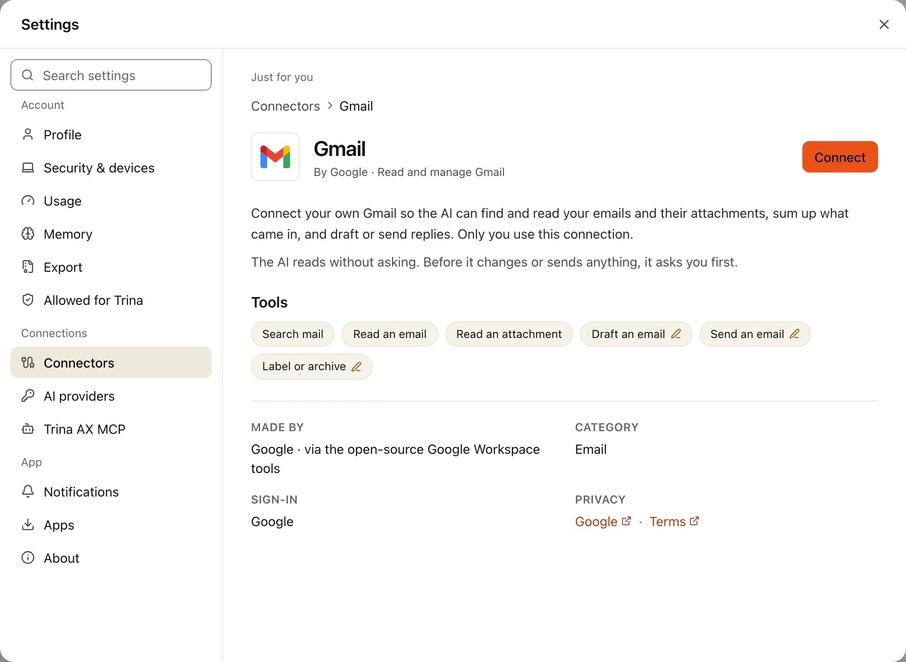
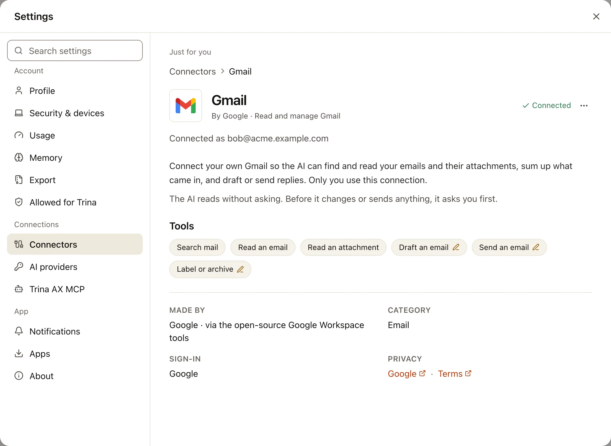
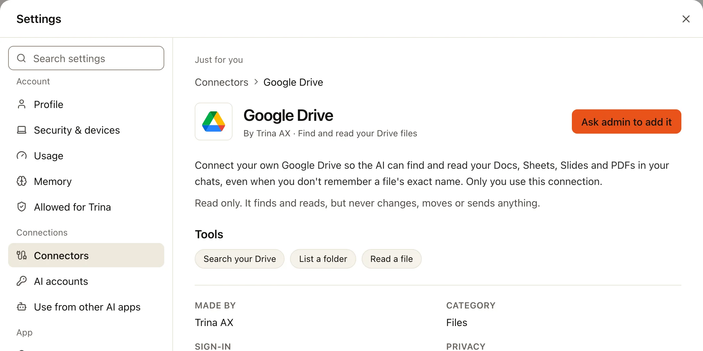
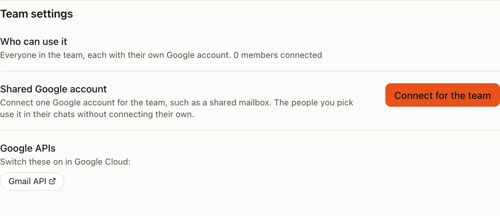
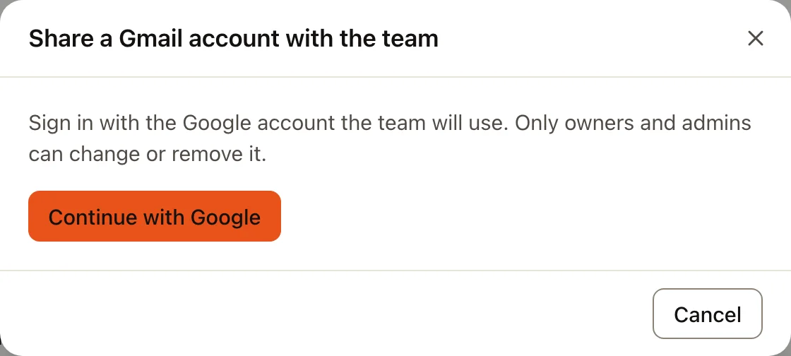
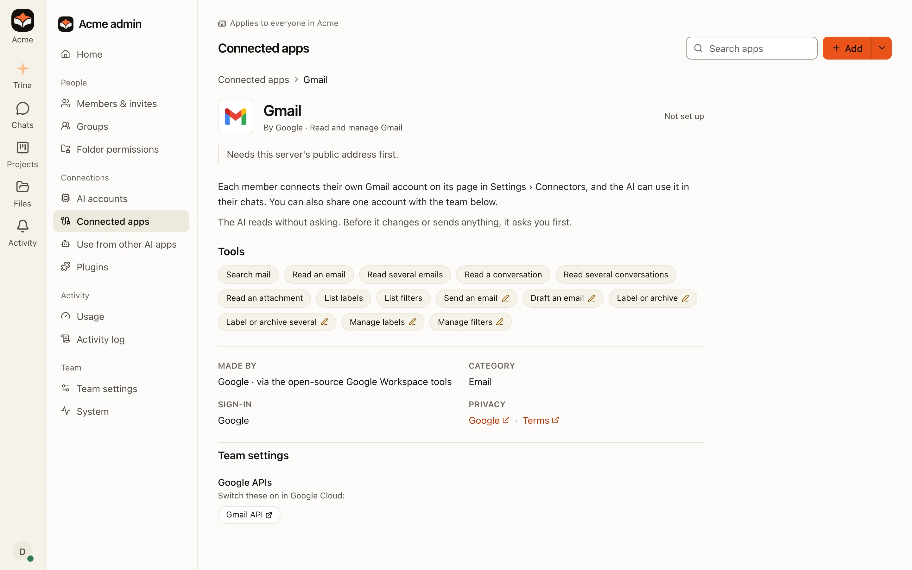

Google Drive、Gmail、Google カレンダー、Google ドキュメント、Google スプレッドシートは Trina AX に組み込まれています。各自がアプリごとに 1 回、自分の Google アカウントをつなぎます。AI はその人のチャットの中だけで、その人の Google の権限の範囲で使います。

コピーや貼り付けは必要ありません。Google でログインするだけです。

## Google アプリをつなぐ（全員）

:::tip
**必要なもの**

- 自分の Google アカウント（会社の Google Workspace アカウントまたは個人の Gmail アカウント）。ブラウザーでログインしておきます。
:::

:::steps
#### コネクターでアプリを開く
1. 左のバーの下にある自分の写真を選び、**設定** を選びます。
2. 左の一覧で **コネクター** を選びます。
3. **見つける** でアプリ（たとえば **Gmail**）を選びます。（見当たらないときは **サービスを検索** に名前を入力します。）

アプリのページが開きます。AI がそこでできることと、すべてのツールが載っています。何かを変更するツールには鉛筆の印がついています。
右上に **接続** があります。



#### 接続を選ぶ
新しいウィンドウで Google 自身のログインページが開きます（デスクトップアプリではブラウザーで開きます）。複数の Google
アカウントにログインしているときは、どのアカウントか Google が尋ねるので、使うアカウントを選びます。

#### すべての項目にチェックを入れたままにする
Google が Trina AX の名前と、許可する内容を 1 つの権限につき 1 行で表示します（「メールの閲覧、作成、送信」など）。
チェックボックスがついた行もあります。**すべての** 項目にチェックを入れたまま **続行** を選びます。チェックを外した項目があるとログインは拒否されます。「一部の権限にチェックが入っていませんでした。もう一度接続し、すべての項目にチェックを入れたままにしてください。」

#### アカウントを確かめる
Trina AX に戻ったら、表示されたアカウント（「このアカウントを接続しますか？」）を確かめて **このアカウントを接続** を選びます。ページの右上に **接続済み** と表示され、名前の下に「（あなたのアドレス）で接続中」と表示されます。


:::

読むだけなら確認はありません。AI がメールを送る、予定を追加する、ドキュメントを編集する前には、行う内容をすべて載せたカードを表示し、あなたの OK を待ちます。カードの上、またはアプリの **設定**（**⋯** メニュー）で、**先に確認する** の代わりに **常に許可** を選ぶこともできます。Google Drive は読むだけで、何かを変更、移動、送信することはありません。

### 「管理者に追加を依頼」と表示されたら

そのアプリはまだチームで設定されていません。**管理者に追加を依頼** を選ぶと、オーナーと管理者に通知が届き、接続できるようになったら知らせが来ます。



## チームで共有する Google アカウント（管理者）

`sales@acme.com` のような共有のメールボックスやカレンダーは、必要な人のために 1 回だけつなげます。何人かで開く Gmail の
共有メールボックスのようなものです。選んだ人は、自分のアカウントをつながなくてもチャットで使えます。

:::steps
#### 管理で Google アプリを開く
左のバーの上にあるチームのロゴを選び、**管理 › 連携サービス** を選んで、Google アプリ（たとえば Gmail）を選びます。
**チーム設定** までスクロールします。**チームで共有するGoogleアカウント** の行の右に **チームに接続** があります。



#### 共有アカウントでログインする
**チームに接続** を選びます。**Gmail アカウントをチームと共有** のダイアログが開きます。**Googleで続ける** を選び、
自分のアカウントではなく共有アカウントで Google にログインします。上と同じように、すべての項目にチェックを入れたままにし、
アカウントを確かめて **このアカウントを接続** を選びます。



#### 使う人を選んで保存する
**使える人** で全員、グループ、または人を選び、**保存** を選びます。保存するまでは誰も使いません。保存する前にダイアログを
閉じると、接続はまた削除されます。そのあと行には、アカウント、使う人、接続した人が **⋯** メニューとともに表示されます。
メニューには **使う人を変更**、**再接続**、**削除** があります。
:::

Google Drive には、同じ場所に **チームと共有** があります。**Google Driveをチームと共有** で Google アカウントを 1 つ
つなぎ、そのフォルダーを選びます。選んだ人は、チャットでそのフォルダーを使えます。

チャットからも同じです。オーナーか管理者が AI に Google Drive や Gmail（またはカレンダー、ドキュメント、スプレッドシート）を
つなぐよう頼むと、カードに **チームで接続** もあり、この同じダイアログが開きます。メンバーには自分のアカウントの接続だけが
表示されます。共有アカウントや共有された Drive をすでに使える人には、つなぐ必要はなく接続済みだと伝えます。

## Google アプリを設定する（自分たちで運用するサーバーの管理者）

Trina がホストするチームでは、Google ログインはすぐに使えるので設定は不要です。会社が自分で運用するサーバーでは、管理者が Google Cloud で Google ログイン用のアプリを 1 回作り、**管理 › 連携サービス** に追加します。

:::tip
**必要なもの**

- チームのサーバーの **公開 https アドレス**（Google から戻ってくる先です）。これがないうちは、Google アプリに「先にこのサーバーの公開アドレスが必要です。」と表示されます。設定はサーバーの運用担当者が行います。[Configuration](../../operate/configuration.md)（英語）を見てください。
- **Google Cloud プロジェクト**、各アプリに必要な **API** の有効化、種類が **Web application** の **ログイン用クライアント**。
- Google Cloud から：クライアントの **JSON ファイル**（または **クライアントID** と **クライアントシークレット**）。
- Google Cloud に入れるもの：Trina AX が表示する **戻り先アドレス**（Google Drive 用に 1 つ、ほかの 4 つのアプリ用に 1 つ）。
:::



:::steps
#### Google Cloud でアプリを作る
会社のアプリのページの [Google Cloud で](google-own-app.md#google-cloud-で) の手順に沿って進めます。プロジェクト、API、アプリの名前と対象（Google Workspace の会社なら **Internal**、それ以外はテストユーザー付きの **External**）、権限、**Web application** のクライアントを用意します。

#### 戻り先アドレスを追加する
クライアントの **Authorized redirect URIs** に、各アプリの **設定** ダイアログに表示されるアドレスを、コピーボタンでコピーして追加します。

```
https://<your team address>/api/integrations/google-drive/callback
https://<your team address>/api/integrations/google-apps/callback
```

#### Trina AX にファイルをアップロードする
**管理 › 連携サービス** で **Google Drive** を開き、**設定** を選びます。ダウンロードした JSON ファイルをアップロードするか、**クライアントID** と **クライアントシークレット** を貼り付けて保存します。続けて Gmail、Google カレンダー、ドキュメント、スプレッドシートを順に開き、**設定** を選んで **Google Drive と同じ Google アプリを使う** をオンにします。ほかにアップロードするものはありません。
:::

各アプリのページの **Google API** に、そのアプリで有効にする API が載っています。

| アプリ | 有効にする Google API |
|---|---|
| Google Drive | Google Drive API |
| Gmail | Gmail API |
| Google カレンダー | Google Calendar API |
| Google ドキュメント | Google Docs API、Google Drive API |
| Google スプレッドシート | Google Sheets API、Google Drive API |

Gmail、カレンダー、ドキュメント、スプレッドシートのアプリは Linux サーバーで動きます。Mac アプリでは、これらのページに「このチームのサーバーではまだ使えません」と表示されます。

## Google の画面に会社名を表示する

Google Workspace を使う会社は、すべての Google アプリのログインに会社独自の Google アプリを使えます。そうすると、Google の画面に会社名が表示され、警告も出ません。[会社独自の Google アプリを使う](google-own-app.md) を見てください。

## 困ったとき

| 表示 | 対処 |
|---|---|
| **一部の権限にチェックが入っていませんでした。もう一度接続し、すべての項目にチェックを入れたままにしてください。** | もう一度接続し、Google の画面のすべての項目にチェックを入れたままにしてください。 |
| **Googleから再ログインを求められています。** | アプリのページで **再接続** を選んでください。パスワードを変えたあとや、会社の管理者がアクセスを取り消したときに起こります。 |
| Google のページに **`redirect_uri_mismatch`**（自分で運用するサーバー） | Google Cloud の戻り先アドレスが、Trina AX の表示と違います。**設定** ダイアログからもう一度コピーしてください。 |
| **「このアプリはブロックされています」**（This app is blocked）または **`admin_policy_enforced`** | 会社の Google 管理者が、Google アカウントを使えるアプリを制限しています。アプリを信頼済みにするよう頼んでください。[管理コンソールでアプリを信頼する](google-own-app.md#任意管理コンソールでアプリを信頼する) を見てください。 |
| **このアプリは Google で確認されていません**（Google hasn't verified this app） | テスト中の External アプリです。管理者が作ったアプリの場合に限り **詳細** › **…（安全ではないページ）に移動**（Advanced › Go to …）を選んでください。または、会社独自のアプリに切り替えるよう管理者に頼んでください。 |

開発者と運用担当者向けの詳しい情報：[Google apps](../../../GOOGLE-APPS.md)（英語）、[Google Drive](../../../GOOGLE-DRIVE.md)（英語）。
