Google Drive、Gmail、Google カレンダー、Google ドキュメント、Google スプレッドシートをつなぐとき、ふだんは Trina 自身の Google アプリを通して Google でログインします。Google Workspace を使う会社は、代わりに **会社独自の Google アプリ** を使えます。IT 管理者が Google Cloud でアプリを 1 回作り、Trina AX に 1 回追加します。それ以降は 5 つの Google アプリすべてがそのアプリでログインし、Google の画面には会社名が表示されます。「未確認のアプリ」という警告は出ず、ログインできる人数の上限もありません。

所要時間は 15 分ほどです。大部分は Google Cloud での作業で、そのあと Trina AX でダイアログを 1 つ操作します。

:::tip
**必要なもの**

| 値 | 入手先 | 入れる場所 |
|---|---|---|
| 2 つの **戻り先アドレス** | Trina AX のダイアログの **Google Cloud で** の手順（それぞれに **コピー** があります） | Google Cloud › Clients › あなたのクライアント › **Authorized redirect URIs** |
| **権限**（スコープ）の一覧 | このページのブロック（[権限を追加する](#google-cloud-で)） | Google Cloud › **Data access** › **Manually add scopes** |
| クライアントの **JSON ファイル**（または **Client ID** と **Client secret**） | クライアントを作った直後の Google Cloud › **Clients** › **Download JSON** | Trina AX のダイアログの **ここに追加する** の手順 |
:::

:::note
このページのスクリーンショットには、架空のチーム「Acme」と、架空の Google Cloud プロジェクト「acme-trina」を使っています。Google のコンソールはときどき変わります。画面が違って見えるときは、本文で引用している表示名と、Google Cloud のページへのリンクに沿って進めてください。
:::

## 対象となる人

- **Google Workspace を使う会社**（全員が `name@acme.com` のような会社のアドレスでログインする）。このページはあなた向けです。Trina AX でチームのオーナーまたは管理者であり、会社の Google Cloud でプロジェクトを作れる必要があります。
- **個人の Gmail アカウントを使う人。** Trina のログインをそのまま使ってください。Internal のアプリは会社のアカウントしか受け付けません。

メンバーにとって変わることはほかにありません。同じページ、同じ **接続** ボタンです。切り替えたあと、Google を 1 回だけつなぎ直します。

:::tip
Google Workspace を使っていない小さなチームは、代わりに **Testing** 状態の **External** アプリを作れます。ログインできるのはテストユーザーとして登録した人だけ（最大 100 人）で、Google から 7 日ごとにログインし直すよう求められます。ほとんどのチームには、Trina のログインのほうが簡単です。
:::

## Google Cloud で

会社のアカウントで [Google Cloud](https://console.cloud.google.com/) にログインします。

:::steps
#### プロジェクトを作る
[New project](https://console.cloud.google.com/projectcreate) を開きます。「acme-trina」など、わかりやすい **Project name**（プロジェクト名）を付けます。**Parent resource**（または **Organization**）では会社を選びます。プロジェクトが会社の組織に属していないと、アプリを **Internal** にできません（画像の「No organization」は架空のアカウントのためです）。**Create** を選び、次の手順に進む前に、ページ上部で新しいプロジェクトが選ばれていることを確かめます。

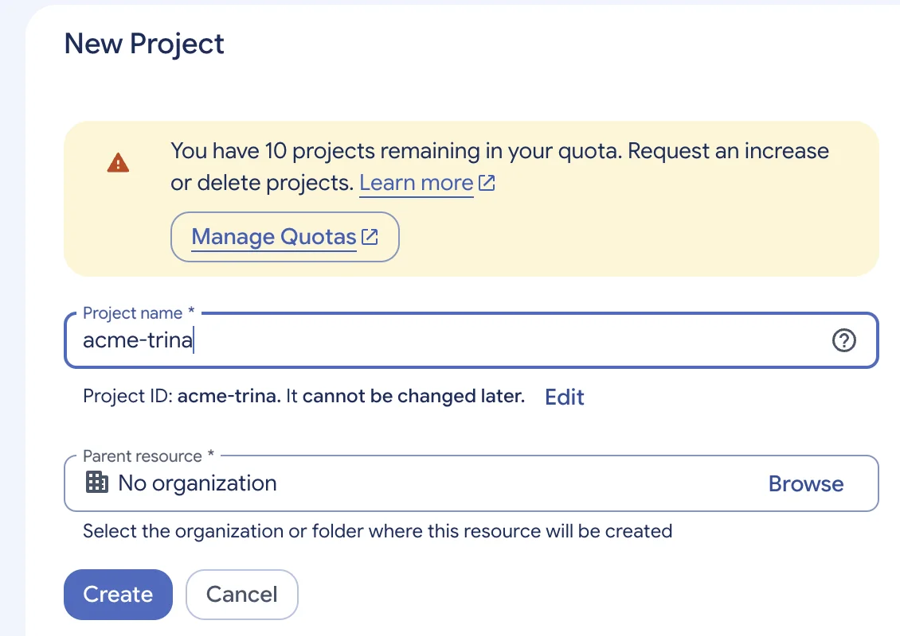

#### 5 つの API を有効にする
下のページを 1 つずつ開き、**Enable** を選びます。

- [Google Drive API](https://console.cloud.google.com/apis/library/drive.googleapis.com)
- [Gmail API](https://console.cloud.google.com/apis/library/gmail.googleapis.com)
- [Google Calendar API](https://console.cloud.google.com/apis/library/calendar-json.googleapis.com)
- [Google Docs API](https://console.cloud.google.com/apis/library/docs.googleapis.com)
- [Google Sheets API](https://console.cloud.google.com/apis/library/sheets.googleapis.com)

今は一部の Google アプリしか使っていなくても、5 つすべてを有効にしてください。有効になった API のページには、**Enable** の代わりに **Manage** と **API Enabled** が表示されます。

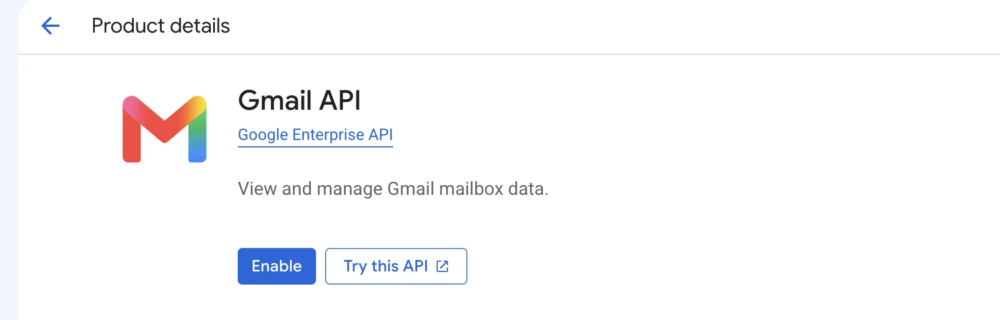

#### アプリに名前を付けて Internal にする
[Google Auth Platform](https://console.cloud.google.com/auth/overview) を開きます。初回は **Get started** が表示されます。

1. **App Information**：「Acme Trina」など、みんながわかる **App name** と、**User support email** を入力します。
   **Next（次へ）** を選びます。

   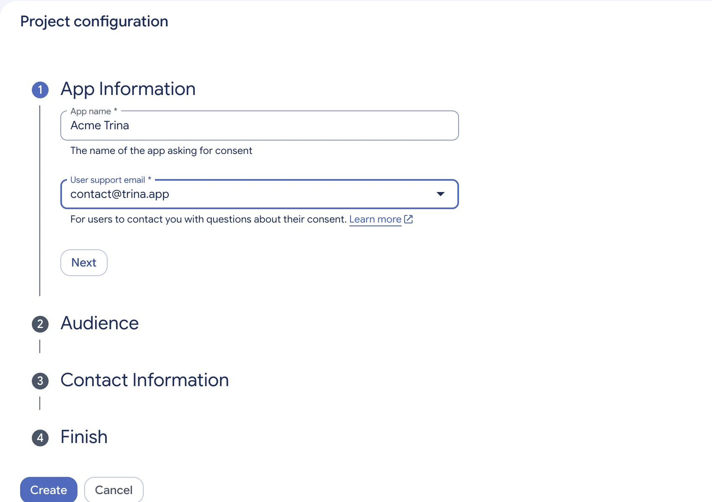

2. **Audience**：**Internal** を選びます。会社のアカウントだけがアプリを使え、Google の審査も不要です。（画像では **Internal** がグレーになっています。架空のアカウントには組織がないためです。会社のアカウントなら選べます。）

   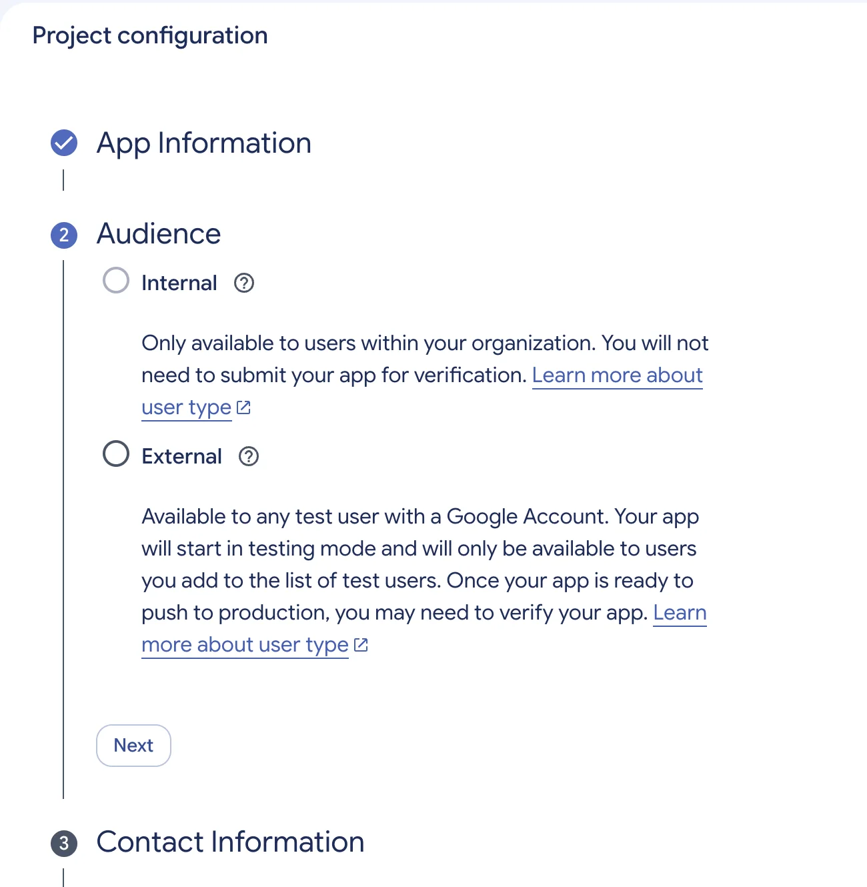
3. **Contact Information**：このプロジェクトについて Google から連絡を受けるメールアドレスを入力します。
4. **Finish**：Google のポリシーに同意して **Create** を選びます。

これらはあとから [Branding](https://console.cloud.google.com/auth/branding) と [Audience](https://console.cloud.google.com/auth/audience) で変更できます。

#### 権限を追加する
[Data access](https://console.cloud.google.com/auth/scopes) を開き、**Add or remove scopes** を選びます。

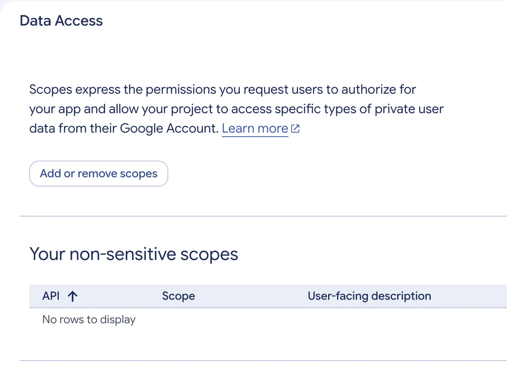

右にパネルが開きます。その下のほうにある **Manually add scopes** に下のブロックを丸ごと貼り付け、**Add to table**、**Update** の順に選び、最後にページの **Save** を選びます。

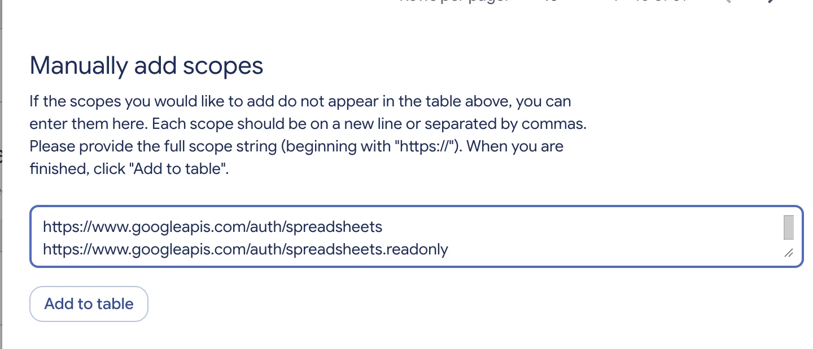

```
openid
https://www.googleapis.com/auth/userinfo.email
https://www.googleapis.com/auth/userinfo.profile
https://www.googleapis.com/auth/drive.readonly
https://www.googleapis.com/auth/drive.file
https://www.googleapis.com/auth/gmail.readonly
https://www.googleapis.com/auth/gmail.send
https://www.googleapis.com/auth/gmail.compose
https://www.googleapis.com/auth/gmail.modify
https://www.googleapis.com/auth/gmail.labels
https://www.googleapis.com/auth/gmail.settings.basic
https://www.googleapis.com/auth/calendar
https://www.googleapis.com/auth/calendar.readonly
https://www.googleapis.com/auth/calendar.events
https://www.googleapis.com/auth/documents
https://www.googleapis.com/auth/documents.readonly
https://www.googleapis.com/auth/spreadsheets
https://www.googleapis.com/auth/spreadsheets.readonly
```

これは、Trina AX が 5 つのアプリ全体で求める権限そのものです。1 つも省かないでください。どれかが欠けたログインは拒否されます。

#### ログイン用クライアントを作る
[Clients](https://console.cloud.google.com/auth/clients) を開き、**Create client** を選びます。

1. **Application type**：**Web application**。
2. **Name**：「Trina AX」など、何でもかまいません。ほかの人には表示されません。

   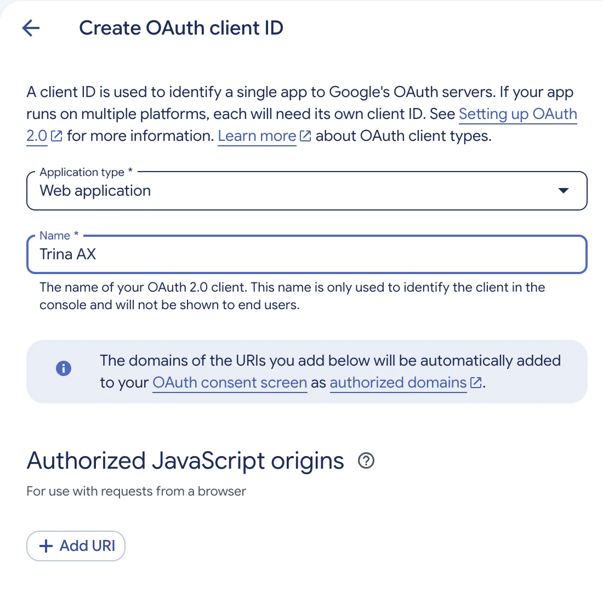

3. **Authorized redirect URIs** で **Add URI** を 2 回選び、2 つの戻り先アドレスを貼り付けます。アドレスは Trina AX からコピーします（次のパートのダイアログに、それぞれ **コピー** 付きで表示されます）。チームのアドレスが入った、次のような形です。

   ```
   https://<your team address>/api/integrations/google-drive/callback
   https://<your team address>/api/integrations/google-apps/callback
   ```

   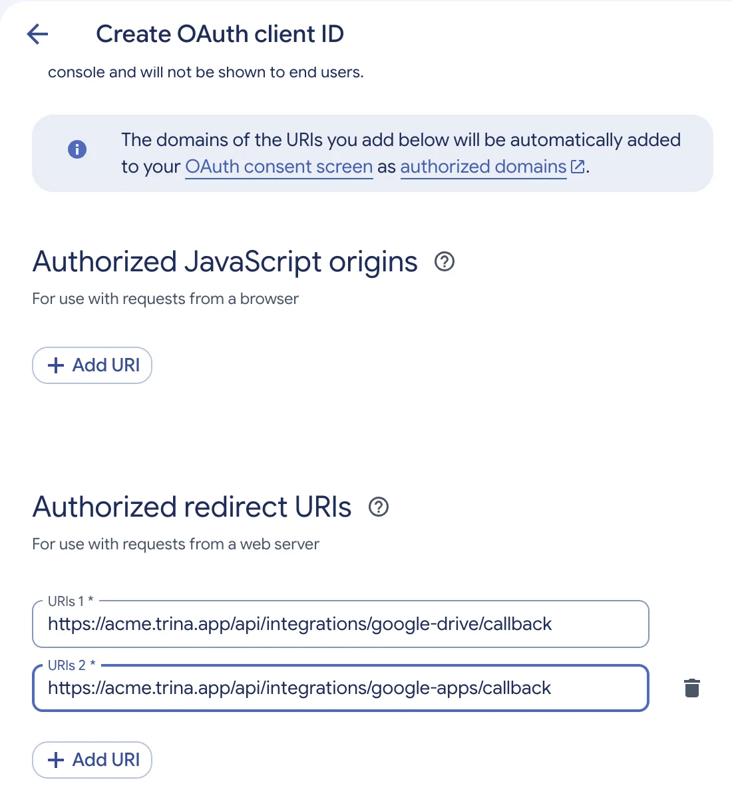

4. **Create** を選びます。**OAuth client created** で **Download JSON** を選び、ファイルを保管します。シークレットが表示されるのはこのときだけです。なくした場合は、クライアントに新しいシークレットを作ります。

   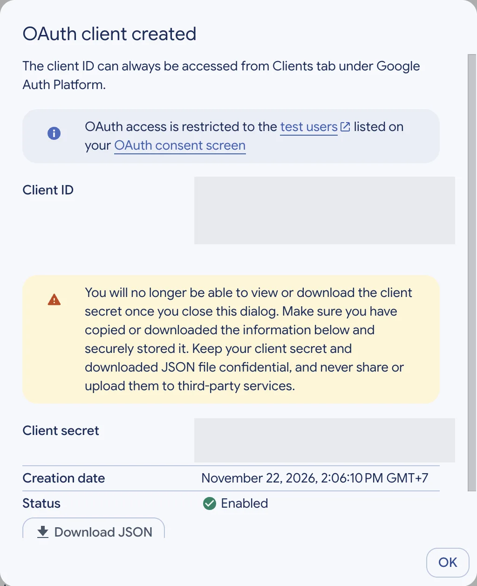
:::

## Trina AX で

:::steps
#### Google のページを開く
**管理 › 連携サービス** で、どれか 1 つの Google アプリ（たとえば **Gmail**）を選びます。5 つのページはどれも最後が **チーム設定** で、その最初の行が **Google ログイン** です。「全員が Trina の Google アプリでログインします。代わりに会社独自の Google アプリを使うこともでき、ここにあるすべての Google アプリに適用されます。」

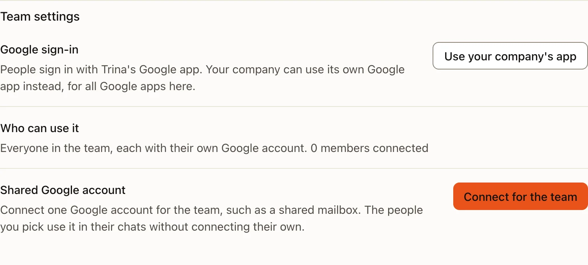

#### 会社のアプリを使うを押す
**会社の Google アプリを使う** ダイアログが開きます。最初の手順 **始める前に** には、対象となる人と、このページへのリンクがあります。

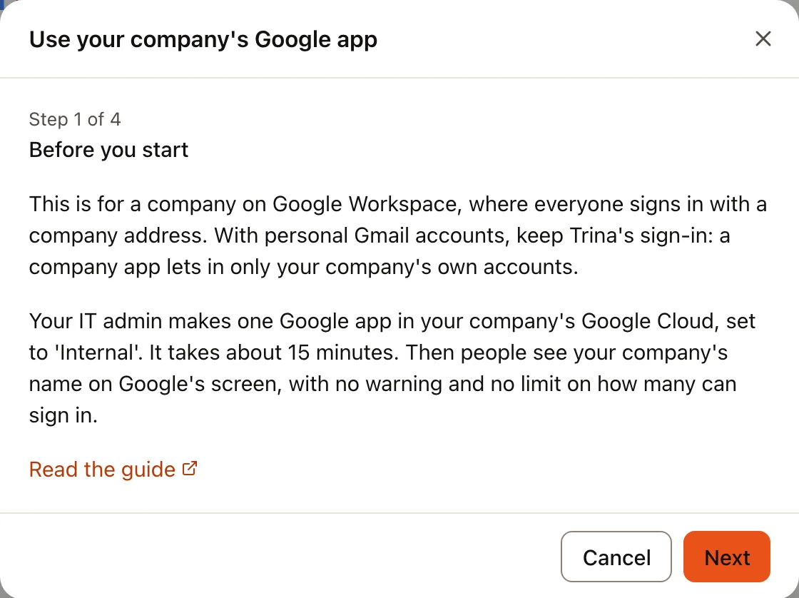

#### Google Cloud で
2 番目の手順には、上の Google Cloud での手順が各ページへのリンク付きで並び、チームの 2 つの戻り先アドレスがそれぞれ **コピー** 付きで表示されます。正確に入るよう、ここからコピーして **Authorized redirect URIs** に貼り付けます。

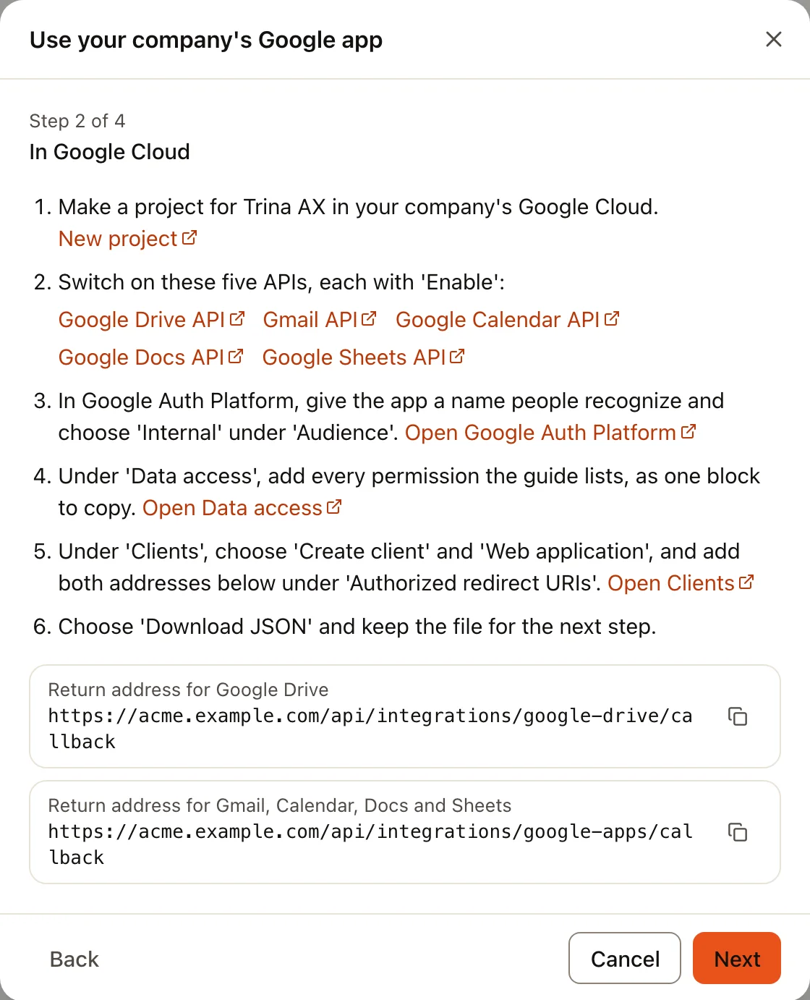

#### ここに追加する
Google からダウンロードしたファイルをドロップするか、選びます。手で入力したいときは、**代わりに ID とシークレットを入力する** を選ぶと **クライアントID** と **クライアントシークレット** の 2 つの欄が開きます。2 つの戻り先アドレスが両方とも入っていないファイルは拒否され、Google Cloud でどちらを追加すればよいかが表示されます。

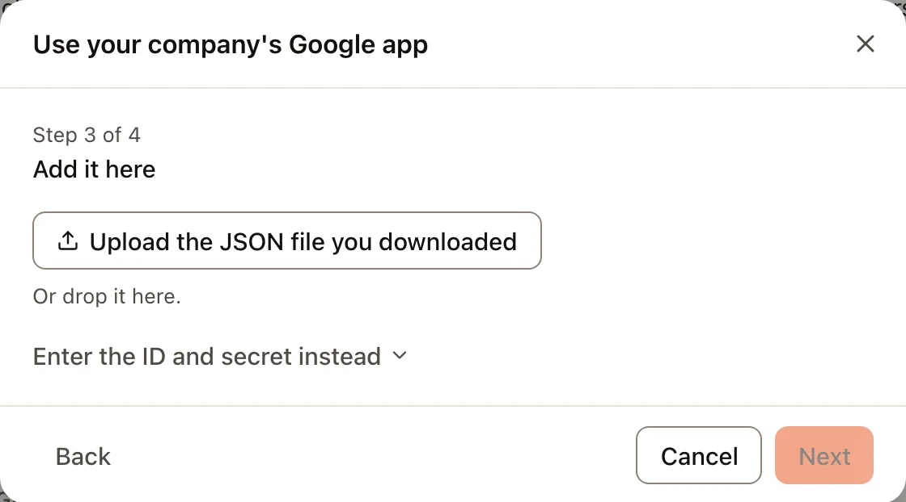

#### 確認して保存する
最後の手順 **保存する前に** には、何が変わるかがチームの数字とともに表示されます。Google をつなぎ直す必要がある人数と、チームで共有する Google アカウントやチームと共有した Drive は管理者がつなぎ直す必要があることです。**保存** を選ぶまで何も変わりません。**キャンセル** を選ぶと、すべて元のままです。

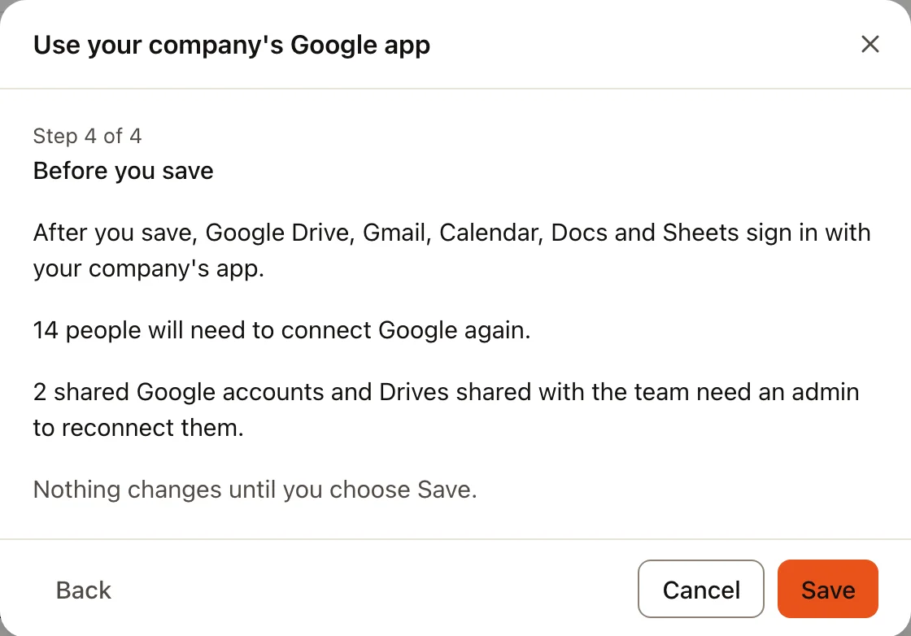
:::

**保存** のあと、行には「全員が会社の Google アプリでログインします。Google ドライブ、Gmail、カレンダー、ドキュメント、スプレッドシートに適用されます。」と、設定した人と日時が表示されます。⋯ メニューには **置き換える**（たとえば新しいシークレットを作ったあとに新しいファイルを追加する）と **Trina の Google ログインに戻す** があります。設定は 1 回だけです。この行は 5 つの Google のページすべてで同じです。

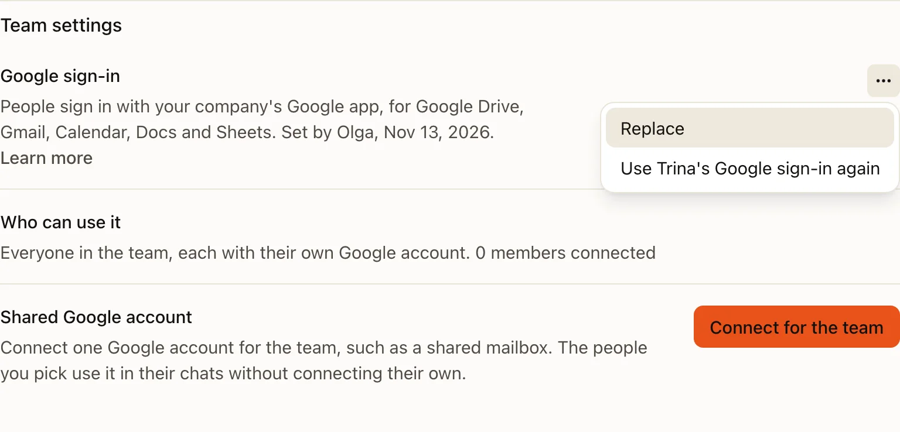

スマートフォンでは、スマートフォンの設定画面と同じように、⋯ は行の名前の横にあります。

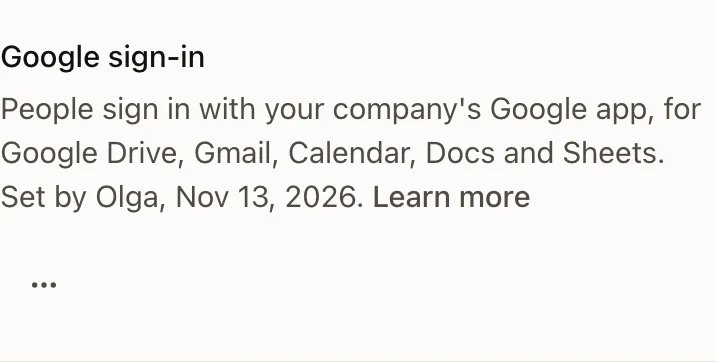

## メンバーに表示されるもの

Google はログインを、それを作ったアプリに結び付けます。そのため、切り替えると、Trina のアプリを通して作った Google への接続はすべて使えなくなります。

- **各自** の **設定 › コネクター** の Google アプリに、いつもの **再接続** が 1 回表示されます。そのあと Google の画面には会社のアプリの名前が表示され、警告は出ません。
- **チームで共有する Google アカウントとチームと共有した Drive** は、それぞれの Google のページの **チーム設定** に **再接続** が表示されます。管理者がつなぎ直すまで、AI はそれらを使えません。

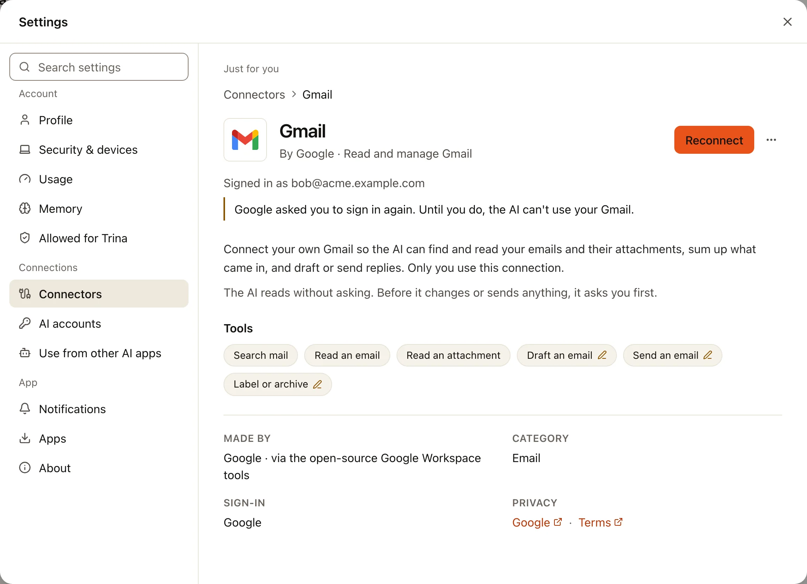

## 任意：管理コンソールでアプリを信頼する

会社が Google アカウントを使えるアプリを制限している場合は、Google Workspace の特権管理者がこのアプリを信頼済みにします。
これをしないと、接続するときに `admin_policy_enforced` と表示されることがあります。

1. アプリのクライアント ID を確かめます。ダウンロードした JSON ファイルの `"client_id":` のあとと、
   [Clients](https://console.cloud.google.com/auth/clients) のクライアントのページにあります。末尾は `.apps.googleusercontent.com` です。
2. 特権管理者として [管理コンソール](https://admin.google.com/) にログインします。
3. 左のメニューで **Security**、**Access and data control**、**API controls** の順に開きます。
4. **Manage Third-Party App Access**、**Configure new app** の順に選びます。
5. 検索欄にクライアント ID を貼り付け、一覧から自分のアプリを選びます。
6. 対象（ふつうは組織全体）を選び、**Trusted** に設定して、**Configure** で終えます（Google の最後のボタンです。
   名前は少し違うことがあります）。

## Trina AX が保存するもの

- アプリの ID とシークレットは、**チームのサーバー上の非公開ファイル** に保存され、サーバーだけが読めます。二度と表示されません。ページにも、ログにも、操作ログにも出ません。
- ホスト型のチームでは **Trina のホスティングサービスがそのサーバーを運用している** ため、そのファイルも Trina のホスティングサービスが運用する場所にあります。シークレットだけでは何も開けません。各自が Google でログインし、そこで同意する必要があります。
- 各自の Google ログインは、これまでどおりサーバーに暗号化して保存されます。

## Trina のログインに戻す

どれかの Google のページの **チーム設定 › Google ログイン** で ⋯ を開き、**Trina の Google ログインに戻す** を選びます。まず **保存する前に** と同じ数字が表示されます。確定すると、5 つの Google アプリはすべて再び Trina のアプリを通してログインするようになり、各自が Google を 1 回つなぎ直します。会社のアプリのファイルはサーバーから削除されます。そのあと、Google Cloud でクライアントを削除してかまいません。

チームのアドレスが変わると、Google ログインの行にそのことが表示されます。Google Cloud のクライアントに新しい 2 つの戻り先アドレスを追加し、ファイルをもう一度ダウンロードしてから、Trina AX で ⋯ › **置き換える** を開きます。ダイアログが **Google Cloud で** の手順で開き、コピーする新しいアドレスが表示されます。それまでは、誰も Google をつなげません。

## 困ったとき

| 表示 | 対処 |
|---|---|
| Google のページに **`redirect_uri_mismatch`** | Google Cloud の戻り先アドレスが抜けているか、1 文字違います。[Clients](https://console.cloud.google.com/auth/clients) を開いてクライアントを選び、ダイアログの **Google Cloud で** の手順から 2 つのアドレスを貼り直してください。保存が反映されるまで数分かかることがあります。 |
| **「一部の権限にチェックが入っていませんでした。もう一度接続し、すべての項目にチェックを入れたままにしてください。」** | Google の画面でチェックが外されたか、**Data access** に権限が足りません。上のブロックがすべて載っているか確かめ、すべての項目にチェックを入れたまま、もう一度接続してください。 |
| **`admin_policy_enforced`** | 会社の管理コンソールがアプリをブロックしています。信頼済みにしてください（[上記](#任意管理コンソールでアプリを信頼する) を参照）。 |
| **会社の外のアカウント** が拒否される（このアプリは組織内でしか使えないと Google に表示される） | それが **Internal** の意味です。会社のアカウントを使ってください。チームで共有する Google アカウントも会社のアカウントである必要があります。 |

開発者と運用担当者向けの詳しい情報：[Google apps](../../../GOOGLE-APPS.md)（英語）、[Google Drive](../../../GOOGLE-DRIVE.md)（英語）。
