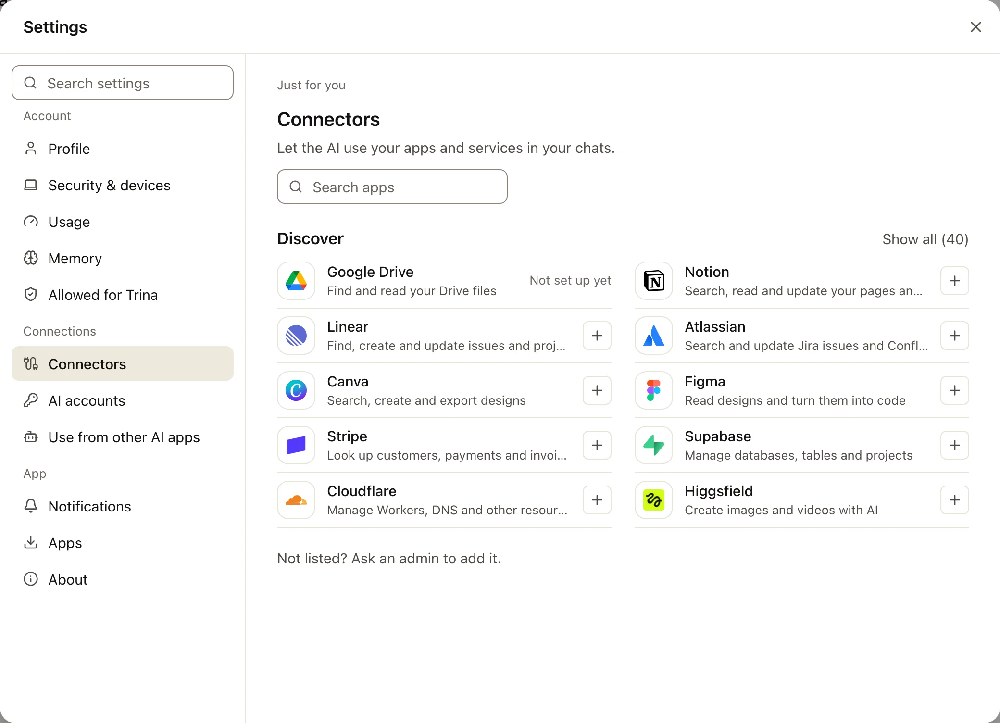
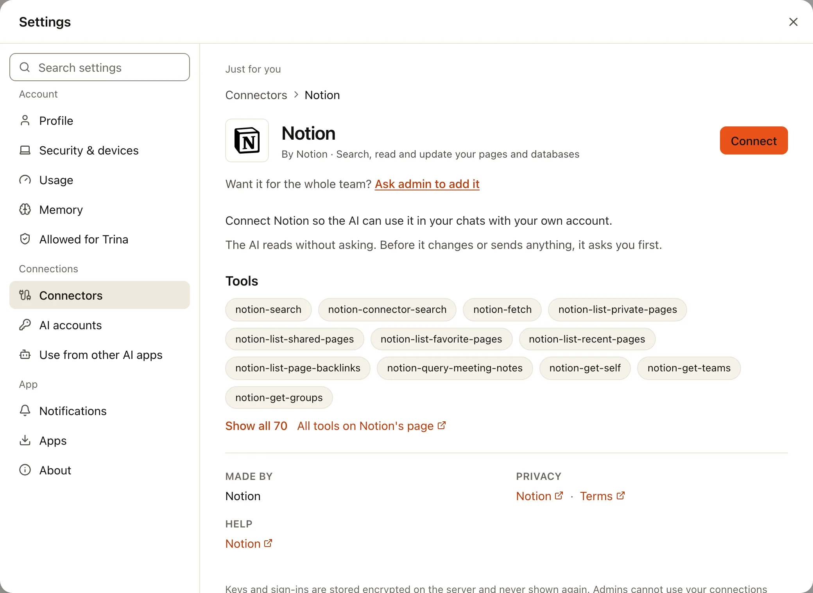
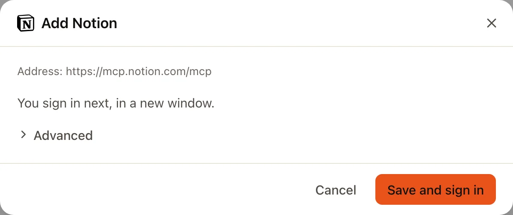
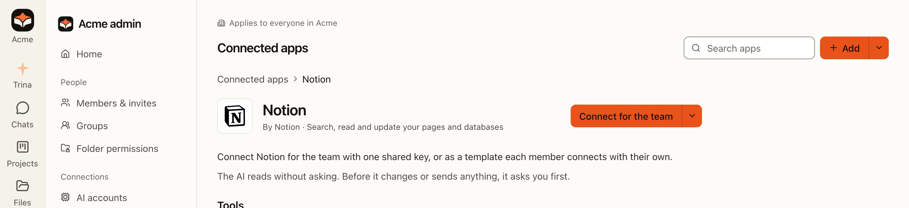
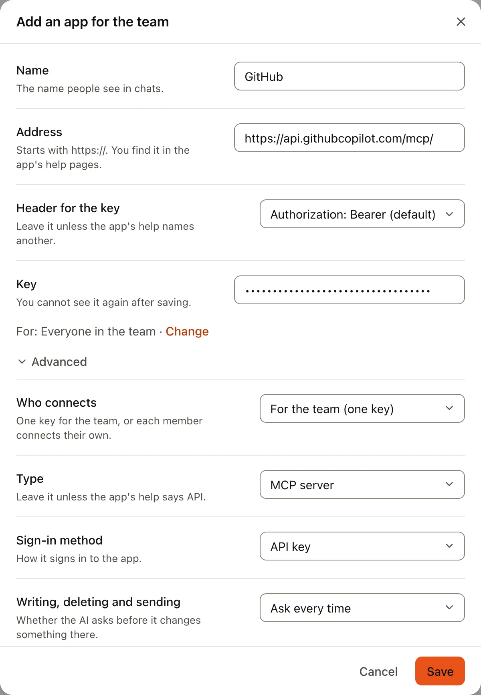

AI は Trina AX の外にあるアプリをあなたの代わりに使えます。Notion のページを検索する、Linear の課題を開く、Jira のチケットを読む、といったことです。アプリは 1 回つなげば済みます。ほとんどのアプリはコピーするものがなく、アプリ自身のページでログインするだけです。GitHub など一部のアプリは、代わりにキーを発行します。

:::note
0.4.0 より前のバージョンでは、この画面の名前は **External services** です。これらの接続には、アプリが AI にツールを提供するための一般的なしくみである MCP を使います。使うだけなら、それ以上知る必要はありません。
:::

## アプリのつなぎ方

| アプリ | 必要なもの | ガイド |
|---|---|---|
| Notion、Linear、Atlassian（Jira、Confluence）、Figma、Canva、Stripe、Supabase、Cloudflare、Higgsfield など **見つける** にあるアプリ | そのアプリのあなたのアカウント。コピーするものはありません | [「見つける」のアプリにログインする](#見つけるのアプリにログインする) |
| GitHub | 自分の GitHub アカウント。コピーするものはなし | [GitHub](#github) |
| 「MCP server」のアドレスを公開しているその他のアプリ | そのアドレスと、アプリが求める場合はキー | [アドレスでアプリを追加する](#アドレスでアプリを追加する) |
| 会社独自のシステム（API） | アドレス、キー、メモ | [会社の API](api-connections.md) |
| Google Drive、Gmail、カレンダー、ドキュメント、スプレッドシート | あなたの Google アカウント | [Google アプリ](google-apps.md) |
| Slack | メンバーは不要。管理者が 1 回追加します | [Slack](slack.md) |

## 自分用かチーム用か

| | 自分用 | チーム用 |
|---|---|---|
| 場所 | **設定 › コネクター** | **管理 › 連携サービス**（オーナーと管理者） |
| AI が使うアカウント | あなたのアカウント | ログインしたアカウント、または保存されたキー |
| 使う人 | あなただけ（自分のチャットで） | 管理者が選んだ全員、グループ、または個人 |
| 見られる人 | あなただけ（管理者も見られません） | 管理者 |

チームの接続は **1 回、1 つのアカウントとして** ログインします。対象の全員が、そのアプリではそのアカウントとして動きます。各自が自分として動くべき場合（自分の Notion ページ、自分の GitHub の権限など）は、代わりに [テンプレート](#テンプレートメンバーが各自のキーを使う) を作るか、各自が自分用につなぐようにします。

## 「見つける」のアプリにログインする

:::tip
**必要なもの**

- そのアプリ（Notion、Linear など）のアカウント。ブラウザーでログインしておきます。
- コピーや貼り付けはありません。Trina AX がアプリの公式アドレスを入力します。
:::

:::steps
#### コネクターを開く
左のバーの下にある自分の写真を選び、**設定 › コネクター** を開きます（スマートフォンでは **自分** タブ）。**見つける** に、つなげるアプリが並んでいます。**すべて表示** ですべてのアプリが表示され、**アプリを検索** で名前から探せます。

#### アプリを開いて接続を選ぶ
アプリのページには、AI がそこでできることとツールの一覧があります。**接続**（または一覧の **+**）を選びます。メンバーには、チーム全体で使えるよう依頼する **管理者に追加を依頼** も表示されます。

#### 保存してログイン
ダイアログにアプリの公式アドレスが表示されます。**詳細設定** はそのままにして、**保存してログイン** を選びます。

#### アプリのページでアクセスを許可する
アプリ自身のページ（Notion、Linear など）が新しいウィンドウで開きます。求められたらログインし、ワークスペースを選んで **Allow**（ボタン名は **Continue** や **Accept** のこともあります）を選びます。ウィンドウが閉じ、Trina AX に **ログインしました。** と表示されます。アプリは **自分のコネクター** に移り、**接続済み** と表示されます。
:::

チーム用には、管理者が **管理 › 連携サービス** で同じことを行います。

1. 左のバーの上にあるチームのロゴを選び、**管理 › 連携サービス** を選んで、**見つける** からアプリを開きます。
2. **チーム用に接続** を選びます。（横の矢印からは、代わりに **テンプレート：メンバーが各自接続** を選べます。
   [テンプレート](#テンプレートメンバーが各自のキーを使う) を参照してください。）
3. ダイアログに、アプリのアドレスと **使える人: チーム全員** という行が表示されます。グループや人を選ぶときは、その行の
   **変更** を選びます。
4. **保存してログイン** を選び、チームで共有するアカウントでアプリのページにログインして、上と同じようにアクセスを許可します。
   アプリが **接続済み** に移ります。

ログインはパソコン（ブラウザーまたはデスクトップアプリ）で行う必要があります。一度つなげば、スマートフォンでも使えます。

## GitHub

GitHub は、一覧にある他のアプリと同じようにサインインでつなぎます。作ったりコピーしたりするトークンはありません。サーバーが持つ GitHub App でサインインするので、各自が自分の GitHub アカウントでサインインし、AI が見てよいリポジトリを選びます。Trina がホスティングするチームではすぐ使えます。自分で運用するサーバーでは、運用者が先に GitHub App を追加します。それまでは GitHub のページに「このサーバーでは GitHub がまだ設定されていません」と表示されます。

:::tip
**必要なもの**

- ブラウザでサインインした自分の GitHub アカウント
:::

:::steps
#### 接続を選ぶ
**見つける** で GitHub を開き、**接続** を選びます。GitHub のページが開きます（デスクトップアプリではブラウザで）。

#### リポジトリを選ぶ
GitHub が、アプリが開いてよいリポジトリを尋ねます。AI に必要なものだけを選ぶと、AI はそれだけを見ます。

#### 完了
Trina AX に戻ると、行に **接続済み** と表示されます。AI は何かを変更する前に確認し、**常に許可** を選ぶこともできます。
:::

チーム全体では、管理者が GitHub をチーム用に接続して使える人を決めるか、各自が自分のアカウントでサインインする [テンプレート](#テンプレートメンバーが各自のキーを使う) を作ります。

## アドレスでアプリを追加する

「MCP server」のアドレスを公開しているアプリなら、見つけるにないものでも追加できます。オーナーと管理者が **管理 › 連携サービス** › **アドレスで追加** で追加します。メンバーには「一覧にありませんか？管理者に追加を頼んでください。」と表示されます。

:::tip
**必要なもの**

- **アドレス**：アプリのヘルプページにあります。たいていは「MCP」「MCP server」「Connect to AI tools」といったページです。`https://` で始まり、`/mcp` で終わることがよくあります。
- アプリのログイン方法：アプリ自身のページで行う（**ログイン（OAuth）**）、キーを使う（**APIキー**）、またはログインなし（**なし**）。
- キーを使う場合：アプリの設定（「API keys」「Tokens」「Developer」）で作る **キー** と、アプリのヘルプに `X-API-Key` などの名前があれば **ヘッダー名**。
:::

ダイアログの欄：

| 欄 | 入れるもの |
|---|---|
| **名前** | チャットで表示される名前（「GitHub」など）。 |
| **アドレス** | アプリの MCP アドレス。`https://` で始まります。 |
| **接続する人**（詳細設定） | **チームで1つ** または **メンバーごとに各自**。 |
| **種類**（詳細設定） | **MCPサーバー**。ふつうの Web API の場合だけ **API** を選びます。[会社の API](api-connections.md) を見てください。 |
| **ログイン方法**（詳細設定） | アプリのヘルプに従って **ログイン（OAuth）**、**APIキー**、**なし** のどれか。 |
| **キーを送るヘッダー** | アプリのヘルプに別のヘッダーが書かれていなければ、**Authorization: Bearer（既定）** のままにします。書かれていれば **別のヘッダー** を選び、その **ヘッダー名** を正確に入力します。 |
| **キー** | キー全体を貼り付けます。保存後は二度と見られません。 |
| **自分のアプリでログイン**（詳細設定） | Google の MCP サーバーのように、自分でログイン用アプリを作るよう求めるアプリの場合だけ使います。[自分のアプリでログインする](api-connections.md#自分のアプリでログインする) を見てください。 |
| **書き込み・削除・送信**（詳細設定） | AI が先に確認するかどうか（下記）。 |

:::warning
キーは必ず **キー** の欄に入れ、アドレス（`…?key=…`）には入れないでください。チームの接続を使う人はそのアドレスを見られ、AI もアドレスを読みます。
:::

## 変更には OK が必要

読み取りはすぐに実行されます。それ以外はすべて書き込みとして扱われ、接続の **書き込み・削除・送信** の設定に従います。

| 設定 | 動き |
|---|---|
| **毎回確認**（既定） | Trina AX が、送られる内容をすべて載せたカードを表示します。誰かが OK するまで何も送られません。 |
| **書き込みをブロック** | 参照だけができ、書き込みは拒否されます。 |
| **確認なしで実行** | 書き込みを確認なしで実行します。選べるのは管理者だけで、チームの接続に限られます。 |

接続を管理する人は、その接続のページでツールを 1 つずつオフにすることもできます。アプリから返ってきた内容は外部のデータとして扱われ、指示として扱われることはありません。定期タスクでは誰も OK できないため、書き込みは拒否されます。例外は、タスクのカードで許可された **確認なしで実行** のチームの接続です。

## テンプレート：メンバーが各自のキーを使う

多くのアプリでは、キーにはその持ち主の権限が付き、すべての呼び出しがその人の名前で記録されます。そうしたアプリには、管理者が **テンプレート** を追加します。アプリを 1 回登録し、各メンバーが自分のキーやログインでつなぎます。

:::steps
#### テンプレートを追加する
**管理 › 連携サービス** で **アドレスで追加** を選びます（または、アプリのページで **チーム用に接続** の横の矢印 › **テンプレート：メンバーが各自接続**）。**詳細設定** で **接続する人** を **メンバーごとに各自** にします。アドレス、ログイン方法、対象の人を入力します。キーの欄はなく、アドレスに `?…` の部分は付けられません。そこにキーがあると全メンバーに届いてしまうからです。**メンバーへのメモ（任意）** で、キーの入手先を伝えられます。

#### メンバーがつなぐ
対象のメンバーには **アクティビティ** に通知が届き、**設定 › コネクター** の **自分のコネクター** に、**チーム** のラベルと **接続** 付きで表示されます。メンバーは自分のキーを入力するか、ログインします。それはその人自身の接続になり、その人のチャットでだけ使われます。
:::

| | チームの接続（キー 1 つ） | テンプレート |
|---|---|---|
| キー | 管理者が追加した 1 つ | 各メンバー自身のキー |
| AI が使う権限 | 全員についてキーの持ち主の権限 | 各メンバー自身の権限 |
| 管理者に見えるもの | 接続 | 誰がいつつないだか、誰のキーが使えなくなったか。キーは見えません |

管理 › 連携サービスのテンプレートの行で **テンプレート · N人接続** を選ぶと、対象の人と状態（**接続済み**、**未接続**、**キーが使えなくなりました**）が表示されます。テンプレートが必要な定期タスクは、自分のキーがないと実行されません。結果に「（名前）のあなた自身のキーが必要です」と表示され、**接続** へのリンクが付きます。

メンバーが変えられるのは、自分のキーまたはログインと、書き込みの設定だけです。接続はいつでも解除できます。管理者がテンプレートのアドレスやログイン方法を変えると、全メンバーのキーが削除され、つなぎ直しになります。名前やメモを変えただけなら、全員の接続はそのまま残ります。テンプレートを削除したり、対象から人を外したりすると、その人たちの接続は削除されます。

## メンバーに接続を依頼する

管理者は、アプリを入力済みにした依頼を 1 人のメンバーに送ることもできます。**管理 › 連携サービス** › **追加** の横の矢印 › **メンバーに接続を依頼** です。メンバーには通知が届き、自分のキーでつなぐか、断ります。管理者がキーを見ることはありません。

## チャットからつなぐ

チャットで「Linear をつないで」と頼むこともできます。AI がアプリの公式アドレスを入力し、カードを表示します。あなたはログインするか、カードにキーを貼り付けるだけです。キーが AI に届くことはありません。

アドレスが Trina AX のアプリ一覧にない場合は、カードのアドレスの横にそう表示されます。接続する前に、そのアプリの公式ドキュメントにあるアドレスと同じか確認してください。

## 困ったとき

| 表示 | 対処 |
|---|---|
| **ログインが必要** | ログインが切れたか、アプリ側でキーが取り消されました。接続を開いて **再ログイン** または **キーを置換** を選んでください。 |
| **ログインはまだ終わっていません。** | ログインのウィンドウが閉じられたか、別のウィンドウの後ろにあります。**ログインウィンドウを開く** を選ぶか、キャンセルしてもう一度試してください。 |
| **サービス側でログインが中止されました。** | アプリのページで Cancel または Deny を選びました。もう一度ログインして許可してください。 |
| **接続を確認できませんでした。**（理由に「401」や「unauthorized」がある） | キーが間違っている、期限切れ、または空白付きでコピーされています。アプリのコピーボタンでもう一度コピーしてください。Bearer 以外のヘッダーの場合は、**ヘッダー名** を 1 文字ずつ確認してください。 |
| **サービスからツールが提示されませんでした。** | そのアドレスは MCP のアドレスではありません（アプリのホームページを貼り付けていることがよくあります）。アプリの MCP のヘルプページにあるアドレスを使ってください。 |
| メンバーがアプリを見つけられない | メンバーは **見つける** からしかアプリをつなげません。アドレスで、またはテンプレートとして追加するよう管理者に頼んでください。 |

## 逆の方向

逆に、あなた自身の Claude（Claude Code、Claude Desktop、claude.ai）から **Trina AX に** つないで、あなたの権限でファイルを使うこともできます。[Trina AX MCP コネクターについて読む](../../agents/mcp-connector.md)（英語）。

開発者向けの詳しい情報：[Integrations](../../../INTEGRATIONS.md)（英語）。
