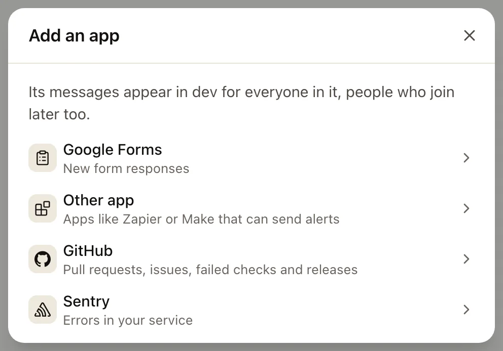
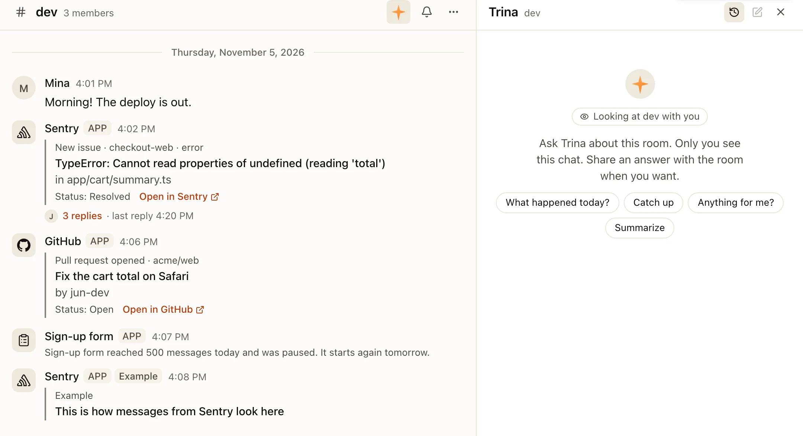
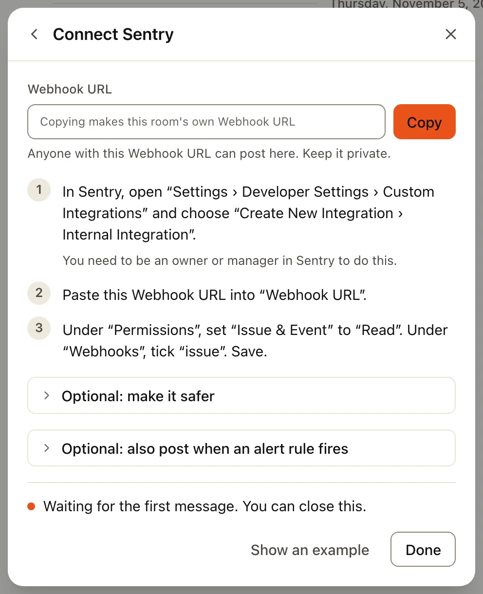
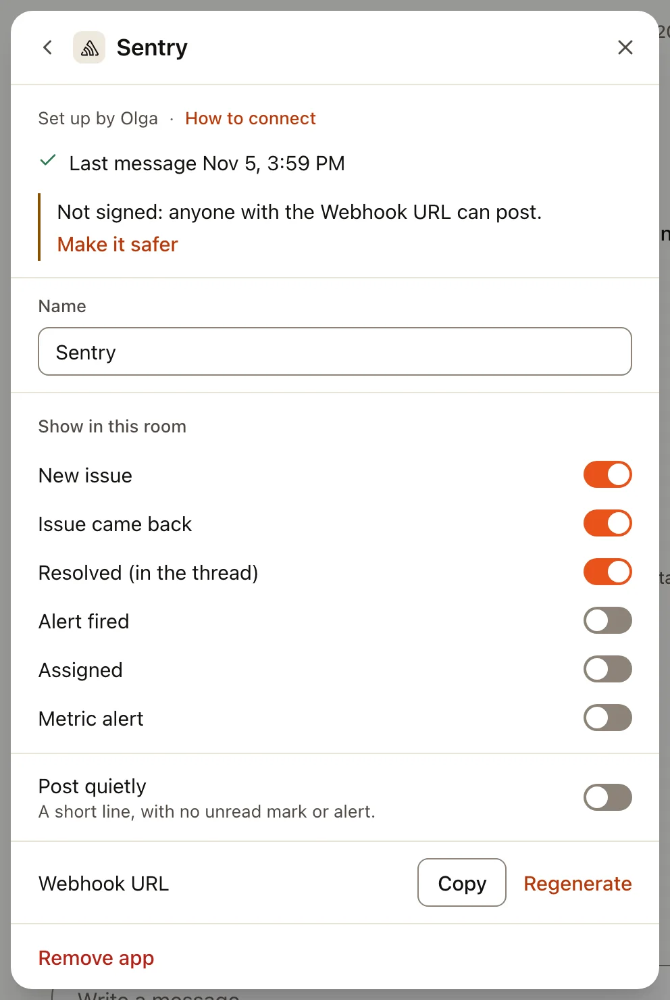

トークルームには、チームがすでに使っているサービスからの更新を届けられます。**Google フォーム** への新しい回答、**Sentry** のエラー、**GitHub** のプルリクエストや失敗したチェック、そのほか Webhook URL にメッセージを送れるものなら何でもです。更新は、人ではなくアプリからのカードとして、ロゴと **アプリ** のタグつきで届きます。同じことの繰り返し（同じエラー、同じプルリクエスト、編集された回答）は最初のカードの下の 1 つのスレッドにまとまり、状況が進むにつれて最初のカードの状態の行が変わります。

## アプリを追加する

1. トークルームを開き、**⋯ › アプリを追加** を選びます。
2. サービスを選びます。サービスは分類されています。**フォーム**（Google フォーム、Typeform、Tally、Jotform）、**決済・注文**（Stripe、Shopify）、**業務**（Notion、Zendesk、Jira、HubSpot）、**開発者向け**（GitHub、Sentry）です。**その他のサービスを表示**を押すと、さらにいくつか（Toss Payments、Channel Talk、PortOne）が開きます。最後の **その他のアプリ** で、それ以外のものを何でも受け付けます。プランや役割が必要なサービスは、その行に表示されます（たとえば *必要: Notion の有料プラン*）。その他のアプリには、最初に名前をつけます（たとえば *バックアップ通知*）。メッセージはその名前で表示されます。
3. Webhook URL の横の **コピー**（Google フォームでは **コードをコピー**）を押し、そのサービスでの番号つきの手順に従います。コピーするまで、トークルームには何も追加されません。先に中身を見てから案内を閉じてもかまいません。
4. 案内には、その場で状況が表示されます。*最初のメッセージを待っています*、*接続済み*、または最後に受け取ったものが表示されなかった理由です。2 分たっても何も届かないときは、**まだ何も届きませんか？** に、そのサービスでよくある間違いと、テストの送り方が表示されます。**例を表示** を押すと、メッセージがどう表示されるかを案内の中で見られます。実際には何も投稿されません。

**設定 › コネクター** から始めることもできます。Sentry、Notion、Stripe、Atlassian（Jira）の行の下に
**トークにアプリを追加** があります。アプリを追加できるトークだけが表示され、選ぶとそのサービスのガイドが開いた状態で
トークが開きます。まだない場合は、先に **新しいトーク** で始めてください。



これができる人：チームのトークルームや全員のトークルームでは、そのトークルームのオーナーと管理者。1:1 トークやグループトークでは、参加している人なら誰でも。トークルームのほかの人は、カードを見て、そのスレッドで返信し、それについてトリナに聞けます。アプリの名前をタップすると、誰が設定したかが表示されます。

アプリのメッセージは、あとから参加した人も含めて、トークルームの全員に見えます。トークルームは慎重に選んでください。エラーの報告やフォームの回答には、お客様のデータが含まれていることがあります。

### トークルームの中では

更新は 1 つずつ、アプリの名前の下にカードとして表示されます。**アプリ** のタグ、何が起きたか、状態の行、サービスで開くためのリンクがあります。返信は、ほかのメッセージと同じく、カードのスレッドに入ります。トークルームの **✦** サイドチャットでは **今日は何がありましたか？**（Google フォームのトークルームでは **今日の回答をまとめる** も）を選べます。アプリのメッセージを、人の対応が必要なものを先にしてまとめます。スレッドの中では **このスレッドをまとめる** を選べます。



### Google フォーム

Google フォームには URL を貼り付ける場所がないため、Trina がフォーム用の短いスクリプトを用意します（[Apps Script のトリガー](https://developers.google.com/apps-script/guides/triggers/installable)）。

- フォームで **⋮ › Apps Script** を開き、もとの内容を削除してコードを貼り付け、保存します。
- 上で **setUp** を選び、**実行**（Run）を押します。Google に **このアプリは Google で確認されていません**（Google hasn't verified this app）と表示されますが、これは想定どおりです。スクリプトは自分のもので、自分のアカウントでだけ動くためです。**詳細 › …（安全ではないページ）に移動**（Advanced › Go to … (unsafe)）を選び、アクセスを許可します。
- フォームでメールアドレスを集めている場合、回答ごとに回答者のメールアドレスが表示されます。表示しないようにするには、アプリの設定で **回答者のメールアドレス** をオフにします。フォームを編集できる人なら誰でも、このコードを見られます。

### フォーム、決済、業務ツール

Typeform、Tally、Jotform、Stripe、Shopify、Notion、Zendesk、Jira、HubSpot には、それぞれのサービスでの手順を、そのサービスでの呼び方のまま書いた専用の案内があります。要点は次のとおりです。

- **Typeform**：フォームの **Connect › Webhooks › Add a webhook** で貼り付けて保存し、オンにします（スイッチは最初はオフで、保存したあとでないと動きません）。
- **Tally**：フォームの **Integrations › Webhooks › Connect** で、**Endpoint URL** に貼り付けます。
- **Jotform**：フォームの **Settings › Integrations** で **WebHooks** を検索し、Webhook URL を貼り付けてから、**Complete Integration** と **Finish** を押します（どちらのボタンも URL を入れたあとでないと動きません。**Add New Web Hook** は押さないでください）。
- **Stripe**（Admin または Developer の役割）：**Developers › Workbench › Webhooks › Create an event destination** で、案内に書かれたイベントにチェックを入れ、**Webhook endpoint** を選んで **Endpoint URL** に貼り付けます。
- **Shopify**（ストアのオーナー、または設定にアクセスできるスタッフ）：**Settings › Notifications › Webhooks › Create webhook** で **Order creation** を作ります。必要なら、Order payment、Order cancellation、Refund create も同じように作ります。
- **Notion**（有料プラン）：データベースの **Automations** で、アクション **Send webhook** を使います。少なくともタイトルと Status にチェックを入れます。
- **Zendesk**（Team プラン以上、管理者）：Webhook を作り、次に案内に書かれた本文を送るトリガーを作ります（その手順の **本文をコピー**）。
- **Jira**（スペースの管理者）：スペースの **Space settings › Automation › Create flow** で、トリガー **Work item created**、アクション **Send web request** に案内に書かれた本文（**本文をコピー**）を使います。必要なら、2 つ目と 3 つ目のフローを **Work item transitioned** と **Work item commented** で作ると、状態の変更とコメントが作業項目のスレッドに入ります（[Jira のオートメーションのアクション](https://support.atlassian.com/cloud-automation/docs/jira-automation-actions/)）。
- **HubSpot**（Data Hub Professional または Enterprise）：取引をもとにしたワークフローで、アクション **Data ops › Send a webhook** を使い、**Customize request body** に案内に書かれたキーを入れます。必要なら、コンタクト用とチケット用も 1 つずつ作ります（[HubSpot のワークフロー](https://knowledge.hubspot.com/workflows/how-do-i-use-webhooks-with-hubspot-workflows)）。コンタクトは名前と会社が表示され、メールアドレスや電話番号は表示されません。

フォームの回答は、メールアドレスも含めて、入力されたとおりにトークルームに表示されます。アップロードされたファイルは名前だけが表示されます（Google フォームでは件数だけ。そのため、スクリプトに Drive へのアクセスは必要ありません）。決済と注文のカードには、お客様の名前（Shopify では市区町村も）が表示され、メールアドレス、電話番号、カードの情報は表示されません。

Stripe、Shopify、Zendesk、Typeform、Tally は、送る内容に署名できます。案内の **任意: より安全にする** に、そのサービスの署名シークレットを入れます（または Trina が渡すシークレットをサービスに貼り付けます）。それ以降は、署名されたメッセージだけが表示されます。Trina が渡すシークレット（Typeform、Tally、GitHub）は、それで署名された最初のメッセージから有効になります（Tally は **Add a signing secret** に独自のシークレットを入れているので、Trina のものに置き換えてください）。それまでは、署名のないメッセージも表示されるため、サービスに貼り付ける前に何かが失われることはありません。Jira と HubSpot は署名できません。Webhook URL が唯一の鍵になるので、ほかの人には教えないでください。

### その他のサービス

選択画面の **その他のサービスを表示** を押すと、主に韓国で使われているサービスが開きます。一覧は全員に同じものが表示されます。

- **Toss Payments**：デベロッパーセンターの **웹훅 › 웹훅 등록하기**（Webhooks › Register webhook）で Webhook URL を貼り付け、**PAYMENT_STATUS_CHANGED** にチェックを入れます（[Toss Payments の Webhook](https://docs.tosspayments.com/guides/v2/webhook)）。カードには金額、注文名、支払い方法が表示され、カード番号、口座、電話番号は表示されません。任意：デベロッパーセンターのセキュリティキー（**API 키 › 보안 키**、API keys › Security key）。
- **Channel Talk**：**Settings › Webhook › Create new webhook** で Webhook URL を貼り付け、チャットとメッセージの通知をオンにします（[Channel Talk の Webhook](https://developers.channel.io/en/articles/Webhook-events-7bd9b8e2)）。新しいチャットにはお客様の名前と最初のメッセージが表示され、その後のメッセージ（オンにした場合はチームの返信も）はスレッドに入ります。チーム内のグループチャットは表示されません。任意：Webhook のトークン。
- **PortOne**（V2）：**결제 연동 › 연동 관리 › 결제알림(Webhook) 관리**（Payment integration › Integration settings › Payment notifications）で、Webhook のバージョン **결제모듈 V2**（Payment module V2）を選び、Webhook URL を貼り付けます（[PortOne の Webhook](https://developers.portone.io/opi/ko/integration/webhook/readme-v2)）。PortOne は支払いの ID と状態しか送らないため、カードには金額や名前は表示されません。任意：Webhook シークレット（**웹훅 시크릿 발급**、Issue webhook secret）。

### その他のアプリ

**Slack、Discord、JANDI の Webhook URL** を入れる欄があるツールなら、ここに投稿できます。その欄に Trina の Webhook URL を貼り付けてください。どちらもないツールは、Zapier か Make を通じて接続できます。案内の **使っているアプリがありませんか?** で、それぞれ 1 つずつ例を説明しています。

Webhook URL にメッセージを送れるものなら何でも使えます（Zapier、Make、Grafana、Uptime Kuma、自作のスクリプト）。サービスがメッセージを送る場所に Webhook URL を貼り付けて、テストを送ってください。案内とアプリの設定には、コピーできる例つきの **送り方** が表示されます。

```json
{ "text": "Backup finished: 1,204 files", "title": "Nightly backup", "url": "https://example.com/report", "thread": "nightly-backup" }
```

- `text` はメッセージで、必要な項目はこれだけです（`content` も使えます）。
- `title` で見出し、`url` でリンクを 1 つ追加します。同じ `thread` のメッセージは 1 つのスレッドにまとまります。
- Slack 形式のメッセージ（`blocks`、`attachments`）、プレーンテキスト、ふつうのフォーム送信（`text=…` と同じ項目、または Slack の `payload` 項目）も受け付けます。`Idempotency-Key` ヘッダーをつけると、再送しても投稿は 1 回だけになります。

```bash
curl -X POST -H 'Content-Type: application/json' -d '{"text":"Hello from my app"}' <Webhook URL>
```

その他のアプリは名前の頭文字をアプリごとの色の上に表示するので、1 つのルームに複数あっても見分けられます。画像にするには、アプリの設定で **アイコンを変更** を押し、**画像をアップロード**（PNG、JPEG、WebP。正方形に切り抜かれます）か **絵文字を選ぶ** を選びます。**アイコンを削除** で頭文字に戻ります。アイコンはアプリの過去のメッセージにも表示されます。メッセージからアプリの名前やアイコンは変えられません。Slack の `username`、`icon_url`、`icon_emoji` や Discord の `avatar_url` は無視されるので、Webhook URL に送られたものが人や別のアプリになりすますことはできません。

### GitHub

リポジトリごとに設定します。そのリポジトリの管理者権限が必要です（[GitHub のドキュメント](https://docs.github.com/en/webhooks/using-webhooks/creating-webhooks)）。

- リポジトリで **Settings › Webhooks › Add webhook** を開きます。
- **Payload URL** に Webhook URL を貼り付け、**application/json** を選びます。
- **Send me everything** を選び、**Add webhook** を押します。Trina が表示するのは、アプリの設定でオンにしたものだけです。
- *任意、より安全に：* 案内の **シークレットをコピー** を押し、**Secret** に貼り付けます。それで署名された最初の配信（保存したときの GitHub の ping）から、Trina は GitHub が署名したものだけを表示します（[配信の検証](https://docs.github.com/en/webhooks/using-webhooks/validating-webhook-deliveries)）。

何も届かないときは、GitHub の Webhook のページにある **Recent Deliveries** で、送られた内容を確認できます。

### Sentry

Sentry では、これを内部インテグレーションと呼びます（[Sentry のドキュメント](https://docs.sentry.io/organization/integrations/integration-platform/)）。Sentry のオーナーかマネージャーである必要があります。



- Sentry で **Settings › Developer Settings › Custom Integrations** を開き、**Create New Integration › Internal Integration** を選びます。
- **Webhook URL** に Webhook URL を貼り付けます。
- **Permissions** で **Issue & Event** を **Read** にし、**Webhooks** で **issue** にチェックを入れます。保存します。
- *任意、より安全に：* インテグレーションの **Client Secret** を案内に貼り付けます。それ以降、Trina は Sentry が署名したものだけを表示します（[Sentry の署名のしかた](https://docs.sentry.io/organization/integrations/integration-platform/webhooks/)）。
- *任意：* アラートルールが作動したときにも投稿するには、ルールにアクション **Send a notification via an integration** を追加してこのインテグレーションを選び、アプリの設定で **アラート作動** をオンにします。

## 設定

**⋯ › 連携** には、トークルームのアプリが **アプリ** の下に一覧表示され、**アプリを追加** があります。1 つのアプリのページには、次のものがあります。

- 誰が設定したかと、**つなぎ方**（もう一度手順を表示）。
- **状態の行**：最後のメッセージ、*一時停止中*、*最初のメッセージを待っています*、または **再生成** のあと新しい URL に最初のメッセージが届くまでの *GitHubが新しい Webhook URL を使うのを待っています*（一覧の行にも表示されます）。
- **警告**。それぞれに 1 つの操作がついています。最後に受け取ったものが表示されなかった理由（**シークレットを確認**）、*退出したメンバーがこの Webhook URL を知っています*（**再生成**）、そして署名できるのにまだシークレットがないサービスでは *署名なし: Webhook URL を知っている人なら誰でも投稿できます。*（**より安全にする**）。
- **アイコンを変更**（その他のアプリ）：名前の頭文字の代わりに画像か絵文字を使います。**アイコンを削除** で元に戻ります。
- **名前**：メッセージに表示される名前。
- **このルームに表示**：投稿する更新の種類（複数の種類を送るアプリの場合）。サービスで設定していない任意のイベント（たとえば Shopify の返金）には *Shopify でまだ設定されていません* と、その手順へのリンクが表示されます。
- **静かに投稿**：未読マークや通知のない、短い 1 行で投稿します。
- **送り方**（その他のアプリ）。
- **Webhook URL**：もう一度 **コピー** するか、**再生成** します（古い URL はすぐに使えなくなります。新しい URL をサービスに貼り付けてください）。
- **アプリを削除**：アプリはもう投稿できなくなります。これまでのメッセージは残ります。



## 上限

1 つのアプリが投稿できるのは、1 日 500 件までです（Google フォームでは回答 500 件）。それを超えると、深夜 0 時（チームのタイムゾーン）まで一時停止します。トークルームには 1 行が表示され、管理する人には **アクティビティ**（とスマートフォン、ブラウザー）に **今すぐ再開**（1 日 1 回）つきのお知らせが届きます。チームのすべてのアプリを合わせて投稿できるのは、1 日 5,000 件までです。それを超えると、すべてのアプリが深夜 0 時まで一時停止し、1 行の表示とお知らせに *チームのアプリは今日合わせて5,000件のメッセージに達しました* と表示されます。**今すぐ再開** はありません。飛ばされたフォームの回答は、フォームの回答タブに残っています。カードはプレーンテキストです。カードの中身で誰かにメンションしたり、何かを実行したり、リンクを隠したりすることはできません。

## アプリがサーバーに届かないとき

アプリがチームにメッセージを送るには、外部からの接続が必要です。ホスティングのチームや、Trina のリレーを使っているサーバーにはそれがあります。社内ネットワークだけで動いているサーバーにはありません。その場合、トークルームの **アプリを追加** にそのことが表示され、オーナーは **管理 › システム › 接続** で **接続をオンにする** を選べます。独自の公開アドレスがあり、国やネットワークの制限があるサーバーでも、アプリのメッセージはどこからでも受け付けます。そのことは管理 › システム › 接続に表示されます。
