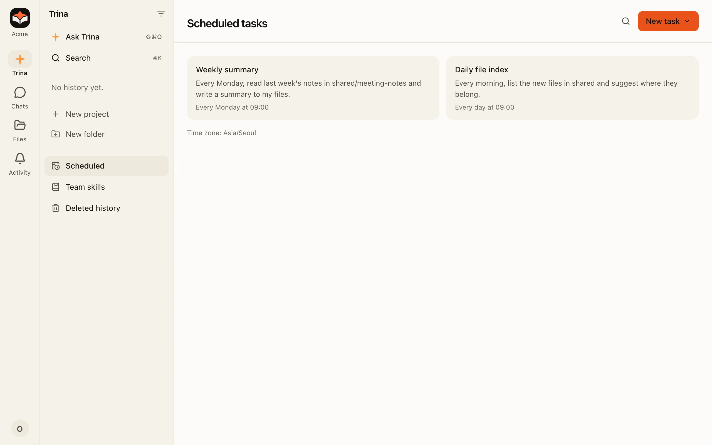
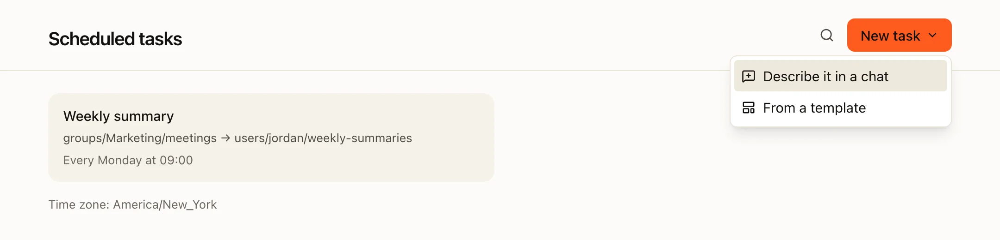
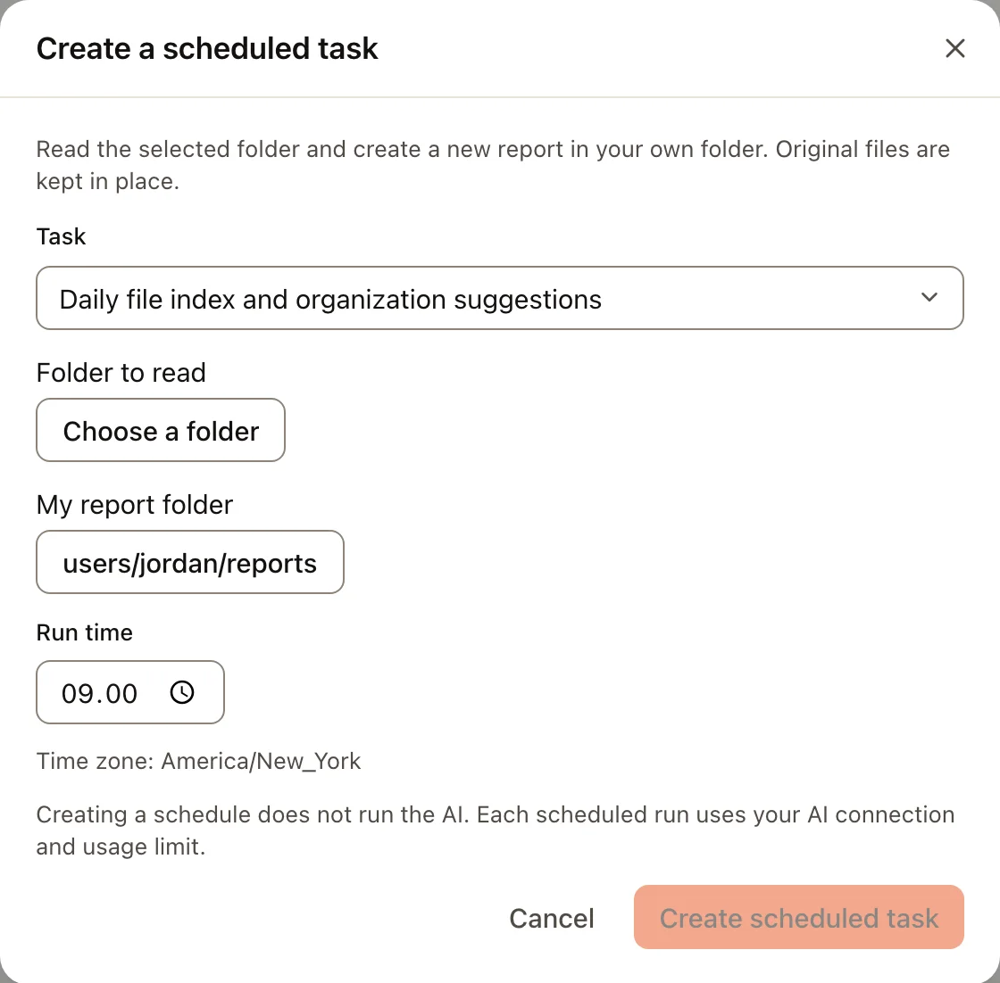
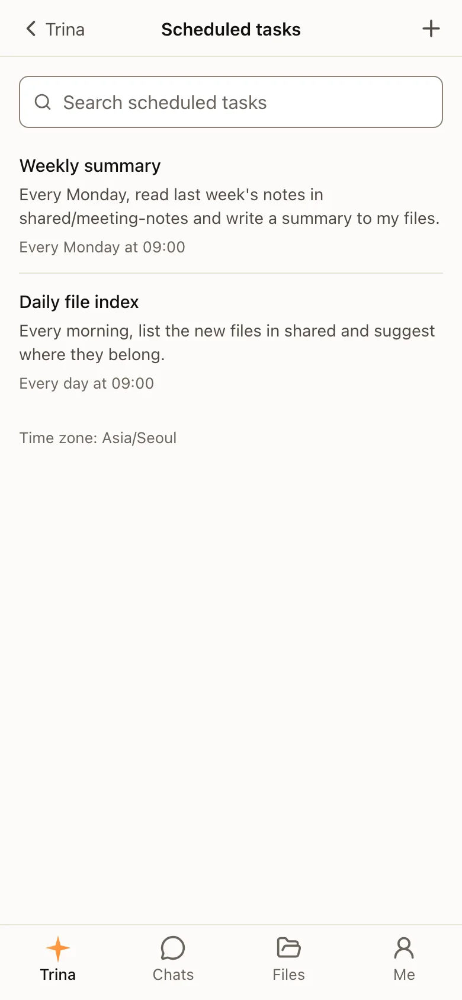

定期タスクは、1 つの依頼を繰り返し実行します。平日の毎朝、毎週月曜日、毎月 1 日などです。タスクは、作った人として実行されます。

:::note
0.4.0 から、定期タスクには専用の **定期タスク** ページがあります。トリナの一覧の上のほうにある行から開けます（スマートフォンでは **トリナ** タブの **☰** メニューの中）。⌘K の **新しい予約タスク** からも開けます。それより前のバージョンでは、**設定 › 定期タスク** にあります。
:::

## タスクを作る

トリナの一覧の上のほうにある **定期タスク** を開き、右上の **新しいタスク** を押します。小さなメニューに、作り方が
2 つ表示されます。

### チャットで説明する

1. **チャットで説明する** を選びます。新しいチャットが開き、メッセージ欄にはすでに「平日の毎朝9時に、」と入っています。
2. 続きを自分の言葉で書いて送ります。たとえば「毎週月曜日の 9:00 に、shared/sales にある先週のメモをまとめて」です。
3. AI が、タスクの名前、繰り返しのタイミング、指示の全文が入ったカードを表示します。確認して **作成する** を押します。
   （タスクがチームの接続先に何かを送る可能性があるときは、代わりに **作成する（そのサービスへの送信を許可）** と
   **作成する（接続サービスには送信しない）** が表示されます。）**作成しない** を押すと、何も作られません。

チャットにタスクを作成したことが表示され、タスクが次の実行日時とともに **定期タスク** ページに入ります。

### テンプレートから

1. **テンプレートから** を選びます。**定期タスクを作成** ウィンドウが開きます。
2. **タスク** で、何をするかを選びます。**毎日のファイル一覧と整理の提案** か **週次サマリー** です。
3. **読み取るフォルダー** の **フォルダーを選択** を押し、読み取るフォルダーを選びます。
4. **自分のレポートフォルダー**（レポートが保存される、自分のフォルダーの中の場所）を確認し、**実行時刻**（週次のものは
   **曜日** も）を設定します。時刻はチームのタイムゾーンで、その下に表示されます。
5. **定期タスクを作成** を押します。

「定期タスクを作成しました。」と表示され、タスクが一覧に入ります。作成しただけでは、まだ AI は動きません。実行のたびに、
自分の AI の接続と使用量の上限を使います。

## 実行のときにできること

| 項目 | 定期実行では |
|---|---|
| **権限** | タスクを作った人のフォルダー権限とスキルを使います。 |
| **時刻** | チームのタイムゾーンです。 |
| **質問** | 答える人がいないため、人の確認が必要なことは実行されません。ただし、タスクのカードで許可したこと（下記）は別です。 |
| **Web** | 人の確認がいらない新しい Web アドレスは、1 回の実行につき 8 件までです。 |
| **大きなダウンロード** | 1 GB を超えるファイルは、確認を求めずに飛ばします。 |

## 確認なしで保存・送信する

実行のときには確認に答える人がいないため、タスクを作るとき、編集するとき、確認し直すときに、タスクのカードで一度だけ確認します。

- **保存先フォルダー。** 「新しいファイルの保存先：shared/Weekly reports（現在 30 人が見られます）。入る可能性のある内容：自分のフォルダー、#Sales のトーク」。実行のたびに、そのフォルダーとサブフォルダーに **新しい** ファイルを確認なしで保存します。1 回の実行につき 20 件までです。そこにある、自分が作っていないファイルを変更したり置き換えたりすることはなく、スキルや指示のファイルにも触れません。カードにない、見られる人がより少ないもの（別のフォルダーや別のトーク）を読んだ場合は、代わりに自分のフォルダーに保存し、その理由を伝えます。
- **自分の接続。** 「送信先：My Notion · 'Daily notes'」。実行のときは、カードに載っている送信先にだけ送ります。

保存先フォルダーが移動・名前の変更・削除されたとき、その権限が変わったとき、または自分がそこに書き込めなくなったときは、タスクに **保存先フォルダーを確認し直してください** と **再確認** が表示され、通知が 1 件届きます。確認し直すまで、実行結果は自分のフォルダーに保存されます。グループに人が入ったり抜けたりしても、何も変わりません。

**編集** では、**保存先フォルダー** の欄で別のフォルダーを選んだり、削除（×）したりできます。そこに入る可能性のある内容も、1 つずつ削除（×）できます。

## タスクを管理する

タスクを開くと、スケジュール、指示、次回と前回の実行が見られます。

- **今すぐ実行** を押すと、すぐに実行します。
- スイッチで一時停止と再開ができます。
- 名前の横のメニューに **編集** と **削除** があります。

1 回だけのタスクが終わったときや、もう実行できないタスクには、オンにできない理由が表示されます。

## スマートフォンでは

タスクは 1 つの一覧にまとまっていて、上に検索欄、いちばん上に新しいタスクを作る **+** があります。

