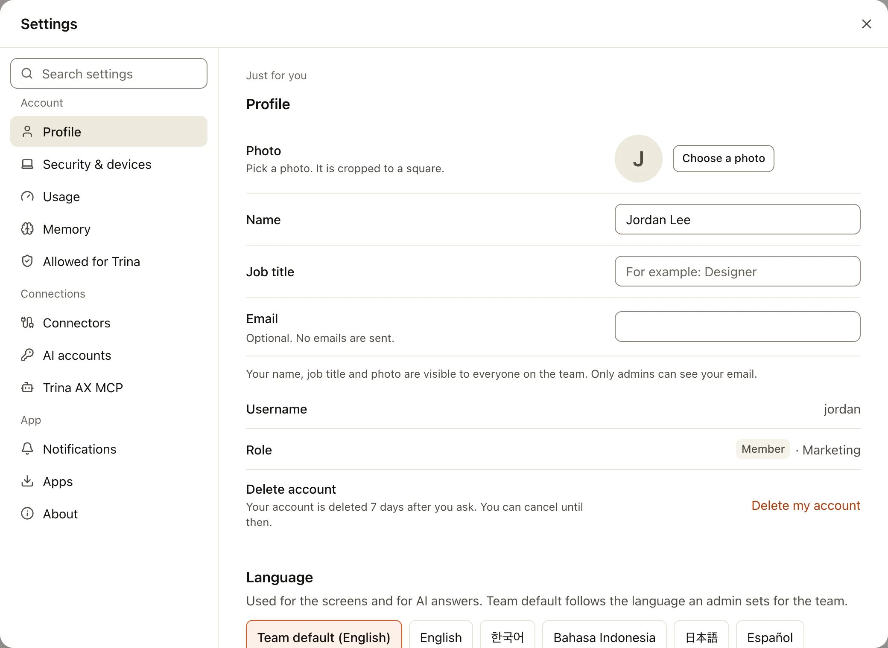
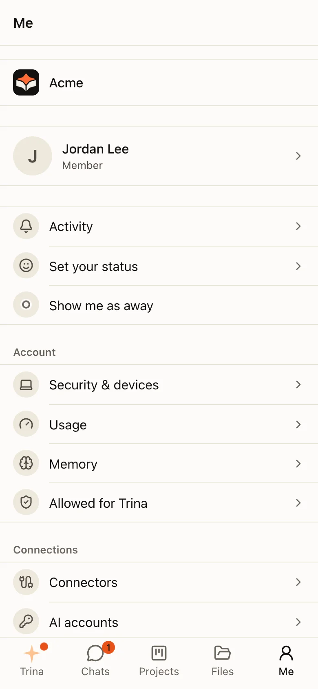
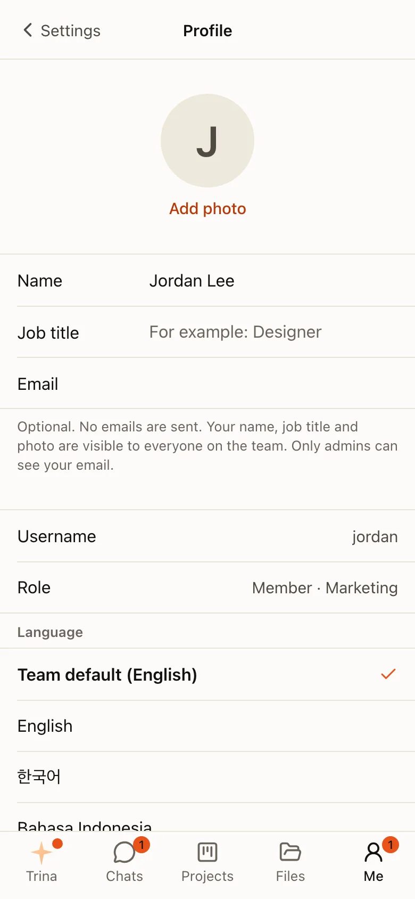
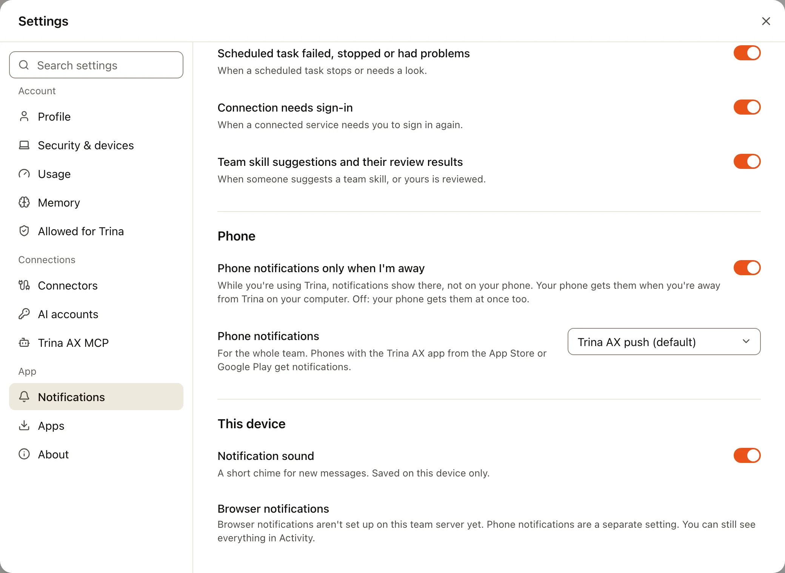
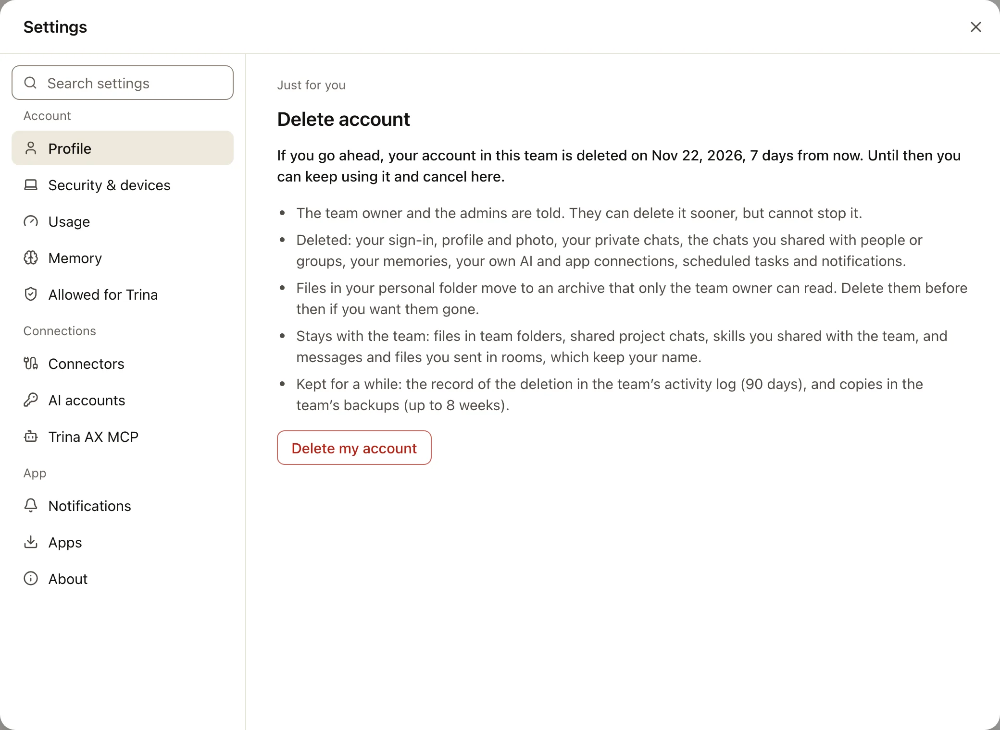
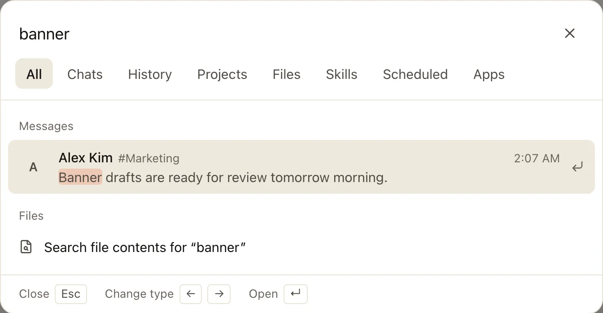

自分のアカウントに関することは、左のバーのいちばん下にある自分の写真から、1 クリックで開けます。

## アカウントのメニュー

左のバーのいちばん下にある自分の写真をクリックします。スマートフォンでは **自分** タブを開きます。

| 項目 | できること |
|---|---|
| **離席中として表示** | 元に戻すまで、ほかの人には離席中と表示されます |
| **ステータスを設定** | 絵文字つきの短いステータスを、名前の横に表示します |
| **設定** | 設定ウィンドウを、プロフィールの画面で開きます |
| **ログアウト** | このセッションを終了します |

自分の使用量は **設定 › 使用量** にあります。削除したチャットは **削除した履歴** にあり、トリナの一覧の **トリナの履歴** の横にある **⋯** メニューから開けます（スマートフォンでは、**トリナ** タブの **☰** メニューのいちばん下）。

### チームを切り替える

デスクトップアプリでは、左のバーのいちばん上にあるチームのロゴをクリックし、**別のチームに切り替え** を選びます。自分のチームが一覧で表示されます。アプリの **チーム** メニュー（⌘1–9）と同じです。スマートフォンのアプリでは、**自分** タブのチーム名の下にあります。Web ブラウザーでは、チームごとにアドレスが違うため、切り替える必要はありません。

## 設定ウィンドウ

設定は、今開いているページの上にウィンドウとして開きます。`/settings/usage` のようなリンクを開くと、その項目の画面で開きます。ここにあるものはすべて自分だけのものです。チーム全体に関わるものは管理にあります。

| グループ | 項目 |
|---|---|
| **アカウント** | プロフィール、セキュリティと端末、使用量、メモリ、トリナに許可したこと（とブラウザー。下記を参照） |
| **接続** | コネクター、AIプロバイダー（メンバーが自分のアカウントを追加できるチームの場合）、Trina AX MCP、開発環境のサイト（自分に開発環境がオンになっている場合） |
| **アプリ** | 通知、アプリ、このアプリについて |

[ゲスト](guests.md)には、プロフィールや通知など、自分用の項目だけが表示されます。自分のログインを使うゲストは、**AIプロバイダー** で自分の Claude または ChatGPT のアカウントを接続します。

**コネクター** には、ほかのサービスとの接続がまとまっています。Google Drive、Gmail などの Google のアプリ、Slack、一覧にあるサービスです。1 つ開くと、接続したり、AI がそれで何をしてよいかを確認したり、接続を解除したりできます。名前の上の **コネクター**（スマートフォンでは **‹ コネクター**）を押すと一覧に戻ります。`/connectors` のような以前のリンクでも開けます。[MCP 接続](mcp.md)を参照してください。

:::steps
#### 項目を探す
左で項目を選ぶか、**設定を検索** に入力します。

#### 必要なところを変える
プロフィール、言語（English、한국어、Bahasa Indonesia、日本語、Español、简体中文）、テーマ（ライト、ダーク、システムに合わせる。プロフィールにあります）、標準のエンジン、通知などを変えられます。

#### 閉じる
**Esc** を押すか、**✕** を選びます。元の画面に戻ります。
:::

**トリナに許可したこと** には、確認カードで **常に許可** を選んだものと、新しいファイルの保存を許可したトークのフォルダーが一覧で表示されます。1 つ削除すると、次回はまた確認されます。

**ブラウザー**（デスクトップアプリと、**すべてのWebサイトを許可** がオンのときの Web 版）には **すべてのWebサイトを許可** があります。オンにすると、自分のチャットやトークで頼んだとき、AI が確認なしで公開されている Web サイトを開きます。定期タスクでは引き続き確認されます。読みにくい長い文字列や長いクエリーを含むアドレスも引き続き確認されますが、見つけられるのは明らかなトークンだけです。文書やページ、トークのメッセージに隠された指示によって、AI が読めるものを何でも、どのサイトにでも送ってしまうおそれがあります。アドレスのカードからオンにすることもできます（「すべてのWebサイトを許可（設定でオフにできます）」）。デスクトップアプリでは、同じスイッチがアプリ内のブラウザーにも適用され、そちらは自分のウィンドウでもう一度確認します。この項目は、チームが許可している間だけ表示されます。

スマートフォンでは、設定は画面いっぱいに表示されます。最初に項目の一覧が表示され、**←** で一覧に戻ります。

## 通知

**設定 › 通知** で、何を受け取るかを選びます。トークのメッセージ（ダイレクトとグループのトークとメンション、すべての新着メッセージ、または受け取らない）、自分のスレッドへの返信、**おやすみモード** の時間帯、定期タスク、接続、チームスキル、**自分に共有されたチャット** です。**スマートフォン** の **離れているときだけスマートフォンに通知** をオンにすると、パソコンで Trina を使っている間はスマートフォンに通知が来ません。**この端末** には、通知音と、ブラウザーでは **ブラウザ通知** があります。

オーナーと管理者は、**スマートフォン › スマホ通知** で、チーム全体のスマートフォン通知の送り先を選べます。**Trina AX プッシュ（デフォルト）**、**オフ**、または **カスタム** です。カスタムは、自分でビルドしたスマートフォンアプリ用の、自分のプッシュサービスのアドレスです。スマートフォンの通知に、ファイルやトークの内容が含まれることはありません。

トークごとのベルで、そのトークのレベルを選べます。**すべてのメッセージ**、**メンションのみ**、**オフ** です。チャンネルは変えなければ **メンションのみ**、ダイレクトとグループのトークは **すべてのメッセージ** です。**メンションのみ** のトークでは、新しいメッセージが来ても名前が太字になるだけで、一覧、**トーク**、アプリのアイコンに数字は付きません。自分をメンションしたメッセージは **@** で表示され、数にも入ります。**オフ** では数字がグレーになり、どこにも数えられません。

## アカウントを削除する

**設定 › プロフィール › アカウントの削除** で、パスワードを入力して申し込むと、7 日後にこのチームでのアカウントが削除されます。ページには、削除される日付、削除されるもの、チームのオーナーのアーカイブに移るもの、チームに残るものが表示されます。それまではアカウントを使い続けられ、**アカウントを残す** を押せば取り消せます。チームのオーナーと管理者には通知が届きます。オーナーと管理者は早めに削除することはできますが、削除を止めることはできません。オーナー自身のアカウントはここでは削除できません。先にチームを引き継いでください。

## ⌘K で検索する

**⌘K**（Windows では Ctrl+K）を押すか、**トリナに聞く** の下の **検索** を選びます。

- **タブ** で検索を絞り込みます。すべて、トーク、履歴、プロジェクト、ファイル、スキル、予約、サービスがあります。
- **何も入力していないとき** は、対応が必要なもの、最近のチャットとプロジェクト、**新しいチャット** などのクイック操作が表示されます。
- 名前で探す **トークと人** は、すべてのタブの最初に表示されます。名前の一部か、韓国語の名前なら初声（「ㄱㅈ」で「견적」が見つかります）を入力します。トークを選ぶとそのトークが開きます。人を選ぶと、その人との 1 対 1 のトークが開きます。まだない場合は、その人にチェックが入った状態で新しいトークの一覧が開き、ボタンを押したときに初めてトークが始まります。
- 自分のトーク（チームのトーク、全員のトーク、1 対 1 とグループのトーク）の **メッセージ** は、すべてのタブで、チャットのあとに表示されます。書いた人、場所、日時、入力した言葉の前後が表示されます。見つかるのは、今そのトークを開いたら見られるものだけです。1 つ選ぶと、そのメッセージの位置でトークが開きます（返信の場合はスレッドが開きます）。**最新のメッセージへ** で最新の位置に戻ります。言葉の一部でも見つかります。「견적」で「견적서를」が見つかります。
- **トークで送られたファイル** は、すべてのタブとファイルのタブで、チームのファイルのあとに名前で表示されます。ファイル、送った人、場所、日時が表示されます。見つかるのは、自分が見られるメッセージのファイルだけです。1 つ選ぶと、そのファイルが送られたメッセージの位置でトークが開きます。
- **入力した言葉はすべて** 使われ、順番は問いません。「견적서 보내」で、メッセージ、チャット、ファイル名の中の「견적서를 보내드렸어요」が見つかります。
- **キー操作：** ↑ と ↓ で移動、Enter で開く、← と → でタブを切り替え、Esc で閉じます。

